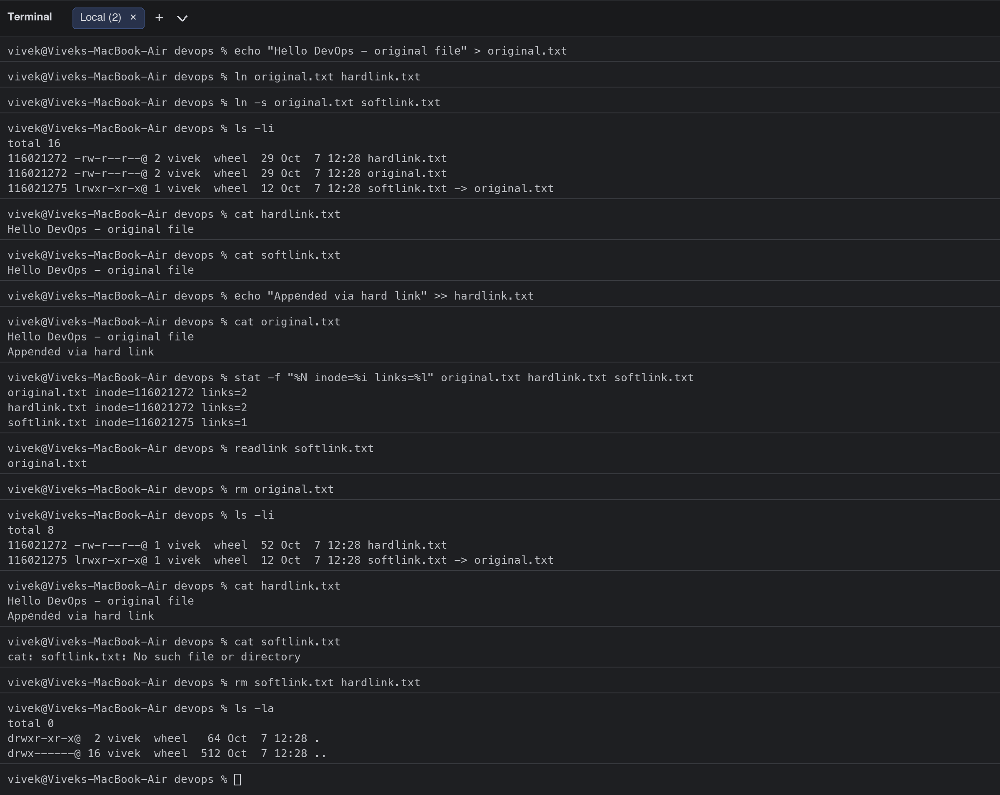
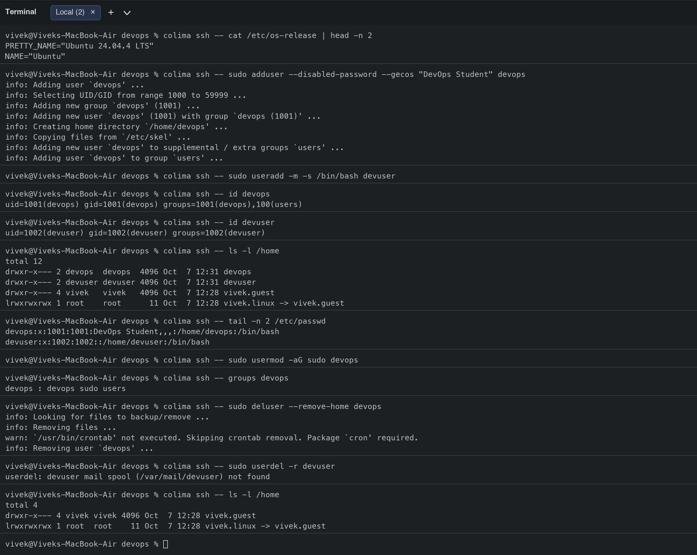
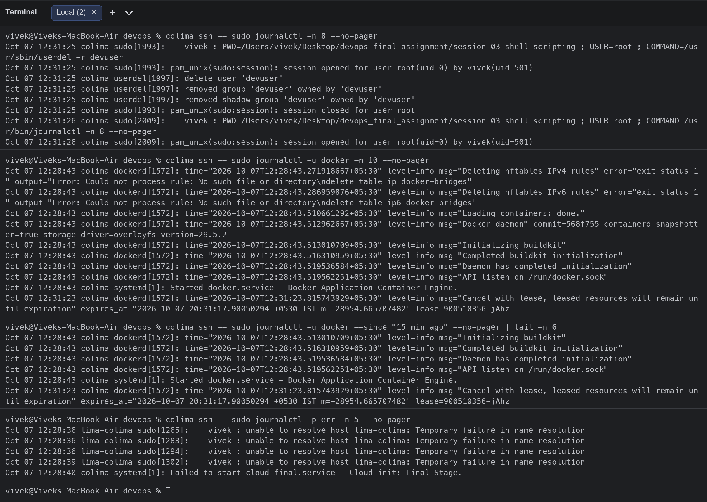
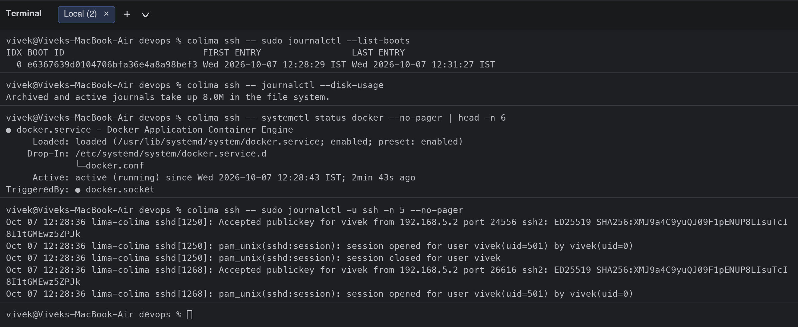
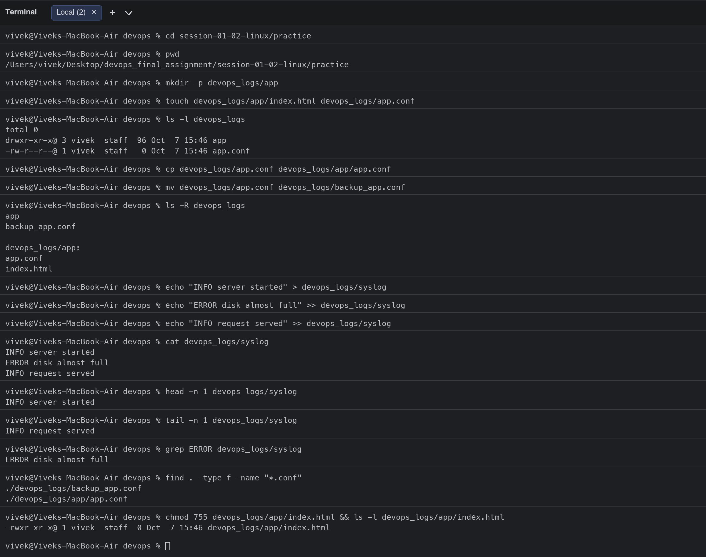
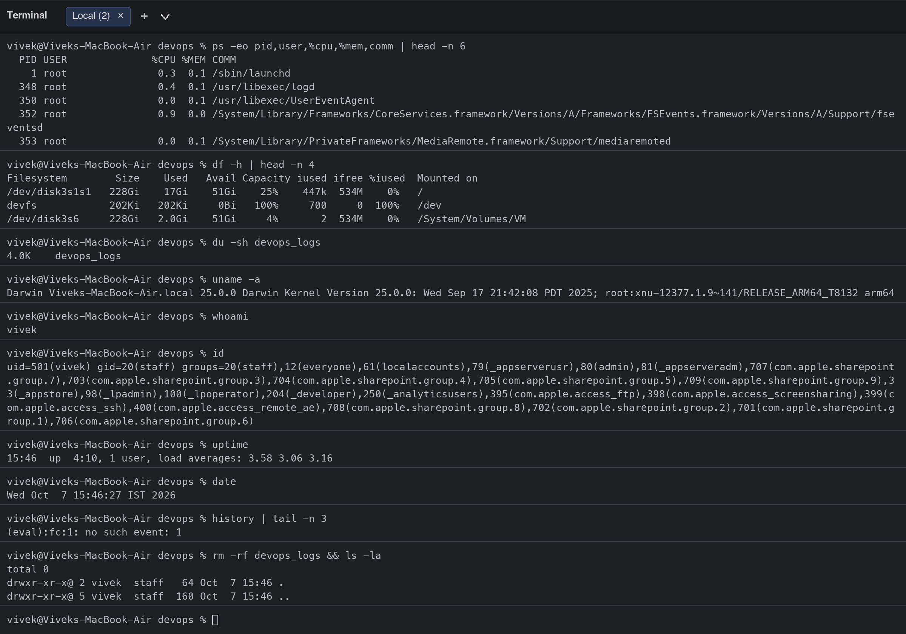
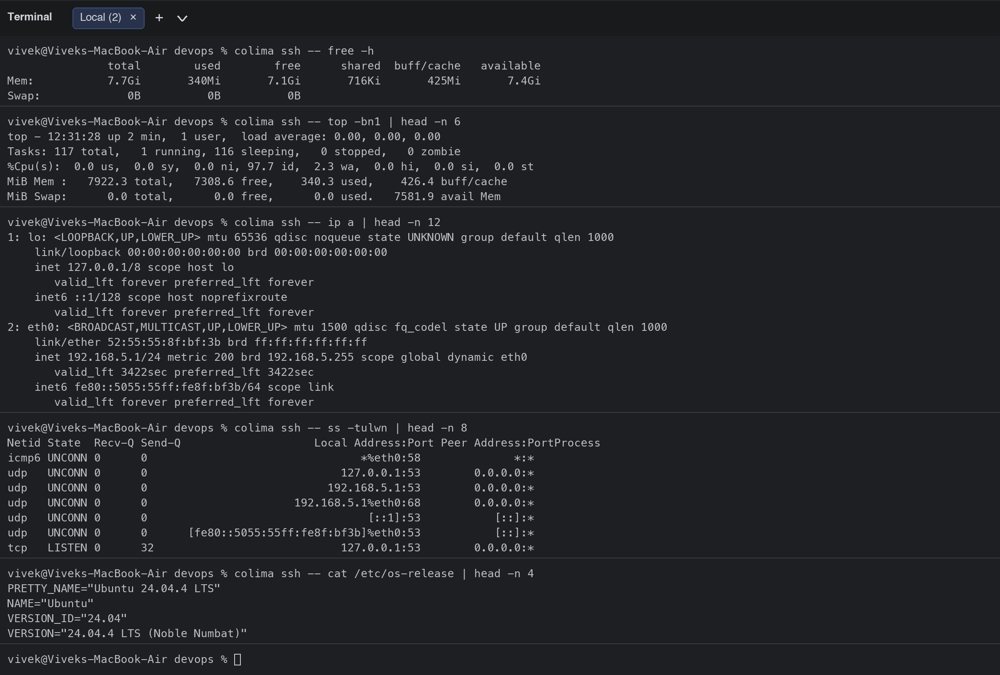
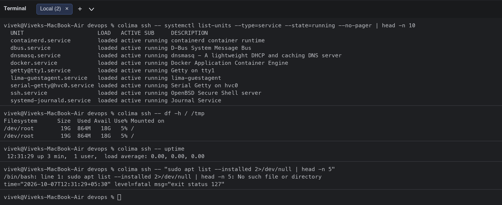

# Session 1 & 2: Linux Fundamentals

**Student:** Vivek Singh Solanki | **Roll number:** 24bcs10338
**Machine:** macOS (Apple Silicon) terminal + Ubuntu 24.04 Linux VM (Colima) for Linux-only commands

All commands below were executed by me. Screenshots are in the [screenshots/](screenshots/) folder.

---

## Task 1: Soft Link vs Hard Link

### Theory

| | Hard link (`ln`) | Soft / symbolic link (`ln -s`) |
|---|---|---|
| What it is | Another directory entry pointing to the **same inode** (same data on disk) | A separate small file that stores the **path** of the target |
| Inode number | Same as the original | Different (its own inode) |
| If original is deleted | Data is still accessible via the hard link (link count just decreases) | Link becomes **dangling / broken** (`No such file or directory`) |
| Across filesystems / partitions | Not allowed | Allowed |
| Can link directories | No (normally) | Yes |
| `ls -l` display | Looks like a normal file, link count > 1 | Shows `l` type and `name -> target` |
| Size | Same as original (shares data) | Size of the path string |

### Commands

```bash
ln original.txt hardlink.txt      # create hard link
ln -s original.txt softlink.txt   # create soft (symbolic) link
ls -li                            # -i shows inode numbers
readlink softlink.txt             # where does the soft link point
rm softlink.txt hardlink.txt      # delete links (rm works on both)
```

### Practical output

```bash
$ echo "Hello DevOps - original file" > original.txt
$ ln original.txt hardlink.txt
$ ln -s original.txt softlink.txt
$ ls -li
total 16
116021272 -rw-r--r--@ 2 vivek  wheel  29 Oct  7 12:28 hardlink.txt
116021272 -rw-r--r--@ 2 vivek  wheel  29 Oct  7 12:28 original.txt
116021275 lrwxr-xr-x@ 1 vivek  wheel  12 Oct  7 12:28 softlink.txt -> original.txt
$ cat hardlink.txt
Hello DevOps - original file
$ cat softlink.txt
Hello DevOps - original file
$ echo "Appended via hard link" >> hardlink.txt
$ cat original.txt
Hello DevOps - original file
Appended via hard link
$ stat -f "%N inode=%i links=%l" original.txt hardlink.txt softlink.txt
original.txt inode=116021272 links=2
hardlink.txt inode=116021272 links=2
softlink.txt inode=116021275 links=1
$ readlink softlink.txt
original.txt
$ rm original.txt
$ ls -li
total 8
116021272 -rw-r--r--@ 1 vivek  wheel  52 Oct  7 12:28 hardlink.txt
116021275 lrwxr-xr-x@ 1 vivek  wheel  12 Oct  7 12:28 softlink.txt -> original.txt
$ cat hardlink.txt
Hello DevOps - original file
Appended via hard link
$ cat softlink.txt
cat: softlink.txt: No such file or directory
$ rm softlink.txt hardlink.txt
$ ls -la
total 0
drwxr-xr-x@  2 vivek  wheel   64 Oct  7 12:28 .
drwx------@ 16 vivek  wheel  512 Oct  7 12:28 ..
```

### What I observed
- `original.txt` and `hardlink.txt` share inode **116021272** and the link count is **2**. They are literally the same file.
- Writing through `hardlink.txt` changed `original.txt` immediately.
- `softlink.txt` has its own inode and shows `-> original.txt`.
- After `rm original.txt`, the hard link still shows the full content, but the soft link is broken (`cat: softlink.txt: No such file or directory`).



### Interview preparation: "What is the difference between a soft link and a hard link?"

> A hard link is an additional name for the same inode, so both names point to the same data blocks; deleting one name does not delete the data as long as another link exists. A hard link cannot cross filesystems and usually cannot point to a directory. A soft (symbolic) link is a separate file whose content is the path to the target; it can cross filesystems and point to directories, but if the target is deleted or moved the link becomes dangling. `ln` creates a hard link, `ln -s` creates a soft link, and `ls -li` shows the inode and link count.

Follow-up questions I prepared for:
- *How do you find all hard links of a file?* `find / -samefile original.txt` or `find / -inum <inode>`.
- *Why does `rm` not free disk space?* Because another hard link (or an open file descriptor) still references the inode.
- *When would you use a soft link?* Pointing `/opt/app/current -> /opt/app/releases/v2.3` for zero-downtime deploys, linking config files, shared libraries (`libssl.so -> libssl.so.3`).

---

## Task 2: `adduser` vs `useradd`

### Theory

| | `useradd` | `adduser` |
|---|---|---|
| Type | Low-level binary (part of `shadow-utils`), available on every Linux | High-level Perl/Python wrapper around `useradd` (Debian/Ubuntu) |
| Interactive | No. Creates only what you ask with flags | Yes. Asks for password, full name, etc. |
| Home directory | Not created unless `-m` is given | Created automatically |
| Default shell | `/bin/sh` (or whatever `/etc/default/useradd` says) unless `-s` given | `/bin/bash` |
| Skeleton files (`/etc/skel`) | Only with `-m` | Copied automatically |
| Private group | Depends on distro config | Creates a group with the same name |
| Best for | Scripts / automation (`useradd -m -s /bin/bash devuser`) | Humans on the terminal |

**Which is preferred on Ubuntu and why?** On Ubuntu/Debian `adduser` is the recommended command for interactive use because it applies sensible defaults (home directory, bash shell, skeleton files, user group, password prompt) and follows Debian policy. `useradd` is the portable low-level tool and is preferred in automation scripts where every option is passed explicitly.

### Practical output (Ubuntu 24.04 VM via `colima ssh`)

```bash
$ colima ssh -- cat /etc/os-release | head -n 2
PRETTY_NAME="Ubuntu 24.04.4 LTS"
NAME="Ubuntu"
$ colima ssh -- sudo adduser --disabled-password --gecos "DevOps Student" devops
info: Adding user `devops' ...
info: Selecting UID/GID from range 1000 to 59999 ...
info: Adding new group `devops' (1001) ...
info: Adding new user `devops' (1001) with group `devops (1001)' ...
info: Creating home directory `/home/devops' ...
info: Copying files from `/etc/skel' ...
info: Adding new user `devops' to supplemental / extra groups `users' ...
info: Adding user `devops' to group `users' ...
$ colima ssh -- sudo useradd -m -s /bin/bash devuser
$ colima ssh -- id devops
uid=1001(devops) gid=1001(devops) groups=1001(devops),100(users)
$ colima ssh -- id devuser
uid=1002(devuser) gid=1002(devuser) groups=1002(devuser)
$ colima ssh -- ls -l /home
total 12
drwxr-x--- 2 devops  devops  4096 Oct  7 12:31 devops
drwxr-x--- 2 devuser devuser 4096 Oct  7 12:31 devuser
drwxr-x--- 4 vivek   vivek   4096 Oct  7 12:28 vivek.guest
lrwxrwxrwx 1 root    root      11 Oct  7 12:28 vivek.linux -> vivek.guest
$ colima ssh -- tail -n 2 /etc/passwd
devops:x:1001:1001:DevOps Student,,,:/home/devops:/bin/bash
devuser:x:1002:1002::/home/devuser:/bin/bash
$ colima ssh -- sudo usermod -aG sudo devops
$ colima ssh -- groups devops
devops : devops sudo users
$ colima ssh -- sudo deluser --remove-home devops
info: Looking for files to backup/remove ...
info: Removing files ...
warn: `/usr/bin/crontab' not executed. Skipping crontab removal. Package `cron' required.
info: Removing user `devops' ...
$ colima ssh -- sudo userdel -r devuser
userdel: devuser mail spool (/var/mail/devuser) not found
$ colima ssh -- ls -l /home
total 4
drwxr-x--- 4 vivek vivek 4096 Oct  7 12:28 vivek.guest
lrwxrwxrwx 1 root  root    11 Oct  7 12:28 vivek.linux -> vivek.guest
```

### What I observed
- `adduser` printed every step: it chose the UID/GID, created the group, created and populated the home directory from `/etc/skel`, and set the GECOS field "DevOps Student".
- `useradd -m -s /bin/bash devuser` was silent, but `id devuser` and `ls -l /home` prove the user and home were created only because I passed `-m` and `-s`.
- `usermod -aG sudo devops` added the user to the `sudo` group.
- Clean-up was done with `deluser --remove-home` and `userdel -r`.



---

## Task 3: `journalctl`

### What is journalctl?
`journalctl` is the command-line tool for reading the **systemd journal**, the binary, indexed log store that collects kernel messages, boot messages, stdout/stderr of all systemd services, and syslog. It replaces grepping through `/var/log/*` files and lets you filter by unit, priority, time and boot.

### Most useful options

| Command | Purpose |
|---|---|
| `journalctl` | Show the whole journal (oldest first, paged) |
| `journalctl -n 20` | Last 20 lines |
| `journalctl -f` | Follow (like `tail -f`) |
| `journalctl -u docker` | Logs of one **service/unit** |
| `journalctl -u docker --since "15 min ago"` | Time filter (`--since "2026-10-07 12:00"`, `--until`) |
| `journalctl -p err` | Only priority `err` and above (`emerg,alert,crit,err,warning,notice,info,debug`) |
| `journalctl -b` / `--list-boots` | Current boot only / list all boots |
| `journalctl -k` | Kernel messages (like `dmesg`) |
| `journalctl --disk-usage` | How much space the journal takes |
| `journalctl --no-pager` | Do not open `less` (good for scripts) |
| `journalctl -o json-pretty` | Structured output |

### Practical output

```bash
$ colima ssh -- sudo journalctl -n 8 --no-pager
Oct 07 12:31:25 colima sudo[1993]:    vivek : PWD=/Users/vivek/Desktop/devops_final_assignment/session-03-shell-scripting ; USER=root ; COMMAND=/usr/sbin/userdel -r devuser
Oct 07 12:31:25 colima sudo[1993]: pam_unix(sudo:session): session opened for user root(uid=0) by vivek(uid=501)
Oct 07 12:31:25 colima userdel[1997]: delete user 'devuser'
Oct 07 12:31:25 colima userdel[1997]: removed group 'devuser' owned by 'devuser'
Oct 07 12:31:25 colima userdel[1997]: removed shadow group 'devuser' owned by 'devuser'
Oct 07 12:31:25 colima sudo[1993]: pam_unix(sudo:session): session closed for user root
Oct 07 12:31:26 colima sudo[2009]:    vivek : PWD=/Users/vivek/Desktop/devops_final_assignment/session-03-shell-scripting ; USER=root ; COMMAND=/usr/bin/journalctl -n 8 --no-pager
Oct 07 12:31:26 colima sudo[2009]: pam_unix(sudo:session): session opened for user root(uid=0) by vivek(uid=501)
$ colima ssh -- sudo journalctl -u docker -n 10 --no-pager
Oct 07 12:28:43 colima dockerd[1572]: time="2026-10-07T12:28:43.271918667+05:30" level=info msg="Deleting nftables IPv4 rules" error="exit status 1" output="Error: Could not process rule: No such file or directory\ndelete table ip docker-bridges"
Oct 07 12:28:43 colima dockerd[1572]: time="2026-10-07T12:28:43.286959876+05:30" level=info msg="Deleting nftables IPv6 rules" error="exit status 1" output="Error: Could not process rule: No such file or directory\ndelete table ip6 docker-bridges"
Oct 07 12:28:43 colima dockerd[1572]: time="2026-10-07T12:28:43.510661292+05:30" level=info msg="Loading containers: done."
Oct 07 12:28:43 colima dockerd[1572]: time="2026-10-07T12:28:43.512962667+05:30" level=info msg="Docker daemon" commit=568f755 containerd-snapshotter=true storage-driver=overlayfs version=29.5.2
Oct 07 12:28:43 colima dockerd[1572]: time="2026-10-07T12:28:43.513010709+05:30" level=info msg="Initializing buildkit"
Oct 07 12:28:43 colima dockerd[1572]: time="2026-10-07T12:28:43.516310959+05:30" level=info msg="Completed buildkit initialization"
Oct 07 12:28:43 colima dockerd[1572]: time="2026-10-07T12:28:43.519536584+05:30" level=info msg="Daemon has completed initialization"
Oct 07 12:28:43 colima dockerd[1572]: time="2026-10-07T12:28:43.519562251+05:30" level=info msg="API listen on /run/docker.sock"
Oct 07 12:28:43 colima systemd[1]: Started docker.service - Docker Application Container Engine.
Oct 07 12:31:23 colima dockerd[1572]: time="2026-10-07T12:31:23.815743929+05:30" level=info msg="Cancel with lease, leased resources will remain until expiration" expires_at="2026-10-07 20:31:17.90050294 +0530 IST m=+28954.665707482" lease=900510356-jAhz
$ colima ssh -- sudo journalctl -u docker --since "15 min ago" --no-pager | tail -n 6
Oct 07 12:28:43 colima dockerd[1572]: time="2026-10-07T12:28:43.513010709+05:30" level=info msg="Initializing buildkit"
Oct 07 12:28:43 colima dockerd[1572]: time="2026-10-07T12:28:43.516310959+05:30" level=info msg="Completed buildkit initialization"
Oct 07 12:28:43 colima dockerd[1572]: time="2026-10-07T12:28:43.519536584+05:30" level=info msg="Daemon has completed initialization"
Oct 07 12:28:43 colima dockerd[1572]: time="2026-10-07T12:28:43.519562251+05:30" level=info msg="API listen on /run/docker.sock"
Oct 07 12:28:43 colima systemd[1]: Started docker.service - Docker Application Container Engine.
Oct 07 12:31:23 colima dockerd[1572]: time="2026-10-07T12:31:23.815743929+05:30" level=info msg="Cancel with lease, leased resources will remain until expiration" expires_at="2026-10-07 20:31:17.90050294 +0530 IST m=+28954.665707482" lease=900510356-jAhz
$ colima ssh -- sudo journalctl -p err -n 5 --no-pager
Oct 07 12:28:36 lima-colima sudo[1265]:    vivek : unable to resolve host lima-colima: Temporary failure in name resolution
Oct 07 12:28:36 lima-colima sudo[1283]:    vivek : unable to resolve host lima-colima: Temporary failure in name resolution
Oct 07 12:28:36 lima-colima sudo[1294]:    vivek : unable to resolve host lima-colima: Temporary failure in name resolution
Oct 07 12:28:39 lima-colima sudo[1302]:    vivek : unable to resolve host lima-colima: Temporary failure in name resolution
Oct 07 12:28:40 colima systemd[1]: Failed to start cloud-final.service - Cloud-init: Final Stage.
$ colima ssh -- sudo journalctl --list-boots
IDX BOOT ID                          FIRST ENTRY                 LAST ENTRY
  0 e6367639d0104706bfa36e4a8a98bef3 Wed 2026-10-07 12:28:29 IST Wed 2026-10-07 12:31:27 IST
$ colima ssh -- journalctl --disk-usage
Archived and active journals take up 8.0M in the file system.
$ colima ssh -- systemctl status docker --no-pager | head -n 6
● docker.service - Docker Application Container Engine
     Loaded: loaded (/usr/lib/systemd/system/docker.service; enabled; preset: enabled)
    Drop-In: /etc/systemd/system/docker.service.d
             └─docker.conf
     Active: active (running) since Wed 2026-10-07 12:28:43 IST; 2min 43s ago
TriggeredBy: ● docker.socket
$ colima ssh -- sudo journalctl -u ssh -n 5 --no-pager
Oct 07 12:28:36 lima-colima sshd[1250]: Accepted publickey for vivek from 192.168.5.2 port 24556 ssh2: ED25519 SHA256:XMJ9a4C9yuQJ09F1pENUP8LIsuTcI8I1tGMEwz5ZPJk
Oct 07 12:28:36 lima-colima sshd[1250]: pam_unix(sshd:session): session opened for user vivek(uid=501) by vivek(uid=0)
Oct 07 12:28:36 lima-colima sshd[1250]: pam_unix(sshd:session): session closed for user vivek
Oct 07 12:28:36 lima-colima sshd[1268]: Accepted publickey for vivek from 192.168.5.2 port 26616 ssh2: ED25519 SHA256:XMJ9a4C9yuQJ09F1pENUP8LIsuTcI8I1tGMEwz5ZPJk
Oct 07 12:28:36 lima-colima sshd[1268]: pam_unix(sshd:session): session opened for user vivek(uid=501) by vivek(uid=0)
```

### What I observed
- `journalctl -u docker` showed exactly when the Docker daemon finished initialization and started listening on `/run/docker.sock`.
- `-p err` immediately surfaced the real problems on the VM (a failed `cloud-final.service` and host-name resolution warnings) without reading the whole log.
- `--list-boots` and `--disk-usage` are quick health checks for the journal itself.




---

## Task 4: Linux Command Cheat Sheet Practice

I practised the commands from the course cheat sheet (file & directory, viewing & search, processes, networking, permissions, disk, user management, system info). Below is a session on macOS followed by the Linux-only commands on the Ubuntu VM.

### Cheat sheet summary

| Category | Commands | Purpose |
|---|---|---|
| Files & directories | `ls`, `cd`, `pwd`, `mkdir`, `rm`, `touch`, `cp`, `mv` | Navigate and manage the filesystem |
| Viewing & search | `cat`, `less`, `head`, `tail`, `grep`, `find` | Read and search file content |
| Processes & services | `ps aux`, `top`, `kill`, `systemctl status/restart` | Inspect and control processes/services |
| Networking | `ping`, `ip a`/`ifconfig`, `netstat`/`ss`, `curl`, `wget` | Check connectivity and ports |
| Permissions | `chmod`, `chown` | File permission and ownership |
| Packages | `apt update && apt install`, `yum install` | Install software |
| Disk | `df -h`, `du -sh` | Disk and folder usage |
| Scheduling | `crontab -e`, `nohup cmd &` | Scheduled and background jobs |
| Users | `adduser`, `useradd`, `usermod`, `passwd`, `id`, `groups`, `who`, `w`, `last` | User management |
| System info | `uname -a`, `hostname`, `uptime`, `whoami`, `history`, `date` | System details |

### Practical output (macOS)

```bash
$ cd session-01-02-linux/practice
$ pwd
/Users/vivek/Desktop/devops_final_assignment/session-01-02-linux/practice
$ mkdir -p devops_logs/app
$ touch devops_logs/app/index.html devops_logs/app.conf
$ ls -l devops_logs
total 0
drwxr-xr-x@ 3 vivek  staff  96 Oct  7 15:46 app
-rw-r--r--@ 1 vivek  staff   0 Oct  7 15:46 app.conf
$ cp devops_logs/app.conf devops_logs/app/app.conf
$ mv devops_logs/app.conf devops_logs/backup_app.conf
$ ls -R devops_logs
app
backup_app.conf

devops_logs/app:
app.conf
index.html
$ echo "INFO server started" > devops_logs/syslog
$ echo "ERROR disk almost full" >> devops_logs/syslog
$ echo "INFO request served" >> devops_logs/syslog
$ cat devops_logs/syslog
INFO server started
ERROR disk almost full
INFO request served
$ head -n 1 devops_logs/syslog
INFO server started
$ tail -n 1 devops_logs/syslog
INFO request served
$ grep ERROR devops_logs/syslog
ERROR disk almost full
$ find . -type f -name "*.conf"
./devops_logs/backup_app.conf
./devops_logs/app/app.conf
$ chmod 755 devops_logs/app/index.html && ls -l devops_logs/app/index.html
-rwxr-xr-x@ 1 vivek  staff  0 Oct  7 15:46 devops_logs/app/index.html
$ ps -eo pid,user,%cpu,%mem,comm | head -n 6
  PID USER              %CPU %MEM COMM
    1 root               0.3  0.1 /sbin/launchd
  348 root               0.4  0.1 /usr/libexec/logd
  350 root               0.0  0.1 /usr/libexec/UserEventAgent
  352 root               0.9  0.0 /System/Library/Frameworks/CoreServices.framework/Versions/A/Frameworks/FSEvents.framework/Versions/A/Support/fseventsd
  353 root               0.0  0.1 /System/Library/PrivateFrameworks/MediaRemote.framework/Support/mediaremoted
$ df -h | head -n 4
Filesystem        Size    Used   Avail Capacity iused ifree %iused  Mounted on
/dev/disk3s1s1   228Gi    17Gi    51Gi    25%    447k  534M    0%   /
devfs            202Ki   202Ki     0Bi   100%     700     0  100%   /dev
/dev/disk3s6     228Gi   2.0Gi    51Gi     4%       2  534M    0%   /System/Volumes/VM
$ du -sh devops_logs
4.0K	devops_logs
$ uname -a
Darwin Viveks-MacBook-Air.local 25.0.0 Darwin Kernel Version 25.0.0: Wed Sep 17 21:42:08 PDT 2025; root:xnu-12377.1.9~141/RELEASE_ARM64_T8132 arm64
$ whoami
vivek
$ id
uid=501(vivek) gid=20(staff) groups=20(staff),12(everyone),61(localaccounts),79(_appserverusr),80(admin),81(_appserveradm),707(com.apple.sharepoint.group.7),703(com.apple.sharepoint.group.3),704(com.apple.sharepoint.group.4),705(com.apple.sharepoint.group.5),709(com.apple.sharepoint.group.9),33(_appstore),98(_lpadmin),100(_lpoperator),204(_developer),250(_analyticsusers),395(com.apple.access_ftp),398(com.apple.access_screensharing),399(com.apple.access_ssh),400(com.apple.access_remote_ae),708(com.apple.sharepoint.group.8),702(com.apple.sharepoint.group.2),701(com.apple.sharepoint.group.1),706(com.apple.sharepoint.group.6)
$ uptime
15:46  up  4:10, 1 user, load averages: 3.58 3.06 3.16
$ date
Wed Oct  7 15:46:27 IST 2026
$ history | tail -n 3
(eval):fc:1: no such event: 1
$ rm -rf devops_logs && ls -la
total 0
drwxr-xr-x@ 2 vivek  staff   64 Oct  7 15:46 .
drwxr-xr-x@ 5 vivek  staff  160 Oct  7 15:46 ..
```

### Practical output (Ubuntu VM: `free`, `top`, `ip a`, `ss`, `systemctl`)

```bash
$ colima ssh -- free -h
               total        used        free      shared  buff/cache   available
Mem:           7.7Gi       340Mi       7.1Gi       716Ki       425Mi       7.4Gi
Swap:             0B          0B          0B
$ colima ssh -- top -bn1 | head -n 6
top - 12:31:28 up 2 min,  1 user,  load average: 0.00, 0.00, 0.00
Tasks: 117 total,   1 running, 116 sleeping,   0 stopped,   0 zombie
%Cpu(s):  0.0 us,  0.0 sy,  0.0 ni, 97.7 id,  2.3 wa,  0.0 hi,  0.0 si,  0.0 st 
MiB Mem :   7922.3 total,   7308.6 free,    340.3 used,    426.4 buff/cache     
MiB Swap:      0.0 total,      0.0 free,      0.0 used.   7581.9 avail Mem 

$ colima ssh -- ip a | head -n 12
1: lo: <LOOPBACK,UP,LOWER_UP> mtu 65536 qdisc noqueue state UNKNOWN group default qlen 1000
    link/loopback 00:00:00:00:00:00 brd 00:00:00:00:00:00
    inet 127.0.0.1/8 scope host lo
       valid_lft forever preferred_lft forever
    inet6 ::1/128 scope host noprefixroute 
       valid_lft forever preferred_lft forever
2: eth0: <BROADCAST,MULTICAST,UP,LOWER_UP> mtu 1500 qdisc fq_codel state UP group default qlen 1000
    link/ether 52:55:55:8f:bf:3b brd ff:ff:ff:ff:ff:ff
    inet 192.168.5.1/24 metric 200 brd 192.168.5.255 scope global dynamic eth0
       valid_lft 3422sec preferred_lft 3422sec
    inet6 fe80::5055:55ff:fe8f:bf3b/64 scope link 
       valid_lft forever preferred_lft forever
$ colima ssh -- ss -tulwn | head -n 8
Netid State  Recv-Q Send-Q                    Local Address:Port Peer Address:PortProcess
icmp6 UNCONN 0      0                                *%eth0:58              *:*          
udp   UNCONN 0      0                             127.0.0.1:53        0.0.0.0:*          
udp   UNCONN 0      0                           192.168.5.1:53        0.0.0.0:*          
udp   UNCONN 0      0                      192.168.5.1%eth0:68        0.0.0.0:*          
udp   UNCONN 0      0                                 [::1]:53           [::]:*          
udp   UNCONN 0      0      [fe80::5055:55ff:fe8f:bf3b]%eth0:53           [::]:*          
tcp   LISTEN 0      32                            127.0.0.1:53        0.0.0.0:*          
$ colima ssh -- cat /etc/os-release | head -n 4
PRETTY_NAME="Ubuntu 24.04.4 LTS"
NAME="Ubuntu"
VERSION_ID="24.04"
VERSION="24.04.4 LTS (Noble Numbat)"
$ colima ssh -- systemctl list-units --type=service --state=running --no-pager | head -n 10
  UNIT                      LOAD   ACTIVE SUB     DESCRIPTION
  containerd.service        loaded active running containerd container runtime
  dbus.service              loaded active running D-Bus System Message Bus
  dnsmasq.service           loaded active running dnsmasq - A lightweight DHCP and caching DNS server
  docker.service            loaded active running Docker Application Container Engine
  getty@tty1.service        loaded active running Getty on tty1
  lima-guestagent.service   loaded active running lima-guestagent
  serial-getty@hvc0.service loaded active running Serial Getty on hvc0
  ssh.service               loaded active running OpenBSD Secure Shell server
  systemd-journald.service  loaded active running Journal Service
$ colima ssh -- df -h / /tmp
Filesystem      Size  Used Avail Use% Mounted on
/dev/root        19G  864M   18G   5% /
/dev/root        19G  864M   18G   5% /
$ colima ssh -- uptime
 12:31:29 up 3 min,  1 user,  load average: 0.00, 0.00, 0.00
$ colima ssh -- "sudo apt list --installed 2>/dev/null | head -n 5"
/bin/bash: line 1: sudo apt list --installed 2>/dev/null | head -n 5: No such file or directory
time="2026-10-07T12:31:29+05:30" level=fatal msg="exit status 127"
```

### Notes on a few commands
- `ps aux` lists every process with owner, PID, CPU/MEM usage (`ps -eo pid,user,%cpu,%mem,comm` picks the columns); `ps aux | grep nginx` is the classic way to find a service's PID.
- `df -h` shows mounted filesystems usage, `du -sh dir` shows one directory's size.
- `chmod 755 file` = owner rwx, group r-x, others r-x. `chown user:group file` changes ownership.
- `free -h` (Linux only) shows RAM and swap; on macOS the equivalent is `vm_stat`/`top`.
- `ip a` is the modern replacement for `ifconfig`; `ss -tulwn` replaces `netstat -tulnp`.
- `systemctl list-units --type=service --state=running` shows which services are active.





