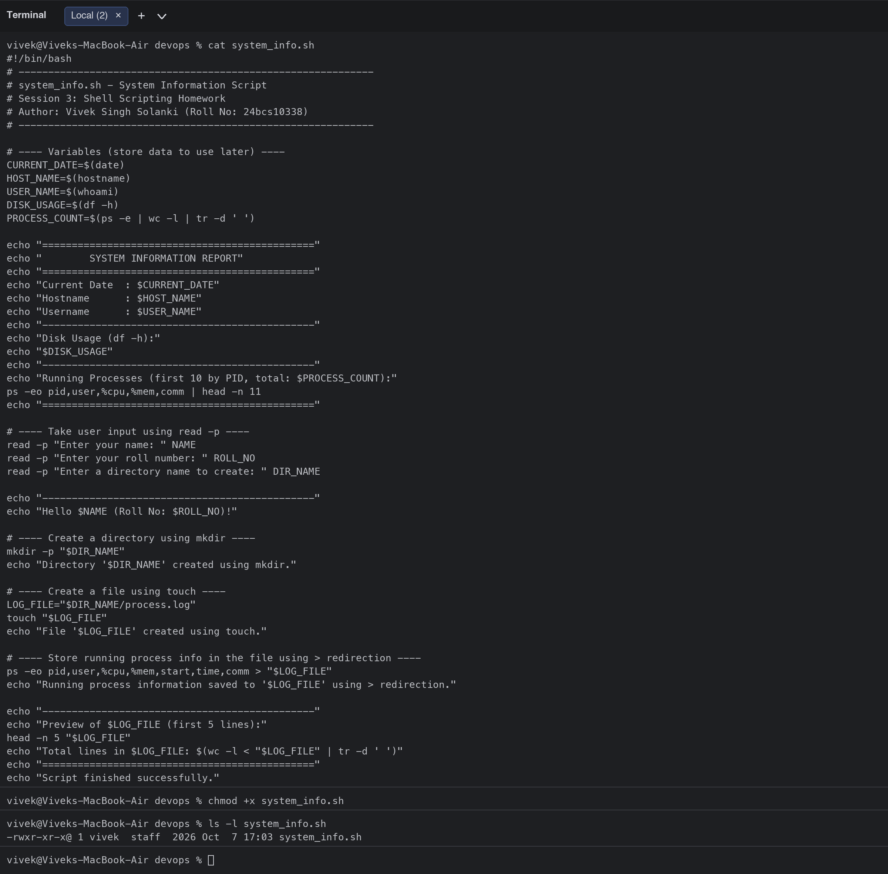
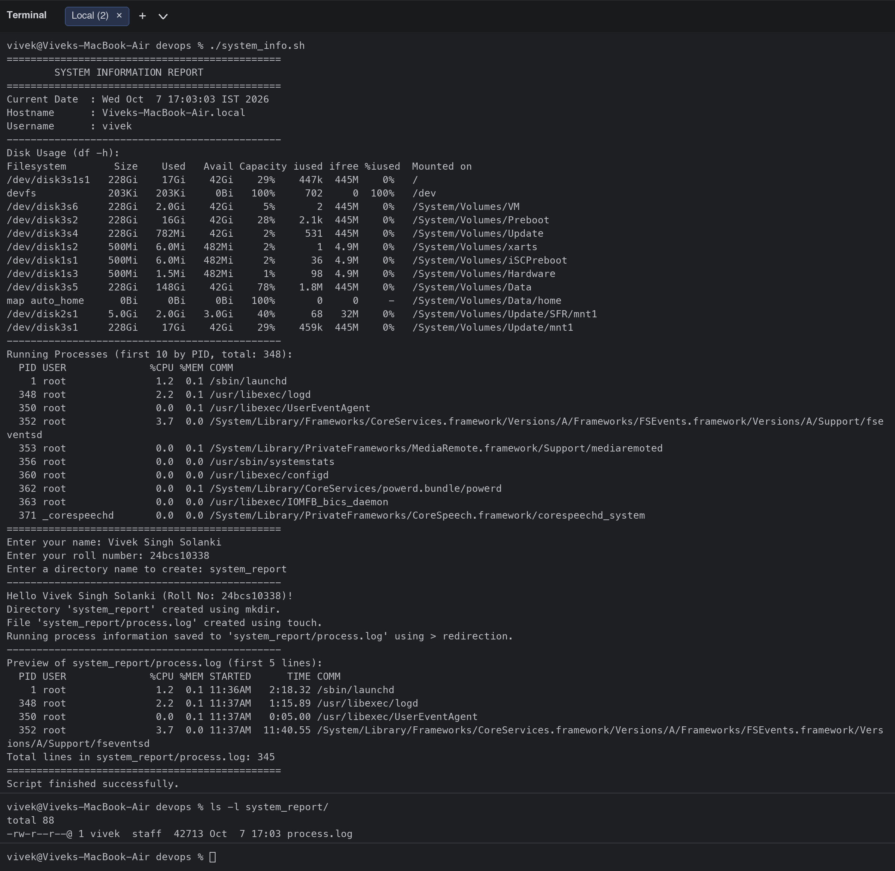
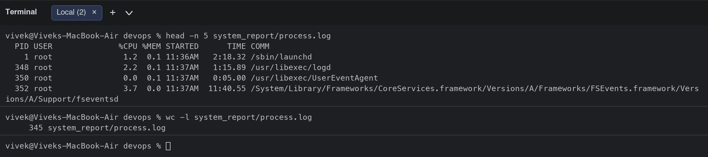

# Session 3: Shell Scripting - System Information Script

**Student:** Vivek Singh Solanki | **Roll number:** 24bcs10338
**Script:** [`system_info.sh`](system_info.sh)

## Task
Create a shell script that prints the current date, hostname, username, disk usage and running processes, uses variables, takes user input with `read -p`, creates a directory with `mkdir`, creates a file with `touch`, and stores the running-process information in that file using `>` output redirection.

## Script

```bash
#!/bin/bash
# ------------------------------------------------------------
# system_info.sh - System Information Script
# Session 3: Shell Scripting Homework
# Author: Vivek Singh Solanki (Roll No: 24bcs10338)
# ------------------------------------------------------------

# ---- Variables (store data to use later) ----
CURRENT_DATE=$(date)
HOST_NAME=$(hostname)
USER_NAME=$(whoami)
DISK_USAGE=$(df -h)
PROCESS_COUNT=$(ps -e | wc -l | tr -d ' ')

echo "=============================================="
echo "        SYSTEM INFORMATION REPORT"
echo "=============================================="
echo "Current Date  : $CURRENT_DATE"
echo "Hostname      : $HOST_NAME"
echo "Username      : $USER_NAME"
echo "----------------------------------------------"
echo "Disk Usage (df -h):"
echo "$DISK_USAGE"
echo "----------------------------------------------"
echo "Running Processes (first 10 by PID, total: $PROCESS_COUNT):"
ps -eo pid,user,%cpu,%mem,comm | head -n 11
echo "=============================================="

# ---- Take user input using read -p ----
read -p "Enter your name: " NAME
read -p "Enter your roll number: " ROLL_NO
read -p "Enter a directory name to create: " DIR_NAME

echo "----------------------------------------------"
echo "Hello $NAME (Roll No: $ROLL_NO)!"

# ---- Create a directory using mkdir ----
mkdir -p "$DIR_NAME"
echo "Directory '$DIR_NAME' created using mkdir."

# ---- Create a file using touch ----
LOG_FILE="$DIR_NAME/process.log"
touch "$LOG_FILE"
echo "File '$LOG_FILE' created using touch."

# ---- Store running process info in the file using > redirection ----
ps -eo pid,user,%cpu,%mem,start,time,comm > "$LOG_FILE"
echo "Running process information saved to '$LOG_FILE' using > redirection."

echo "----------------------------------------------"
echo "Preview of $LOG_FILE (first 5 lines):"
head -n 5 "$LOG_FILE"
echo "Total lines in $LOG_FILE: $(wc -l < "$LOG_FILE" | tr -d ' ')"
echo "=============================================="
echo "Script finished successfully."
```

## How each requirement is covered

| Requirement | Where in the script |
|---|---|
| Print current date | `CURRENT_DATE=$(date)` then `echo "Current Date : $CURRENT_DATE"` |
| Print hostname | `HOST_NAME=$(hostname)` |
| Print username | `USER_NAME=$(whoami)` |
| Print disk usage | `DISK_USAGE=$(df -h)` |
| Print running processes | `ps -eo pid,user,%cpu,%mem,comm \| head -n 11` |
| Variables | `CURRENT_DATE`, `HOST_NAME`, `USER_NAME`, `DISK_USAGE`, `PROCESS_COUNT`, `NAME`, `ROLL_NO`, `DIR_NAME`, `LOG_FILE` |
| User input with `read -p` | `read -p "Enter your name: " NAME` (3 prompts) |
| Create directory with `mkdir` | `mkdir -p "$DIR_NAME"` |
| Create file with `touch` | `touch "$LOG_FILE"` |
| Store processes with `>` | `ps -eo pid,user,%cpu,%mem,start,time,comm > "$LOG_FILE"` |
| `echo` | used for every line of output |

## Running the script (all commands and output)

```bash
$ chmod +x system_info.sh
$ ls -l system_info.sh
-rwxr-xr-x@ 1 vivek  staff  2026 Oct  7 17:03 system_info.sh
$ ./system_info.sh
==============================================
        SYSTEM INFORMATION REPORT
==============================================
Current Date  : Wed Oct  7 17:03:03 IST 2026
Hostname      : Viveks-MacBook-Air.local
Username      : vivek
----------------------------------------------
Disk Usage (df -h):
Filesystem        Size    Used   Avail Capacity iused ifree %iused  Mounted on
/dev/disk3s1s1   228Gi    17Gi    42Gi    29%    447k  445M    0%   /
devfs            203Ki   203Ki     0Bi   100%     702     0  100%   /dev
/dev/disk3s6     228Gi   2.0Gi    42Gi     5%       2  445M    0%   /System/Volumes/VM
/dev/disk3s2     228Gi    16Gi    42Gi    28%    2.1k  445M    0%   /System/Volumes/Preboot
/dev/disk3s4     228Gi   782Mi    42Gi     2%     531  445M    0%   /System/Volumes/Update
/dev/disk1s2     500Mi   6.0Mi   482Mi     2%       1  4.9M    0%   /System/Volumes/xarts
/dev/disk1s1     500Mi   6.0Mi   482Mi     2%      36  4.9M    0%   /System/Volumes/iSCPreboot
/dev/disk1s3     500Mi   1.5Mi   482Mi     1%      98  4.9M    0%   /System/Volumes/Hardware
/dev/disk3s5     228Gi   148Gi    42Gi    78%    1.8M  445M    0%   /System/Volumes/Data
map auto_home      0Bi     0Bi     0Bi   100%       0     0     -   /System/Volumes/Data/home
/dev/disk2s1     5.0Gi   2.0Gi   3.0Gi    40%      68   32M    0%   /System/Volumes/Update/SFR/mnt1
/dev/disk3s1     228Gi    17Gi    42Gi    29%    459k  445M    0%   /System/Volumes/Update/mnt1
----------------------------------------------
Running Processes (first 10 by PID, total: 348):
  PID USER              %CPU %MEM COMM
    1 root               1.2  0.1 /sbin/launchd
  348 root               2.2  0.1 /usr/libexec/logd
  350 root               0.0  0.1 /usr/libexec/UserEventAgent
  352 root               3.7  0.0 /System/Library/Frameworks/CoreServices.framework/Versions/A/Frameworks/FSEvents.framework/Versions/A/Support/fseventsd
  353 root               0.0  0.1 /System/Library/PrivateFrameworks/MediaRemote.framework/Support/mediaremoted
  356 root               0.0  0.0 /usr/sbin/systemstats
  360 root               0.0  0.0 /usr/libexec/configd
  362 root               0.0  0.1 /System/Library/CoreServices/powerd.bundle/powerd
  363 root               0.0  0.0 /usr/libexec/IOMFB_bics_daemon
  371 _corespeechd       0.0  0.0 /System/Library/PrivateFrameworks/CoreSpeech.framework/corespeechd_system
==============================================
Enter your name: Vivek Singh Solanki
Enter your roll number: 24bcs10338
Enter a directory name to create: system_report
----------------------------------------------
Hello Vivek Singh Solanki (Roll No: 24bcs10338)!
Directory 'system_report' created using mkdir.
File 'system_report/process.log' created using touch.
Running process information saved to 'system_report/process.log' using > redirection.
----------------------------------------------
Preview of system_report/process.log (first 5 lines):
  PID USER              %CPU %MEM STARTED      TIME COMM
    1 root               1.2  0.1 11:36AM   2:18.32 /sbin/launchd
  348 root               2.2  0.1 11:37AM   1:15.89 /usr/libexec/logd
  350 root               0.0  0.1 11:37AM   0:05.00 /usr/libexec/UserEventAgent
  352 root               3.7  0.0 11:37AM  11:40.55 /System/Library/Frameworks/CoreServices.framework/Versions/A/Frameworks/FSEvents.framework/Versions/A/Support/fseventsd
Total lines in system_report/process.log: 345
==============================================
Script finished successfully.
$ ls -l system_report/
total 88
-rw-r--r--@ 1 vivek  staff  42713 Oct  7 17:03 process.log
$ head -n 5 system_report/process.log
  PID USER              %CPU %MEM STARTED      TIME COMM
    1 root               1.2  0.1 11:36AM   2:18.32 /sbin/launchd
  348 root               2.2  0.1 11:37AM   1:15.89 /usr/libexec/logd
  350 root               0.0  0.1 11:37AM   0:05.00 /usr/libexec/UserEventAgent
  352 root               3.7  0.0 11:37AM  11:40.55 /System/Library/Frameworks/CoreServices.framework/Versions/A/Frameworks/FSEvents.framework/Versions/A/Support/fseventsd
$ wc -l system_report/process.log
     345 system_report/process.log
```

The generated file is kept in the repo at [`system_report/process.log`](system_report/process.log) (trimmed to the first 40 lines to keep the repository small; the full run produced 345 lines).

## Screenshots





## What I learned
- `$(command)` captures a command's output into a variable; quoting `"$VAR"` keeps multi-line output intact.
- `read -p "prompt" VAR` prints a prompt and stores the typed value without needing a separate `echo`.
- `>` **overwrites** the target file (we `touch` it first to show file creation explicitly), while `>>` would append.
- `mkdir -p` does not fail if the directory already exists, which makes the script re-runnable.
- `chmod +x` is required before running the script as `./system_info.sh`; otherwise it must be run as `bash system_info.sh`.
