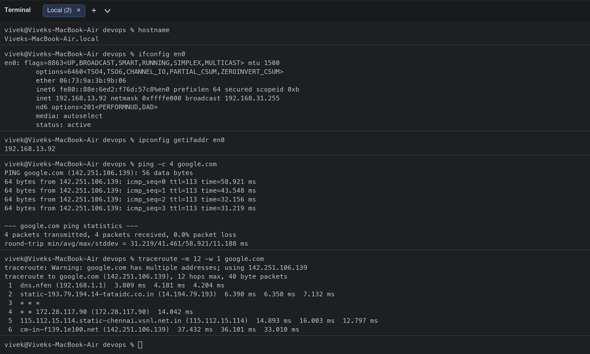
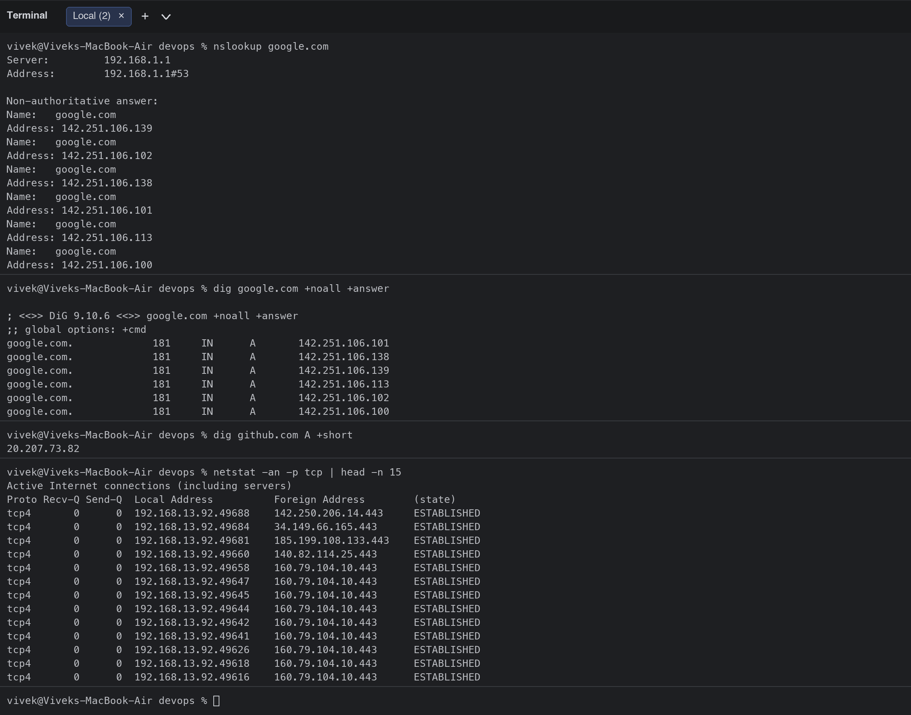
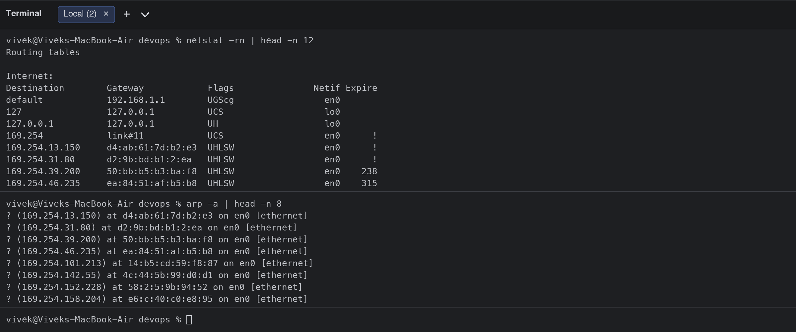
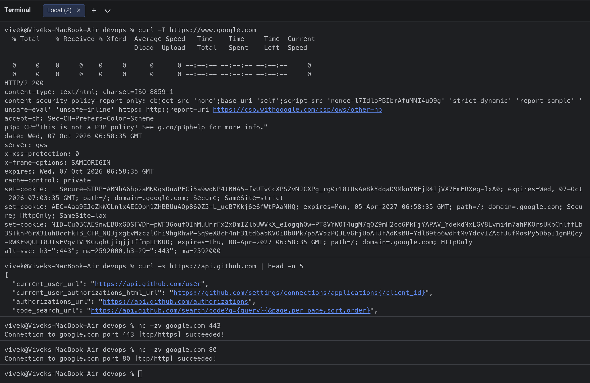
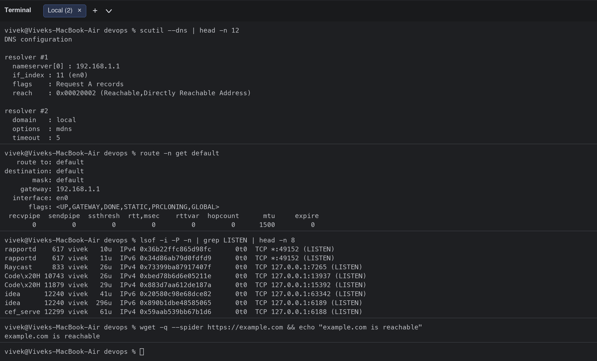
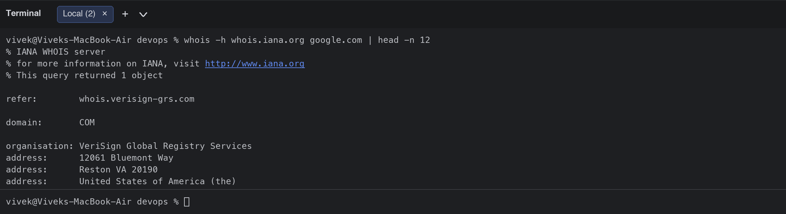

# Session 4: Networking

**Student:** Vivek Singh Solanki | **Roll number:** 24bcs10338
**Environment:** macOS terminal (Wi-Fi interface `en0`), home network behind a router at 192.168.1.1

## Task 1: Practice commands and repos shared in the devops-heros repo
I went through the networking repos shared in the session (`Networking`, `Network-Troubleshooting`, `OSI-Network-devices`, `Subnetting`, `IP-quest`, `How-DHCP-Works`) and practised the troubleshooting flow they describe: **DHCP gives my laptop an IP -> DNS resolves the name -> routing/hops carry the packet -> TCP port opens -> HTTP request/response**.

Quick notes from the repos:
- **IP classes**: A `1-127` (/8, mask 255.0.0.0), B `128-191` (/16), C `192-223` (/24), D `224-239` multicast. Private ranges: `10.0.0.0/8`, `172.16.0.0/12`, `192.168.0.0/16`.
- **Subnet mask** separates network bits from host bits. Usable hosts = 2^host_bits - 2. Example: my laptop is `192.168.13.92` with netmask `0xffffe000` = `255.255.224.0` (/19) -> 13 host bits -> 8190 usable hosts in `192.168.0.0 - 192.168.31.255`.
- **Switch** works at Layer 2 (MAC addresses), **router** at Layer 3 (IP addresses) and is usually also the **DHCP** server and default gateway. Each router on the path to a destination is a **hop**.
- Troubleshooting order: `ping` -> `traceroute` -> `nslookup`/`dig` -> `nc`/`telnet` port -> `curl`.

## Task 2: Execute networking commands, add output and explanation

Each command below was run from my terminal; the exact output follows and the screenshots are in [screenshots/](screenshots/).

### 1. `hostname`

Prints the name of this machine on the network. Useful to confirm which host you are on before running anything else.

```bash
$ hostname
Viveks-MacBook-Air.local
```

### 2. `ifconfig en0`

Shows the network interface configuration. `en0` is the Wi-Fi interface on my Mac: its MAC address (`ether`), IPv4 address `192.168.13.92`, netmask and broadcast address. On modern Linux the equivalent is `ip a`.

```bash
$ ifconfig en0
en0: flags=8863<UP,BROADCAST,SMART,RUNNING,SIMPLEX,MULTICAST> mtu 1500
	options=6460<TSO4,TSO6,CHANNEL_IO,PARTIAL_CSUM,ZEROINVERT_CSUM>
	ether 06:73:9a:3b:9b:06
	inet6 fe80::88e:6ed2:f76d:57c8%en0 prefixlen 64 secured scopeid 0xb 
	inet 192.168.13.92 netmask 0xffffe000 broadcast 192.168.31.255
	nd6 options=201<PERFORMNUD,DAD>
	media: autoselect
	status: active
```

### 3. `ipconfig getifaddr en0`

macOS shortcut that prints only the IPv4 address of an interface. Handy inside scripts.

```bash
$ ipconfig getifaddr en0
192.168.13.92
```

### 4. `ping -c 4 google.com`

Sends ICMP echo requests to check reachability and latency. `-c 4` sends 4 packets. 0% packet loss and ~31-59 ms round-trip time means the path to Google is healthy. If this fails but `ping 8.8.8.8` works, the problem is DNS, not connectivity.

```bash
$ ping -c 4 google.com
PING google.com (142.251.106.139): 56 data bytes
64 bytes from 142.251.106.139: icmp_seq=0 ttl=113 time=58.921 ms
64 bytes from 142.251.106.139: icmp_seq=1 ttl=113 time=43.548 ms
64 bytes from 142.251.106.139: icmp_seq=2 ttl=113 time=32.156 ms
64 bytes from 142.251.106.139: icmp_seq=3 ttl=113 time=31.219 ms

--- google.com ping statistics ---
4 packets transmitted, 4 packets received, 0.0% packet loss
round-trip min/avg/max/stddev = 31.219/41.461/58.921/11.188 ms
```

### 5. `traceroute -m 12 -w 1 google.com`

Shows every router (hop) between my laptop and the destination. Hop 1 is my home router (192.168.1.1), hop 2 is the ISP (Tata), then the Tata/VSNL backbone, and the packet reaches Google in 6 hops. `* * *` means a hop did not answer ICMP within the wait time, which is normal for some carriers.

```bash
$ traceroute -m 12 -w 1 google.com
traceroute: Warning: google.com has multiple addresses; using 142.251.106.139
traceroute to google.com (142.251.106.139), 12 hops max, 40 byte packets
 1  dns.nfen (192.168.1.1)  3.809 ms  4.181 ms  4.204 ms
 2  static-193.79.194.14-tataidc.co.in (14.194.79.193)  6.390 ms  6.350 ms  7.132 ms
 3  * * *
 4  * * 172.28.117.90 (172.28.117.90)  14.042 ms
 5  115.112.15.114.static-chennai.vsnl.net.in (115.112.15.114)  14.893 ms  16.003 ms  12.797 ms
 6  cm-in-f139.1e100.net (142.251.106.139)  37.432 ms  36.101 ms  33.010 ms
```

### 6. `nslookup google.com`

Queries DNS to resolve a name to IP addresses. `Server: 192.168.1.1` shows my router is the DNS resolver; the answer is a list of 6 A records (Google load-balances across many IPs). 'Non-authoritative' means the answer came from a cache, not Google's own name servers.

```bash
$ nslookup google.com
Server:		192.168.1.1
Address:	192.168.1.1#53

Non-authoritative answer:
Name:	google.com
Address: 142.251.106.139
Name:	google.com
Address: 142.251.106.102
Name:	google.com
Address: 142.251.106.138
Name:	google.com
Address: 142.251.106.101
Name:	google.com
Address: 142.251.106.113
Name:	google.com
Address: 142.251.106.100
```

### 7. `dig google.com +noall +answer`

A more detailed DNS tool. The answer section shows record name, TTL (181 s left in cache), class `IN`, type `A` and the IP. `dig` is preferred for debugging because it shows TTLs, record types and can query specific servers (`dig @8.8.8.8 ...`).

```bash
$ dig google.com +noall +answer

; <<>> DiG 9.10.6 <<>> google.com +noall +answer
;; global options: +cmd
google.com.		181	IN	A	142.251.106.101
google.com.		181	IN	A	142.251.106.138
google.com.		181	IN	A	142.251.106.139
google.com.		181	IN	A	142.251.106.113
google.com.		181	IN	A	142.251.106.102
google.com.		181	IN	A	142.251.106.100
```

### 8. `dig github.com A +short`

`+short` prints only the IP, perfect for scripts.

```bash
$ dig github.com A +short
20.207.73.82
```

### 9. `netstat -an -p tcp | head -n 15`

Lists all TCP sockets with their local/foreign address and state (`ESTABLISHED`, `LISTEN`, `TIME_WAIT`...). This tells me which connections my machine currently has open.

```bash
$ netstat -an -p tcp | head -n 15
Active Internet connections (including servers)
Proto Recv-Q Send-Q  Local Address          Foreign Address        (state)    
tcp4       0      0  192.168.13.92.49688    142.250.206.14.443     ESTABLISHED
tcp4       0      0  192.168.13.92.49684    34.149.66.165.443      ESTABLISHED
tcp4       0      0  192.168.13.92.49681    185.199.108.133.443    ESTABLISHED
tcp4       0      0  192.168.13.92.49660    140.82.114.25.443      ESTABLISHED
tcp4       0      0  192.168.13.92.49658    160.79.104.10.443      ESTABLISHED
tcp4       0      0  192.168.13.92.49647    160.79.104.10.443      ESTABLISHED
tcp4       0      0  192.168.13.92.49645    160.79.104.10.443      ESTABLISHED
tcp4       0      0  192.168.13.92.49644    160.79.104.10.443      ESTABLISHED
tcp4       0      0  192.168.13.92.49642    160.79.104.10.443      ESTABLISHED
tcp4       0      0  192.168.13.92.49641    160.79.104.10.443      ESTABLISHED
tcp4       0      0  192.168.13.92.49626    160.79.104.10.443      ESTABLISHED
tcp4       0      0  192.168.13.92.49618    160.79.104.10.443      ESTABLISHED
tcp4       0      0  192.168.13.92.49616    160.79.104.10.443      ESTABLISHED
```

### 10. `netstat -rn | head -n 12`

Shows the kernel routing table. The `default` route via `192.168.1.1` is the gateway all non-local traffic is sent to. On Linux use `ip route`.

```bash
$ netstat -rn | head -n 12
Routing tables

Internet:
Destination        Gateway            Flags               Netif Expire
default            192.168.1.1        UGScg                 en0       
127                127.0.0.1          UCS                   lo0       
127.0.0.1          127.0.0.1          UH                    lo0       
169.254            link#11            UCS                   en0      !
169.254.13.150     d4:ab:61:7d:b2:e3  UHLSW                 en0      !
169.254.31.80      d2:9b:bd:b1:2:ea   UHLSW                 en0      !
169.254.39.200     50:bb:b5:b3:ba:f8  UHLSW                 en0    238
169.254.46.235     ea:84:51:af:b5:b8  UHLSW                 en0    315
```

### 11. `arp -a | head -n 8`

Shows the ARP cache: the mapping between IP addresses and MAC addresses of devices on my local network (Layer 2). The router 192.168.1.1 appears with its MAC.

```bash
$ arp -a | head -n 8
? (169.254.13.150) at d4:ab:61:7d:b2:e3 on en0 [ethernet]
? (169.254.31.80) at d2:9b:bd:b1:2:ea on en0 [ethernet]
? (169.254.39.200) at 50:bb:b5:b3:ba:f8 on en0 [ethernet]
? (169.254.46.235) at ea:84:51:af:b5:b8 on en0 [ethernet]
? (169.254.101.213) at 14:b5:cd:59:f8:87 on en0 [ethernet]
? (169.254.142.55) at 4c:44:5b:99:d0:d1 on en0 [ethernet]
? (169.254.152.228) at 58:2:5:9b:94:52 on en0 [ethernet]
? (169.254.158.204) at e6:c:40:c0:e8:95 on en0 [ethernet]
```

### 12. `curl -I https://www.google.com`

Sends an HTTP HEAD request and prints only the response headers. `HTTP/2 200` confirms the web server answers; headers also reveal the server, content-type, caching and security policies.

```bash
$ curl -I https://www.google.com
  % Total    % Received % Xferd  Average Speed   Time    Time     Time  Current
                                 Dload  Upload   Total   Spent    Left  Speed

  0     0    0     0    0     0      0      0 --:--:-- --:--:-- --:--:--     0
  0     0    0     0    0     0      0      0 --:--:-- --:--:-- --:--:--     0
HTTP/2 200 
content-type: text/html; charset=ISO-8859-1
content-security-policy-report-only: object-src 'none';base-uri 'self';script-src 'nonce-l7IdloPBIbrAfuMNI4uQ9g' 'strict-dynamic' 'report-sample' 'unsafe-eval' 'unsafe-inline' https: http:;report-uri https://csp.withgoogle.com/csp/gws/other-hp
accept-ch: Sec-CH-Prefers-Color-Scheme
p3p: CP="This is not a P3P policy! See g.co/p3phelp for more info."
date: Wed, 07 Oct 2026 06:58:35 GMT
server: gws
x-xss-protection: 0
x-frame-options: SAMEORIGIN
expires: Wed, 07 Oct 2026 06:58:35 GMT
cache-control: private
set-cookie: __Secure-STRP=ABNhA6hp2aMN0qsOnWPFCi5a9wqNP4tBHA5-fvUTvCcXPSZvNJCXPg_rg0r18tUsAe8kYdqaD9MkuYBEjR4IjVX7EmERXeg-lxA0; expires=Wed, 07-Oct-2026 07:03:35 GMT; path=/; domain=.google.com; Secure; SameSite=strict
set-cookie: AEC=Aaa9EJoZkWCLnlxAECQpn1ZHBBUuAQp860Z5-L_ucB7Kkj6e6fWtPAaNHQ; expires=Mon, 05-Apr-2027 06:58:35 GMT; path=/; domain=.google.com; Secure; HttpOnly; SameSite=lax
set-cookie: NID=Cu0BCAESnwEBOxGDSFVDh-pWF36oufQIhMuUnrFx2xDmIZlbUWVkX_eIogqhOw-PT8VYWOT4ugM7qOZ9mH2cc6PkFjYAPAV_YdekdNxLGV8Lvmi4m7ahPKOrsUKpCnlffLb3STknP6rX3IuhDccFkTB_CTR_NQJjxgEvMzczlOFi9hgRhwP-Sq9eX8cF4nF31td6a5KVOiDbUPk7p5AV5zPQJLvGFjUoATJFAdKsB8-YdlB9to6wdFtMvYdcvIZAcFJufMosPy5DbpI1gmRQcy-RWKF9QULt8JTsFVqvTVPKGuqhCjiqjjIffmpLPKUO; expires=Thu, 08-Apr-2027 06:58:35 GMT; path=/; domain=.google.com; HttpOnly
alt-svc: h3=":443"; ma=2592000,h3-29=":443"; ma=2592000
```

### 13. `curl -s https://api.github.com | head -n 5`

Fetches the body of a URL. Here the GitHub REST API returns JSON, proving HTTPS + DNS + TCP all work end to end.

```bash
$ curl -s https://api.github.com | head -n 5
{
  "current_user_url": "https://api.github.com/user",
  "current_user_authorizations_html_url": "https://github.com/settings/connections/applications{/client_id}",
  "authorizations_url": "https://api.github.com/authorizations",
  "code_search_url": "https://api.github.com/search/code?q={query}{&page,per_page,sort,order}",
```

### 14. `nc -zv google.com 443`

Netcat in zero-I/O (`-z`) verbose mode tests whether a specific TCP port is open without sending data. 443 (HTTPS) succeeded. This is the modern replacement for `telnet host port`.

```bash
$ nc -zv google.com 443
Connection to google.com port 443 [tcp/https] succeeded!
```

### 15. `nc -zv google.com 80`

Same check for HTTP port 80.

```bash
$ nc -zv google.com 80
Connection to google.com port 80 [tcp/http] succeeded!
```

### 16. `scutil --dns | head -n 12`

macOS command that prints the DNS resolver configuration (which name servers and search domains the system uses). On Linux this is `cat /etc/resolv.conf` or `resolvectl status`.

```bash
$ scutil --dns | head -n 12
DNS configuration

resolver #1
  nameserver[0] : 192.168.1.1
  if_index : 11 (en0)
  flags    : Request A records
  reach    : 0x00020002 (Reachable,Directly Reachable Address)

resolver #2
  domain   : local
  options  : mdns
  timeout  : 5
```

### 17. `route -n get default`

Shows the details of the default route: gateway, interface and MTU.

```bash
$ route -n get default
   route to: default
destination: default
       mask: default
    gateway: 192.168.1.1
  interface: en0
      flags: <UP,GATEWAY,DONE,STATIC,PRCLONING,GLOBAL>
 recvpipe  sendpipe  ssthresh  rtt,msec    rttvar  hopcount      mtu     expire
       0         0         0         0         0         0      1500         0
```

### 18. `lsof -i -P -n | grep LISTEN | head -n 8`

Lists processes that are listening on network ports. On Linux `ss -tulnp` or `netstat -tulnp` gives the same information. Useful to find what is already using a port before starting a container on it.

```bash
$ lsof -i -P -n | grep LISTEN | head -n 8
rapportd    617 vivek   10u  IPv4 0x36b22ffc865d98fc      0t0  TCP *:49152 (LISTEN)
rapportd    617 vivek   11u  IPv6 0x34d86ab79d0fdfd9      0t0  TCP *:49152 (LISTEN)
Raycast     833 vivek   26u  IPv4 0x73399ba87917407f      0t0  TCP 127.0.0.1:7265 (LISTEN)
Code\x20H 10743 vivek   26u  IPv4 0xbed78b6d6e05211e      0t0  TCP 127.0.0.1:13937 (LISTEN)
Code\x20H 11879 vivek   29u  IPv4 0x883d7aa612de187a      0t0  TCP 127.0.0.1:15392 (LISTEN)
idea      12240 vivek   41u  IPv6 0x20580c98e68dce82      0t0  TCP 127.0.0.1:63342 (LISTEN)
idea      12240 vivek  296u  IPv6 0x890b1dbe48585065      0t0  TCP 127.0.0.1:6189 (LISTEN)
cef_serve 12299 vivek   61u  IPv4 0x59aab539bb67b1d6      0t0  TCP 127.0.0.1:6188 (LISTEN)
```

### 19. `wget -q --spider https://example.com && echo "example.com is reachable"`

`wget` downloads files; `--spider` only checks that the URL exists without downloading. Good for health checks in scripts.

```bash
$ wget -q --spider https://example.com && echo "example.com is reachable"
example.com is reachable
```

### 20. `whois -h whois.iana.org google.com | head -n 12`

Looks up domain registration information from the registry (who owns the domain, registrar, name servers).

```bash
$ whois -h whois.iana.org google.com | head -n 12
% IANA WHOIS server
% for more information on IANA, visit http://www.iana.org
% This query returned 1 object

refer:        whois.verisign-grs.com

domain:       COM

organisation: VeriSign Global Registry Services
address:      12061 Bluemont Way
address:      Reston VA 20190
address:      United States of America (the)
```

## Summary of what I understood

| Layer | Question it answers | Commands |
|---|---|---|
| L1/L2 Link | Is my interface up? Who is on my LAN? | `ifconfig` / `ip a`, `arp -a` |
| L3 Network | Can I reach the host? Which path? | `ping`, `traceroute`, `netstat -rn` / `ip route` |
| DNS | Does the name resolve? | `nslookup`, `dig`, `scutil --dns` / `resolv.conf` |
| L4 Transport | Is the port open? What is listening locally? | `nc -zv`, `telnet`, `netstat -an`, `ss -tulwn`, `lsof -i` |
| L7 Application | Does the service answer correctly? | `curl -I`, `curl`, `wget --spider` |

## Screenshots







