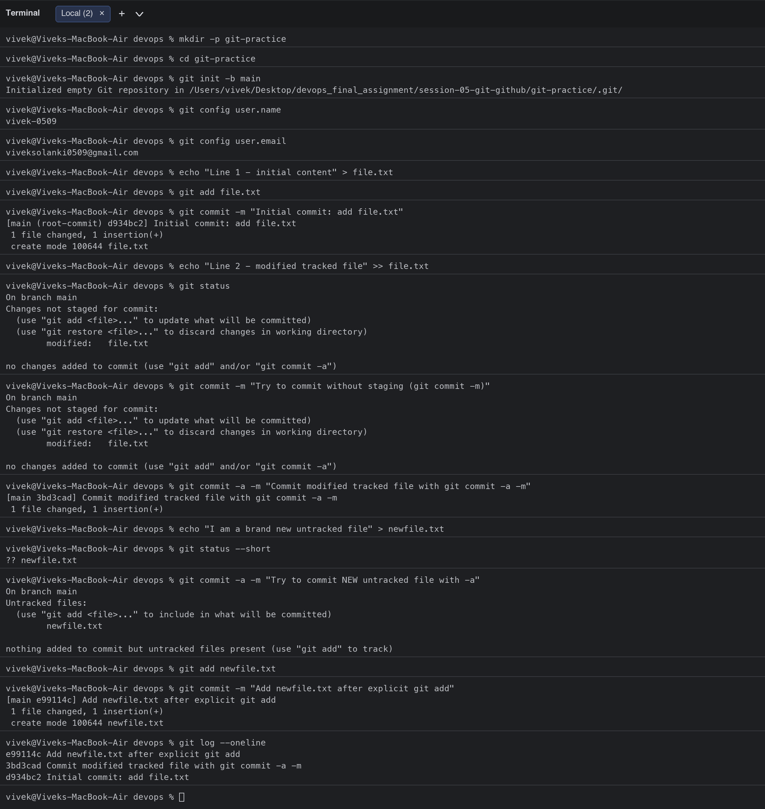
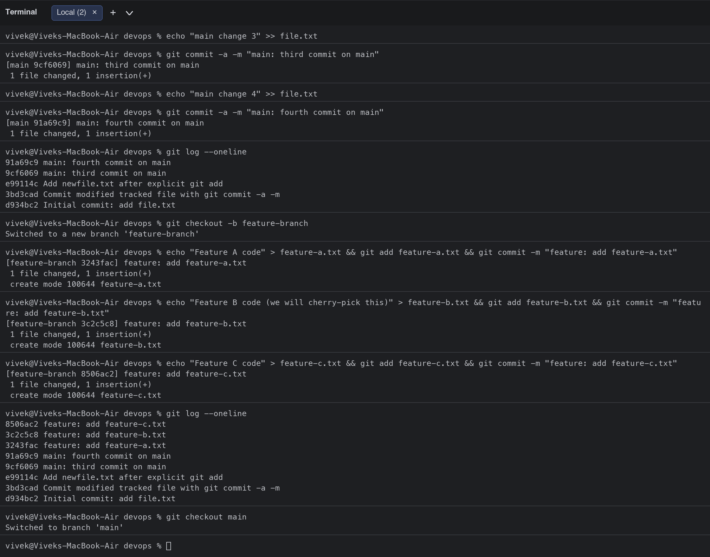
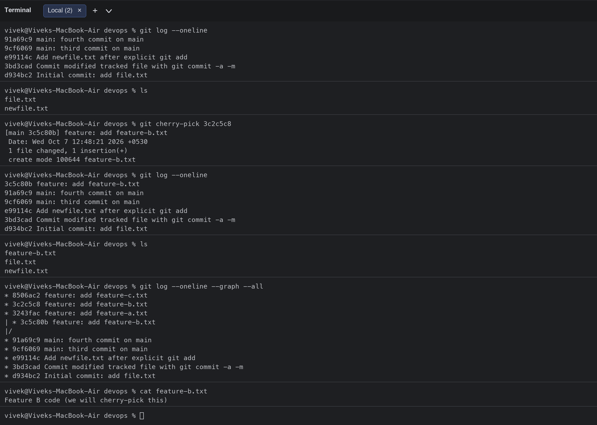

# Session 5: Git and GitHub

**Student:** Vivek Singh Solanki | **Roll number:** 24bcs10338
**Practice repository:** [`git-practice/`](git-practice/) was created with `git init -b main` only for this exercise; after capturing the output its `.git` folder was removed so the files can live inside this repository as plain files. The commands and outputs below are copied verbatim from that session.

## Task 1: `git commit -a -m` vs `git commit -m`

### Theory

| | `git commit -m "msg"` | `git commit -a -m "msg"` |
|---|---|---|
| What gets committed | Only changes that were **staged** with `git add` | All **modified and deleted tracked** files are staged automatically, then committed |
| New (untracked) files | Must be `git add`ed first | **Still ignored**, `-a` never adds untracked files |
| Typical use | Fine-grained commits, you choose exactly what goes in | Quick commit of every edit to files Git already tracks |
| Risk | Forgetting to `git add` -> "no changes added to commit" | Accidentally committing unrelated edits |

`-a` = `--all` (stage tracked changes), `-m` = `--message`.

### Commands and output

```bash
$ mkdir -p git-practice
$ cd git-practice
$ git init -b main
Initialized empty Git repository in /Users/vivek/Desktop/devops_final_assignment/session-05-git-github/git-practice/.git/
$ git config user.name
vivek-0509
$ git config user.email
viveksolanki0509@gmail.com
$ echo "Line 1 - initial content" > file.txt
$ git add file.txt
$ git commit -m "Initial commit: add file.txt"
[main (root-commit) d934bc2] Initial commit: add file.txt
 1 file changed, 1 insertion(+)
 create mode 100644 file.txt
$ echo "Line 2 - modified tracked file" >> file.txt
$ git status
On branch main
Changes not staged for commit:
  (use "git add <file>..." to update what will be committed)
  (use "git restore <file>..." to discard changes in working directory)
	modified:   file.txt

no changes added to commit (use "git add" and/or "git commit -a")
$ git commit -m "Try to commit without staging (git commit -m)"
On branch main
Changes not staged for commit:
  (use "git add <file>..." to update what will be committed)
  (use "git restore <file>..." to discard changes in working directory)
	modified:   file.txt

no changes added to commit (use "git add" and/or "git commit -a")
$ git commit -a -m "Commit modified tracked file with git commit -a -m"
[main 3bd3cad] Commit modified tracked file with git commit -a -m
 1 file changed, 1 insertion(+)
$ echo "I am a brand new untracked file" > newfile.txt
$ git status --short
?? newfile.txt
$ git commit -a -m "Try to commit NEW untracked file with -a"
On branch main
Untracked files:
  (use "git add <file>..." to include in what will be committed)
	newfile.txt

nothing added to commit but untracked files present (use "git add" to track)
$ git add newfile.txt
$ git commit -m "Add newfile.txt after explicit git add"
[main e99114c] Add newfile.txt after explicit git add
 1 file changed, 1 insertion(+)
 create mode 100644 newfile.txt
$ git log --oneline
e99114c Add newfile.txt after explicit git add
3bd3cad Commit modified tracked file with git commit -a -m
d934bc2 Initial commit: add file.txt
```

### What I observed
1. After editing a tracked file, `git commit -m` **refused** ("no changes added to commit") because nothing was staged.
2. `git commit -a -m` committed the same edit immediately, because `-a` staged the modified tracked file for me.
3. For a brand-new file, `git commit -a -m` did **not** include it ("nothing added to commit but untracked files present"). Untracked files always need an explicit `git add`.
4. After `git add newfile.txt`, a plain `git commit -m` worked.



---

## Task 2: Git Cherry-Pick

### Theory
`git cherry-pick <commit>` copies the **changes of one specific commit** from another branch onto the current branch, creating a **new commit with a new hash** (the original stays on its branch). It is used when you need one fix from a feature branch (for example a hotfix) without merging the whole branch.

### Steps performed
1. Created 4 commits on `main` (2 from Task 1 + 2 new ones).
2. `git log --oneline` to view them.
3. `git checkout -b feature-branch` and made 3 commits (`feature-a`, `feature-b`, `feature-c`).
4. Used `git log --oneline` to identify the hash of the `feature-b` commit (`3c2c5c8`).
5. Switched back to `main` and ran `git cherry-pick 3c2c5c8`.
6. Verified with `git log`, `ls` and `cat feature-b.txt` that only feature-b arrived on `main`.

### Commands and output

```bash
$ echo "main change 3" >> file.txt
$ git commit -a -m "main: third commit on main"
[main 9cf6069] main: third commit on main
 1 file changed, 1 insertion(+)
$ echo "main change 4" >> file.txt
$ git commit -a -m "main: fourth commit on main"
[main 91a69c9] main: fourth commit on main
 1 file changed, 1 insertion(+)
$ git log --oneline
91a69c9 main: fourth commit on main
9cf6069 main: third commit on main
e99114c Add newfile.txt after explicit git add
3bd3cad Commit modified tracked file with git commit -a -m
d934bc2 Initial commit: add file.txt
$ git checkout -b feature-branch
Switched to a new branch 'feature-branch'
$ echo "Feature A code" > feature-a.txt && git add feature-a.txt && git commit -m "feature: add feature-a.txt"
[feature-branch 3243fac] feature: add feature-a.txt
 1 file changed, 1 insertion(+)
 create mode 100644 feature-a.txt
$ echo "Feature B code (we will cherry-pick this)" > feature-b.txt && git add feature-b.txt && git commit -m "feature: add feature-b.txt"
[feature-branch 3c2c5c8] feature: add feature-b.txt
 1 file changed, 1 insertion(+)
 create mode 100644 feature-b.txt
$ echo "Feature C code" > feature-c.txt && git add feature-c.txt && git commit -m "feature: add feature-c.txt"
[feature-branch 8506ac2] feature: add feature-c.txt
 1 file changed, 1 insertion(+)
 create mode 100644 feature-c.txt
$ git log --oneline
8506ac2 feature: add feature-c.txt
3c2c5c8 feature: add feature-b.txt
3243fac feature: add feature-a.txt
91a69c9 main: fourth commit on main
9cf6069 main: third commit on main
e99114c Add newfile.txt after explicit git add
3bd3cad Commit modified tracked file with git commit -a -m
d934bc2 Initial commit: add file.txt
$ git checkout main
Switched to branch 'main'
$ git log --oneline
91a69c9 main: fourth commit on main
9cf6069 main: third commit on main
e99114c Add newfile.txt after explicit git add
3bd3cad Commit modified tracked file with git commit -a -m
d934bc2 Initial commit: add file.txt
$ ls
file.txt
newfile.txt
$ git cherry-pick 3c2c5c8
[main 3c5c80b] feature: add feature-b.txt
 Date: Wed Oct 7 12:48:21 2026 +0530
 1 file changed, 1 insertion(+)
 create mode 100644 feature-b.txt
$ git log --oneline
3c5c80b feature: add feature-b.txt
91a69c9 main: fourth commit on main
9cf6069 main: third commit on main
e99114c Add newfile.txt after explicit git add
3bd3cad Commit modified tracked file with git commit -a -m
d934bc2 Initial commit: add file.txt
$ ls
feature-b.txt
file.txt
newfile.txt
$ git log --oneline --graph --all
* 8506ac2 feature: add feature-c.txt
* 3c2c5c8 feature: add feature-b.txt
* 3243fac feature: add feature-a.txt
| * 3c5c80b feature: add feature-b.txt
|/  
* 91a69c9 main: fourth commit on main
* 9cf6069 main: third commit on main
* e99114c Add newfile.txt after explicit git add
* 3bd3cad Commit modified tracked file with git commit -a -m
* d934bc2 Initial commit: add file.txt
$ cat feature-b.txt
Feature B code (we will cherry-pick this)
```

### What I observed
- Before the cherry-pick, `main` had no `feature-*` files.
- After `git cherry-pick 3c2c5c8`, `main` got a **new commit `3c5c80b`** with the same message and content as `3c2c5c8`, and `feature-b.txt` now exists on `main`.
- `feature-a.txt` and `feature-c.txt` are still only on `feature-branch`, which proves cherry-pick copies a single commit, not the whole branch.
- `git log --oneline --graph --all` shows both commits (`3c2c5c8` on the feature branch, `3c5c80b` on main) side by side.




## Extra notes
- If a cherry-pick conflicts, fix the files, `git add` them and run `git cherry-pick --continue` (or `--abort`).
- `git cherry-pick A..B` picks a range of commits; `-x` appends "(cherry picked from commit ...)" to the message for traceability.
