# Session 6: Docker Fundamentals - Hello World Applications

**Student:** Vivek Singh Solanki | **Roll number:** 24bcs10338
**Docker engine:** Docker 29 (Colima VM on macOS Apple Silicon)

## Task
Create simple Hello World web applications using Docker for Node.js, Python, Java, Apache, React and Nginx. For each one: separate folder, application code, Dockerfile, build the image, run the container, verify Hello World in a browser.

## Folder structure

```text
session-06-docker-fundamentals/
├── nodejs-app/     server.js, package.json, Dockerfile
├── python-app/     app.py, requirements.txt, Dockerfile
├── java-app/       HelloWorldServer.java, Dockerfile (multi-stage)
├── Apache-app/     index.html, Dockerfile
├── React-app/      src/, index.html, package.json, vite.config.js, nginx.conf, Dockerfile (multi-stage)
├── nginx-app/      index.html, Dockerfile
└── screenshots/
```

## Summary

| Folder | Stack | Base image | Host port | Build command |
|---|---|---|---|---|
| [`nodejs-app/`](nodejs-app/) | Node.js (Express) | `node:24-alpine` | 3000 | `docker build -t nodejs-app:1.0 ./nodejs-app` |
| [`python-app/`](python-app/) | Python (Flask) | `python:3.12-slim` | 5000 | `docker build -t python-app:1.0 ./python-app` |
| [`java-app/`](java-app/) | Java (JDK HttpServer, multi-stage JDK -> JRE) | `eclipse-temurin:21-jdk-alpine / 21-jre-alpine` | 8080 | `docker build -t java-app:1.0 ./java-app` |
| [`Apache-app/`](Apache-app/) | Apache HTTP Server | `httpd:2.4-alpine` | 8081 -> 80 | `docker build -t apache-app:1.0 ./Apache-app` |
| [`React-app/`](React-app/) | React (Vite build, served by Nginx, multi-stage) | `node:24-alpine -> nginx:alpine` | 3001 -> 80 | `docker build -t react-app:1.0 ./React-app` |
| [`nginx-app/`](nginx-app/) | Nginx | `nginx:alpine` | 8082 -> 80 | `docker build -t nginx-app:1.0 ./nginx-app` |

Run commands used:

```bash
docker run -d --name nodejs-app -p 3000:3000 nodejs-app:1.0
docker run -d --name python-app -p 5000:5000 python-app:1.0
docker run -d --name java-app   -p 8080:8080 java-app:1.0
docker run -d --name apache-app -p 8081:80   apache-app:1.0
docker run -d --name nginx-app  -p 8082:80   nginx-app:1.0
docker run -d --name react-app  -p 3001:80   react-app:1.0
```

## All six containers running

```bash
$ docker images | grep -E "REPOSITORY|-app"
apache-app:1.0                  349c29ca1d32        115MB           24MB   U    
java-app:1.0                    060c82d57955        286MB         73.4MB   U    
nginx-app:1.0                   080c730738ff         93MB         26.3MB   U    
nodejs-app:1.0                  6a9b7ab0e32f        255MB         64.9MB   U    
python-app:1.0                  6d620a5f0eec        223MB         48.5MB   U    
react-app:1.0                   7e91b192669c       93.3MB         26.3MB   U    
$ docker ps --format "table {{.Names}}	{{.Image}}	{{.Status}}	{{.Ports}}"
NAMES        IMAGE            STATUS              PORTS
react-app    react-app:1.0    Up 5 seconds        0.0.0.0:3001->80/tcp, [::]:3001->80/tcp
nginx-app    nginx-app:1.0    Up About a minute   0.0.0.0:8082->80/tcp, [::]:8082->80/tcp
apache-app   apache-app:1.0   Up About a minute   0.0.0.0:8081->80/tcp, [::]:8081->80/tcp
java-app     java-app:1.0     Up 2 minutes        0.0.0.0:8080->8080/tcp, [::]:8080->8080/tcp
python-app   python-app:1.0   Up 3 minutes        0.0.0.0:5000->5000/tcp, [::]:5000->5000/tcp
nodejs-app   nodejs-app:1.0   Up 3 minutes        0.0.0.0:3000->3000/tcp, [::]:3000->3000/tcp
$ curl -s http://localhost:3000 | grep -o '<h1>.*</h1>'
<h1>Hello World from Node.js + Docker!</h1>
$ curl -s http://localhost:5000 | grep -o '<h1>.*</h1>'
<h1>Hello World from Python (Flask) + Docker!</h1>
$ curl -s http://localhost:8080 | grep -o '<h1>.*</h1>'
<h1>Hello World from Java + Docker!</h1>
$ curl -s http://localhost:8081 | grep -o '<h1>.*</h1>'
<h1>Hello World from Apache HTTP Server + Docker!</h1>
$ curl -s http://localhost:8082 | grep -o '<h1>.*</h1>'
<h1>Hello World from Nginx + Docker!</h1>
$ curl -s http://localhost:3001 | grep -o '<h1>.*</h1>'
```

> The React page is rendered by JavaScript in the browser, so `curl` only returns the empty `<div id="root">`; the last command proves the text is inside the built JS bundle, and the browser screenshot below shows it rendered.

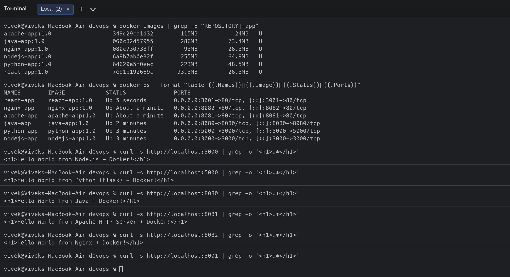

## Per-application details

### Node.js (Express) - `nodejs-app/`

Files: `Dockerfile`, `package.json`, `server.js`

```bash
$ cat nodejs-app/Dockerfile
# Node.js Hello World - Dockerfile
FROM node:24-alpine

WORKDIR /app

# Install dependencies first (better layer caching)
COPY package*.json ./
RUN npm install --omit=dev

# Copy application code
COPY server.js .

EXPOSE 3000

CMD ["npm", "start"]
$ docker build -t nodejs-app:1.0 ./nodejs-app
#0 building with "colima" instance using docker driver

#1 [internal] load build definition from Dockerfile
#1 transferring dockerfile: 287B done
#1 DONE 0.0s

#2 [internal] load metadata for docker.io/library/node:24-alpine
#2 DONE 0.0s

#3 [internal] load .dockerignore
#3 transferring context: 67B done
#3 DONE 0.0s

#4 [internal] load build context
#4 transferring context: 956B done
#4 DONE 0.0s

#5 [1/5] FROM docker.io/library/node:24-alpine@sha256:ebfe2f90462722a7a4de65e91990e97fe0d401c70e0e762c5b53302f905ec1c1
#5 DONE 0.0s

#6 [2/5] WORKDIR /app
#6 DONE 0.0s

#7 [3/5] COPY package*.json ./
#7 DONE 0.0s

#8 [4/5] RUN npm install --omit=dev
#8 6.643 
#8 6.643 added 68 packages, and audited 69 packages in 7s
#8 6.644 
#8 6.644 28 packages are looking for funding
#8 6.644   run `npm fund` for details
#8 6.646 
#8 6.646 found 0 vulnerabilities
#8 6.648 npm notice
#8 6.648 npm notice New major version of npm available! 11.19.0 -> 12.2.0
#8 6.648 npm notice Changelog: https://github.com/npm/cli/releases/tag/v12.2.0
#8 6.648 npm notice To update run: npm install -g npm@12.2.0
#8 6.648 npm notice
#8 DONE 6.7s

#9 [5/5] COPY server.js .
#9 DONE 0.0s

#10 exporting to image
#10 exporting layers
#10 exporting layers 0.2s done
#10 exporting manifest sha256:33371506862b798e38aca93262615fe944408f065356eda5f4e7914d44581817 done
#10 exporting config sha256:31ea589121275d1bce1782cdd62c44089e9aa9281edd4cd69d795e40b2122026 done
#10 exporting attestation manifest sha256:0f72fcc2f6d9de7edaa7a9efa6a494083b255fdf1a9ddc419d25736b7e0a1f62 done
#10 exporting manifest list sha256:6a9b7ab0e32f479134f72f2038ef0a172d6165566cf2e347438b1981f468f528 done
#10 naming to docker.io/library/nodejs-app:1.0 done
#10 unpacking to docker.io/library/nodejs-app:1.0 0.1s done
#10 DONE 0.3s
$ docker run -d --name nodejs-app -p 3000:3000 nodejs-app:1.0
f2dcf0766a787266dad53aa4e3134b2ddb0cce3ce768f3786da40d53925271dd
$ docker ps --filter name=nodejs-app
CONTAINER ID   IMAGE            COMMAND                  CREATED         STATUS         PORTS                                         NAMES
f2dcf0766a78   nodejs-app:1.0   "docker-entrypoint.s…"   6 seconds ago   Up 5 seconds   0.0.0.0:3000->3000/tcp, [::]:3000->3000/tcp   nodejs-app
$ curl -s http://localhost:3000
<!DOCTYPE html>
<html>
  <head><title>Node.js Hello World</title></head>
  <body style="font-family: sans-serif; text-align: center; margin-top: 80px;">
    <h1>Hello World from Node.js + Docker!</h1>
    <p>Served by Express on container <b>f2dcf0766a78</b> (port 3000)</p>
  </body>
</html>
```

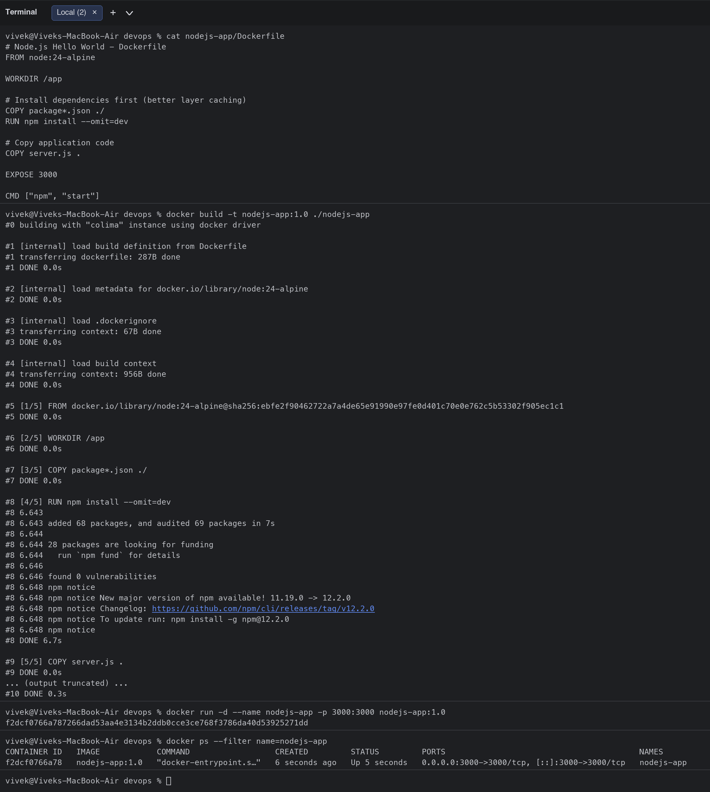
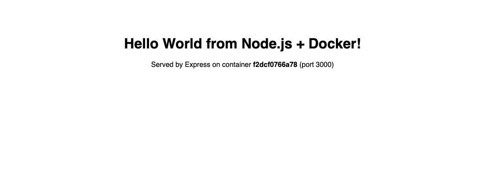
### Python (Flask) - `python-app/`

Files: `Dockerfile`, `app.py`, `requirements.txt`

```bash
$ cat python-app/Dockerfile
# Python Hello World - Dockerfile
FROM python:3.12-slim

WORKDIR /app

COPY requirements.txt .
RUN pip install --no-cache-dir -r requirements.txt

COPY app.py .

EXPOSE 5000

CMD ["python", "app.py"]
$ docker build -t python-app:1.0 ./python-app
#0 building with "colima" instance using docker driver

#1 [internal] load build definition from Dockerfile
#1 transferring dockerfile: 239B done
#1 DONE 0.0s

#2 [internal] load metadata for docker.io/library/python:3.12-slim
#2 DONE 0.0s

#3 [internal] load .dockerignore
#3 transferring context: 2B done
#3 DONE 0.0s

#4 [internal] load build context
#4 transferring context: 638B done
#4 DONE 0.0s

#5 [1/5] FROM docker.io/library/python:3.12-slim@sha256:05cda9777409a9c3ffddd94a4c476b79f0769a0b4857f0c7ed9226b6800b0d6f
#5 DONE 0.0s

#6 [2/5] WORKDIR /app
#6 DONE 0.0s

#7 [3/5] COPY requirements.txt .
#7 DONE 0.0s

#8 [4/5] RUN pip install --no-cache-dir -r requirements.txt
#8 1.043 Collecting flask==3.1.1 (from -r requirements.txt (line 1))
#8 1.624   Downloading flask-3.1.1-py3-none-any.whl.metadata (3.0 kB)
#8 1.752 Collecting blinker>=1.9.0 (from flask==3.1.1->-r requirements.txt (line 1))
#8 1.840   Downloading blinker-1.9.0-py3-none-any.whl.metadata (1.6 kB)
#8 1.967 Collecting click>=8.1.3 (from flask==3.1.1->-r requirements.txt (line 1))
#8 2.049   Downloading click-8.5.0-py3-none-any.whl.metadata (2.6 kB)
#8 2.139 Collecting itsdangerous>=2.2.0 (from flask==3.1.1->-r requirements.txt (line 1))
#8 2.197   Downloading itsdangerous-2.2.0-py3-none-any.whl.metadata (1.9 kB)
#8 2.293 Collecting jinja2>=3.1.2 (from flask==3.1.1->-r requirements.txt (line 1))
#8 2.406   Downloading jinja2-3.1.6-py3-none-any.whl.metadata (2.9 kB)
#8 2.687 Collecting markupsafe>=2.1.1 (from flask==3.1.1->-r requirements.txt (line 1))
#8 2.799   Downloading markupsafe-3.0.4-cp312-cp312-manylinux2014_aarch64.manylinux_2_17_aarch64.manylinux_2_28_aarch64.whl.metadata (2.7 kB)
#8 2.988 Collecting werkzeug>=3.1.0 (from flask==3.1.1->-r requirements.txt (line 1))
#8 3.126   Downloading werkzeug-3.1.9-py3-none-any.whl.metadata (4.1 kB)
#8 3.275 Downloading flask-3.1.1-py3-none-any.whl (103 kB)
#8 3.733 Downloading blinker-1.9.0-py3-none-any.whl (8.5 kB)
#8 3.848 Downloading click-8.5.0-py3-none-any.whl (125 kB)
#8 4.444 Downloading itsdangerous-2.2.0-py3-none-any.whl (16 kB)
#8 4.627 Downloading jinja2-3.1.6-py3-none-any.whl (134 kB)
#8 5.542 Downloading markupsafe-3.0.4-cp312-cp312-manylinux2014_aarch64.manylinux_2_17_aarch64.manylinux_2_28_aarch64.whl (24 kB)
#8 5.766 Downloading werkzeug-3.1.9-py3-none-any.whl (228 kB)
#8 6.958 Installing collected packages: markupsafe, itsdangerous, click, blinker, werkzeug, jinja2, flask
#8 7.126 Successfully installed blinker-1.9.0 click-8.5.0 flask-3.1.1 itsdangerous-2.2.0 jinja2-3.1.6 markupsafe-3.0.4 werkzeug-3.1.9
#8 7.126 WARNING: Running pip as the 'root' user can result in broken permissions and conflicting behaviour with the system package manager, possibly rendering your system unusable. It is recommended to use a virtual environment instead: https://pip.pypa.io/warnings/venv. Use the --root-user-action option if you know what you are doing and want to suppress this warning.
#8 7.798 
#8 7.798 [notice] A new release of pip is available: 25.0.1 -> 26.2.1
#8 7.798 [notice] To update, run: pip install --upgrade pip
#8 DONE 7.9s

#9 [5/5] COPY app.py .
#9 DONE 0.0s

#10 exporting to image
#10 exporting layers
#10 exporting layers 0.3s done
#10 exporting manifest sha256:843cbb2161c1103b6f1579ac86457a64cd17ed684088db2cac7d9887c4d8a804 done
#10 exporting config sha256:71e04d159e62eda88a9bc83f6f54331906968cd3a35cf88465780999a983de27 done
#10 exporting attestation manifest sha256:ec0e0974e7a06e85d215db75112cab2608c224dab8947612e4500c228b45d965 done
#10 exporting manifest list sha256:6d620a5f0eecaf84be45eb1b2e394693f5888503a0aa444d340d13d2923c08bb done
#10 naming to docker.io/library/python-app:1.0 done
#10 unpacking to docker.io/library/python-app:1.0 0.1s done
#10 DONE 0.4s
$ docker run -d --name python-app -p 5000:5000 python-app:1.0
d5515654b7ee88ec9dcad850401525336ca1f95ab8972209318d6b23705cb43f
$ docker ps --filter name=python-app
CONTAINER ID   IMAGE            COMMAND           CREATED         STATUS         PORTS                                         NAMES
d5515654b7ee   python-app:1.0   "python app.py"   5 seconds ago   Up 5 seconds   0.0.0.0:5000->5000/tcp, [::]:5000->5000/tcp   python-app
$ curl -s http://localhost:5000
<!DOCTYPE html>
<html>
  <head><title>Python Hello World</title></head>
  <body style="font-family: sans-serif; text-align: center; margin-top: 80px;">
    <h1>Hello World from Python (Flask) + Docker!</h1>
    <p>Served from container <b>d5515654b7ee</b> on port 5000</p>
  </body>
</html>
```

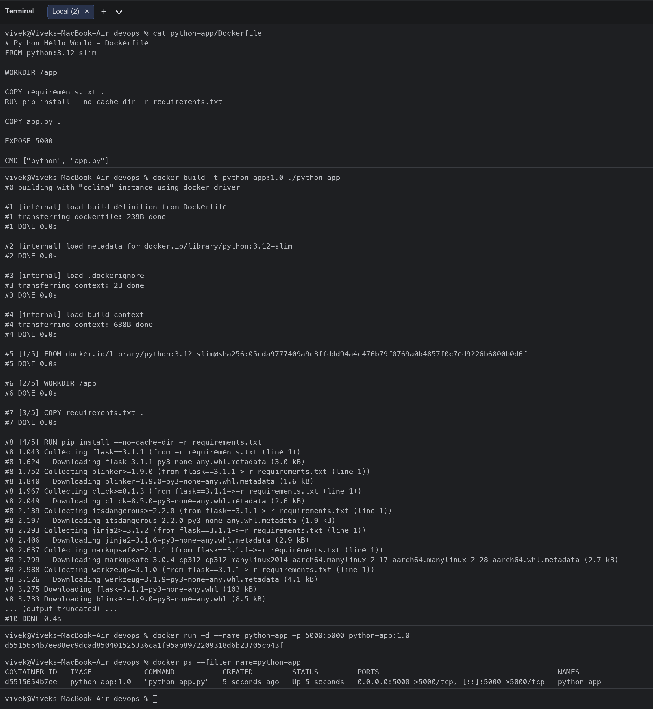
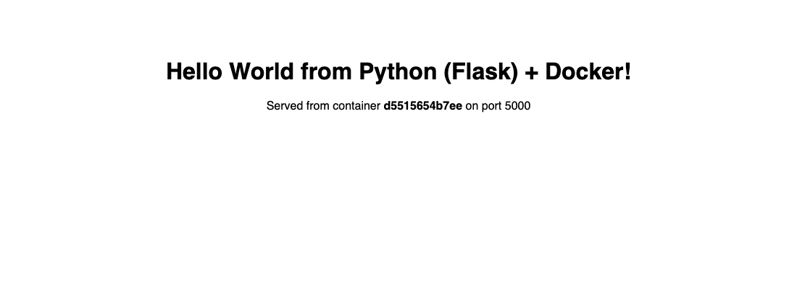
### Java (JDK HttpServer, multi-stage JDK -> JRE) - `java-app/`

Files: `Dockerfile`, `HelloWorldServer.java`

```bash
$ cat java-app/Dockerfile
# Java Hello World - multi-stage Dockerfile
# Stage 1: compile with the JDK
FROM eclipse-temurin:21-jdk-alpine AS build
WORKDIR /src
COPY HelloWorldServer.java .
RUN javac HelloWorldServer.java

# Stage 2: run with the smaller JRE image
FROM eclipse-temurin:21-jre-alpine
WORKDIR /app
COPY --from=build /src/HelloWorldServer.class .
EXPOSE 8080
CMD ["java", "HelloWorldServer"]
$ docker build -t java-app:1.0 ./java-app
#0 building with "colima" instance using docker driver

#1 [internal] load build definition from Dockerfile
#1 transferring dockerfile: 417B done
#1 DONE 0.0s

#2 [internal] load metadata for docker.io/library/eclipse-temurin:21-jdk-alpine
#2 DONE 2.3s

#3 [internal] load metadata for docker.io/library/eclipse-temurin:21-jre-alpine
#3 DONE 4.6s

#4 [internal] load .dockerignore
#4 transferring context: 2B done
#4 DONE 0.0s

#5 [internal] load build context
#5 transferring context: 1.72kB done
#5 DONE 0.0s

#6 [stage-1 1/3] FROM docker.io/library/eclipse-temurin:21-jre-alpine@sha256:51ab5e3302e7141ce665ca3ea85e8b5cd648eafbc3c0c90dd79d6537684e4555

#7 [build 1/4] FROM docker.io/library/eclipse-temurin:21-jdk-alpine@sha256:0bfc69a4758a86710e5c474032d28400a8bd00874766f9e8b1642ac2fd293159

#6 [stage-1 1/3] FROM docker.io/library/eclipse-temurin:21-jre-alpine@sha256:51ab5e3302e7141ce665ca3ea85e8b5cd648eafbc3c0c90dd79d6537684e4555

#7 [build 1/4] FROM docker.io/library/eclipse-temurin:21-jdk-alpine@sha256:0bfc69a4758a86710e5c474032d28400a8bd00874766f9e8b1642ac2fd293159
#7 DONE 82.0s

#8 [build 2/4] WORKDIR /src
#8 DONE 0.6s

#9 [build 3/4] COPY HelloWorldServer.java .
#9 DONE 0.0s

#10 [build 4/4] RUN javac HelloWorldServer.java
#10 DONE 0.3s

#6 [stage-1 1/3] FROM docker.io/library/eclipse-temurin:21-jre-alpine@sha256:51ab5e3302e7141ce665ca3ea85e8b5cd648eafbc3c0c90dd79d6537684e4555
#6 DONE 86.3s

#6 [stage-1 1/3] FROM docker.io/library/eclipse-temurin:21-jre-alpine@sha256:51ab5e3302e7141ce665ca3ea85e8b5cd648eafbc3c0c90dd79d6537684e4555
#6 DONE 86.3s

#11 [stage-1 2/3] WORKDIR /app
#11 DONE 0.1s

#12 [stage-1 3/3] COPY --from=build /src/HelloWorldServer.class .
#12 DONE 0.0s

#13 exporting to image
#13 exporting layers 0.0s done
#13 exporting manifest sha256:622da8ffd6d5a13732abbce601fc69669e4507d5ae84a7c3d00026be6050530b done
#13 exporting config sha256:fad75c957c19e95fdc7d35b83cf973c2dcc037d2ccb7b10345c4e7d9268da4a9 done
#13 exporting attestation manifest sha256:08aa482de9d1785e2725eccdb938df4b4566d0738af3efc661ba9f0d38bd4f1f done
#13 exporting manifest list sha256:060c82d5795541ef580313f565fa700084b64fc02a6fa800d83d72c92f6d8a65 done
#13 naming to docker.io/library/java-app:1.0 done
#13 unpacking to docker.io/library/java-app:1.0 0.0s done
#13 DONE 0.1s
$ docker run -d --name java-app -p 8080:8080 java-app:1.0
709cfcb7eef2a2bcc5645cb9df73bb727e6a3b134591fb30afe2c1f62f5f6230
$ docker ps --filter name=java-app
CONTAINER ID   IMAGE          COMMAND                  CREATED         STATUS         PORTS                                         NAMES
709cfcb7eef2   java-app:1.0   "/__cacert_entrypoin…"   5 seconds ago   Up 5 seconds   0.0.0.0:8080->8080/tcp, [::]:8080->8080/tcp   java-app
$ curl -s http://localhost:8080
<!DOCTYPE html>
<html>
  <head><title>Java Hello World</title></head>
  <body style="font-family: sans-serif; text-align: center; margin-top: 80px;">
    <h1>Hello World from Java + Docker!</h1>
    <p>Served by JDK HttpServer on container <b>709cfcb7eef2</b> (port 8080)</p>
  </body>
</html>
```

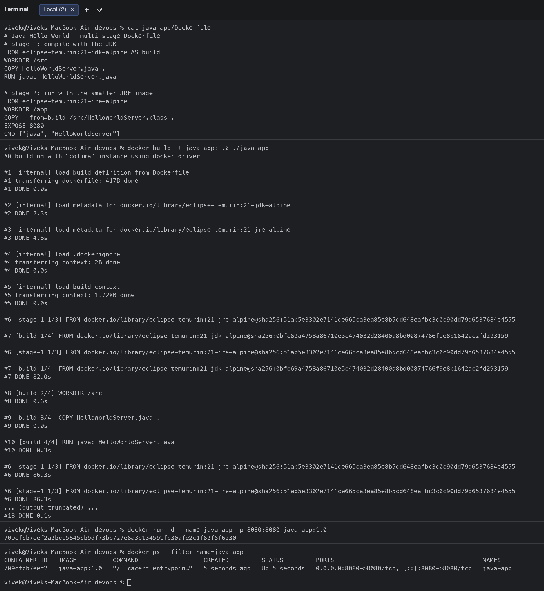
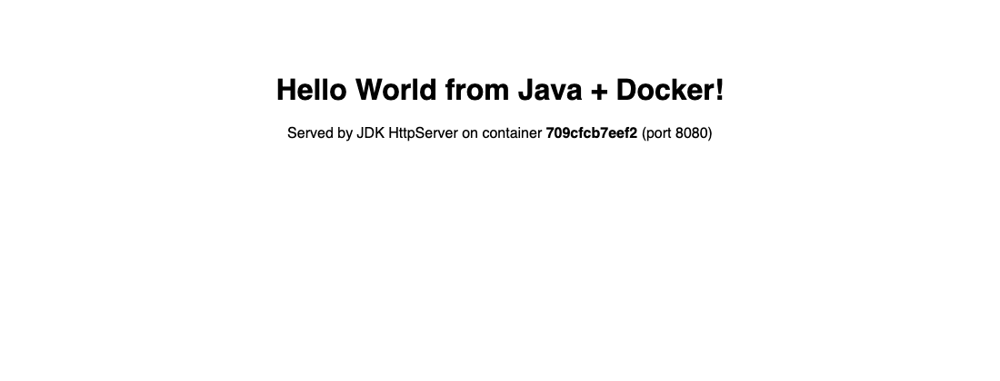
### Apache HTTP Server - `Apache-app/`

Files: `Dockerfile`, `index.html`

```bash
$ cat Apache-app/Dockerfile
# Apache HTTP Server Hello World - Dockerfile
FROM httpd:2.4-alpine

# Replace the default "It works!" page
COPY index.html /usr/local/apache2/htdocs/index.html

EXPOSE 80
$ docker build -t apache-app:1.0 ./Apache-app
#0 building with "colima" instance using docker driver

#1 [internal] load build definition from Dockerfile
#1 transferring dockerfile: 211B done
#1 DONE 0.0s

#2 [internal] load metadata for docker.io/library/httpd:2.4-alpine
#2 DONE 3.7s

#3 [internal] load .dockerignore
#3 transferring context: 2B done
#3 DONE 0.0s

#4 [internal] load build context
#4 transferring context: 318B done
#4 DONE 0.0s

#5 [1/2] FROM docker.io/library/httpd:2.4-alpine@sha256:3440c39d8d6f54fa9ad2549e5a60c19ddd435faadc29c1ad28aa795f71888889
#5 DONE 14.2s

#5 [1/2] FROM docker.io/library/httpd:2.4-alpine@sha256:3440c39d8d6f54fa9ad2549e5a60c19ddd435faadc29c1ad28aa795f71888889
#5 DONE 14.3s

#5 [1/2] FROM docker.io/library/httpd:2.4-alpine@sha256:3440c39d8d6f54fa9ad2549e5a60c19ddd435faadc29c1ad28aa795f71888889
#5 DONE 14.3s

#6 [2/2] COPY index.html /usr/local/apache2/htdocs/index.html
#6 DONE 0.1s

#7 exporting to image
#7 exporting layers 0.0s done
#7 exporting manifest sha256:e4d2179691b8df367701aad080012b9246ed8bec14ef5907e4221bc1ade560b9 done
#7 exporting config sha256:c2f72180b085566b0ca0070274016885ae8d6b5349adbb3fbc362d075cf6a66c done
#7 exporting attestation manifest sha256:bcd8ce8c89a0f1b110dba83a63a6a6cf3ac5a088c241a0dd50cc52eccd097803 done
#7 exporting manifest list sha256:349c29ca1d32d75c655ef5879c5afc3ae5cfe044a0bdec2417a6157d3b6b758d done
#7 naming to docker.io/library/apache-app:1.0 done
#7 unpacking to docker.io/library/apache-app:1.0 done
#7 DONE 0.0s
$ docker run -d --name apache-app -p 8081:80 apache-app:1.0
2aa49d0fbb41998c374f2e707c37e9a273e60dffc047b39ecd57834543388d73
$ docker ps --filter name=apache-app
CONTAINER ID   IMAGE            COMMAND              CREATED         STATUS         PORTS                                     NAMES
2aa49d0fbb41   apache-app:1.0   "httpd-foreground"   5 seconds ago   Up 5 seconds   0.0.0.0:8081->80/tcp, [::]:8081->80/tcp   apache-app
$ curl -s http://localhost:8081
<!DOCTYPE html>
<html>
  <head><title>Apache Hello World</title></head>
  <body style="font-family: sans-serif; text-align: center; margin-top: 80px;">
    <h1>Hello World from Apache HTTP Server + Docker!</h1>
    <p>Static page served by httpd on port 80</p>
  </body>
</html>
```

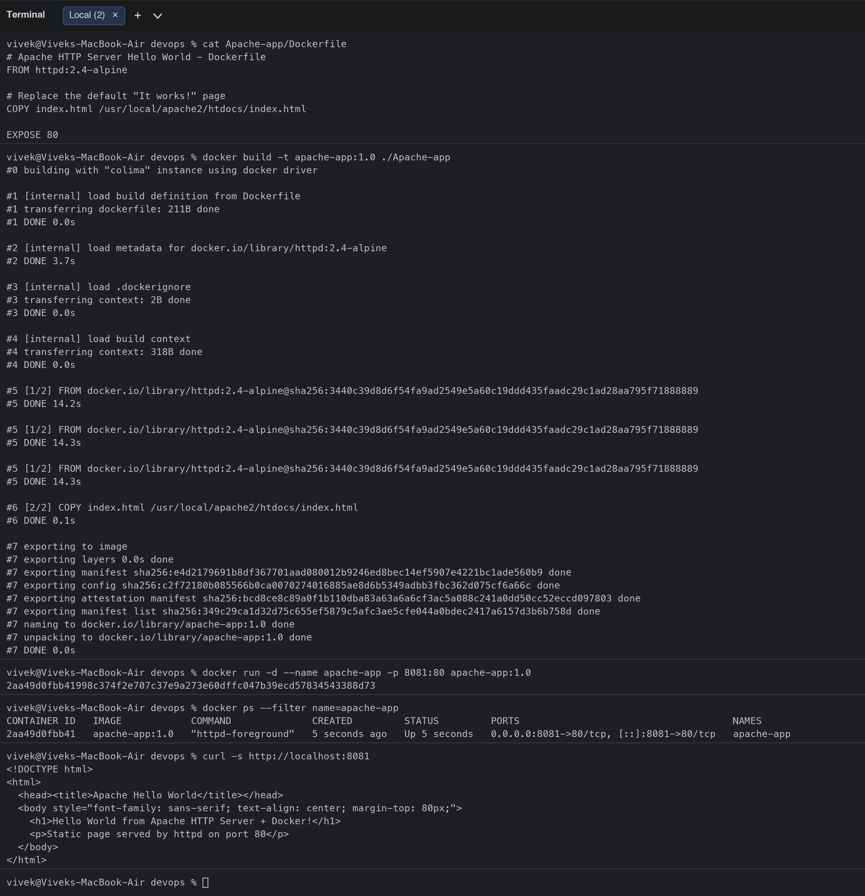
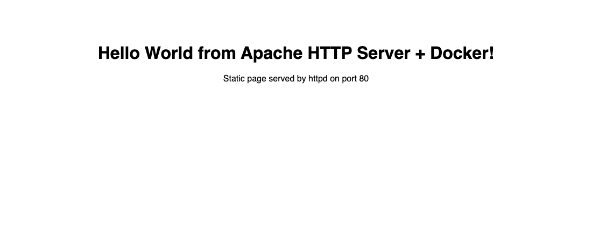
### React (Vite build, served by Nginx, multi-stage) - `React-app/`

Files: `Dockerfile`, `index.html`, `nginx.conf`, `package.json`, `public`, `src`, `vite.config.js`

```bash
$ cat React-app/Dockerfile
# React Hello World - multi-stage Dockerfile
# Stage 1: build the static bundle with Node + Vite
FROM node:24-alpine AS build
WORKDIR /app
COPY package.json ./
RUN npm install
COPY . .
RUN npm run build

# Stage 2: serve the static files with Nginx
FROM nginx:alpine
COPY --from=build /app/dist /usr/share/nginx/html
COPY nginx.conf /etc/nginx/conf.d/default.conf
EXPOSE 80
CMD ["nginx", "-g", "daemon off;"]
$ docker build -t react-app:1.0 ./React-app
#0 building with "colima" instance using docker driver

#1 [internal] load build definition from Dockerfile
#1 transferring dockerfile: 448B done
#1 DONE 0.0s

#2 [internal] load metadata for docker.io/library/nginx:alpine
#2 DONE 0.0s

#3 [internal] load metadata for docker.io/library/node:24-alpine
#3 DONE 0.0s

#4 [internal] load .dockerignore
#4 transferring context: 58B done
#4 DONE 0.0s

#5 [build 1/6] FROM docker.io/library/node:24-alpine@sha256:ebfe2f90462722a7a4de65e91990e97fe0d401c70e0e762c5b53302f905ec1c1
#5 DONE 0.0s

#6 [internal] load build context
#6 transferring context: 2.39kB done
#6 DONE 0.0s

#7 [stage-1 1/3] FROM docker.io/library/nginx:alpine@sha256:df221db836e1754089190208cee7eeda94f233197056426eda74a43ab1abeac2
#7 CACHED

#8 [build 2/6] WORKDIR /app
#8 CACHED

#9 [build 3/6] COPY package.json ./
#9 DONE 0.0s

#10 [build 4/6] RUN npm install
#10 50.20 
#10 50.20 added 64 packages, and audited 65 packages in 50s
#10 50.20 
#10 50.20 9 packages are looking for funding
#10 50.20   run `npm fund` for details
#10 50.20 
#10 50.20 found 0 vulnerabilities
#10 50.20 npm warn install-scripts 1 package has install scripts not yet covered by allowScripts:
#10 50.20 npm warn install-scripts   esbuild@0.25.12 (postinstall: node install.js)
#10 50.20 npm warn install-scripts
#10 50.20 npm warn install-scripts Run `npm install-scripts ls` to review, or `npm install-scripts approve <pkg>` to allow.
#10 50.20 npm notice
#10 50.20 npm notice New major version of npm available! 11.19.0 -> 12.2.0
#10 50.20 npm notice Changelog: https://github.com/npm/cli/releases/tag/v12.2.0
#10 50.20 npm notice To update run: npm install -g npm@12.2.0
#10 50.20 npm notice
#10 DONE 50.3s

#11 [build 5/6] COPY . .
#11 DONE 0.0s

#12 [build 6/6] RUN npm run build
#12 0.114 
#12 0.114 > react-hello-world@1.0.0 build
#12 0.114 > vite build
#12 0.114 
#12 0.202 vite v6.4.4 building for production...
#12 0.230 transforming...
#12 0.977 ✓ 28 modules transformed.
#12 1.035 rendering chunks...
#12 1.038 computing gzip size...
#12 1.043 dist/index.html                  0.33 kB │ gzip:  0.24 kB
#12 1.043 dist/assets/index-C4URpvw_.js  224.38 kB │ gzip: 69.78 kB
#12 1.043 ✓ built in 828ms
#12 DONE 1.1s

#13 [stage-1 2/3] COPY --from=build /app/dist /usr/share/nginx/html
#13 DONE 0.0s

#14 [stage-1 3/3] COPY nginx.conf /etc/nginx/conf.d/default.conf
#14 DONE 0.0s

#15 exporting to image
#15 exporting layers 0.0s done
#15 exporting manifest sha256:6277627c8a615dccbfc65e52b0de6dae4b1a4df9e5e47a6799665b6c4ac56e62 done
#15 exporting config sha256:51eb4eed18971f5aa32799f8f4abc34742697705c55f64d1acdcbc8adb492af2 done
#15 exporting attestation manifest sha256:df939884beba0975364806e872cd031cf8c14ce2341f659c041b0f659e06492e done
#15 exporting manifest list sha256:7e91b192669cb0efc768b2b8129336e347a8b32336625cd3e78ec185d960f47f done
#15 naming to docker.io/library/react-app:1.0 done
#15 unpacking to docker.io/library/react-app:1.0 0.0s done
#15 DONE 0.1s
$ docker run -d --name react-app -p 3001:80 react-app:1.0
012e680278049510b0112737ff4f61d6faab2f8277ce84a45383bfb7a2b4c6e2
$ docker ps --filter name=react-app
CONTAINER ID   IMAGE           COMMAND                  CREATED         STATUS         PORTS                                     NAMES
012e68027804   react-app:1.0   "/docker-entrypoint.…"   5 seconds ago   Up 5 seconds   0.0.0.0:3001->80/tcp, [::]:3001->80/tcp   react-app
$ curl -s http://localhost:3001
<!DOCTYPE html>
<html lang="en">
  <head>
    <meta charset="UTF-8" />
    <meta name="viewport" content="width=device-width, initial-scale=1.0" />
    <title>React Hello World</title>
    <script type="module" crossorigin src="/assets/index-C4URpvw_.js"></script>
  </head>
  <body>
    <div id="root"></div>
  </body>
</html>
```

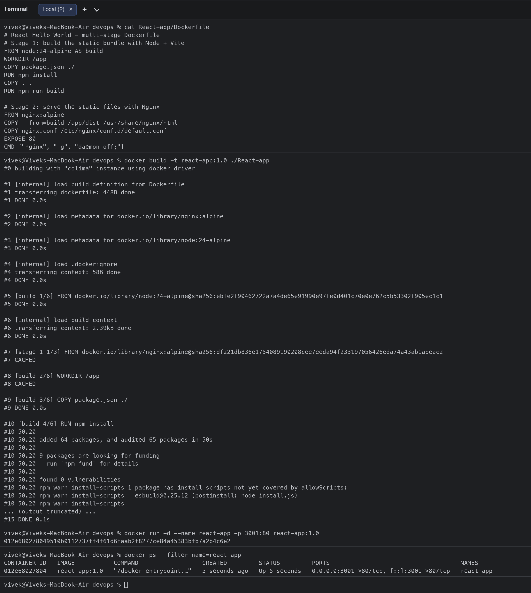
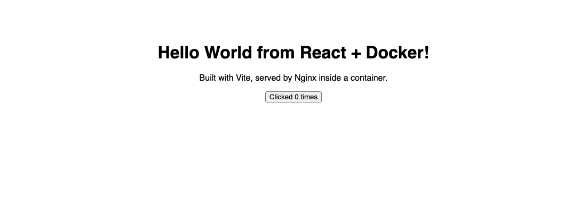
### Nginx - `nginx-app/`

Files: `Dockerfile`, `index.html`

```bash
$ cat nginx-app/Dockerfile
# Nginx Hello World - Dockerfile
FROM nginx:alpine

COPY index.html /usr/share/nginx/html/index.html

EXPOSE 80

CMD ["nginx", "-g", "daemon off;"]
$ docker build -t nginx-app:1.0 ./nginx-app
#0 building with "colima" instance using docker driver

#1 [internal] load build definition from Dockerfile
#1 transferring dockerfile: 187B done
#1 DONE 0.0s

#2 [internal] load metadata for docker.io/library/nginx:alpine
#2 DONE 2.6s

#3 [internal] load .dockerignore
#3 transferring context: 2B done
#3 DONE 0.0s

#4 [internal] load build context
#4 transferring context: 304B done
#4 DONE 0.0s

#5 [1/2] FROM docker.io/library/nginx:alpine@sha256:df221db836e1754089190208cee7eeda94f233197056426eda74a43ab1abeac2
#5 DONE 33.5s

#5 [1/2] FROM docker.io/library/nginx:alpine@sha256:df221db836e1754089190208cee7eeda94f233197056426eda74a43ab1abeac2
#5 DONE 33.7s

#6 [2/2] COPY index.html /usr/share/nginx/html/index.html
#6 DONE 0.1s

#7 exporting to image
#7 exporting layers 0.0s done
#7 exporting manifest sha256:6dc0532c685331869918d00e6f59c2c58ef0139ce3ed515df872fcc305409696 done
#7 exporting config sha256:8742078655a3c81aed862aea71f0d0e55a001855944f469a5d43d60a4a30d13a done
#7 exporting attestation manifest sha256:4c6ba281957c426915f29a7e59ccd5b84255ba9ba5aad9d9f6b3dd097c6ef64f done
#7 exporting manifest list sha256:080c730738ffb241a94fcca9e57e3c799630be3c4160d7964937aac22db23df3 done
#7 naming to docker.io/library/nginx-app:1.0 done
#7 unpacking to docker.io/library/nginx-app:1.0 done
#7 DONE 0.0s
$ docker run -d --name nginx-app -p 8082:80 nginx-app:1.0
60426b994eb0cbf29b61560a2c42fdba43ce0806c524a3b29091b37581af8703
$ docker ps --filter name=nginx-app
CONTAINER ID   IMAGE           COMMAND                  CREATED         STATUS         PORTS                                     NAMES
60426b994eb0   nginx-app:1.0   "/docker-entrypoint.…"   6 seconds ago   Up 5 seconds   0.0.0.0:8082->80/tcp, [::]:8082->80/tcp   nginx-app
$ curl -s http://localhost:8082
<!DOCTYPE html>
<html>
  <head><title>Nginx Hello World</title></head>
  <body style="font-family: sans-serif; text-align: center; margin-top: 80px;">
    <h1>Hello World from Nginx + Docker!</h1>
    <p>Static page served by nginx on port 80</p>
  </body>
</html>
```

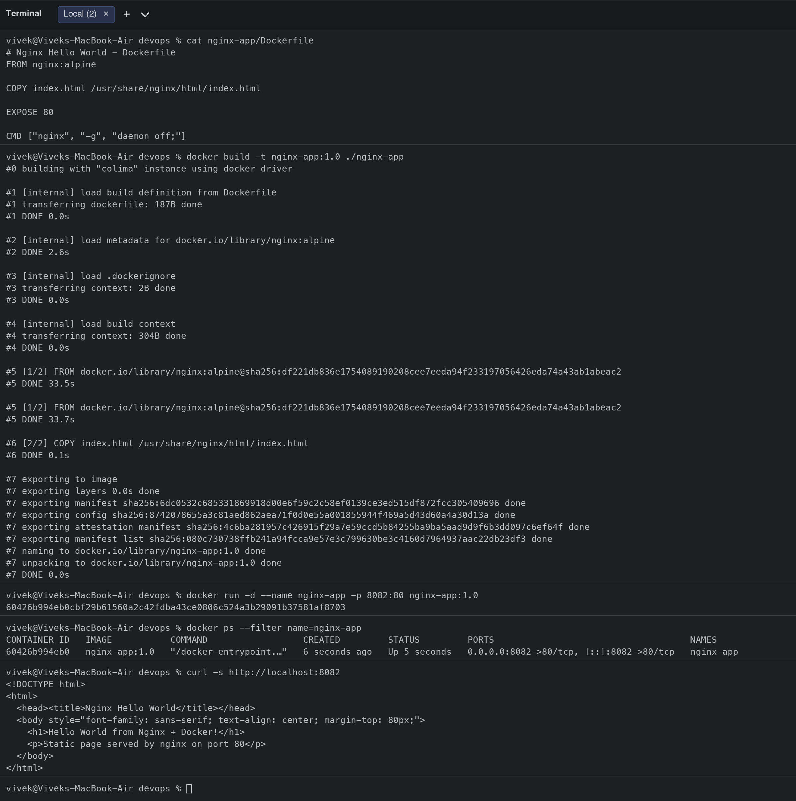
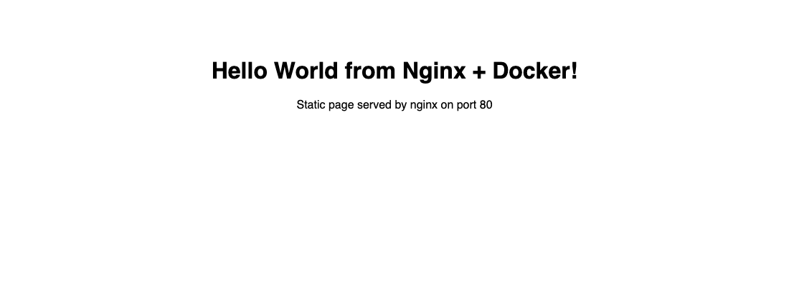


## Browser verification (headless Chrome screenshots of each page)

| Node.js | Python |
|---|---|
|  |  |

| Java | Apache |
|---|---|
|  |  |

| React | Nginx |
|---|---|
|  |  |

## What I learned
- `WORKDIR`, `COPY`, `RUN`, `EXPOSE`, `CMD` are the core Dockerfile instructions; copying `package.json`/`requirements.txt` before the source code lets Docker cache the dependency layer.
- `-p HOST:CONTAINER` maps a port on my machine to the port the process listens on inside the container (e.g. `8081:80` for Apache).
- Multi-stage builds (Java and React) compile in a big image (JDK / Node) and copy only the result into a small runtime image (JRE / Nginx), which is why `react-app` is 93 MB instead of 300+ MB.
- `docker ps`, `docker images`, `docker logs <name>` and `curl localhost:<port>` are the quickest ways to verify a running web container.

## Clean-up

```bash
docker rm -f nodejs-app python-app java-app apache-app nginx-app react-app
docker rmi nodejs-app:1.0 python-app:1.0 java-app:1.0 apache-app:1.0 nginx-app:1.0 react-app:1.0
```
