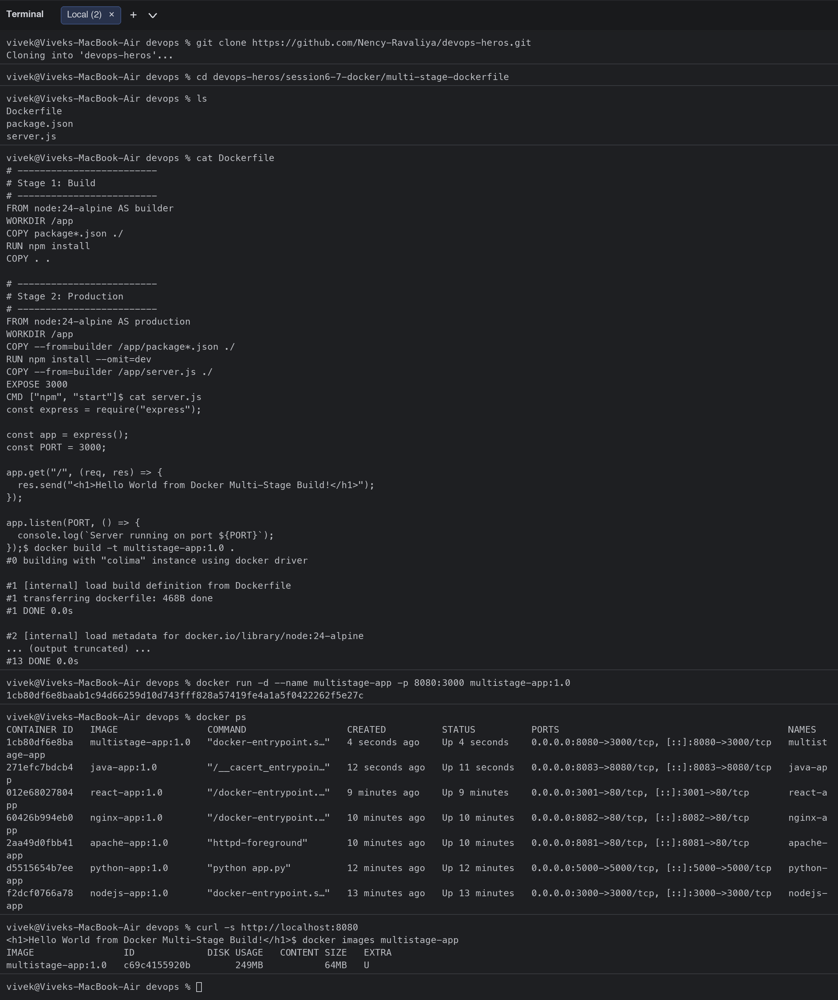
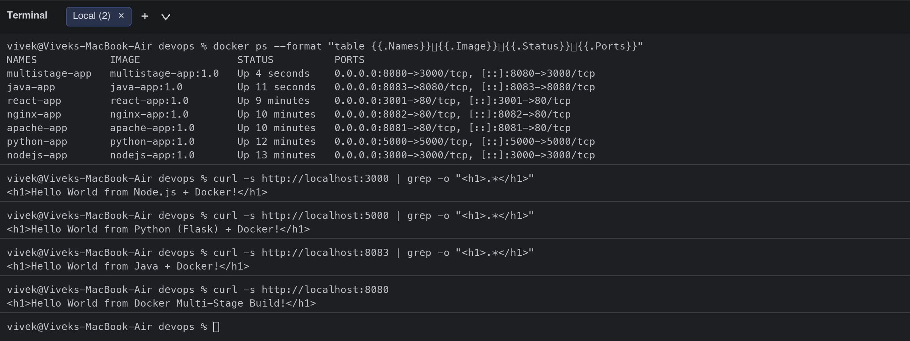

# Session 7: Docker Images - Multi-Stage Build

| | |
|---|---|
| **Name** | Vivek Singh Solanki |
| **Enrollment number** | 24bcs10338 |
| **Course** | DevOps (devops-heros) |

## Task 1: Run the multi-stage Dockerfile

Steps performed:
1. Cloned the course repository that contains the multi-stage Dockerfile (`session6-7-docker/multi-stage-dockerfile`). A copy of the application is kept in [`multi-stage-app/`](multi-stage-app/).
2. Built the image with `docker build -t multistage-app:1.0 .`
3. Ran a container with `docker run -d --name multistage-app -p 8080:3000 multistage-app:1.0` (the Node app listens on 3000 inside the container; port **8080** on my machine is mapped to it).
4. Opened http://localhost:8080 and verified the page shows **Hello World from Docker Multi-Stage Build!**
5. Verified with `docker ps` that the container is running and bound to `0.0.0.0:8080->3000/tcp`.

### How the multi-stage Dockerfile works

```text
Stage 1 "builder"  (node:24-alpine)          Stage 2 "production" (node:24-alpine)
  WORKDIR /app                                  WORKDIR /app
  COPY package*.json  -> npm install            COPY --from=builder package*.json
  COPY . .            (all sources + devDeps)   RUN npm install --omit=dev   (prod deps only)
                                                COPY --from=builder server.js
                                                EXPOSE 3000 / CMD npm start
```
Only the files copied with `COPY --from=builder` end up in the final image, so build tools, tests and dev dependencies never ship to production. The final image is 249 MB on disk (64 MB content) instead of carrying the whole build context.

### Commands and output

```bash
$ git clone https://github.com/Nency-Ravaliya/devops-heros.git
Cloning into 'devops-heros'...
$ cd devops-heros/session6-7-docker/multi-stage-dockerfile
$ ls
Dockerfile
package.json
server.js
$ cat Dockerfile
# -------------------------
# Stage 1: Build
# -------------------------
FROM node:24-alpine AS builder
WORKDIR /app
COPY package*.json ./
RUN npm install
COPY . .

# -------------------------
# Stage 2: Production
# -------------------------
FROM node:24-alpine AS production
WORKDIR /app
COPY --from=builder /app/package*.json ./
RUN npm install --omit=dev
COPY --from=builder /app/server.js ./
EXPOSE 3000
CMD ["npm", "start"]$ cat server.js
const express = require("express");

const app = express();
const PORT = 3000;

app.get("/", (req, res) => {
  res.send("<h1>Hello World from Docker Multi-Stage Build!</h1>");
});

app.listen(PORT, () => {
  console.log(`Server running on port ${PORT}`);
});$ docker build -t multistage-app:1.0 .
#0 building with "colima" instance using docker driver

#1 [internal] load build definition from Dockerfile
#1 transferring dockerfile: 468B done
#1 DONE 0.0s

#2 [internal] load metadata for docker.io/library/node:24-alpine
#2 DONE 0.0s

#3 [internal] load .dockerignore
#3 transferring context: 2B done
#3 DONE 0.0s

#4 [builder 1/5] FROM docker.io/library/node:24-alpine@sha256:ebfe2f90462722a7a4de65e91990e97fe0d401c70e0e762c5b53302f905ec1c1
#4 DONE 0.0s

#5 [internal] load build context
#5 transferring context: 987B done
#5 DONE 0.0s

#6 [production 4/5] RUN npm install --omit=dev
#6 CACHED

#7 [builder 5/5] COPY . .
#7 CACHED

#8 [builder 3/5] COPY package*.json ./
#8 CACHED

#9 [builder 4/5] RUN npm install
#9 CACHED

#10 [builder 2/5] WORKDIR /app
#10 CACHED

#11 [production 3/5] COPY --from=builder /app/package*.json ./
#11 CACHED

#12 [production 5/5] COPY --from=builder /app/server.js ./
#12 CACHED

#13 exporting to image
#13 exporting layers done
#13 exporting manifest sha256:4e03d37623b16e253b23f23062063261ea0394860f1447c8411ef8b4aec157ba done
#13 exporting config sha256:dfa3f2440673dac0a4ca5ee679c39f7c81dc48e7a2866f33091a0f9654bab4ba done
#13 exporting attestation manifest sha256:b767ceb7bd3f32877b11bae56a0dadff3d321f5481e1ce152e1da4c32e646468 done
#13 exporting manifest list sha256:c69c4155920b000dd6f74aaeac277e40bb6890fdd735b34c6d6884bf6e23fcb4 done
#13 naming to docker.io/library/multistage-app:1.0 done
#13 unpacking to docker.io/library/multistage-app:1.0 done
#13 DONE 0.0s
$ docker run -d --name multistage-app -p 8080:3000 multistage-app:1.0
1cb80df6e8baab1c94d66259d10d743fff828a57419fe4a1a5f0422262f5e27c
$ docker ps
CONTAINER ID   IMAGE                COMMAND                  CREATED          STATUS          PORTS                                         NAMES
1cb80df6e8ba   multistage-app:1.0   "docker-entrypoint.s…"   4 seconds ago    Up 4 seconds    0.0.0.0:8080->3000/tcp, [::]:8080->3000/tcp   multistage-app
271efc7bdcb4   java-app:1.0         "/__cacert_entrypoin…"   12 seconds ago   Up 11 seconds   0.0.0.0:8083->8080/tcp, [::]:8083->8080/tcp   java-app
012e68027804   react-app:1.0        "/docker-entrypoint.…"   9 minutes ago    Up 9 minutes    0.0.0.0:3001->80/tcp, [::]:3001->80/tcp       react-app
60426b994eb0   nginx-app:1.0        "/docker-entrypoint.…"   10 minutes ago   Up 10 minutes   0.0.0.0:8082->80/tcp, [::]:8082->80/tcp       nginx-app
2aa49d0fbb41   apache-app:1.0       "httpd-foreground"       10 minutes ago   Up 10 minutes   0.0.0.0:8081->80/tcp, [::]:8081->80/tcp       apache-app
d5515654b7ee   python-app:1.0       "python app.py"          12 minutes ago   Up 12 minutes   0.0.0.0:5000->5000/tcp, [::]:5000->5000/tcp   python-app
f2dcf0766a78   nodejs-app:1.0       "docker-entrypoint.s…"   13 minutes ago   Up 13 minutes   0.0.0.0:3000->3000/tcp, [::]:3000->3000/tcp   nodejs-app
$ curl -s http://localhost:8080
<h1>Hello World from Docker Multi-Stage Build!</h1>$ docker images multistage-app
IMAGE                ID             DISK USAGE   CONTENT SIZE   EXTRA
multistage-app:1.0   c69c4155920b        249MB           64MB   U    
$ docker logs multistage-app

> docker-hello-world@1.0.0 start
> node server.js

Server running on port 3000
```



## Task 2: Evidence

**Application running on port 8080 (browser):**


**`docker ps` showing the container on port 8080** (see the `docker ps` block above and the screenshot). The relevant line:

```text
1cb80df6e8ba   multistage-app:1.0   "docker-entrypoint.s…"   Up 4 seconds   0.0.0.0:8080->3000/tcp, [::]:8080->3000/tcp   multistage-app
```

## Task 3: Deploy 3 different types of applications with Docker

Three application types (plus the multi-stage app) are running at the same time, each built from its own Dockerfile in [Session 6](../session-06-docker-fundamentals/):

| Type | Image | Port | Source |
|---|---|---|---|
| Node.js (Express) | `nodejs-app:1.0` | 3000 | `../session-06-docker-fundamentals/nodejs-app` |
| Python (Flask) | `python-app:1.0` | 5000 | `../session-06-docker-fundamentals/python-app` |
| Java (JDK HttpServer) | `java-app:1.0` | 8083 | `../session-06-docker-fundamentals/java-app` |
| Node.js multi-stage | `multistage-app:1.0` | 8080 | `multi-stage-app/` |

```bash
$ docker ps --format "table {{.Names}}	{{.Image}}	{{.Status}}	{{.Ports}}"
NAMES            IMAGE                STATUS          PORTS
multistage-app   multistage-app:1.0   Up 4 seconds    0.0.0.0:8080->3000/tcp, [::]:8080->3000/tcp
java-app         java-app:1.0         Up 11 seconds   0.0.0.0:8083->8080/tcp, [::]:8083->8080/tcp
react-app        react-app:1.0        Up 9 minutes    0.0.0.0:3001->80/tcp, [::]:3001->80/tcp
nginx-app        nginx-app:1.0        Up 10 minutes   0.0.0.0:8082->80/tcp, [::]:8082->80/tcp
apache-app       apache-app:1.0       Up 10 minutes   0.0.0.0:8081->80/tcp, [::]:8081->80/tcp
python-app       python-app:1.0       Up 12 minutes   0.0.0.0:5000->5000/tcp, [::]:5000->5000/tcp
nodejs-app       nodejs-app:1.0       Up 13 minutes   0.0.0.0:3000->3000/tcp, [::]:3000->3000/tcp
$ curl -s http://localhost:3000 | grep -o "<h1>.*</h1>"
<h1>Hello World from Node.js + Docker!</h1>
$ curl -s http://localhost:5000 | grep -o "<h1>.*</h1>"
<h1>Hello World from Python (Flask) + Docker!</h1>
$ curl -s http://localhost:8083 | grep -o "<h1>.*</h1>"
<h1>Hello World from Java + Docker!</h1>
$ curl -s http://localhost:8080
<h1>Hello World from Docker Multi-Stage Build!</h1>
```



## Clean-up

```bash
docker rm -f multistage-app
docker rmi multistage-app:1.0
```
