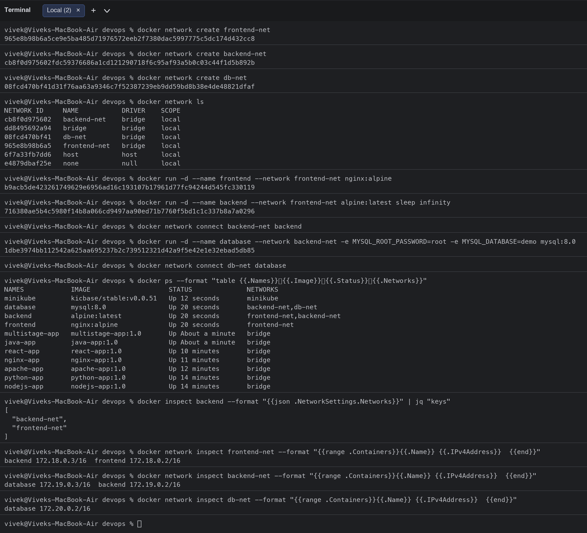
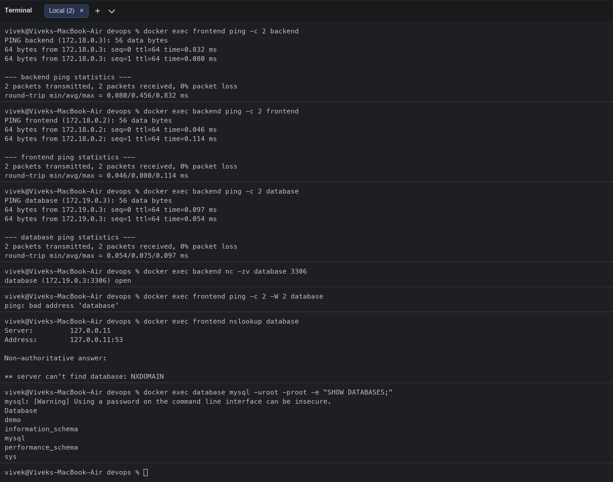
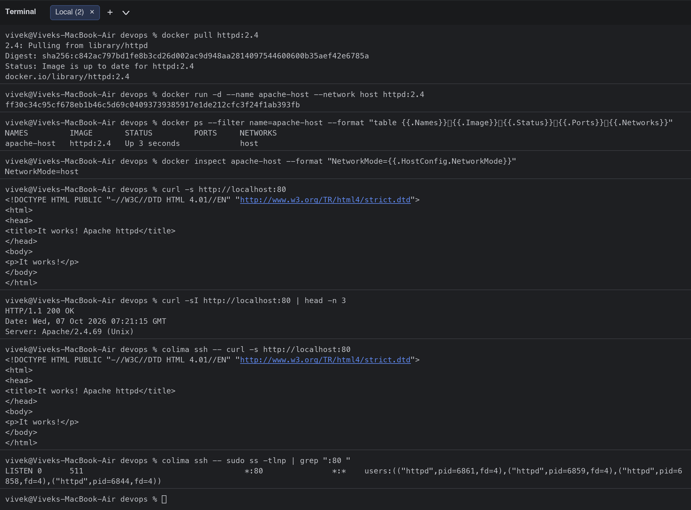
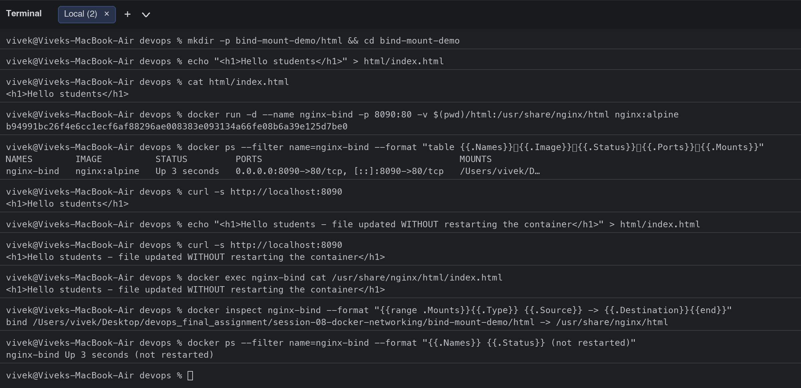
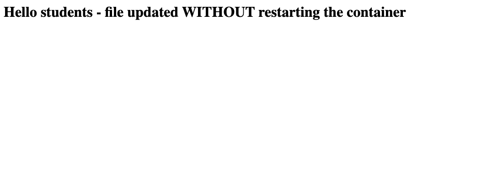

# Session 8: Docker Networking & Volumes

**Student:** Vivek Singh Solanki | **Roll number:** 24bcs10338

## Task 1: Docker container networking (3 containers, 3 networks)

Design:

```text
 frontend-net                backend-net               db-net
+-------------------+     +-------------------+     +-----------+
| frontend (nginx)  |     |                   |     |           |
| backend  (alpine) |-----| backend (alpine)  |     | database  |
+-------------------+     | database (mysql)  |-----| (mysql)   |
                          +-------------------+     +-----------+
```

- `frontend` (nginx:alpine) is only on **frontend-net**.
- `backend` (alpine) is on **two** networks: `frontend-net` and `backend-net`, so it can talk to both sides.
- `database` (mysql:8.0) is on `backend-net` (and the extra `db-net`), never on the frontend network.

### Commands and output

```bash
$ docker network create frontend-net
965e8b98b6a5ce9e5ba485d71976572eeb2f7380dac5997775c5dc174d432cc8
$ docker network create backend-net
cb8f0d975602fdc59376686a1cd121290718f6c95af93a5b0c03c44f1d5b892b
$ docker network create db-net
08fcd470bf41d31f76aa63a9346c7f52387239eb9dd59bd8b38e4de48821dfaf
$ docker network ls
NETWORK ID     NAME           DRIVER    SCOPE
cb8f0d975602   backend-net    bridge    local
dd8495692a94   bridge         bridge    local
08fcd470bf41   db-net         bridge    local
965e8b98b6a5   frontend-net   bridge    local
6f7a33fb7dd6   host           host      local
e4879dbaf25e   none           null      local
$ docker run -d --name frontend --network frontend-net nginx:alpine
b9acb5de423261749629e6956ad16c193107b17961d77fc94244d545fc330119
$ docker run -d --name backend --network frontend-net alpine:latest sleep infinity
716380ae5b4c5980f14b8a066cd9497aa90ed71b7760f5bd1c1c337b8a7a0296
$ docker network connect backend-net backend
$ docker run -d --name database --network backend-net -e MYSQL_ROOT_PASSWORD=root -e MYSQL_DATABASE=demo mysql:8.0
1dbe3974bb112542a625aa695237b2c739512321d42a9f5e42e1e32ebad5db85
$ docker network connect db-net database
$ docker ps --format "table {{.Names}}	{{.Image}}	{{.Status}}	{{.Networks}}"
NAMES            IMAGE                    STATUS              NETWORKS
minikube         kicbase/stable:v0.0.51   Up 12 seconds       minikube
database         mysql:8.0                Up 20 seconds       backend-net,db-net
backend          alpine:latest            Up 20 seconds       frontend-net,backend-net
frontend         nginx:alpine             Up 20 seconds       frontend-net
multistage-app   multistage-app:1.0       Up About a minute   bridge
java-app         java-app:1.0             Up About a minute   bridge
react-app        react-app:1.0            Up 10 minutes       bridge
nginx-app        nginx-app:1.0            Up 11 minutes       bridge
apache-app       apache-app:1.0           Up 12 minutes       bridge
python-app       python-app:1.0           Up 14 minutes       bridge
nodejs-app       nodejs-app:1.0           Up 14 minutes       bridge
$ docker inspect backend --format "{{json .NetworkSettings.Networks}}" | jq "keys"
[
  "backend-net",
  "frontend-net"
]
$ docker network inspect frontend-net --format "{{range .Containers}}{{.Name}} {{.IPv4Address}}  {{end}}"
backend 172.18.0.3/16  frontend 172.18.0.2/16  
$ docker network inspect backend-net --format "{{range .Containers}}{{.Name}} {{.IPv4Address}}  {{end}}"
database 172.19.0.3/16  backend 172.19.0.2/16  
$ docker network inspect db-net --format "{{range .Containers}}{{.Name}} {{.IPv4Address}}  {{end}}"
database 172.20.0.2/16
```

### Connectivity checks

```bash
$ docker exec frontend ping -c 2 backend
PING backend (172.18.0.3): 56 data bytes
64 bytes from 172.18.0.3: seq=0 ttl=64 time=0.832 ms
64 bytes from 172.18.0.3: seq=1 ttl=64 time=0.080 ms

--- backend ping statistics ---
2 packets transmitted, 2 packets received, 0% packet loss
round-trip min/avg/max = 0.080/0.456/0.832 ms
$ docker exec backend ping -c 2 frontend
PING frontend (172.18.0.2): 56 data bytes
64 bytes from 172.18.0.2: seq=0 ttl=64 time=0.046 ms
64 bytes from 172.18.0.2: seq=1 ttl=64 time=0.114 ms

--- frontend ping statistics ---
2 packets transmitted, 2 packets received, 0% packet loss
round-trip min/avg/max = 0.046/0.080/0.114 ms
$ docker exec backend ping -c 2 database
PING database (172.19.0.3): 56 data bytes
64 bytes from 172.19.0.3: seq=0 ttl=64 time=0.097 ms
64 bytes from 172.19.0.3: seq=1 ttl=64 time=0.054 ms

--- database ping statistics ---
2 packets transmitted, 2 packets received, 0% packet loss
round-trip min/avg/max = 0.054/0.075/0.097 ms
$ docker exec backend nc -zv database 3306
database (172.19.0.3:3306) open
$ docker exec frontend ping -c 2 -W 2 database
ping: bad address 'database'
$ docker exec frontend nslookup database
Server:		127.0.0.11
Address:	127.0.0.11:53

Non-authoritative answer:

** server can't find database: NXDOMAIN

$ docker exec database mysql -uroot -proot -e "SHOW DATABASES;"
mysql: [Warning] Using a password on the command line interface can be insecure.
Database
demo
information_schema
mysql
performance_schema
sys
```

**Observations**
- Containers on the same user-defined network resolve each other **by name** through Docker's embedded DNS (`127.0.0.11`): `frontend -> backend` and `backend -> database` work, and port 3306 on the database is open from the backend.
- `frontend -> database` fails with `bad address` / `NXDOMAIN` because they do not share a network. This is network-level isolation: the frontend can only reach the backend, exactly like a real 3-tier architecture.
- The backend has two IPs (`172.18.0.3` on frontend-net and `172.19.x` on backend-net), one per network it is attached to.




## Task 2: Host network (Apache2)

```bash
$ docker pull httpd:2.4
2.4: Pulling from library/httpd
Digest: sha256:c842ac797bd1fe8b3cd26d002ac9d948aa2814097544600600b35aef42e6785a
Status: Image is up to date for httpd:2.4
docker.io/library/httpd:2.4
$ docker run -d --name apache-host --network host httpd:2.4
ff30c34c95cf678eb1b46c5d69c04093739385917e1de212cfc3f24f1ab393fb
$ docker ps --filter name=apache-host --format "table {{.Names}}	{{.Image}}	{{.Status}}	{{.Ports}}	{{.Networks}}"
NAMES         IMAGE       STATUS         PORTS     NETWORKS
apache-host   httpd:2.4   Up 3 seconds             host
$ docker inspect apache-host --format "NetworkMode={{.HostConfig.NetworkMode}}"
NetworkMode=host
$ curl -s http://localhost:80
<!DOCTYPE HTML PUBLIC "-//W3C//DTD HTML 4.01//EN" "http://www.w3.org/TR/html4/strict.dtd">
<html>
<head>
<title>It works! Apache httpd</title>
</head>
<body>
<p>It works!</p>
</body>
</html>
$ curl -sI http://localhost:80 | head -n 3
HTTP/1.1 200 OK
Date: Wed, 07 Oct 2026 07:21:15 GMT
Server: Apache/2.4.69 (Unix)
$ colima ssh -- curl -s http://localhost:80
<!DOCTYPE HTML PUBLIC "-//W3C//DTD HTML 4.01//EN" "http://www.w3.org/TR/html4/strict.dtd">
<html>
<head>
<title>It works! Apache httpd</title>
</head>
<body>
<p>It works!</p>
</body>
</html>
$ colima ssh -- sudo ss -tlnp | grep ":80 "
LISTEN 0      511                                   *:80               *:*    users:(("httpd",pid=6861,fd=4),("httpd",pid=6859,fd=4),("httpd",pid=6858,fd=4),("httpd",pid=6844,fd=4))
```

**Observations**
- With `--network host` the container shares the Docker host's network namespace, so there is **no port mapping** (the `PORTS` column is empty) and Apache listens directly on port 80 of the host (`ss -tlnp` inside the VM shows `httpd` on `*:80`).
- `curl http://localhost:80` returns Apache's "It works!" page. On macOS the Docker host is the Colima Linux VM, and Colima forwards the VM's listening ports to my Mac, so the page is reachable from the Mac as well.
- Host networking is fast and simple but gives up isolation: two containers cannot both use port 80.




## Task 3: Bind mount

Folder on my machine: [`bind-mount-demo/html/`](bind-mount-demo/html/) containing `index.html`.

```bash
$ mkdir -p bind-mount-demo/html && cd bind-mount-demo
$ echo "<h1>Hello students</h1>" > html/index.html
$ cat html/index.html
<h1>Hello students</h1>
$ docker run -d --name nginx-bind -p 8090:80 -v $(pwd)/html:/usr/share/nginx/html nginx:alpine
b94991bc26f4e6cc1ecf6af88296ae008383e093134a66fe08b6a39e125d7be0
$ docker ps --filter name=nginx-bind --format "table {{.Names}}	{{.Image}}	{{.Status}}	{{.Ports}}	{{.Mounts}}"
NAMES        IMAGE          STATUS         PORTS                                     MOUNTS
nginx-bind   nginx:alpine   Up 3 seconds   0.0.0.0:8090->80/tcp, [::]:8090->80/tcp   /Users/vivek/D…
$ curl -s http://localhost:8090
<h1>Hello students</h1>
$ echo "<h1>Hello students - file updated WITHOUT restarting the container</h1>" > html/index.html
$ curl -s http://localhost:8090
<h1>Hello students - file updated WITHOUT restarting the container</h1>
$ docker exec nginx-bind cat /usr/share/nginx/html/index.html
<h1>Hello students - file updated WITHOUT restarting the container</h1>
$ docker inspect nginx-bind --format "{{range .Mounts}}{{.Type}} {{.Source}} -> {{.Destination}}{{end}}"
bind /Users/vivek/Desktop/devops_final_assignment/session-08-docker-networking/bind-mount-demo/html -> /usr/share/nginx/html
$ docker ps --filter name=nginx-bind --format "{{.Names}} {{.Status}} (not restarted)"
nginx-bind Up 3 seconds (not restarted)
```

**Observations**
- `-v $(pwd)/html:/usr/share/nginx/html` mounts my local folder into the container (type `bind`), so Nginx serves my file directly.
- After editing `index.html` on the host, the next `curl` immediately returned the new content. The container was **not restarted** (`Up 3 seconds`, same container ID), because a bind mount is the same directory, not a copy.
- Bind mounts are ideal for local development; named volumes (`docker volume create`) are preferred for persistent data such as databases.




## Task 4: Overlay network (research)

See [overlay-network/README.md](overlay-network/README.md) for what an overlay network is, its use cases and how it works across multiple Docker hosts (VXLAN, Swarm control plane, required ports, routing mesh, encrypted overlay).

## Network drivers summary

| Driver | Scope | Use case |
|---|---|---|
| `bridge` (default / user-defined) | single host | isolated app networks with DNS by container name |
| `host` | single host | no isolation, max performance, container uses host ports |
| `none` | single host | fully isolated container (no network) |
| `overlay` | multi-host (Swarm) | containers on different hosts talk on one virtual network |
| `macvlan` | single host | container gets its own MAC/IP on the physical LAN |

## Clean-up

```bash
docker rm -f frontend backend database apache-host nginx-bind
docker network rm frontend-net backend-net db-net
```
