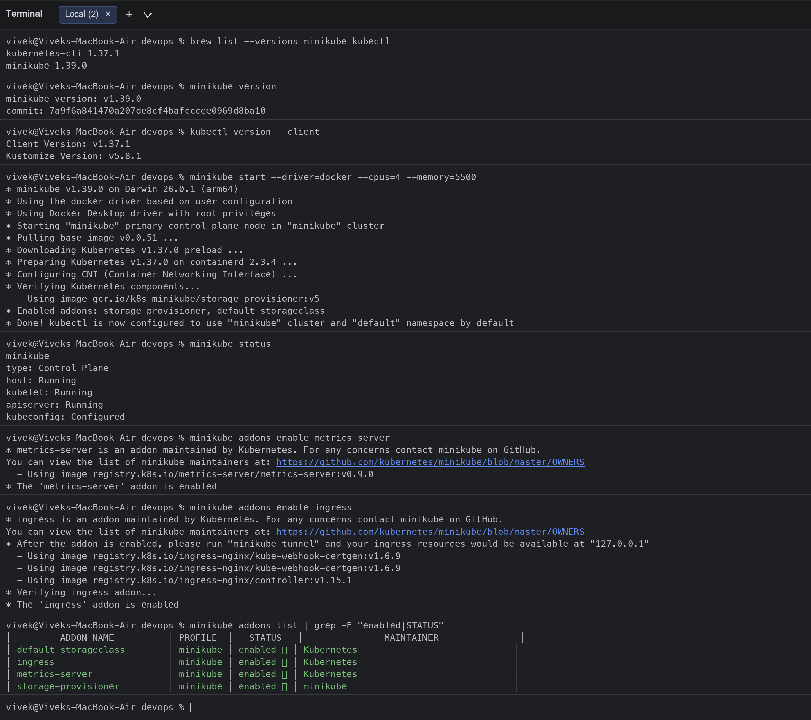
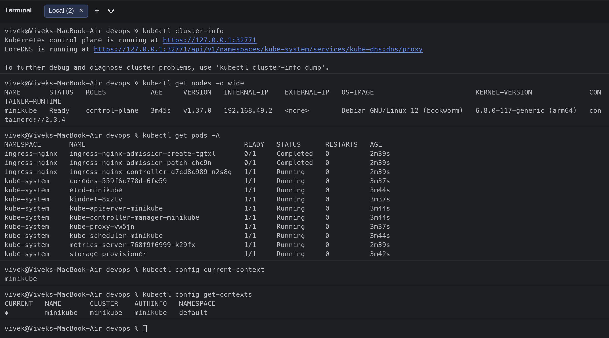
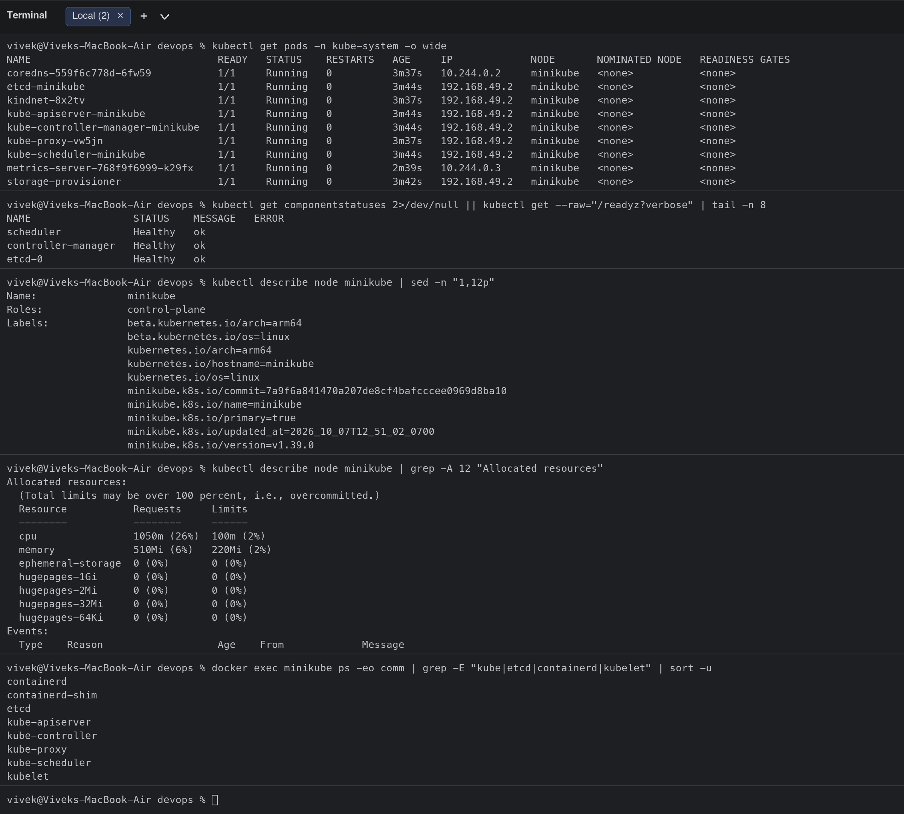
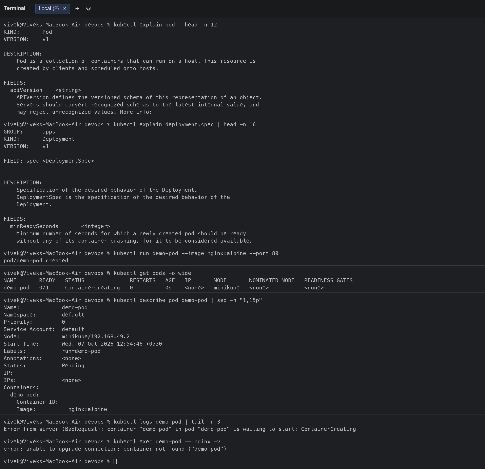
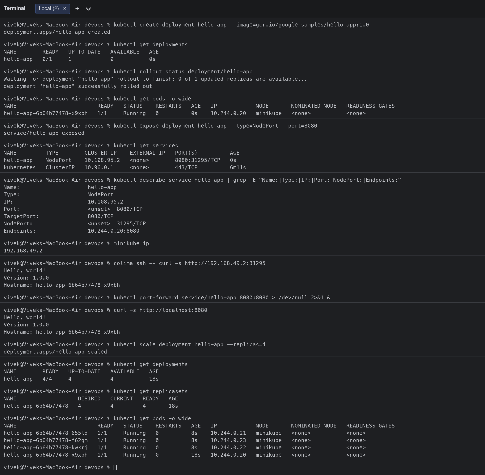
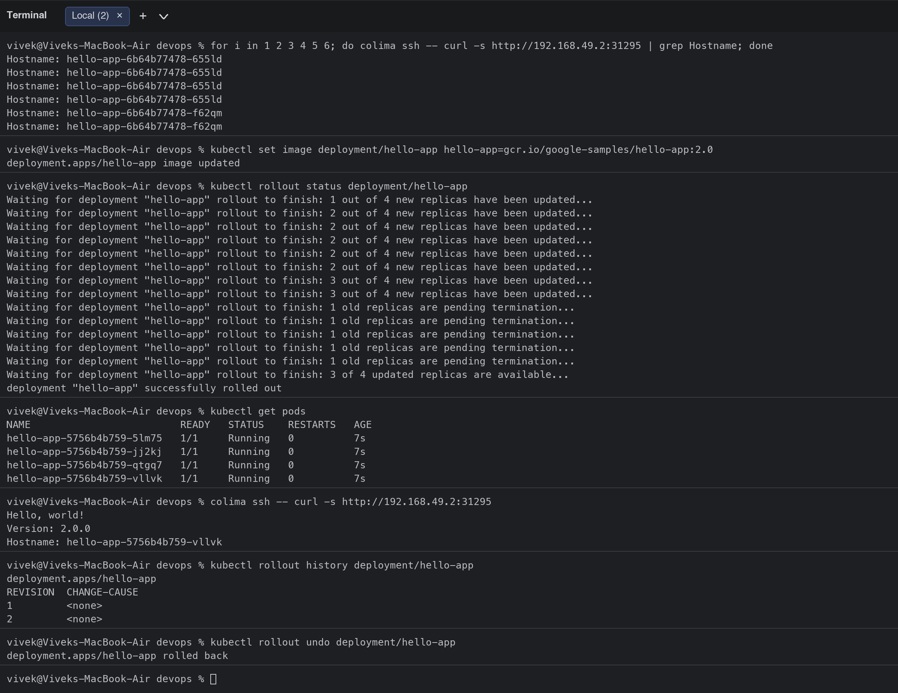
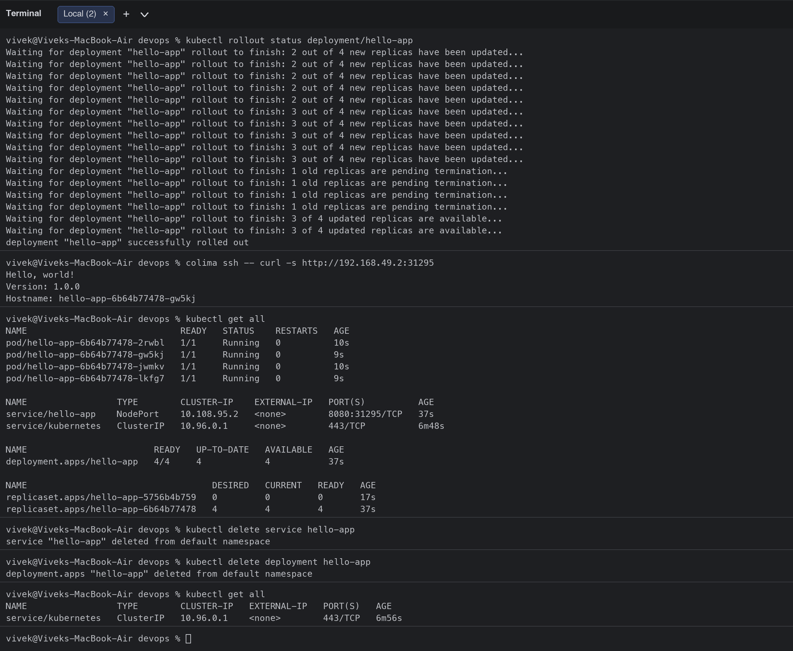

# Session 9: Kubernetes Fundamentals

**Student:** Vivek Singh Solanki | **Roll number:** 24bcs10338
**Cluster:** minikube v1.37 (docker driver) on macOS Apple Silicon, Kubernetes v1.37.0

## Task 1: Install and configure Minikube

Installed with Homebrew (`brew install minikube kubectl`) and started a single-node cluster with the Docker driver.

```bash
$ brew list --versions minikube kubectl
kubernetes-cli 1.37.1
minikube 1.39.0
$ minikube version
minikube version: v1.39.0
commit: 7a9f6a841470a207de8cf4bafcccee0969d8ba10
$ kubectl version --client
Client Version: v1.37.1
Kustomize Version: v5.8.1
$ minikube start --driver=docker --cpus=4 --memory=5500
* minikube v1.39.0 on Darwin 26.0.1 (arm64)
* Using the docker driver based on user configuration
* Using Docker Desktop driver with root privileges
* Starting "minikube" primary control-plane node in "minikube" cluster
* Pulling base image v0.0.51 ...
* Downloading Kubernetes v1.37.0 preload ...
* Preparing Kubernetes v1.37.0 on containerd 2.3.4 ...
* Configuring CNI (Container Networking Interface) ...
* Verifying Kubernetes components...
  - Using image gcr.io/k8s-minikube/storage-provisioner:v5
* Enabled addons: storage-provisioner, default-storageclass
* Done! kubectl is now configured to use "minikube" cluster and "default" namespace by default
$ minikube status
minikube
type: Control Plane
host: Running
kubelet: Running
apiserver: Running
kubeconfig: Configured

$ minikube addons enable metrics-server
* metrics-server is an addon maintained by Kubernetes. For any concerns contact minikube on GitHub.
You can view the list of minikube maintainers at: https://github.com/kubernetes/minikube/blob/master/OWNERS
  - Using image registry.k8s.io/metrics-server/metrics-server:v0.9.0
* The 'metrics-server' addon is enabled
$ minikube addons enable ingress
* ingress is an addon maintained by Kubernetes. For any concerns contact minikube on GitHub.
You can view the list of minikube maintainers at: https://github.com/kubernetes/minikube/blob/master/OWNERS
* After the addon is enabled, please run "minikube tunnel" and your ingress resources would be available at "127.0.0.1"
  - Using image registry.k8s.io/ingress-nginx/kube-webhook-certgen:v1.6.9
  - Using image registry.k8s.io/ingress-nginx/kube-webhook-certgen:v1.6.9
  - Using image registry.k8s.io/ingress-nginx/controller:v1.15.1
* Verifying ingress addon...
* The 'ingress' addon is enabled
$ minikube addons list | grep -E "enabled|STATUS"
│         ADDON NAME          │ PROFILE  │   STATUS   │               MAINTAINER               │
│ default-storageclass        │ minikube │ enabled ✅ │ Kubernetes                             │
│ ingress                     │ minikube │ enabled ✅ │ Kubernetes                             │
│ metrics-server              │ minikube │ enabled ✅ │ Kubernetes                             │
│ storage-provisioner         │ minikube │ enabled ✅ │ minikube                               │
```



## Task 2: Verify Kubernetes cluster status

```bash
$ kubectl cluster-info
Kubernetes control plane is running at https://127.0.0.1:32771
CoreDNS is running at https://127.0.0.1:32771/api/v1/namespaces/kube-system/services/kube-dns:dns/proxy

To further debug and diagnose cluster problems, use 'kubectl cluster-info dump'.
$ kubectl get nodes -o wide
NAME       STATUS   ROLES           AGE     VERSION   INTERNAL-IP    EXTERNAL-IP   OS-IMAGE                         KERNEL-VERSION              CONTAINER-RUNTIME
minikube   Ready    control-plane   3m45s   v1.37.0   192.168.49.2   <none>        Debian GNU/Linux 12 (bookworm)   6.8.0-117-generic (arm64)   containerd://2.3.4
$ kubectl get pods -A
NAMESPACE       NAME                                       READY   STATUS      RESTARTS   AGE
ingress-nginx   ingress-nginx-admission-create-tgtxl       0/1     Completed   0          2m39s
ingress-nginx   ingress-nginx-admission-patch-chc9n        0/1     Completed   0          2m39s
ingress-nginx   ingress-nginx-controller-d7cd8c989-n2s8g   1/1     Running     0          2m39s
kube-system     coredns-559f6c778d-6fw59                   1/1     Running     0          3m37s
kube-system     etcd-minikube                              1/1     Running     0          3m44s
kube-system     kindnet-8x2tv                              1/1     Running     0          3m37s
kube-system     kube-apiserver-minikube                    1/1     Running     0          3m44s
kube-system     kube-controller-manager-minikube           1/1     Running     0          3m44s
kube-system     kube-proxy-vw5jn                           1/1     Running     0          3m37s
kube-system     kube-scheduler-minikube                    1/1     Running     0          3m44s
kube-system     metrics-server-768f9f6999-k29fx            1/1     Running     0          2m39s
kube-system     storage-provisioner                        1/1     Running     0          3m42s
$ kubectl config current-context
minikube
$ kubectl config get-contexts
CURRENT   NAME       CLUSTER    AUTHINFO   NAMESPACE
*         minikube   minikube   minikube   default
```



## Task 3: Explore Kubernetes architecture

```bash
$ kubectl get pods -n kube-system -o wide
NAME                               READY   STATUS    RESTARTS   AGE     IP             NODE       NOMINATED NODE   READINESS GATES
coredns-559f6c778d-6fw59           1/1     Running   0          3m37s   10.244.0.2     minikube   <none>           <none>
etcd-minikube                      1/1     Running   0          3m44s   192.168.49.2   minikube   <none>           <none>
kindnet-8x2tv                      1/1     Running   0          3m37s   192.168.49.2   minikube   <none>           <none>
kube-apiserver-minikube            1/1     Running   0          3m44s   192.168.49.2   minikube   <none>           <none>
kube-controller-manager-minikube   1/1     Running   0          3m44s   192.168.49.2   minikube   <none>           <none>
kube-proxy-vw5jn                   1/1     Running   0          3m37s   192.168.49.2   minikube   <none>           <none>
kube-scheduler-minikube            1/1     Running   0          3m44s   192.168.49.2   minikube   <none>           <none>
metrics-server-768f9f6999-k29fx    1/1     Running   0          2m39s   10.244.0.3     minikube   <none>           <none>
storage-provisioner                1/1     Running   0          3m42s   192.168.49.2   minikube   <none>           <none>
$ kubectl get componentstatuses 2>/dev/null || kubectl get --raw="/readyz?verbose" | tail -n 8
NAME                 STATUS    MESSAGE   ERROR
scheduler            Healthy   ok        
controller-manager   Healthy   ok        
etcd-0               Healthy   ok        
$ kubectl describe node minikube | sed -n "1,12p"
Name:               minikube
Roles:              control-plane
Labels:             beta.kubernetes.io/arch=arm64
                    beta.kubernetes.io/os=linux
                    kubernetes.io/arch=arm64
                    kubernetes.io/hostname=minikube
                    kubernetes.io/os=linux
                    minikube.k8s.io/commit=7a9f6a841470a207de8cf4bafcccee0969d8ba10
                    minikube.k8s.io/name=minikube
                    minikube.k8s.io/primary=true
                    minikube.k8s.io/updated_at=2026_10_07T12_51_02_0700
                    minikube.k8s.io/version=v1.39.0
$ kubectl describe node minikube | grep -A 12 "Allocated resources"
Allocated resources:
  (Total limits may be over 100 percent, i.e., overcommitted.)
  Resource           Requests     Limits
  --------           --------     ------
  cpu                1050m (26%)  100m (2%)
  memory             510Mi (6%)   220Mi (2%)
  ephemeral-storage  0 (0%)       0 (0%)
  hugepages-1Gi      0 (0%)       0 (0%)
  hugepages-2Mi      0 (0%)       0 (0%)
  hugepages-32Mi     0 (0%)       0 (0%)
  hugepages-64Ki     0 (0%)       0 (0%)
Events:
  Type    Reason                   Age    From             Message
$ docker exec minikube ps -eo comm | grep -E "kube|etcd|containerd|kubelet" | sort -u
containerd
containerd-shim
etcd
kube-apiserver
kube-controller
kube-proxy
kube-scheduler
kubelet
$ kubectl api-resources | head -n 20
NAME                                SHORTNAMES   APIVERSION                        NAMESPACED   KIND
bindings                                         v1                                true         Binding
componentstatuses                   cs           v1                                false        ComponentStatus
configmaps                          cm           v1                                true         ConfigMap
endpoints                           ep           v1                                true         Endpoints
events                              ev           v1                                true         Event
limitranges                         limits       v1                                true         LimitRange
namespaces                          ns           v1                                false        Namespace
nodes                               no           v1                                false        Node
persistentvolumeclaims              pvc          v1                                true         PersistentVolumeClaim
persistentvolumes                   pv           v1                                false        PersistentVolume
pods                                po           v1                                true         Pod
podtemplates                                     v1                                true         PodTemplate
replicationcontrollers              rc           v1                                true         ReplicationController
resourcequotas                      quota        v1                                true         ResourceQuota
secrets                                          v1                                true         Secret
serviceaccounts                     sa           v1                                true         ServiceAccount
services                            svc          v1                                true         Service
mutatingadmissionpolicies                        admissionregistration.k8s.io/v1   false        MutatingAdmissionPolicy
mutatingadmissionpolicybindings                  admissionregistration.k8s.io/v1   false        MutatingAdmissionPolicyBinding
$ kubectl api-versions | head -n 10
admissionregistration.k8s.io/v1
apiextensions.k8s.io/v1
apiregistration.k8s.io/v1
apps/v1
authentication.k8s.io/v1
authorization.k8s.io/v1
autoscaling/v1
autoscaling/v2
batch/v1
certificates.k8s.io/v1
```



### Short notes on Kubernetes architecture

```text
                        CONTROL PLANE (master)                       WORKER NODE(S)
 kubectl ---> +----------------------------------------+     +-----------------------------+
              |  kube-apiserver  (REST front door,     |     |  kubelet  (node agent: runs  |
              |  authn/authz, validation, only thing   |<--->|  Pods, reports status)       |
              |  that talks to etcd)                   |     |  kube-proxy (Service VIPs,   |
              |  etcd            (key-value store,     |     |  iptables/IPVS rules)        |
              |  desired + current state)              |     |  container runtime           |
              |  kube-scheduler  (picks a node for     |     |  (containerd) runs the       |
              |  each new Pod: resources, affinity,    |     |  containers                  |
              |  taints)                               |     |  +-----+ +-----+ +-----+     |
              |  kube-controller-manager (Deployment,  |     |  | Pod | | Pod | | Pod |     |
              |  ReplicaSet, Node, Job controllers:    |     |  +-----+ +-----+ +-----+     |
              |  reconcile actual -> desired state)    |     +-----------------------------+
              |  cloud-controller-manager (cloud LB,   |       CoreDNS (cluster DNS) runs as
              |  volumes; not used on minikube)        |       Pods in kube-system
              +----------------------------------------+
```

- **kube-apiserver** is the only component everyone talks to (kubectl, kubelet, controllers). It validates requests and persists objects in **etcd**.
- **etcd** is the cluster database. Losing it means losing the cluster state, so it is backed up in production.
- **kube-scheduler** watches for Pods with no node assigned and chooses a node based on CPU/memory requests, affinity rules, taints and tolerations.
- **kube-controller-manager** runs the control loops (Deployment -> ReplicaSet -> Pod, Node health, endpoints) that constantly move the actual state towards the desired state declared in YAML.
- **kubelet** on each node makes sure the containers described in PodSpecs are running and healthy (liveness/readiness probes) and reports back.
- **kube-proxy** programs iptables/IPVS so that a Service ClusterIP/NodePort load-balances to the right Pod IPs.
- **Container runtime** (containerd in minikube) pulls images and runs containers via the CRI.
- **CoreDNS** gives every Service a DNS name (`svc.namespace.svc.cluster.local`).
- On minikube all of these run inside one Docker container (`minikube`), which is why `kubectl get pods -n kube-system` shows `etcd-minikube`, `kube-apiserver-minikube`, `kube-scheduler-minikube`, `kube-controller-manager-minikube`, `kube-proxy-xxxxx` and `coredns-xxxxx` together.

## Task 4: Basic Kubernetes objects and commands

| Object | Purpose | Create / inspect |
|---|---|---|
| Pod | Smallest deployable unit: one or more containers sharing network and storage | `kubectl run`, `kubectl get pods`, `kubectl describe pod`, `kubectl logs`, `kubectl exec` |
| ReplicaSet | Keeps N identical Pods running | created by a Deployment, `kubectl get rs` |
| Deployment | Declarative updates for Pods/ReplicaSets (rolling update, rollback, scaling) | `kubectl create deployment`, `kubectl scale`, `kubectl set image`, `kubectl rollout` |
| Service | Stable IP/DNS name + load balancing in front of Pods | `kubectl expose`, `kubectl get svc` |
| Namespace | Logical partition of the cluster | `kubectl get ns`, `-n <ns>` |
| ConfigMap / Secret | Configuration and sensitive data injected into Pods | `kubectl create configmap/secret` |
| Node | A worker machine | `kubectl get nodes`, `kubectl describe node` |

Most used commands: `kubectl get`, `describe`, `logs`, `exec`, `apply -f`, `delete`, `explain`, `scale`, `rollout`, `port-forward`, `config`.

```bash
$ kubectl explain pod | head -n 12
KIND:       Pod
VERSION:    v1

DESCRIPTION:
    Pod is a collection of containers that can run on a host. This resource is
    created by clients and scheduled onto hosts.
    
FIELDS:
  apiVersion	<string>
    APIVersion defines the versioned schema of this representation of an object.
    Servers should convert recognized schemas to the latest internal value, and
    may reject unrecognized values. More info:
$ kubectl explain deployment.spec | head -n 16
GROUP:      apps
KIND:       Deployment
VERSION:    v1

FIELD: spec <DeploymentSpec>


DESCRIPTION:
    Specification of the desired behavior of the Deployment.
    DeploymentSpec is the specification of the desired behavior of the
    Deployment.
    
FIELDS:
  minReadySeconds	<integer>
    Minimum number of seconds for which a newly created pod should be ready
    without any of its container crashing, for it to be considered available.
$ kubectl run demo-pod --image=nginx:alpine --port=80
pod/demo-pod created
$ kubectl get pods -o wide
NAME       READY   STATUS              RESTARTS   AGE   IP       NODE       NOMINATED NODE   READINESS GATES
demo-pod   0/1     ContainerCreating   0          0s    <none>   minikube   <none>           <none>
$ kubectl describe pod demo-pod | sed -n "1,15p"
Name:             demo-pod
Namespace:        default
Priority:         0
Service Account:  default
Node:             minikube/192.168.49.2
Start Time:       Wed, 07 Oct 2026 12:54:46 +0530
Labels:           run=demo-pod
Annotations:      <none>
Status:           Pending
IP:               
IPs:              <none>
Containers:
  demo-pod:
    Container ID:   
    Image:          nginx:alpine
$ kubectl logs demo-pod | tail -n 3
Error from server (BadRequest): container "demo-pod" in pod "demo-pod" is waiting to start: ContainerCreating
$ kubectl exec demo-pod -- nginx -v
error: unable to upgrade connection: container not found ("demo-pod")
$ kubectl get pod demo-pod -o yaml | head -n 20
apiVersion: v1
kind: Pod
metadata:
  creationTimestamp: "2026-10-07T07:24:46Z"
  generation: 1
  labels:
    run: demo-pod
  name: demo-pod
  namespace: default
  resourceVersion: "791"
  uid: 8e426e9c-b516-49f1-b9fc-a6da11cea3dc
spec:
  containers:
  - image: nginx:alpine
    imagePullPolicy: IfNotPresent
    name: demo-pod
    ports:
    - containerPort: 80
      protocol: TCP
    resources: {}
$ kubectl delete pod demo-pod
pod "demo-pod" deleted from default namespace
```



## Task 5: Kubernetes Basics tutorial hands-on

Following the official "Kubernetes Basics" tutorial modules: create a Deployment, explore the app, expose it with a Service, scale it, and perform a rolling update + rollback. I used the multi-arch `gcr.io/google-samples/hello-app` image (v1.0 -> v2.0) because the classic `kubernetes-bootcamp` image is amd64-only.

```bash
$ kubectl create deployment hello-app --image=gcr.io/google-samples/hello-app:1.0
deployment.apps/hello-app created
$ kubectl get deployments
NAME        READY   UP-TO-DATE   AVAILABLE   AGE
hello-app   0/1     1            0           0s
$ kubectl rollout status deployment/hello-app
Waiting for deployment "hello-app" rollout to finish: 0 of 1 updated replicas are available...
deployment "hello-app" successfully rolled out
$ kubectl get pods -o wide
NAME                         READY   STATUS    RESTARTS   AGE   IP            NODE       NOMINATED NODE   READINESS GATES
hello-app-6b64b77478-x9xbh   1/1     Running   0          0s    10.244.0.20   minikube   <none>           <none>
$ kubectl expose deployment hello-app --type=NodePort --port=8080
service/hello-app exposed
$ kubectl get services
NAME         TYPE        CLUSTER-IP    EXTERNAL-IP   PORT(S)          AGE
hello-app    NodePort    10.108.95.2   <none>        8080:31295/TCP   0s
kubernetes   ClusterIP   10.96.0.1     <none>        443/TCP          6m11s
$ kubectl describe service hello-app | grep -E "Name:|Type:|IP:|Port:|NodePort:|Endpoints:"
Name:                     hello-app
Type:                     NodePort
IP:                       10.108.95.2
Port:                     <unset>  8080/TCP
TargetPort:               8080/TCP
NodePort:                 <unset>  31295/TCP
Endpoints:                10.244.0.20:8080
$ minikube ip
192.168.49.2
$ colima ssh -- curl -s http://192.168.49.2:31295
Hello, world!
Version: 1.0.0
Hostname: hello-app-6b64b77478-x9xbh
$ kubectl port-forward service/hello-app 8080:8080 > /dev/null 2>&1 &
$ curl -s http://localhost:8080
Hello, world!
Version: 1.0.0
Hostname: hello-app-6b64b77478-x9xbh
$ kubectl scale deployment hello-app --replicas=4
deployment.apps/hello-app scaled
$ kubectl get deployments
NAME        READY   UP-TO-DATE   AVAILABLE   AGE
hello-app   4/4     4            4           18s
$ kubectl get replicasets
NAME                   DESIRED   CURRENT   READY   AGE
hello-app-6b64b77478   4         4         4       18s
$ kubectl get pods -o wide
NAME                         READY   STATUS    RESTARTS   AGE   IP            NODE       NOMINATED NODE   READINESS GATES
hello-app-6b64b77478-655ld   1/1     Running   0          8s    10.244.0.21   minikube   <none>           <none>
hello-app-6b64b77478-f62qm   1/1     Running   0          8s    10.244.0.23   minikube   <none>           <none>
hello-app-6b64b77478-kwkrj   1/1     Running   0          8s    10.244.0.22   minikube   <none>           <none>
hello-app-6b64b77478-x9xbh   1/1     Running   0          18s   10.244.0.20   minikube   <none>           <none>
$ for i in 1 2 3 4 5 6; do colima ssh -- curl -s http://192.168.49.2:31295 | grep Hostname; done
Hostname: hello-app-6b64b77478-655ld
Hostname: hello-app-6b64b77478-655ld
Hostname: hello-app-6b64b77478-655ld
Hostname: hello-app-6b64b77478-655ld
Hostname: hello-app-6b64b77478-f62qm
Hostname: hello-app-6b64b77478-f62qm
$ kubectl set image deployment/hello-app hello-app=gcr.io/google-samples/hello-app:2.0
deployment.apps/hello-app image updated
$ kubectl rollout status deployment/hello-app
Waiting for deployment "hello-app" rollout to finish: 1 out of 4 new replicas have been updated...
Waiting for deployment "hello-app" rollout to finish: 2 out of 4 new replicas have been updated...
Waiting for deployment "hello-app" rollout to finish: 2 out of 4 new replicas have been updated...
Waiting for deployment "hello-app" rollout to finish: 2 out of 4 new replicas have been updated...
Waiting for deployment "hello-app" rollout to finish: 2 out of 4 new replicas have been updated...
Waiting for deployment "hello-app" rollout to finish: 2 out of 4 new replicas have been updated...
Waiting for deployment "hello-app" rollout to finish: 3 out of 4 new replicas have been updated...
Waiting for deployment "hello-app" rollout to finish: 3 out of 4 new replicas have been updated...
Waiting for deployment "hello-app" rollout to finish: 1 old replicas are pending termination...
Waiting for deployment "hello-app" rollout to finish: 1 old replicas are pending termination...
Waiting for deployment "hello-app" rollout to finish: 1 old replicas are pending termination...
Waiting for deployment "hello-app" rollout to finish: 1 old replicas are pending termination...
Waiting for deployment "hello-app" rollout to finish: 1 old replicas are pending termination...
Waiting for deployment "hello-app" rollout to finish: 3 of 4 updated replicas are available...
deployment "hello-app" successfully rolled out
$ kubectl get pods
NAME                         READY   STATUS    RESTARTS   AGE
hello-app-5756b4b759-5lm75   1/1     Running   0          7s
hello-app-5756b4b759-jj2kj   1/1     Running   0          7s
hello-app-5756b4b759-qtgq7   1/1     Running   0          7s
hello-app-5756b4b759-vllvk   1/1     Running   0          7s
$ colima ssh -- curl -s http://192.168.49.2:31295
Hello, world!
Version: 2.0.0
Hostname: hello-app-5756b4b759-vllvk
$ kubectl rollout history deployment/hello-app
deployment.apps/hello-app 
REVISION  CHANGE-CAUSE
1         <none>
2         <none>

$ kubectl rollout undo deployment/hello-app
deployment.apps/hello-app rolled back
$ kubectl rollout status deployment/hello-app
Waiting for deployment "hello-app" rollout to finish: 2 out of 4 new replicas have been updated...
Waiting for deployment "hello-app" rollout to finish: 2 out of 4 new replicas have been updated...
Waiting for deployment "hello-app" rollout to finish: 2 out of 4 new replicas have been updated...
Waiting for deployment "hello-app" rollout to finish: 2 out of 4 new replicas have been updated...
Waiting for deployment "hello-app" rollout to finish: 2 out of 4 new replicas have been updated...
Waiting for deployment "hello-app" rollout to finish: 3 out of 4 new replicas have been updated...
Waiting for deployment "hello-app" rollout to finish: 3 out of 4 new replicas have been updated...
Waiting for deployment "hello-app" rollout to finish: 3 out of 4 new replicas have been updated...
Waiting for deployment "hello-app" rollout to finish: 3 out of 4 new replicas have been updated...
Waiting for deployment "hello-app" rollout to finish: 3 out of 4 new replicas have been updated...
Waiting for deployment "hello-app" rollout to finish: 1 old replicas are pending termination...
Waiting for deployment "hello-app" rollout to finish: 1 old replicas are pending termination...
Waiting for deployment "hello-app" rollout to finish: 1 old replicas are pending termination...
Waiting for deployment "hello-app" rollout to finish: 1 old replicas are pending termination...
Waiting for deployment "hello-app" rollout to finish: 3 of 4 updated replicas are available...
Waiting for deployment "hello-app" rollout to finish: 3 of 4 updated replicas are available...
deployment "hello-app" successfully rolled out
$ colima ssh -- curl -s http://192.168.49.2:31295
Hello, world!
Version: 1.0.0
Hostname: hello-app-6b64b77478-gw5kj
$ kubectl get all
NAME                             READY   STATUS    RESTARTS   AGE
pod/hello-app-6b64b77478-2rwbl   1/1     Running   0          10s
pod/hello-app-6b64b77478-gw5kj   1/1     Running   0          9s
pod/hello-app-6b64b77478-jwmkv   1/1     Running   0          10s
pod/hello-app-6b64b77478-lkfg7   1/1     Running   0          9s

NAME                 TYPE        CLUSTER-IP    EXTERNAL-IP   PORT(S)          AGE
service/hello-app    NodePort    10.108.95.2   <none>        8080:31295/TCP   37s
service/kubernetes   ClusterIP   10.96.0.1     <none>        443/TCP          6m48s

NAME                        READY   UP-TO-DATE   AVAILABLE   AGE
deployment.apps/hello-app   4/4     4            4           37s

NAME                                   DESIRED   CURRENT   READY   AGE
replicaset.apps/hello-app-5756b4b759   0         0         0       17s
replicaset.apps/hello-app-6b64b77478   4         4         4       37s
$ kubectl delete service hello-app
service "hello-app" deleted from default namespace
$ kubectl delete deployment hello-app
deployment.apps "hello-app" deleted from default namespace
$ kubectl get all
NAME                 TYPE        CLUSTER-IP   EXTERNAL-IP   PORT(S)   AGE
service/kubernetes   ClusterIP   10.96.0.1    <none>        443/TCP   6m56s
```

**What I observed**
- `kubectl create deployment` created a Deployment, which created a ReplicaSet, which created the Pod.
- `kubectl expose --type=NodePort` gave the app a stable ClusterIP plus a port on the node; `minikube ip` + NodePort is reachable from the Docker host (the Colima VM), and `kubectl port-forward` makes it reachable on `localhost:8080` from my Mac.
- After `kubectl scale --replicas=4` the Service load-balanced requests across the four Pods (different `Hostname` values).
- `kubectl set image` triggered a **rolling update** to v2.0 with zero downtime; `kubectl rollout undo` rolled back to v1.0 and the old ReplicaSet was reused.





## Resources used
- https://kubernetes.io/docs/tutorials/kubernetes-basics/
- https://minikube.sigs.k8s.io/docs/start/
- https://kubernetes.io/docs/concepts/architecture/
- https://github.com/kubernetes/kubernetes
