# Session 10: Kubernetes Pods, ReplicaSets & Deployments

**Student:** Vivek Singh Solanki | **Roll number:** 24bcs10338
**Cluster:** minikube (docker driver), Kubernetes v1.37

## Task 1: Deployment strategies

| Strategy | How it works | Downtime | Extra resources | Rollback |
|---|---|---|---|---|
| Rolling update (default) | Replace Pods a few at a time (`maxSurge`, `maxUnavailable`) | No | Little (surge Pods) | `kubectl rollout undo` |
| Blue-Green | Run v1 (blue) and v2 (green) side by side, flip the Service selector | No | 2x (both versions) | Flip selector back |
| Canary | Send a small % of traffic to v2 by running few canary Pods behind the same Service | No | Small | Scale canary to 0 |
| Recreate | Kill **all** old Pods, then start new ones | Yes | None | Re-apply old version |

### 01. Rolling Update ([01-rolling-update/](01-rolling-update/))

`deployment-v1.yaml` (nginx 1.24, 4 replicas, `maxSurge: 1`, `maxUnavailable: 0`) -> `deployment-v2.yaml` (nginx 1.25). A NodePort Service on 30010 serves the page.

```bash
$ cd 01-rolling-update
$ grep -B1 -A4 "strategy:" deployment-v1.yaml
  # maxUnavailable: 0 -> Zero pods can be unavailable at any point. Zero downtime guaranteed.
  strategy:
    type: RollingUpdate
    rollingUpdate:
      maxSurge: 1
      maxUnavailable: 0
$ kubectl apply -f deployment-v1.yaml -f service.yaml
deployment.apps/app-rolling created
service/app-rolling-service created
$ kubectl rollout status deployment/app-rolling
Waiting for deployment "app-rolling" rollout to finish: 0 of 4 updated replicas are available...
Waiting for deployment "app-rolling" rollout to finish: 1 of 4 updated replicas are available...
Waiting for deployment "app-rolling" rollout to finish: 2 of 4 updated replicas are available...
Waiting for deployment "app-rolling" rollout to finish: 3 of 4 updated replicas are available...
deployment "app-rolling" successfully rolled out
$ kubectl get pods -L version
NAME                           READY   STATUS    RESTARTS   AGE   VERSION
app-rolling-86d7d44d5b-fbxrq   1/1     Running   0          8s    v1
app-rolling-86d7d44d5b-ff866   1/1     Running   0          8s    v1
app-rolling-86d7d44d5b-lht4z   1/1     Running   0          8s    v1
app-rolling-86d7d44d5b-wxz9c   1/1     Running   0          8s    v1
$ kubectl describe deployment app-rolling | grep -E "StrategyType|RollingUpdateStrategy|Image:"
StrategyType:           RollingUpdate
RollingUpdateStrategy:  0 max unavailable, 1 max surge
    Image:      nginx:1.24-alpine
$ colima ssh -- curl -s http://192.168.49.2:30010 | grep VERSION
<p>VERSION: v1</p><p style="font-size:0.5em;color:#16213e">Rolling Update Demo</p></body></html>
$ diff deployment-v1.yaml deployment-v2.yaml
9,11d8
<   # RollingUpdate: Kubernetes replaces old pods one-by-one while keeping the service up.
<   # maxSurge: 1     -> Allows 1 extra pod above the desired count during the update.
<   # maxUnavailable: 0 -> Zero pods can be unavailable at any point. Zero downtime guaranteed.
24c21
<         version: v1
---
>         version: v2
28c25
<           image: nginx:1.24-alpine
---
>           image: nginx:1.25-alpine
31d27
<           # Custom HTML shows version so students can see it change in their browser
39,40c35,36
<                     echo '<html><body style="background:#1a1a2e;color:#e94560;font-family:monospace;font-size:3em;text-align:center;padding-top:20vh">
<                     <p>VERSION: v1</p><p style="font-size:0.5em;color:#16213e">Rolling Update Demo</p></body></html>' \
---
>                     echo '<html><body style="background:#0f3460;color:#e94560;font-family:monospace;font-size:3em;text-align:center;padding-top:20vh">
>                     <p>VERSION: v2</p><p style="font-size:0.5em;color:#53d8fb">Rolling Update Demo - NEW VERSION!</p></body></html>' \
$ kubectl apply -f deployment-v2.yaml
deployment.apps/app-rolling configured
$ kubectl get pods -L version
NAME                           READY   STATUS              RESTARTS   AGE   VERSION
app-rolling-56bff6d88c-zrkrm   0/1     ContainerCreating   0          0s    v2
app-rolling-86d7d44d5b-fbxrq   1/1     Running             0          8s    v1
app-rolling-86d7d44d5b-ff866   1/1     Running             0          8s    v1
app-rolling-86d7d44d5b-lht4z   1/1     Running             0          8s    v1
app-rolling-86d7d44d5b-wxz9c   1/1     Running             0          8s    v1
$ kubectl get pods -L version
NAME                           READY   STATUS    RESTARTS   AGE   VERSION
app-rolling-56bff6d88c-zrkrm   0/1     Running   0          4s    v2
app-rolling-86d7d44d5b-fbxrq   1/1     Running   0          12s   v1
app-rolling-86d7d44d5b-ff866   1/1     Running   0          12s   v1
app-rolling-86d7d44d5b-lht4z   1/1     Running   0          12s   v1
app-rolling-86d7d44d5b-wxz9c   1/1     Running   0          12s   v1
$ kubectl get pods -L version
NAME                           READY   STATUS    RESTARTS   AGE   VERSION
app-rolling-56bff6d88c-d9f5c   0/1     Running   0          1s    v2
app-rolling-56bff6d88c-zrkrm   1/1     Running   0          8s    v2
app-rolling-86d7d44d5b-fbxrq   1/1     Running   0          16s   v1
app-rolling-86d7d44d5b-lht4z   1/1     Running   0          16s   v1
app-rolling-86d7d44d5b-wxz9c   1/1     Running   0          16s   v1
$ kubectl rollout status deployment/app-rolling
Waiting for deployment "app-rolling" rollout to finish: 2 out of 4 new replicas have been updated...
Waiting for deployment "app-rolling" rollout to finish: 2 out of 4 new replicas have been updated...
Waiting for deployment "app-rolling" rollout to finish: 2 out of 4 new replicas have been updated...
Waiting for deployment "app-rolling" rollout to finish: 3 out of 4 new replicas have been updated...
Waiting for deployment "app-rolling" rollout to finish: 3 out of 4 new replicas have been updated...
Waiting for deployment "app-rolling" rollout to finish: 3 out of 4 new replicas have been updated...
Waiting for deployment "app-rolling" rollout to finish: 3 out of 4 new replicas have been updated...
Waiting for deployment "app-rolling" rollout to finish: 1 old replicas are pending termination...
Waiting for deployment "app-rolling" rollout to finish: 1 old replicas are pending termination...
Waiting for deployment "app-rolling" rollout to finish: 1 old replicas are pending termination...
deployment "app-rolling" successfully rolled out
$ kubectl get pods -L version
NAME                           READY   STATUS        RESTARTS   AGE   VERSION
app-rolling-56bff6d88c-cjp8b   1/1     Running       0          6s    v2
app-rolling-56bff6d88c-cn86q   1/1     Running       0          12s   v2
app-rolling-56bff6d88c-d9f5c   1/1     Running       0          18s   v2
app-rolling-56bff6d88c-zrkrm   1/1     Running       0          25s   v2
app-rolling-86d7d44d5b-fbxrq   1/1     Terminating   0          33s   v1
$ kubectl get replicasets -L version
NAME                     DESIRED   CURRENT   READY   AGE   VERSION
app-rolling-56bff6d88c   4         4         4       25s   v2
app-rolling-86d7d44d5b   0         0         0       33s   v1
$ kubectl rollout history deployment/app-rolling
deployment.apps/app-rolling 
REVISION  CHANGE-CAUSE
1         <none>
2         <none>

$ colima ssh -- curl -s http://192.168.49.2:30010 | grep VERSION
<p>VERSION: v2</p><p style="font-size:0.5em;color:#53d8fb">Rolling Update Demo - NEW VERSION!</p></body></html>
$ kubectl delete -f deployment-v2.yaml -f service.yaml
deployment.apps "app-rolling" deleted from default namespace
service "app-rolling-service" deleted from default namespace
```

**Verified:** while the update was in progress, `kubectl get pods -L version` showed v1 and v2 Pods **at the same time** (one extra v2 Pod created first, then v1 Pods removed one by one). The Service always had ready Pods, and after the rollout only v2 Pods remain; the old ReplicaSet is kept (scaled to 0) for rollback.

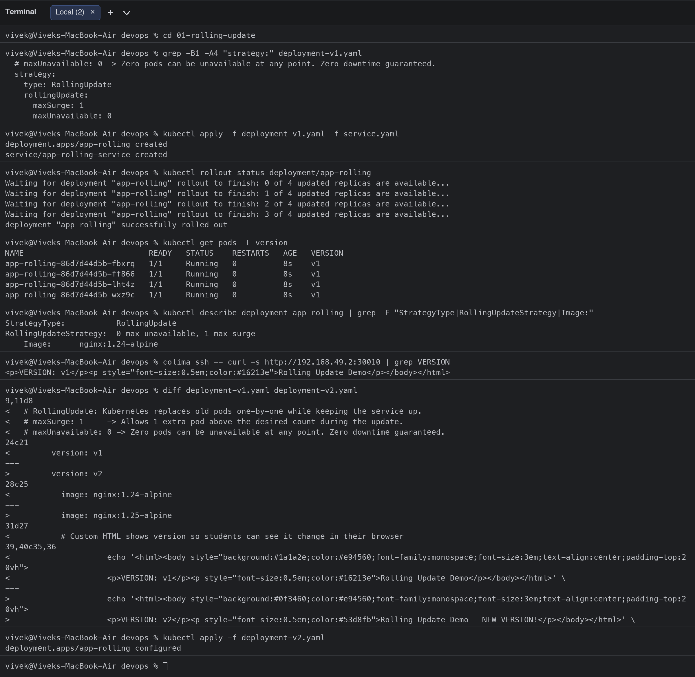
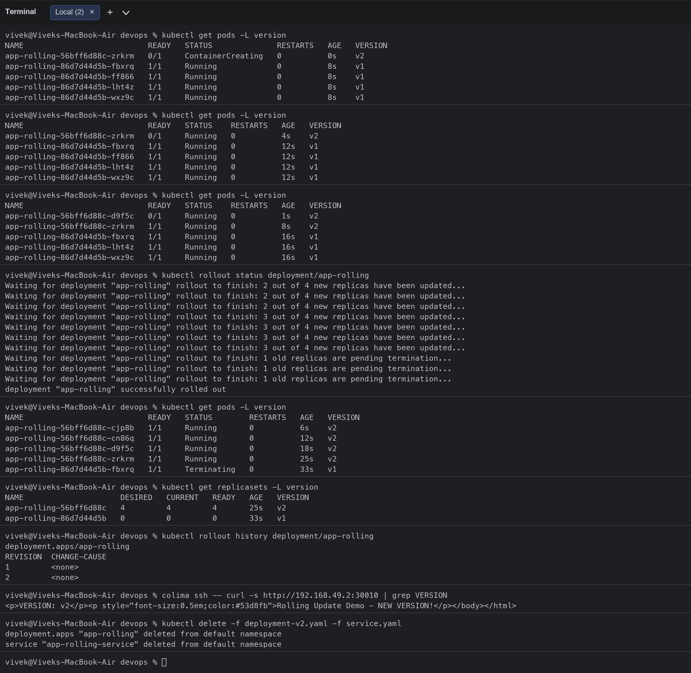

### 02. Blue-Green ([02-blue-green/](02-blue-green/))

```bash
$ cd 02-blue-green
$ kubectl apply -f deployment-blue.yaml -f deployment-green.yaml
deployment.apps/app-blue created
deployment.apps/app-green created
$ kubectl rollout status deployment/app-blue && kubectl rollout status deployment/app-green
Waiting for deployment "app-blue" rollout to finish: 0 of 3 updated replicas are available...
Waiting for deployment "app-blue" rollout to finish: 1 of 3 updated replicas are available...
Waiting for deployment "app-blue" rollout to finish: 2 of 3 updated replicas are available...
deployment "app-blue" successfully rolled out
deployment "app-green" successfully rolled out
$ kubectl get pods -L slot,version
NAME                        READY   STATUS    RESTARTS   AGE   SLOT    VERSION
app-blue-5c69d7785c-l7fv4   1/1     Running   0          8s    blue    v1
app-blue-5c69d7785c-ldvp8   1/1     Running   0          8s    blue    v1
app-blue-5c69d7785c-lhxdb   1/1     Running   0          8s    blue    v1
app-green-84df7f978-dl9j7   1/1     Running   0          8s    green   v2
app-green-84df7f978-f77cf   1/1     Running   0          8s    green   v2
app-green-84df7f978-ntxf7   1/1     Running   0          8s    green   v2
$ grep -A3 "selector:" service-blue.yaml
  selector:
    app: myapp
    slot: blue     # <-- Currently routing to BLUE (v1)
  ports:
$ kubectl apply -f service-blue.yaml
service/myapp-service created
$ kubectl get svc myapp-service -o jsonpath="{.spec.selector}"; echo
{"app":"myapp","slot":"blue"}
$ kubectl get endpoints myapp-service
Warning: v1 Endpoints is deprecated in v1.33+; use discovery.k8s.io/v1 EndpointSlice
NAME            ENDPOINTS                                      AGE
myapp-service   10.244.0.40:80,10.244.0.42:80,10.244.0.43:80   4s
$ colima ssh -- curl -s http://192.168.49.2:30020 | grep -E 'ENVIRONMENT|Slot'
<p>BLUE ENVIRONMENT</p>
<p style="font-size:0.5em">Version: v1 | Slot: BLUE (LIVE)</p>
$ diff service-blue.yaml service-green.yaml
1,3c1,2
< # service-blue.yaml - Service pointing to BLUE (v1) - LIVE traffic
< # To switch to GREEN: change selector slot: blue -> slot: green
< # OR apply service-green.yaml directly
---
> # service-green.yaml - Service pointing to GREEN (v2) - SWITCHED traffic
> # Apply this to promote GREEN and route ALL traffic to v2 instantly
12c11
<   # THE SWITCH: Change this selector to switch all traffic instantly
---
>   # THE SWITCH: Selector flipped to green - all traffic now goes to v2
15c14
<     slot: blue     # <-- Currently routing to BLUE (v1)
---
>     slot: green    # <-- NOW routing to GREEN (v2)
$ kubectl apply -f service-green.yaml
service/myapp-service configured
$ kubectl get svc myapp-service -o jsonpath="{.spec.selector}"; echo
{"app":"myapp","slot":"green"}
$ kubectl get endpoints myapp-service
Warning: v1 Endpoints is deprecated in v1.33+; use discovery.k8s.io/v1 EndpointSlice
NAME            ENDPOINTS                                      AGE
myapp-service   10.244.0.41:80,10.244.0.44:80,10.244.0.45:80   9s
$ colima ssh -- curl -s http://192.168.49.2:30020 | grep -E 'ENVIRONMENT|Slot'
<p>GREEN ENVIRONMENT</p>
<p style="font-size:0.5em">Version: v2 | Slot: GREEN (STANDBY -> PROMOTED)</p>
$ kubectl apply -f service-blue.yaml
service/myapp-service configured
$ colima ssh -- curl -s http://192.168.49.2:30020 | grep -E 'ENVIRONMENT'
<p>BLUE ENVIRONMENT</p>
$ kubectl delete -f deployment-blue.yaml -f deployment-green.yaml -f service-blue.yaml
deployment.apps "app-blue" deleted from default namespace
deployment.apps "app-green" deleted from default namespace
service "myapp-service" deleted from default namespace
```

**Verified:** both versions run at the same time (3 blue + 3 green Pods). The Service selector `slot: blue` sends 100% of traffic to v1; applying `service-green.yaml` changes only the selector to `slot: green`, the endpoints list instantly changes to the green Pod IPs and `curl` returns the GREEN page. Switching back is just re-applying the blue Service.

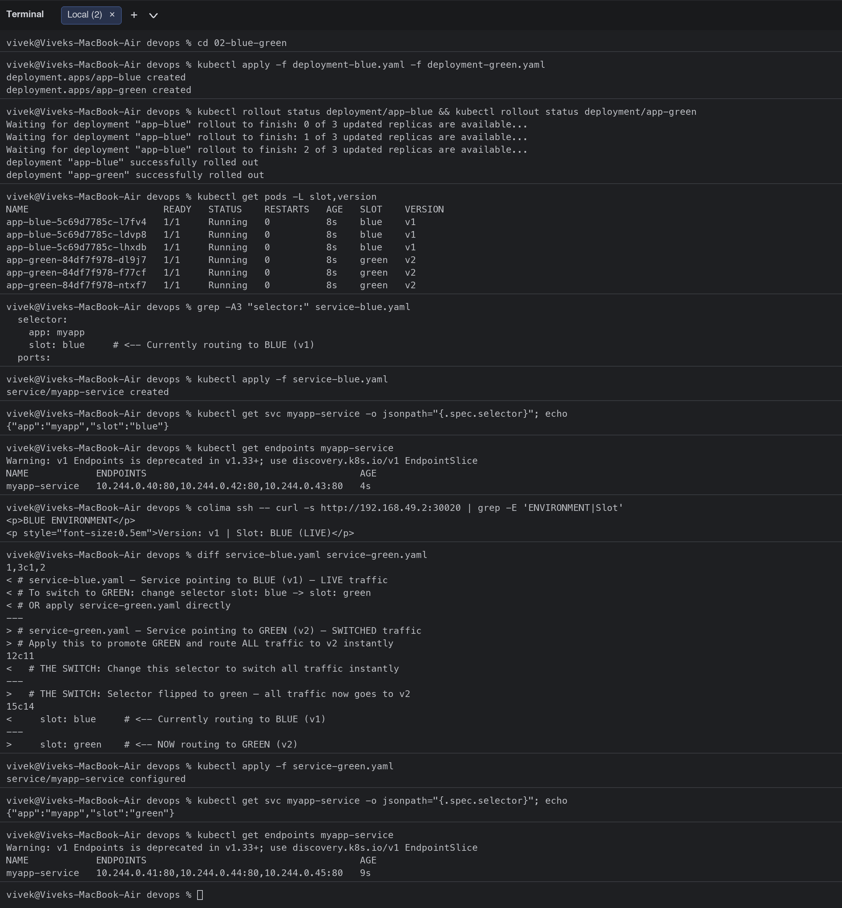
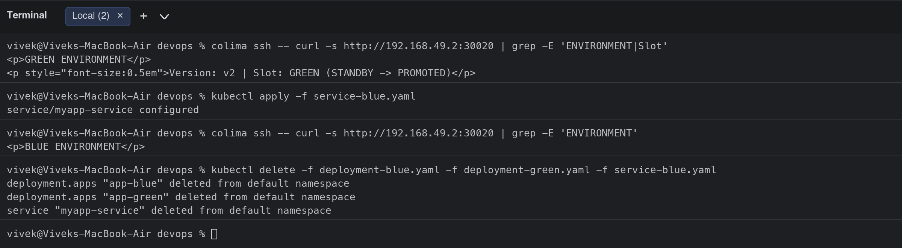

### 03. Canary ([03-canary/](03-canary/))

```bash
$ cd 03-canary
$ grep -E "name: app-|replicas:|track:" deployment-stable.yaml deployment-canary.yaml | grep -v matchLabels
deployment-canary.yaml:  name: app-canary
deployment-canary.yaml:    track: canary
deployment-canary.yaml:  replicas: 1
deployment-canary.yaml:      track: canary
deployment-canary.yaml:        track: canary
deployment-stable.yaml:  name: app-stable
deployment-stable.yaml:    track: stable
deployment-stable.yaml:  replicas: 9
deployment-stable.yaml:      track: stable
deployment-stable.yaml:        track: stable
$ kubectl apply -f deployment-stable.yaml -f deployment-canary.yaml -f service.yaml
deployment.apps/app-stable created
deployment.apps/app-canary created
service/myapp-canary-service created
$ kubectl rollout status deployment/app-stable && kubectl rollout status deployment/app-canary
Waiting for deployment "app-stable" rollout to finish: 0 of 9 updated replicas are available...
Waiting for deployment "app-stable" rollout to finish: 1 of 9 updated replicas are available...
Waiting for deployment "app-stable" rollout to finish: 2 of 9 updated replicas are available...
Waiting for deployment "app-stable" rollout to finish: 3 of 9 updated replicas are available...
Waiting for deployment "app-stable" rollout to finish: 4 of 9 updated replicas are available...
Waiting for deployment "app-stable" rollout to finish: 5 of 9 updated replicas are available...
Waiting for deployment "app-stable" rollout to finish: 6 of 9 updated replicas are available...
Waiting for deployment "app-stable" rollout to finish: 7 of 9 updated replicas are available...
Waiting for deployment "app-stable" rollout to finish: 8 of 9 updated replicas are available...
deployment "app-stable" successfully rolled out
deployment "app-canary" successfully rolled out
$ kubectl get pods -L track,version
NAME                          READY   STATUS    RESTARTS   AGE   TRACK    VERSION
app-canary-5849994497-jn5pc   1/1     Running   0          6s    canary   v2
app-stable-6ffb777f9d-9b4xh   1/1     Running   0          6s    stable   v1
app-stable-6ffb777f9d-9dz7w   1/1     Running   0          6s    stable   v1
app-stable-6ffb777f9d-fdjhz   1/1     Running   0          6s    stable   v1
app-stable-6ffb777f9d-kx4dx   1/1     Running   0          6s    stable   v1
app-stable-6ffb777f9d-n87gw   1/1     Running   0          6s    stable   v1
app-stable-6ffb777f9d-nblpz   1/1     Running   0          6s    stable   v1
app-stable-6ffb777f9d-q67dp   1/1     Running   0          6s    stable   v1
app-stable-6ffb777f9d-twgm8   1/1     Running   0          6s    stable   v1
app-stable-6ffb777f9d-vrzct   1/1     Running   0          6s    stable   v1
$ kubectl get endpoints myapp-canary-service
Warning: v1 Endpoints is deprecated in v1.33+; use discovery.k8s.io/v1 EndpointSlice
NAME                   ENDPOINTS                                                  AGE
myapp-canary-service   10.244.0.46:80,10.244.0.47:80,10.244.0.48:80 + 7 more...   6s
$ kubectl get svc myapp-canary-service -o jsonpath="{.spec.selector}"; echo
{"app":"myapp-canary"}
$ for i in $(seq 1 20); do colima ssh -- curl -s http://192.168.49.2:30030 | grep -oE 'STABLE v1|CANARY v2'; done | sort | uniq -c
  20 STABLE v1
$ kubectl scale deployment app-canary --replicas=5 && kubectl scale deployment app-stable --replicas=5
deployment.apps/app-canary scaled
deployment.apps/app-stable scaled
$ kubectl rollout status deployment/app-canary
Waiting for deployment "app-canary" rollout to finish: 1 of 5 updated replicas are available...
Waiting for deployment "app-canary" rollout to finish: 2 of 5 updated replicas are available...
Waiting for deployment "app-canary" rollout to finish: 3 of 5 updated replicas are available...
Waiting for deployment "app-canary" rollout to finish: 4 of 5 updated replicas are available...
deployment "app-canary" successfully rolled out
$ kubectl get pods -L track
NAME                          READY   STATUS    RESTARTS   AGE   TRACK
app-canary-5849994497-4v7j4   1/1     Running   0          11s   canary
app-canary-5849994497-794tx   1/1     Running   0          11s   canary
app-canary-5849994497-jn5pc   1/1     Running   0          21s   canary
app-canary-5849994497-phcvg   1/1     Running   0          11s   canary
app-canary-5849994497-tgk6h   1/1     Running   0          11s   canary
app-stable-6ffb777f9d-9b4xh   1/1     Running   0          21s   stable
app-stable-6ffb777f9d-fdjhz   1/1     Running   0          21s   stable
app-stable-6ffb777f9d-kx4dx   1/1     Running   0          21s   stable
app-stable-6ffb777f9d-n87gw   1/1     Running   0          21s   stable
app-stable-6ffb777f9d-nblpz   1/1     Running   0          21s   stable
$ for i in $(seq 1 20); do colima ssh -- curl -s http://192.168.49.2:30030 | grep -oE 'STABLE v1|CANARY v2'; done | sort | uniq -c
  10 CANARY v2
  10 STABLE v1
$ kubectl delete -f deployment-stable.yaml -f deployment-canary.yaml -f service.yaml
deployment.apps "app-stable" deleted from default namespace
deployment.apps "app-canary" deleted from default namespace
service "myapp-canary-service" deleted from default namespace
```

**Verified:** one Service selects both tracks (`app: myapp-canary`). With 9 stable + 1 canary Pods roughly 10% of requests hit the canary (in my 20-request sample every request landed on stable Pods, which is expected with random distribution). After scaling to 5/5, the sample split exactly 10/10, proving the traffic share follows the Pod ratio.

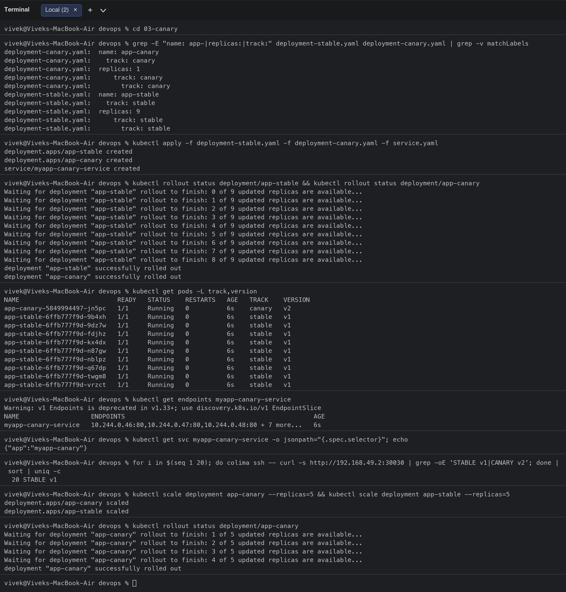
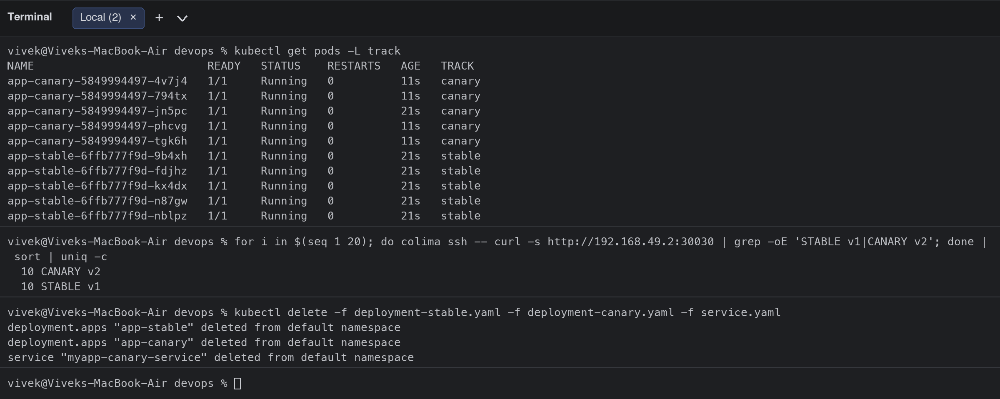

### 04. Recreate ([04-recreate/](04-recreate/))

```bash
$ cd 04-recreate
$ grep -A1 "strategy:" deployment-v1.yaml
  # Recreate strategy: Kubernetes terminates ALL old pods before creating any new pods.
  # This guarantees no two versions run concurrently, but causes a brief downtime.
  strategy:
    type: Recreate
$ kubectl apply -f deployment-v1.yaml -f service.yaml
deployment.apps/app-recreate created
service/app-recreate-service created
$ kubectl rollout status deployment/app-recreate
Waiting for deployment "app-recreate" rollout to finish: 0 of 3 updated replicas are available...
Waiting for deployment "app-recreate" rollout to finish: 1 of 3 updated replicas are available...
Waiting for deployment "app-recreate" rollout to finish: 2 of 3 updated replicas are available...
deployment "app-recreate" successfully rolled out
$ kubectl get pods -L version
NAME                            READY   STATUS    RESTARTS   AGE   VERSION
app-recreate-6c78cb55bb-kdrxj   1/1     Running   0          0s    v1
app-recreate-6c78cb55bb-qrdv5   1/1     Running   0          0s    v1
app-recreate-6c78cb55bb-sxdss   1/1     Running   0          0s    v1
$ colima ssh -- curl -s http://192.168.49.2:30040 | grep VERSION
<p style="color:#3282b8">VERSION: v1</p>
$ kubectl apply -f deployment-v2.yaml
deployment.apps/app-recreate configured
$ kubectl get pods -L version
NAME                            READY   STATUS        RESTARTS   AGE   VERSION
app-recreate-6c78cb55bb-kdrxj   1/1     Terminating   0          1s    v1
app-recreate-6c78cb55bb-qrdv5   1/1     Terminating   0          1s    v1
app-recreate-6c78cb55bb-sxdss   1/1     Terminating   0          1s    v1
$ kubectl get pods -L version
NAME                            READY   STATUS    RESTARTS   AGE   VERSION
app-recreate-7bd8d89b8b-7phwm   1/1     Running   0          2s    v2
app-recreate-7bd8d89b8b-pw2dj   1/1     Running   0          2s    v2
app-recreate-7bd8d89b8b-wghvd   1/1     Running   0          2s    v2
$ kubectl get pods -L version
NAME                            READY   STATUS    RESTARTS   AGE   VERSION
app-recreate-7bd8d89b8b-7phwm   1/1     Running   0          4s    v2
app-recreate-7bd8d89b8b-pw2dj   1/1     Running   0          4s    v2
app-recreate-7bd8d89b8b-wghvd   1/1     Running   0          4s    v2
$ kubectl get pods -L version
NAME                            READY   STATUS    RESTARTS   AGE   VERSION
app-recreate-7bd8d89b8b-7phwm   1/1     Running   0          6s    v2
app-recreate-7bd8d89b8b-pw2dj   1/1     Running   0          6s    v2
app-recreate-7bd8d89b8b-wghvd   1/1     Running   0          6s    v2
$ kubectl rollout status deployment/app-recreate
deployment "app-recreate" successfully rolled out
$ kubectl get pods -L version
NAME                            READY   STATUS    RESTARTS   AGE   VERSION
app-recreate-7bd8d89b8b-7phwm   1/1     Running   0          8s    v2
app-recreate-7bd8d89b8b-pw2dj   1/1     Running   0          8s    v2
app-recreate-7bd8d89b8b-wghvd   1/1     Running   0          8s    v2
$ kubectl describe deployment app-recreate | grep -A 8 "^Events"
Events:
  Type    Reason             Age   From                   Message
  ----    ------             ----  ----                   -------
  Normal  ScalingReplicaSet  9s    deployment-controller  Scaled up replica set app-recreate-6c78cb55bb from 0 to 3
  Normal  ScalingReplicaSet  8s    deployment-controller  Scaled down replica set app-recreate-6c78cb55bb from 3 to 0
  Normal  ScalingReplicaSet  8s    deployment-controller  Scaled up replica set app-recreate-7bd8d89b8b from 0 to 3
$ colima ssh -- curl -s http://192.168.49.2:30040 | grep VERSION
<p style="color:#00ffcc">VERSION: v2 (UPGRADED)</p>
$ kubectl delete -f deployment-v2.yaml -f service.yaml
deployment.apps "app-recreate" deleted from default namespace
service "app-recreate-service" deleted from default namespace
```

**Verified:** right after applying v2 all three v1 Pods were `Terminating` and **no** v2 Pod existed yet; only afterwards did the v2 Pods appear. The Deployment events confirm the order: scale old RS 3 -> 0, then scale new RS 0 -> 3. During that gap the service was down, which is the price of the Recreate strategy (acceptable for apps that cannot run two versions at once, e.g. DB schema migrations).

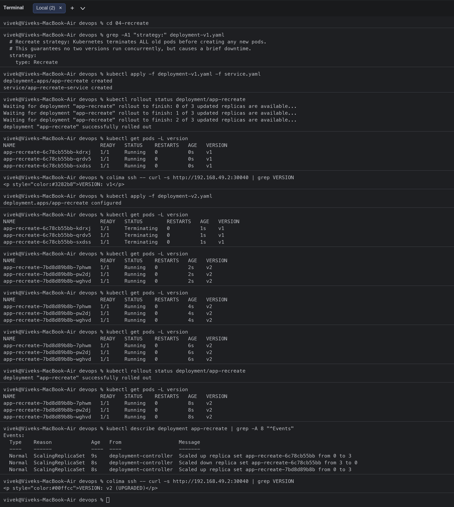
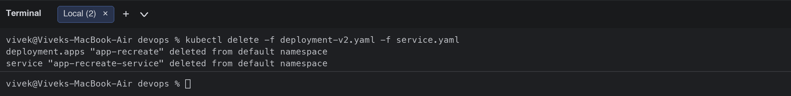

## Task 2: Pod lifecycle ([pod-lifecycle/](pod-lifecycle/))

Pod phases: `Pending` -> `Running` -> `Succeeded` / `Failed` (plus `Unknown`). Container states: `Waiting` (reasons such as ContainerCreating, CrashLoopBackOff, ImagePullBackOff), `Running`, `Terminated`. Probes: **startup** (is it finished starting?), **readiness** (can it receive traffic?), **liveness** (should it be restarted?).

```text
 apply ---> Pending ---(scheduled, images pulled, init containers done)---> Running ---> Succeeded (exit 0, restartPolicy Never/OnFailure)
              |                                                               |  \--> Failed    (exit != 0, not restarted)
              | (unschedulable: stays Pending)                                 |  \--> CrashLoopBackOff (keeps crashing, restartPolicy Always)
              |-- ImagePullBackOff (bad image)                                 \--> delete: SIGTERM -> grace period -> SIGKILL
```

For every YAML I applied the file, checked `kubectl get pod`, checked details with `kubectl describe` / `kubectl logs`, captured the output and explained what happened.

### 01. Running

```bash
$ cat 01-running.yaml
apiVersion: v1
kind: Pod
metadata:
  name: lifecycle-running
spec:
  containers:
    - name: nginx
      image: nginx:1.27
      ports:
        - containerPort: 80
$ kubectl apply -f 01-running.yaml
pod/lifecycle-running created
$ kubectl get pod lifecycle-running -o wide
NAME                READY   STATUS    RESTARTS   AGE   IP            NODE       NOMINATED NODE   READINESS GATES
lifecycle-running   1/1     Running   0          10s   10.244.0.66   minikube   <none>           <none>
$ kubectl describe pod lifecycle-running | grep -E "^Status:|State:|Ready:|Restart Count:" 
Status:           Running
    State:          Running
    Ready:          True
    Restart Count:  0
$ kubectl get pod lifecycle-running -o jsonpath="{.status.phase}{\"\n\"}"
Running
```

**Observation:** `lifecycle-running` reached `Running` with `Ready: True`. Phase `Running` means the Pod is bound to a node and at least one container is running.

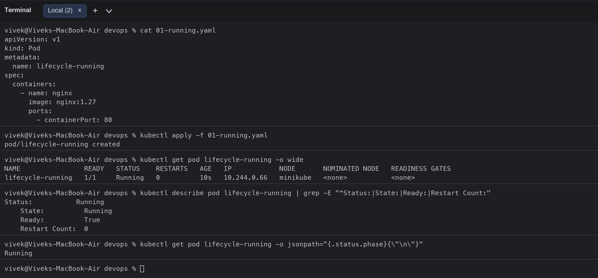

### 02. Pending

```bash
$ cat 02-pending.yaml
apiVersion: v1
kind: Pod
metadata:
  name: lifecycle-pending
spec:
  containers:
    - name: impossible-resource
      image: nginx:1.27
      resources:
        requests:
          cpu: "1"
          memory: "9Gi"
$ kubectl apply -f 02-pending.yaml
pod/lifecycle-pending created
$ kubectl get pod lifecycle-pending
NAME                READY   STATUS    RESTARTS   AGE
lifecycle-pending   0/1     Pending   0          7s
$ kubectl describe pod lifecycle-pending | grep -A 4 "^Events"
Events:
  Type     Reason            Age   From               Message
  ----     ------            ----  ----               -------
  Warning  FailedScheduling  7s    default-scheduler  0/1 nodes are available: 1 Insufficient memory. preemption: 0/1 nodes are available: 1 Preemption is not helpful for scheduling.
```

**Observation:** The Pod stays `Pending` forever because it requests 9Gi memory and 1 CPU that the node cannot provide. `kubectl describe` shows the scheduler event `FailedScheduling ... Insufficient memory`. Pending = accepted by the API server but not yet scheduled/started.

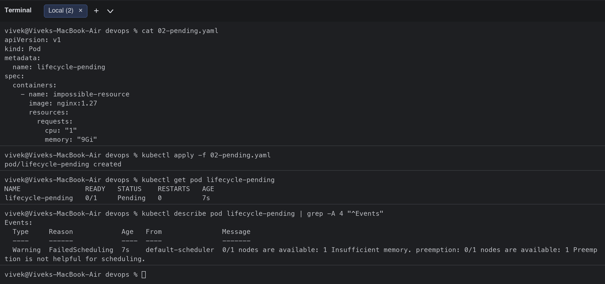

### 03. Succeeded

```bash
$ cat 03-succeeded.yaml
apiVersion: v1
kind: Pod
metadata:
  name: lifecycle-succeeded
spec:
  restartPolicy: Never
  containers:
    - name: task
      image: busybox:1.36
      command: ["sh", "-c", "echo 'Task started'; sleep 5; echo 'Task completed successfully'; exit 0"]
$ kubectl apply -f 03-succeeded.yaml
pod/lifecycle-succeeded created
$ kubectl get pod lifecycle-succeeded
NAME                  READY   STATUS    RESTARTS   AGE
lifecycle-succeeded   1/1     Running   0          3s
$ kubectl get pod lifecycle-succeeded
NAME                  READY   STATUS      RESTARTS   AGE
lifecycle-succeeded   0/1     Completed   0          15s
$ kubectl logs lifecycle-succeeded
Task started
Task completed successfully
$ kubectl get pod lifecycle-succeeded -o jsonpath="phase={.status.phase} exitCode={.status.containerStatuses[0].state.terminated.exitCode}{\"\n\"}"
phase=Succeeded exitCode=0
```

**Observation:** A one-shot task (`restartPolicy: Never`) runs for 5 seconds and exits 0. Status becomes `Completed`, phase `Succeeded`, exit code 0; the logs show the task output.

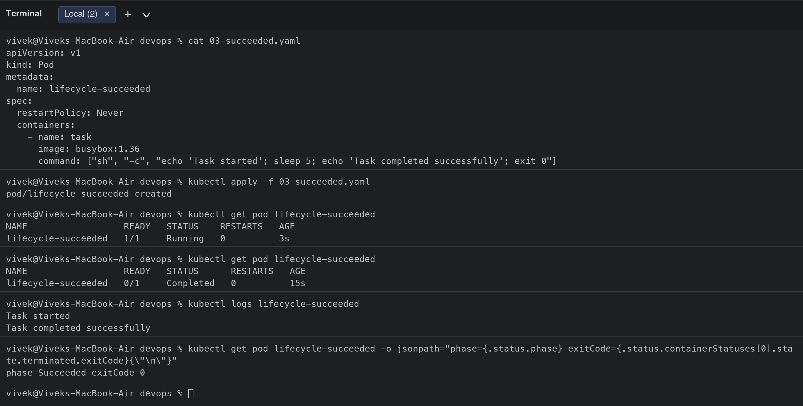

### 04. Failed

```bash
$ cat 04-failed.yaml
apiVersion: v1
kind: Pod
metadata:
  name: lifecycle-failed
spec:
  restartPolicy: Never
  containers:
    - name: task
      image: busybox:1.36
      command: ["sh", "-c", "echo 'Task started'; sleep 5; echo 'Task failed'; exit 1"]
$ kubectl apply -f 04-failed.yaml
pod/lifecycle-failed created
$ kubectl get pod lifecycle-failed
NAME               READY   STATUS   RESTARTS   AGE
lifecycle-failed   0/1     Error    0          14s
$ kubectl logs lifecycle-failed
Task started
Task failed
$ kubectl get pod lifecycle-failed -o jsonpath="phase={.status.phase} exitCode={.status.containerStatuses[0].state.terminated.exitCode} reason={.status.containerStatuses[0].state.terminated.reason}{\"\n\"}"
phase=Failed exitCode=1 reason=Error
```

**Observation:** Same task but `exit 1`. Status shows `Error`, phase `Failed`, `exitCode=1`, `reason=Error`. Because `restartPolicy: Never`, kubelet does not restart it.

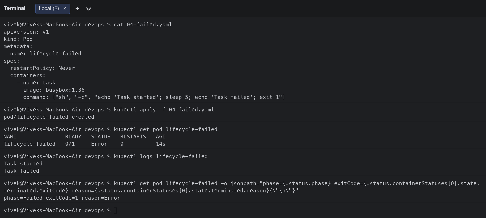

### 05. CrashLoopBackOff

```bash
$ cat 05-crashloopbackoff.yaml
apiVersion: v1
kind: Pod
metadata:
  name: lifecycle-crashloop
spec:
  containers:
    - name: crashing-app
      image: busybox:1.36
      command: ["sh", "-c", "echo 'Application started'; sleep 3; echo 'Application crashed'; exit 1"]
$ kubectl apply -f 05-crashloopbackoff.yaml
pod/lifecycle-crashloop created
$ kubectl get pod lifecycle-crashloop
NAME                  READY   STATUS             RESTARTS      AGE
lifecycle-crashloop   0/1     CrashLoopBackOff   2 (25s ago)   50s
$ kubectl logs lifecycle-crashloop --previous
Application started
Application crashed
$ kubectl describe pod lifecycle-crashloop | grep -A 10 "^Events" | tail -n 6
  ----     ------     ----               ----               -------
  Normal   Scheduled  50s                default-scheduler  Successfully assigned default/lifecycle-crashloop to minikube
  Warning  BackOff    24s (x2 over 42s)  kubelet            spec.containers{crashing-app}: Back-off restarting failed container crashing-app in pod lifecycle-crashloop_default(24b97d8f-bf8a-4c8d-8738-a2a6ed47e2c1)
  Normal   Pulled     0s (x4 over 50s)   kubelet            spec.containers{crashing-app}: Container image "busybox:1.36" already present on machine and can be accessed by the pod
  Normal   Created    0s (x4 over 50s)   kubelet            spec.containers{crashing-app}: Container created
  Normal   Started    0s (x4 over 50s)   kubelet            spec.containers{crashing-app}: Container started
```

**Observation:** The container exits 1 every 3 s with the default `restartPolicy: Always`. kubelet restarts it with exponential back-off (10s, 20s, 40s ...). `kubectl logs --previous` shows the output of the crashed container and the events show `Back-off restarting failed container`.

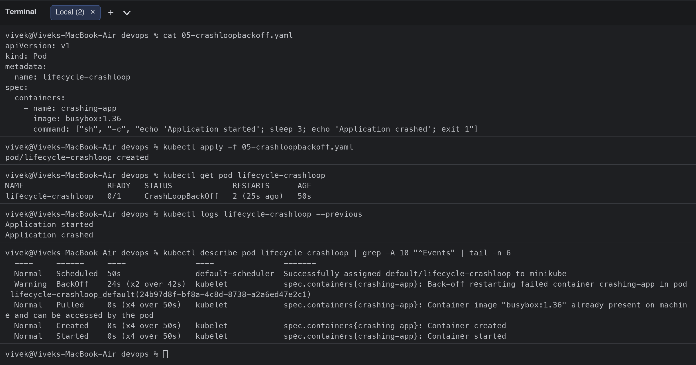

### 06. ImagePullBackOff

```bash
$ cat 06-imagepullbackoff.yaml
apiVersion: v1
kind: Pod
metadata:
  name: lifecycle-image-error
spec:
  containers:
    - name: broken-image
      image: jakwehrgkaejw:kahsdfgkhj
$ kubectl apply -f 06-imagepullbackoff.yaml
pod/lifecycle-image-error created
$ kubectl get pod lifecycle-image-error
NAME                    READY   STATUS             RESTARTS   AGE
lifecycle-image-error   0/1     ImagePullBackOff   0          26s
$ kubectl describe pod lifecycle-image-error | grep -A 8 "^Events" | tail -n 6
  Normal   Scheduled  26s                default-scheduler  Successfully assigned default/lifecycle-image-error to minikube
  Normal   BackOff    23s                kubelet            spec.containers{broken-image}: Back-off pulling image "jakwehrgkaejw:kahsdfgkhj"
  Warning  Failed     23s                kubelet            spec.containers{broken-image}: Error: ImagePullBackOff
  Normal   Pulling    10s (x2 over 25s)  kubelet            spec.containers{broken-image}: Pulling image "jakwehrgkaejw:kahsdfgkhj"
  Warning  Failed     8s (x2 over 24s)   kubelet            spec.containers{broken-image}: Failed to pull image "jakwehrgkaejw:kahsdfgkhj": failed to pull and unpack image "docker.io/library/jakwehrgkaejw:kahsdfgkhj": failed to resolve reference "docker.io/library/jakwehrgkaejw:kahsdfgkhj": pull access denied, repository does not exist or may require authorization: server message: insufficient_scope: authorization failed
  Warning  Failed     8s (x2 over 24s)   kubelet            spec.containers{broken-image}: Error: ErrImagePull
```

**Observation:** The image `jakwehrgkaejw:kahsdfgkhj` does not exist, so the Pod goes `ErrImagePull` -> `ImagePullBackOff`. The events show `Failed to pull image ... repository does not exist`. Fix = correct image name/tag or registry credentials.

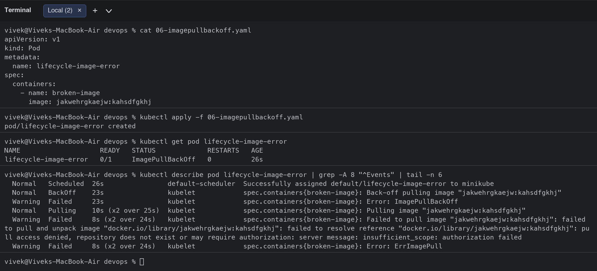

### 07. Readiness probe

```bash
$ cat 07-readiness.yaml
apiVersion: v1
kind: Pod
metadata:
  name: lifecycle-readiness
spec:
  containers:
    - name: nginx
      image: nginx:1.27
      readinessProbe:
        httpGet:
          path: /
          port: 80
        initialDelaySeconds: 5
        periodSeconds: 5
$ kubectl apply -f 07-readiness.yaml
pod/lifecycle-readiness created
$ kubectl get pod lifecycle-readiness
NAME                  READY   STATUS    RESTARTS   AGE
lifecycle-readiness   0/1     Running   0          2s
$ kubectl get pod lifecycle-readiness
NAME                  READY   STATUS    RESTARTS   AGE
lifecycle-readiness   1/1     Running   0          14s
$ kubectl describe pod lifecycle-readiness | grep -E "Readiness:|Ready "
    Readiness:      http-get http://:80/ delay=5s timeout=1s period=5s successThreshold=1 failureThreshold=3
  Ready                       True 
  ContainersReady             True
```

**Observation:** Right after creation the Pod is `Running` but `0/1` READY. Only after the HTTP readiness probe on `/` succeeds (initialDelay 5s) does it become `1/1`, which is when a Service would start sending it traffic.

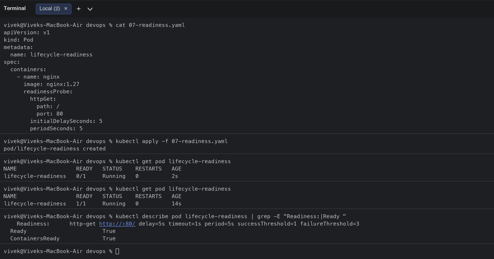

### 08. Liveness probe

```bash
$ cat 08-liveness.yaml
apiVersion: v1
kind: Pod
metadata:
  name: lifecycle-liveness
spec:
  containers:
    - name: app
      image: busybox:1.36
      command: ["sh", "-c", "echo 'App started'; touch /tmp/healthy; sleep 20; rm /tmp/healthy; echo 'Health file removed'; sleep 300"]
      livenessProbe:
        exec:
          command: ["sh", "-c", "test -f /tmp/healthy"]
        initialDelaySeconds: 5
        periodSeconds: 5
        failureThreshold: 2
$ kubectl apply -f 08-liveness.yaml
pod/lifecycle-liveness created
$ kubectl get pod lifecycle-liveness
NAME                 READY   STATUS    RESTARTS   AGE
lifecycle-liveness   1/1     Running   0          10s
$ kubectl get pod lifecycle-liveness
NAME                 READY   STATUS    RESTARTS   AGE
lifecycle-liveness   1/1     Running   0          45s
$ kubectl describe pod lifecycle-liveness | grep -A 8 "^Events" | tail -n 5
  Normal   Pulled     45s                kubelet            spec.containers{app}: Container image "busybox:1.36" already present on machine and can be accessed by the pod
  Normal   Created    45s                kubelet            spec.containers{app}: Container created
  Normal   Started    45s                kubelet            spec.containers{app}: Container started
  Warning  Unhealthy  15s (x2 over 20s)  kubelet            spec.containers{app}: Liveness probe failed:
  Normal   Killing    15s                kubelet            spec.containers{app}: Container app failed liveness probe, will be restarted
```

**Observation:** The app creates `/tmp/healthy`, deletes it after 20 s. The exec liveness probe fails twice (`failureThreshold: 2`), kubelet logs `Liveness probe failed` and `Killing ... will be restarted`, and RESTARTS increases while the Pod keeps its name and IP.

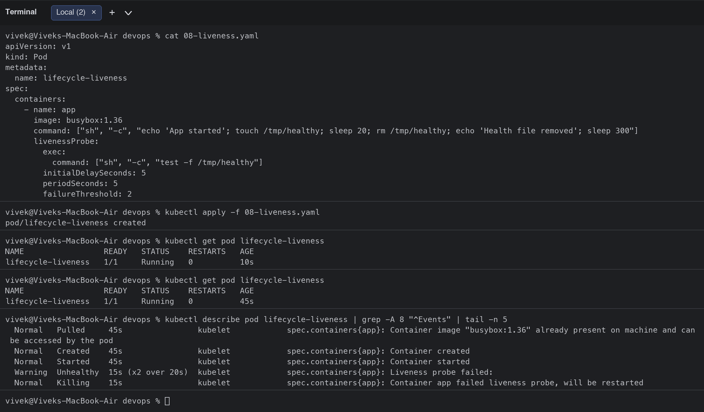

### 09. Startup probe

```bash
$ cat 09-startup.yaml
apiVersion: v1
kind: Pod
metadata:
  name: lifecycle-startup
spec:
  containers:
    - name: slow-app
      image: busybox:1.36
      command: ["sh", "-c", "echo 'Application starting...'; sleep 30; touch /tmp/started; echo 'Application started'; sleep 300"]
      startupProbe:
        exec:
          command: ["sh", "-c", "test -f /tmp/started"]
        periodSeconds: 5
        failureThreshold: 10
$ kubectl apply -f 09-startup.yaml
pod/lifecycle-startup created
$ kubectl get pod lifecycle-startup
NAME                READY   STATUS    RESTARTS   AGE
lifecycle-startup   0/1     Running   0          10s
$ kubectl get pod lifecycle-startup
NAME                READY   STATUS    RESTARTS   AGE
lifecycle-startup   1/1     Running   0          41s
$ kubectl describe pod lifecycle-startup | grep -E "Startup:|State:|Started:"
    State:          Running
      Started:      Wed, 07 Oct 2026 13:03:52 +0530
    Startup:        exec [sh -c test -f /tmp/started] delay=0s timeout=1s period=5s successThreshold=1 failureThreshold=10
```

**Observation:** The app needs 30 s to start. The startup probe (`periodSeconds: 5`, `failureThreshold: 10` = up to 50 s) keeps the Pod `0/1` without killing it; once `/tmp/started` exists the Pod becomes `1/1`. Startup probes protect slow-starting apps from liveness-probe kills.

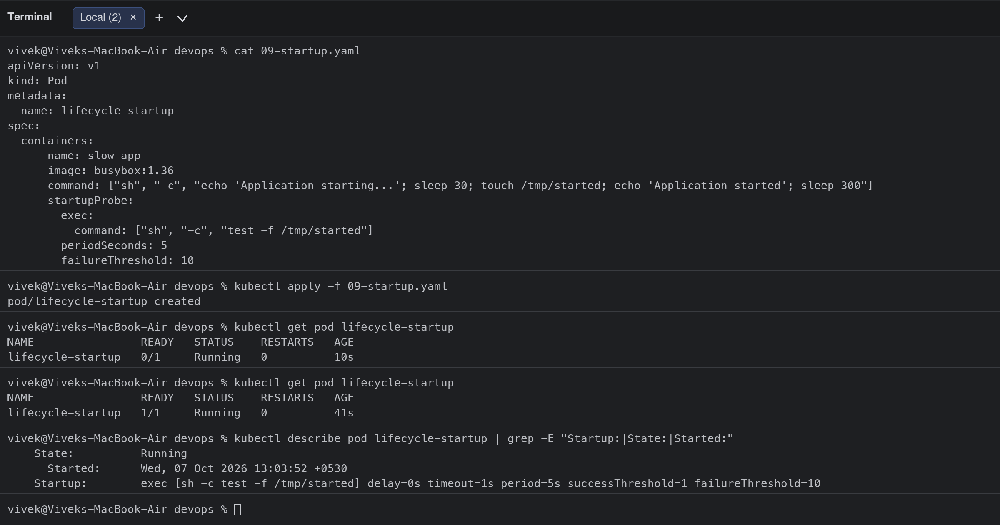

### 10. Init container

```bash
$ cat 10-init-container.yaml
apiVersion: v1
kind: Pod
metadata:
  name: lifecycle-init
spec:
  initContainers:
    - name: setup
      image: busybox:1.36
      command: ["sh", "-c", "echo 'Init container running'; sleep 10; echo 'Init complete'"]
  containers:
    - name: app
      image: nginx:1.27
$ kubectl apply -f 10-init-container.yaml
pod/lifecycle-init created
$ kubectl get pod lifecycle-init
NAME             READY   STATUS     RESTARTS   AGE
lifecycle-init   0/1     Init:0/1   0          3s
$ kubectl get pod lifecycle-init
NAME             READY   STATUS    RESTARTS   AGE
lifecycle-init   1/1     Running   0          19s
$ kubectl logs lifecycle-init -c setup
Init container running
Init complete
```

**Observation:** The Pod first shows `Init:0/1` while the `setup` init container runs (10 s); only after it exits 0 does the main nginx container start and the Pod becomes `Running`. `kubectl logs -c setup` shows the init output.

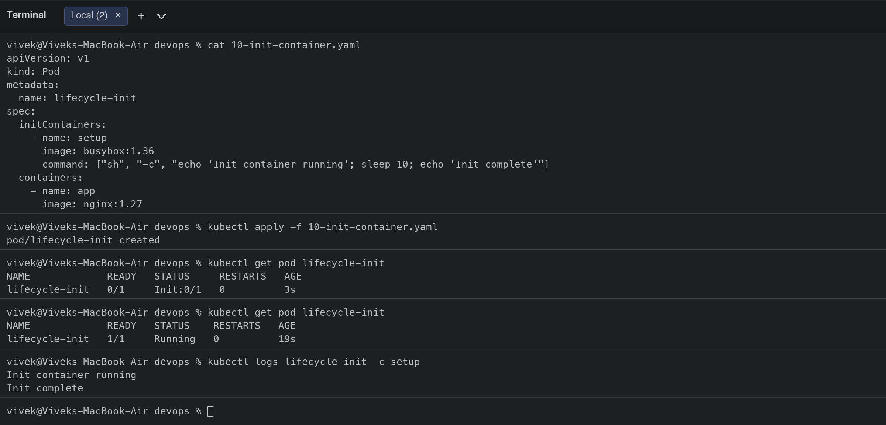

### 11. Multi-container Pod

```bash
$ cat 11-multi-container.yaml
apiVersion: v1
kind: Pod
metadata:
  name: lifecycle-multi-container
spec:
  containers:
    - name: app
      image: nginx:1.27
    - name: sidecar
      image: busybox:1.36
      command: ["sh", "-c", "while true; do echo 'Sidecar is running'; sleep 10; done"]
$ kubectl apply -f 11-multi-container.yaml
pod/lifecycle-multi-container created
$ kubectl get pod lifecycle-multi-container
NAME                        READY   STATUS    RESTARTS   AGE
lifecycle-multi-container   2/2     Running   0          12s
$ kubectl logs lifecycle-multi-container -c sidecar | head -n 2
Sidecar is running
Sidecar is running
$ kubectl get pod lifecycle-multi-container -o jsonpath="{range .status.containerStatuses[*]}{.name}: ready={.ready}{\"\n\"}{end}"
app: ready=true
sidecar: ready=true
```

**Observation:** Two containers (nginx `app` + busybox `sidecar`) run in one Pod: READY shows `2/2`, both share the network namespace and lifecycle. `kubectl logs -c sidecar` selects a specific container.

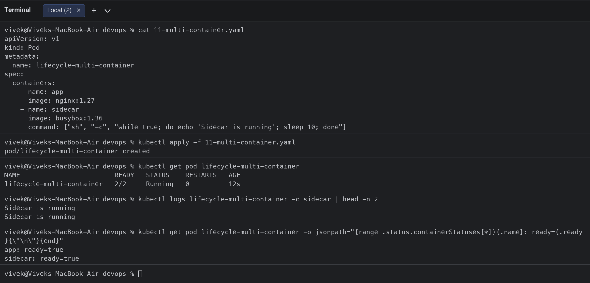

### 12. Graceful termination

```bash
$ cat 12-termination.yaml
apiVersion: v1
kind: Pod
metadata:
  name: lifecycle-termination
spec:
  terminationGracePeriodSeconds: 20
  containers:
    - name: graceful-app
      image: busybox:1.36
      command:
        - sh
        - -c
        - |
          trap 'echo "SIGTERM received; cleaning up..."; sleep 10; echo "Cleanup complete"; exit 0' TERM
          echo "Application running"
          while true; do sleep 2; done
$ kubectl apply -f 12-termination.yaml
pod/lifecycle-termination created
$ kubectl get pod lifecycle-termination
NAME                    READY   STATUS    RESTARTS   AGE
lifecycle-termination   1/1     Running   0          8s
$ time kubectl delete pod lifecycle-termination
pod "lifecycle-termination" deleted from default namespace
  0.04s user 0.02s system 0% cpu 10.898 total
$ kubectl logs -f lifecycle-termination   # (was running in another terminal during the delete)
Application running
SIGTERM received; cleaning up...
Cleanup complete
```

**Observation:** `kubectl delete` sends SIGTERM; the app traps it, logs `SIGTERM received; cleaning up...`, sleeps 10 s and exits 0. The delete took ~11 s, well within `terminationGracePeriodSeconds: 20`. If the app ignored SIGTERM, kubelet would send SIGKILL after 20 s.

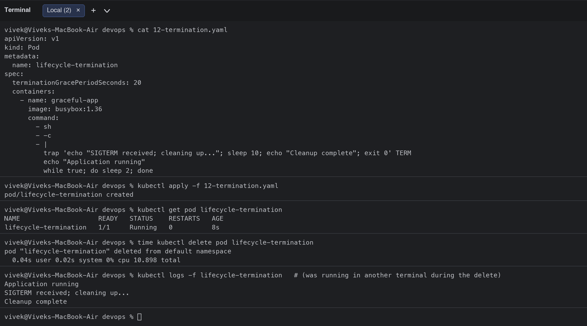


### All lifecycle Pods together and clean-up

```bash
$ kubectl get pods
NAME                        READY   STATUS             RESTARTS       AGE
lifecycle-crashloop         0/1     Error              5 (116s ago)   3m50s
lifecycle-failed            0/1     Error              0              4m4s
lifecycle-image-error       0/1     ImagePullBackOff   0              3m
lifecycle-init              1/1     Running            0              54s
lifecycle-liveness          1/1     Running            2 (20s ago)    2m20s
lifecycle-multi-container   2/2     Running            0              35s
lifecycle-pending           0/1     Pending            0              4m26s
lifecycle-readiness         1/1     Running            0              2m34s
lifecycle-running           1/1     Running            0              4m36s
lifecycle-startup           1/1     Running            0              95s
lifecycle-succeeded         0/1     Completed          0              4m19s
$ kubectl delete -f . --ignore-not-found
pod "lifecycle-running" deleted from default namespace
pod "lifecycle-pending" deleted from default namespace
pod "lifecycle-succeeded" deleted from default namespace
pod "lifecycle-failed" deleted from default namespace
pod "lifecycle-crashloop" deleted from default namespace
pod "lifecycle-image-error" deleted from default namespace
pod "lifecycle-readiness" deleted from default namespace
pod "lifecycle-liveness" deleted from default namespace
pod "lifecycle-startup" deleted from default namespace
pod "lifecycle-init" deleted from default namespace
pod "lifecycle-multi-container" deleted from default namespace
```

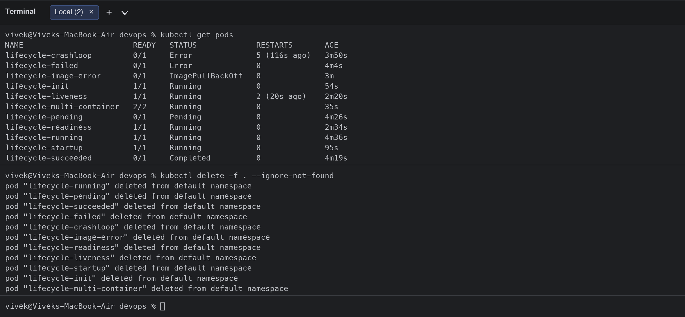
