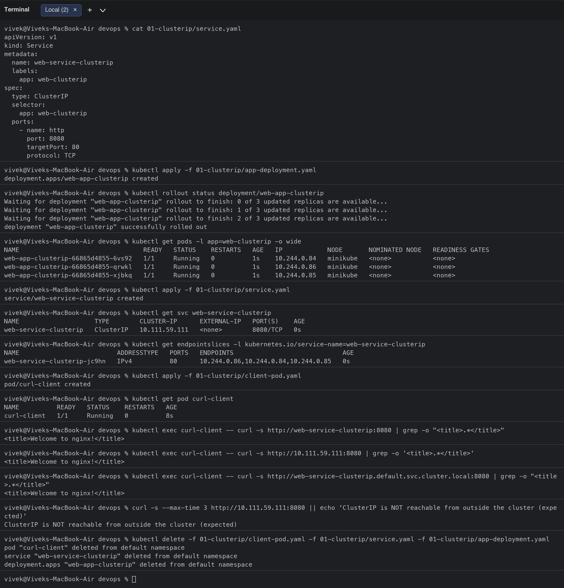
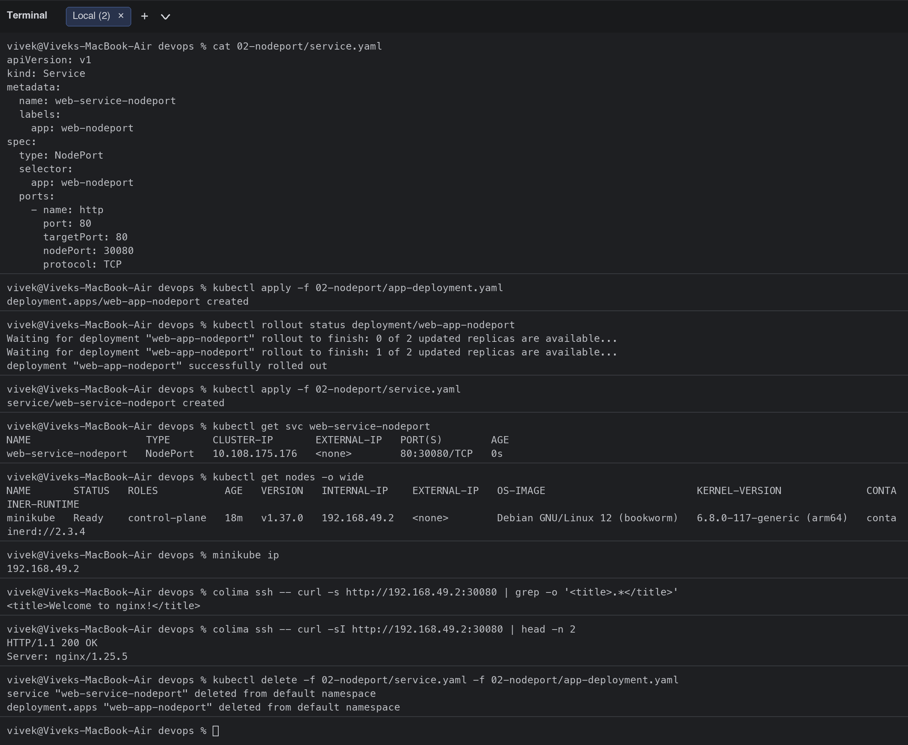
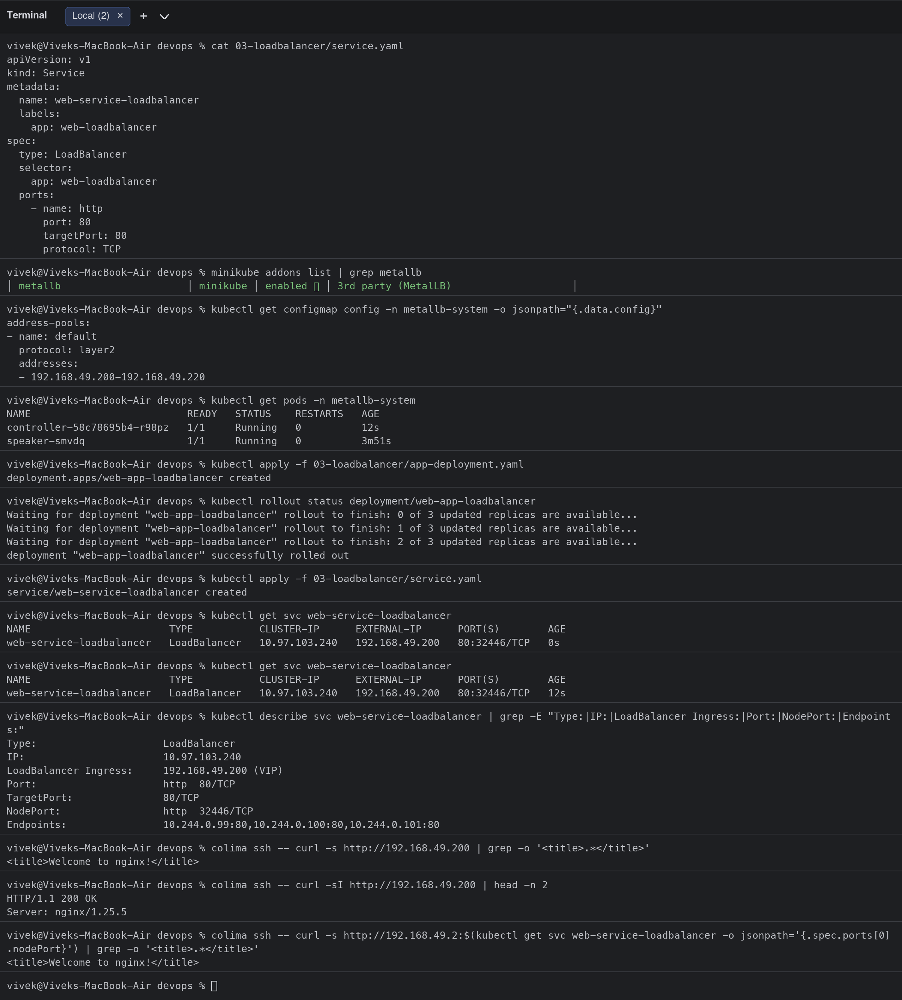
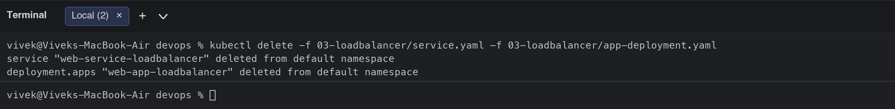
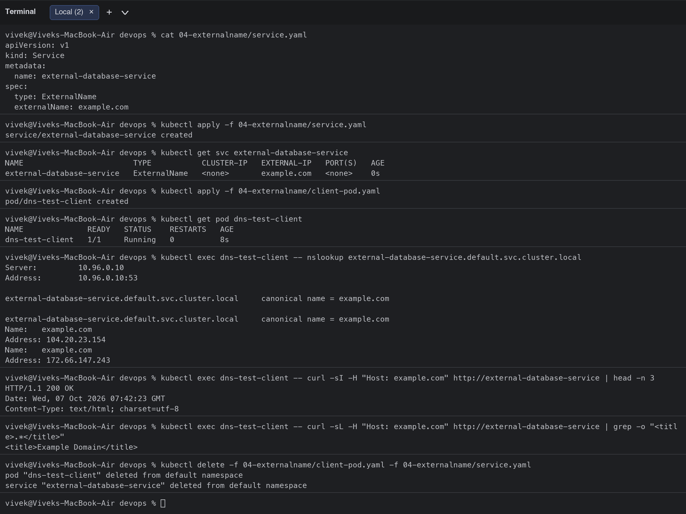
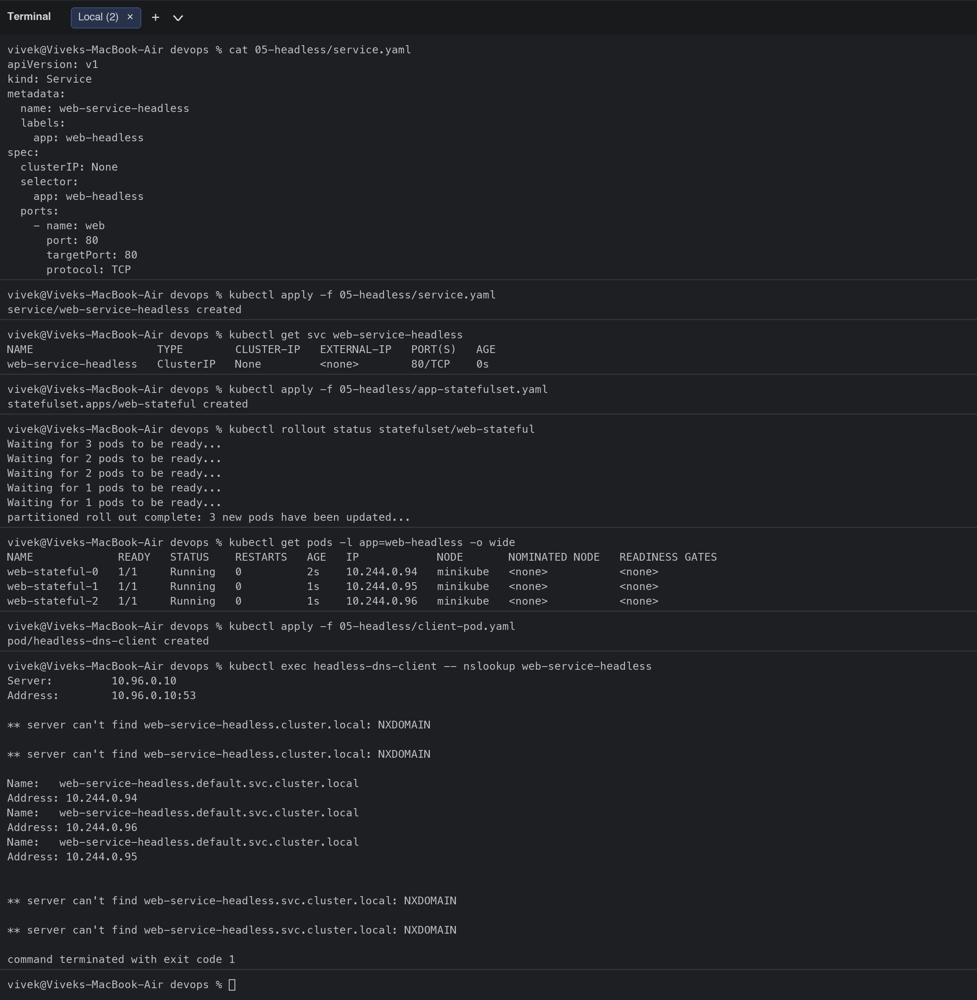
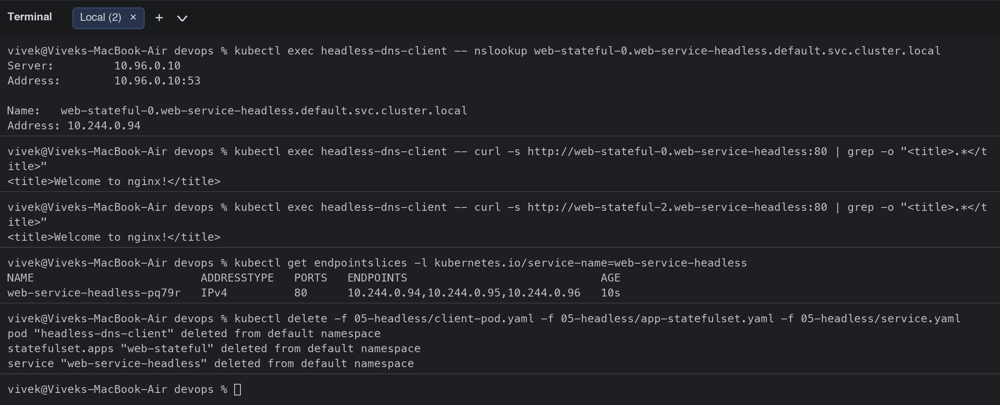

# Session 11: Kubernetes Networking & Services

**Student:** Vivek Singh Solanki | **Roll number:** 24bcs10338
**Cluster:** minikube (docker driver) + MetalLB addon for LoadBalancer IPs

## Task 1: Kubernetes Service types

| Type | Reachable from | How | Typical use |
|---|---|---|---|
| ClusterIP (default) | Inside the cluster only | Virtual IP + DNS name | Backend/microservice-to-microservice |
| NodePort | Any node IP on a port 30000-32767 | kube-proxy opens the port on every node | Dev/test access, behind an external LB |
| LoadBalancer | External IP from the cloud/MetalLB | Creates a NodePort + asks the provider for an LB | Production entry point on AWS/GCP/Azure |
| ExternalName | Inside the cluster | DNS CNAME to an external hostname | Alias an external DB/API with a cluster name |
| Headless (`clusterIP: None`) | Inside the cluster | DNS returns the Pod IPs directly, one record per Pod | StatefulSets (databases, Kafka), client-side LB |

### 1. ClusterIP ([01-clusterip/](01-clusterip/))

```bash
$ cat 01-clusterip/service.yaml
apiVersion: v1
kind: Service
metadata:
  name: web-service-clusterip
  labels:
    app: web-clusterip
spec:
  type: ClusterIP
  selector:
    app: web-clusterip
  ports:
    - name: http
      port: 8080
      targetPort: 80
      protocol: TCP
$ kubectl apply -f 01-clusterip/app-deployment.yaml
deployment.apps/web-app-clusterip created
$ kubectl rollout status deployment/web-app-clusterip
Waiting for deployment "web-app-clusterip" rollout to finish: 0 of 3 updated replicas are available...
Waiting for deployment "web-app-clusterip" rollout to finish: 1 of 3 updated replicas are available...
Waiting for deployment "web-app-clusterip" rollout to finish: 2 of 3 updated replicas are available...
deployment "web-app-clusterip" successfully rolled out
$ kubectl get pods -l app=web-clusterip -o wide
NAME                                 READY   STATUS    RESTARTS   AGE   IP            NODE       NOMINATED NODE   READINESS GATES
web-app-clusterip-66865d4855-6vs92   1/1     Running   0          1s    10.244.0.84   minikube   <none>           <none>
web-app-clusterip-66865d4855-qrwkl   1/1     Running   0          1s    10.244.0.86   minikube   <none>           <none>
web-app-clusterip-66865d4855-xjbkq   1/1     Running   0          1s    10.244.0.85   minikube   <none>           <none>
$ kubectl apply -f 01-clusterip/service.yaml
service/web-service-clusterip created
$ kubectl get svc web-service-clusterip
NAME                    TYPE        CLUSTER-IP      EXTERNAL-IP   PORT(S)    AGE
web-service-clusterip   ClusterIP   10.111.59.111   <none>        8080/TCP   0s
$ kubectl get endpointslices -l kubernetes.io/service-name=web-service-clusterip
NAME                          ADDRESSTYPE   PORTS   ENDPOINTS                             AGE
web-service-clusterip-jc9hn   IPv4          80      10.244.0.86,10.244.0.84,10.244.0.85   0s
$ kubectl apply -f 01-clusterip/client-pod.yaml
pod/curl-client created
$ kubectl get pod curl-client
NAME          READY   STATUS    RESTARTS   AGE
curl-client   1/1     Running   0          8s
$ kubectl exec curl-client -- curl -s http://web-service-clusterip:8080 | grep -o "<title>.*</title>"
<title>Welcome to nginx!</title>
$ kubectl exec curl-client -- curl -s http://10.111.59.111:8080 | grep -o '<title>.*</title>'
<title>Welcome to nginx!</title>
$ kubectl exec curl-client -- curl -s http://web-service-clusterip.default.svc.cluster.local:8080 | grep -o "<title>.*</title>"
<title>Welcome to nginx!</title>
$ curl -s --max-time 3 http://10.111.59.111:8080 || echo 'ClusterIP is NOT reachable from outside the cluster (expected)'
ClusterIP is NOT reachable from outside the cluster (expected)
$ kubectl delete -f 01-clusterip/client-pod.yaml -f 01-clusterip/service.yaml -f 01-clusterip/app-deployment.yaml
pod "curl-client" deleted from default namespace
service "web-service-clusterip" deleted from default namespace
deployment.apps "web-app-clusterip" deleted from default namespace
```

**Verified:** the Service got a stable virtual IP (`10.96.x.x`) and the EndpointSlice lists the three Pod IPs. From the `curl-client` Pod the app is reachable by short name, by ClusterIP and by FQDN (`web-service-clusterip.default.svc.cluster.local`). From my laptop the ClusterIP is **not** reachable, which is exactly the point of ClusterIP.



### 2. NodePort ([02-nodeport/](02-nodeport/))

```bash
$ cat 02-nodeport/service.yaml
apiVersion: v1
kind: Service
metadata:
  name: web-service-nodeport
  labels:
    app: web-nodeport
spec:
  type: NodePort
  selector:
    app: web-nodeport
  ports:
    - name: http
      port: 80
      targetPort: 80
      nodePort: 30080
      protocol: TCP
$ kubectl apply -f 02-nodeport/app-deployment.yaml
deployment.apps/web-app-nodeport created
$ kubectl rollout status deployment/web-app-nodeport
Waiting for deployment "web-app-nodeport" rollout to finish: 0 of 2 updated replicas are available...
Waiting for deployment "web-app-nodeport" rollout to finish: 1 of 2 updated replicas are available...
deployment "web-app-nodeport" successfully rolled out
$ kubectl apply -f 02-nodeport/service.yaml
service/web-service-nodeport created
$ kubectl get svc web-service-nodeport
NAME                   TYPE       CLUSTER-IP       EXTERNAL-IP   PORT(S)        AGE
web-service-nodeport   NodePort   10.108.175.176   <none>        80:30080/TCP   0s
$ kubectl get nodes -o wide
NAME       STATUS   ROLES           AGE   VERSION   INTERNAL-IP    EXTERNAL-IP   OS-IMAGE                         KERNEL-VERSION              CONTAINER-RUNTIME
minikube   Ready    control-plane   18m   v1.37.0   192.168.49.2   <none>        Debian GNU/Linux 12 (bookworm)   6.8.0-117-generic (arm64)   containerd://2.3.4
$ minikube ip
192.168.49.2
$ colima ssh -- curl -s http://192.168.49.2:30080 | grep -o '<title>.*</title>'
<title>Welcome to nginx!</title>
$ colima ssh -- curl -sI http://192.168.49.2:30080 | head -n 2
HTTP/1.1 200 OK
Server: nginx/1.25.5
$ kubectl delete -f 02-nodeport/service.yaml -f 02-nodeport/app-deployment.yaml
service "web-service-nodeport" deleted from default namespace
deployment.apps "web-app-nodeport" deleted from default namespace
```

**Verified:** `PORT(S)` shows `80:30080/TCP`, so port 30080 is opened on the node. `minikube ip` + `:30080` returns the nginx page (tested from the Docker host VM, because the minikube node network lives inside it on macOS).



### 3. LoadBalancer ([03-loadbalancer/](03-loadbalancer/))

On a cloud provider the cloud-controller-manager creates an external load balancer (ELB/NLB on AWS). On minikube there is no cloud, so `EXTERNAL-IP` stays `<pending>` unless a bare-metal LB implementation is installed. I enabled the **MetalLB** addon with the address pool `192.168.49.200-192.168.49.220` and the Service immediately received `192.168.49.200`.

```bash
$ cat 03-loadbalancer/service.yaml
apiVersion: v1
kind: Service
metadata:
  name: web-service-loadbalancer
  labels:
    app: web-loadbalancer
spec:
  type: LoadBalancer
  selector:
    app: web-loadbalancer
  ports:
    - name: http
      port: 80
      targetPort: 80
      protocol: TCP
$ minikube addons list | grep metallb
│ metallb                     │ minikube │ enabled ✅ │ 3rd party (MetalLB)                    │
$ kubectl get configmap config -n metallb-system -o jsonpath="{.data.config}"
address-pools:
- name: default
  protocol: layer2
  addresses:
  - 192.168.49.200-192.168.49.220
$ kubectl get pods -n metallb-system
NAME                          READY   STATUS    RESTARTS   AGE
controller-58c78695b4-r98pz   1/1     Running   0          12s
speaker-smvdq                 1/1     Running   0          3m51s
$ kubectl apply -f 03-loadbalancer/app-deployment.yaml
deployment.apps/web-app-loadbalancer created
$ kubectl rollout status deployment/web-app-loadbalancer
Waiting for deployment "web-app-loadbalancer" rollout to finish: 0 of 3 updated replicas are available...
Waiting for deployment "web-app-loadbalancer" rollout to finish: 1 of 3 updated replicas are available...
Waiting for deployment "web-app-loadbalancer" rollout to finish: 2 of 3 updated replicas are available...
deployment "web-app-loadbalancer" successfully rolled out
$ kubectl apply -f 03-loadbalancer/service.yaml
service/web-service-loadbalancer created
$ kubectl get svc web-service-loadbalancer
NAME                       TYPE           CLUSTER-IP      EXTERNAL-IP      PORT(S)        AGE
web-service-loadbalancer   LoadBalancer   10.97.103.240   192.168.49.200   80:32446/TCP   0s
$ kubectl get svc web-service-loadbalancer
NAME                       TYPE           CLUSTER-IP      EXTERNAL-IP      PORT(S)        AGE
web-service-loadbalancer   LoadBalancer   10.97.103.240   192.168.49.200   80:32446/TCP   12s
$ kubectl describe svc web-service-loadbalancer | grep -E "Type:|IP:|LoadBalancer Ingress:|Port:|NodePort:|Endpoints:"
Type:                     LoadBalancer
IP:                       10.97.103.240
LoadBalancer Ingress:     192.168.49.200 (VIP)
Port:                     http  80/TCP
TargetPort:               80/TCP
NodePort:                 http  32446/TCP
Endpoints:                10.244.0.99:80,10.244.0.100:80,10.244.0.101:80
$ colima ssh -- curl -s http://192.168.49.200 | grep -o '<title>.*</title>'
<title>Welcome to nginx!</title>
$ colima ssh -- curl -sI http://192.168.49.200 | head -n 2
HTTP/1.1 200 OK
Server: nginx/1.25.5
$ colima ssh -- curl -s http://192.168.49.2:$(kubectl get svc web-service-loadbalancer -o jsonpath='{.spec.ports[0].nodePort}') | grep -o '<title>.*</title>'
<title>Welcome to nginx!</title>
$ kubectl delete -f 03-loadbalancer/service.yaml -f 03-loadbalancer/app-deployment.yaml
service "web-service-loadbalancer" deleted from default namespace
deployment.apps "web-app-loadbalancer" deleted from default namespace
```

**Verified:** `LoadBalancer Ingress: 192.168.49.200 (VIP)`; `curl http://192.168.49.200` returns the nginx page. A LoadBalancer Service also keeps a NodePort (`32446`) underneath, which I tested as well.




### 4. ExternalName ([04-externalname/](04-externalname/))

```bash
$ cat 04-externalname/service.yaml
apiVersion: v1
kind: Service
metadata:
  name: external-database-service
spec:
  type: ExternalName
  externalName: example.com
$ kubectl apply -f 04-externalname/service.yaml
service/external-database-service created
$ kubectl get svc external-database-service
NAME                        TYPE           CLUSTER-IP   EXTERNAL-IP   PORT(S)   AGE
external-database-service   ExternalName   <none>       example.com   <none>    0s
$ kubectl apply -f 04-externalname/client-pod.yaml
pod/dns-test-client created
$ kubectl get pod dns-test-client
NAME              READY   STATUS    RESTARTS   AGE
dns-test-client   1/1     Running   0          8s
$ kubectl exec dns-test-client -- nslookup external-database-service.default.svc.cluster.local
Server:		10.96.0.10
Address:	10.96.0.10:53

external-database-service.default.svc.cluster.local	canonical name = example.com

external-database-service.default.svc.cluster.local	canonical name = example.com
Name:	example.com
Address: 104.20.23.154
Name:	example.com
Address: 172.66.147.243

$ kubectl exec dns-test-client -- curl -sI -H "Host: example.com" http://external-database-service | head -n 3
HTTP/1.1 200 OK
Date: Wed, 07 Oct 2026 07:42:23 GMT
Content-Type: text/html; charset=utf-8
$ kubectl exec dns-test-client -- curl -sL -H "Host: example.com" http://external-database-service | grep -o "<title>.*</title>"
<title>Example Domain</title>
$ kubectl delete -f 04-externalname/client-pod.yaml -f 04-externalname/service.yaml
pod "dns-test-client" deleted from default namespace
service "external-database-service" deleted from default namespace
```

**Verified:** the Service has no ClusterIP and no endpoints; CoreDNS answers `external-database-service.default.svc.cluster.local` with a **CNAME to example.com**. Pods can use the internal name and the target can be changed later (for example to an RDS endpoint) without touching application config.



### 5. Headless ([05-headless/](05-headless/))

```bash
$ cat 05-headless/service.yaml
apiVersion: v1
kind: Service
metadata:
  name: web-service-headless
  labels:
    app: web-headless
spec:
  clusterIP: None
  selector:
    app: web-headless
  ports:
    - name: web
      port: 80
      targetPort: 80
      protocol: TCP
$ kubectl apply -f 05-headless/service.yaml
service/web-service-headless created
$ kubectl get svc web-service-headless
NAME                   TYPE        CLUSTER-IP   EXTERNAL-IP   PORT(S)   AGE
web-service-headless   ClusterIP   None         <none>        80/TCP    0s
$ kubectl apply -f 05-headless/app-statefulset.yaml
statefulset.apps/web-stateful created
$ kubectl rollout status statefulset/web-stateful
Waiting for 3 pods to be ready...
Waiting for 2 pods to be ready...
Waiting for 2 pods to be ready...
Waiting for 1 pods to be ready...
Waiting for 1 pods to be ready...
partitioned roll out complete: 3 new pods have been updated...
$ kubectl get pods -l app=web-headless -o wide
NAME             READY   STATUS    RESTARTS   AGE   IP            NODE       NOMINATED NODE   READINESS GATES
web-stateful-0   1/1     Running   0          2s    10.244.0.94   minikube   <none>           <none>
web-stateful-1   1/1     Running   0          1s    10.244.0.95   minikube   <none>           <none>
web-stateful-2   1/1     Running   0          1s    10.244.0.96   minikube   <none>           <none>
$ kubectl apply -f 05-headless/client-pod.yaml
pod/headless-dns-client created
$ kubectl exec headless-dns-client -- nslookup web-service-headless
Server:		10.96.0.10
Address:	10.96.0.10:53

** server can't find web-service-headless.cluster.local: NXDOMAIN

** server can't find web-service-headless.cluster.local: NXDOMAIN

Name:	web-service-headless.default.svc.cluster.local
Address: 10.244.0.94
Name:	web-service-headless.default.svc.cluster.local
Address: 10.244.0.96
Name:	web-service-headless.default.svc.cluster.local
Address: 10.244.0.95


** server can't find web-service-headless.svc.cluster.local: NXDOMAIN

** server can't find web-service-headless.svc.cluster.local: NXDOMAIN

command terminated with exit code 1
$ kubectl exec headless-dns-client -- nslookup web-stateful-0.web-service-headless.default.svc.cluster.local
Server:		10.96.0.10
Address:	10.96.0.10:53

Name:	web-stateful-0.web-service-headless.default.svc.cluster.local
Address: 10.244.0.94


$ kubectl exec headless-dns-client -- curl -s http://web-stateful-0.web-service-headless:80 | grep -o "<title>.*</title>"
<title>Welcome to nginx!</title>
$ kubectl exec headless-dns-client -- curl -s http://web-stateful-2.web-service-headless:80 | grep -o "<title>.*</title>"
<title>Welcome to nginx!</title>
$ kubectl get endpointslices -l kubernetes.io/service-name=web-service-headless
NAME                         ADDRESSTYPE   PORTS   ENDPOINTS                             AGE
web-service-headless-pq79r   IPv4          80      10.244.0.94,10.244.0.95,10.244.0.96   10s
$ kubectl delete -f 05-headless/client-pod.yaml -f 05-headless/app-statefulset.yaml -f 05-headless/service.yaml
pod "headless-dns-client" deleted from default namespace
statefulset.apps "web-stateful" deleted from default namespace
service "web-service-headless" deleted from default namespace
```

**Verified:** `CLUSTER-IP` is `None`. `nslookup web-service-headless` returns **three A records** (one per Pod) instead of one virtual IP, and each StatefulSet Pod has its own stable DNS name `web-stateful-0.web-service-headless.default.svc.cluster.local`. This is how databases find a specific replica (primary vs. replicas).




## Task 2: Kubernetes object comparison
See [comparison/README.md](comparison/README.md): Deployment vs ReplicaSet, Deployment vs DaemonSet vs StatefulSet, ReplicaSet vs Service.

## Task 3: FQDN
See [fqdn/README.md](fqdn/README.md): what an FQDN is, Kubernetes Service DNS, naming convention, namespace-based DNS, Pod-to-Service communication and examples.

## Task 4: CoreDNS
See [coredns/README.md](coredns/README.md): what CoreDNS is, why Kubernetes uses it, service discovery, query resolution, the Corefile configuration and DNS troubleshooting.

## Clean-up
All demo resources were deleted after each test (`kubectl delete -f ...`). MetalLB can be disabled with `minikube addons disable metallb`.
