# Session 12: Kubernetes Ingress, ConfigMaps & Secrets

**Student:** Vivek Singh Solanki | **Roll number:** 24bcs10338
**Cluster:** minikube with the NGINX Ingress Controller addon (`minikube addons enable ingress`)

## Task 1: ConfigMap hands-on ([01-configmap/](01-configmap/))

Files: [`app-config.yaml`](01-configmap/app-config.yaml) (the ConfigMap), [`configmap-demo-pod.yaml`](01-configmap/configmap-demo-pod.yaml) (Pod that injects it as env vars **and** as files).

```bash
$ cat 01-configmap/app-config.yaml
apiVersion: v1
kind: ConfigMap
metadata:
  name: yatri-app-config
  labels:
    app: yatri-backend
data:
  ENVIRONMENT: "production"
  LOG_LEVEL: "INFO"
  PORT: "5000"
  DEFAULT_CURRENCY: "INR"
  MAX_BOOKING_DAYS: "30"
$ kubectl apply -f 01-configmap/app-config.yaml
configmap/yatri-app-config created
$ kubectl get configmap yatri-app-config
NAME               DATA   AGE
yatri-app-config   5      0s
$ kubectl describe configmap yatri-app-config
Name:         yatri-app-config
Namespace:    default
Labels:       app=yatri-backend
Annotations:  <none>

Data
====
DEFAULT_CURRENCY:
----
INR

ENVIRONMENT:
----
production

LOG_LEVEL:
----
INFO

MAX_BOOKING_DAYS:
----
30

PORT:
----
5000


BinaryData
====

Events:  <none>
$ kubectl create configmap demo-literal --from-literal=FEATURE_FLAG=true --from-literal=REGION=ap-south-1
configmap/demo-literal created
$ kubectl get configmap demo-literal -o yaml | grep -v -E "creationTimestamp|resourceVersion|uid"
apiVersion: v1
data:
  FEATURE_FLAG: "true"
  REGION: ap-south-1
kind: ConfigMap
metadata:
  name: demo-literal
  namespace: default
$ grep -v "^#" 01-configmap/configmap-demo-pod.yaml
apiVersion: v1
kind: Pod
metadata:
  name: configmap-demo
  labels:
    app: configmap-demo
spec:
  containers:
    - name: app
      image: busybox:1.36
      command: ["sh", "-c", "echo 'ConfigMap demo pod started'; sleep 3600"]
      envFrom:
        - configMapRef:
            name: yatri-app-config
      env:
        - name: APP_LOG_LEVEL          # single key with a custom variable name
          valueFrom:
            configMapKeyRef:
              name: yatri-app-config
              key: LOG_LEVEL
      volumeMounts:
        - name: config-volume
          mountPath: /etc/app-config
          readOnly: true
  volumes:
    - name: config-volume
      configMap:
        name: yatri-app-config
$ kubectl apply -f 01-configmap/configmap-demo-pod.yaml
pod/configmap-demo created
$ kubectl wait --for=condition=Ready pod/configmap-demo --timeout=60s
pod/configmap-demo condition met
$ kubectl exec configmap-demo -- env | grep -E "ENVIRONMENT|LOG_LEVEL|^PORT|CURRENCY|MAX_BOOKING|APP_LOG_LEVEL"
DEFAULT_CURRENCY=INR
ENVIRONMENT=production
LOG_LEVEL=INFO
MAX_BOOKING_DAYS=30
PORT=5000
APP_LOG_LEVEL=INFO
$ kubectl exec configmap-demo -- ls -l /etc/app-config/
total 0
lrwxrwxrwx    1 root     root            23 Oct  7 07:45 DEFAULT_CURRENCY -> ..data/DEFAULT_CURRENCY
lrwxrwxrwx    1 root     root            18 Oct  7 07:45 ENVIRONMENT -> ..data/ENVIRONMENT
lrwxrwxrwx    1 root     root            16 Oct  7 07:45 LOG_LEVEL -> ..data/LOG_LEVEL
lrwxrwxrwx    1 root     root            23 Oct  7 07:45 MAX_BOOKING_DAYS -> ..data/MAX_BOOKING_DAYS
lrwxrwxrwx    1 root     root            11 Oct  7 07:45 PORT -> ..data/PORT
$ kubectl exec configmap-demo -- cat /etc/app-config/DEFAULT_CURRENCY
INR
$ kubectl patch configmap yatri-app-config -p "{\"data\":{\"LOG_LEVEL\":\"DEBUG\"}}"
configmap/yatri-app-config patched
$ kubectl exec configmap-demo -- cat /etc/app-config/LOG_LEVEL; echo
INFO
$ sleep 120   # wait for the kubelet to sync the mounted ConfigMap
$ kubectl exec configmap-demo -- cat /etc/app-config/LOG_LEVEL; echo
DEBUG
$ kubectl exec configmap-demo -- sh -c "echo env LOG_LEVEL=\$LOG_LEVEL   # env vars are NOT updated until the Pod restarts"
env LOG_LEVEL=INFO
```

**What I verified**
- `kubectl describe configmap` shows the plain-text keys/values.
- `envFrom.configMapRef` injected every key as an environment variable, and `configMapKeyRef` mapped one key to a custom name (`APP_LOG_LEVEL`).
- The volume mount created one file per key under `/etc/app-config` (symlinks into `..data`, which is how Kubernetes swaps versions atomically).
- After `kubectl patch`, the **mounted file** changed from INFO to DEBUG within the kubelet sync period, but the **environment variable** stayed INFO: env vars are only read at container start, so a rollout/restart is needed for them.

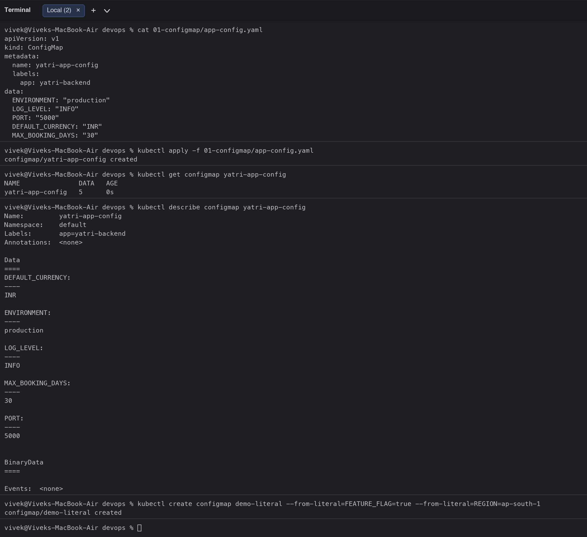
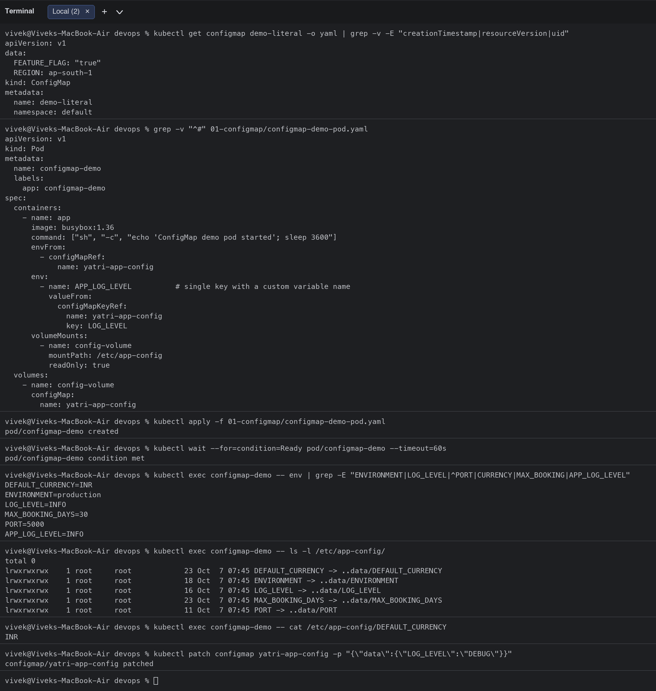
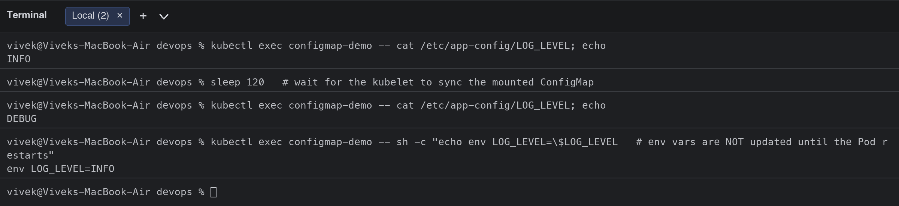

## Task 2: Secret hands-on ([02-secret/](02-secret/))

Files: [`db-secret.yaml`](02-secret/db-secret.yaml), [`secret-demo-pod.yaml`](02-secret/secret-demo-pod.yaml).

```bash
$ echo -n "yatri_admin" | base64
eWF0cmlfYWRtaW4=
$ echo -n "secretpassword" | base64
c2VjcmV0cGFzc3dvcmQ=
$ cat 02-secret/db-secret.yaml
apiVersion: v1
kind: Secret
metadata:
  name: yatri-db-secret
  labels:
    app: yatri-backend
type: Opaque
data:
  # Base64 for 'yatri_admin' -> echo -n "yatri_admin" | base64
  POSTGRES_USER: eWF0cmlfYWRtaW4=

  # Base64 for 'secretpassword' -> echo -n "secretpassword" | base64
  POSTGRES_PASSWORD: c2VjcmV0cGFzc3dvcmQ=
  # Base64 for 'yatri_production_db' -> echo -n "yatri_production_db" | base64
  POSTGRES_DB: eWF0cmlfcHJvZHVjdGlvbl9kYg==
$ kubectl apply -f 02-secret/db-secret.yaml
secret/yatri-db-secret created
$ kubectl get secret yatri-db-secret
NAME              TYPE     DATA   AGE
yatri-db-secret   Opaque   3      0s
$ kubectl describe secret yatri-db-secret
Name:         yatri-db-secret
Namespace:    default
Labels:       app=yatri-backend
Annotations:  <none>

Type:  Opaque

Data
====
POSTGRES_DB:        19 bytes
POSTGRES_PASSWORD:  14 bytes
POSTGRES_USER:      11 bytes
$ kubectl get secret yatri-db-secret -o jsonpath="{.data.POSTGRES_PASSWORD}" | base64 --decode; echo
secretpassword
$ kubectl create secret generic api-token --from-literal=API_TOKEN=sk-demo-12345 --dry-run=client -o yaml
apiVersion: v1
data:
  API_TOKEN: c2stZGVtby0xMjM0NQ==
kind: Secret
metadata:
  name: api-token
$ grep -v "^#" 02-secret/secret-demo-pod.yaml
apiVersion: v1
kind: Pod
metadata:
  name: secret-demo
  labels:
    app: secret-demo
spec:
  containers:
    - name: app
      image: busybox:1.36
      command: ["sh", "-c", "echo 'Secret demo pod started'; sleep 3600"]
      env:
        - name: POSTGRES_USER
          valueFrom:
            secretKeyRef:
              name: yatri-db-secret
              key: POSTGRES_USER
        - name: POSTGRES_PASSWORD
          valueFrom:
            secretKeyRef:
              name: yatri-db-secret
              key: POSTGRES_PASSWORD
        - name: POSTGRES_DB
          valueFrom:
            secretKeyRef:
              name: yatri-db-secret
              key: POSTGRES_DB
      volumeMounts:
        - name: secret-volume
          mountPath: /etc/db-secret
          readOnly: true
  volumes:
    - name: secret-volume
      secret:
        secretName: yatri-db-secret
        defaultMode: 0400
$ kubectl apply -f 02-secret/secret-demo-pod.yaml
pod/secret-demo created
$ kubectl wait --for=condition=Ready pod/secret-demo --timeout=60s
pod/secret-demo condition met
$ kubectl exec secret-demo -- env | grep POSTGRES
POSTGRES_USER=yatri_admin
POSTGRES_PASSWORD=secretpassword
POSTGRES_DB=yatri_production_db
$ kubectl exec secret-demo -- ls -l /etc/db-secret/
total 0
lrwxrwxrwx    1 root     root            18 Oct  7 07:46 POSTGRES_DB -> ..data/POSTGRES_DB
lrwxrwxrwx    1 root     root            24 Oct  7 07:46 POSTGRES_PASSWORD -> ..data/POSTGRES_PASSWORD
lrwxrwxrwx    1 root     root            20 Oct  7 07:46 POSTGRES_USER -> ..data/POSTGRES_USER
$ kubectl exec secret-demo -- cat /etc/db-secret/POSTGRES_PASSWORD; echo
secretpassword
$ kubectl exec secret-demo -- mount | grep db-secret
tmpfs on /etc/db-secret type tmpfs (ro,relatime,size=8112404k,inode64,noswap)
```

**What I verified**
- Secret values must be base64 in `data:` (or plain text in `stringData:`); `kubectl get/describe secret` never prints the values, only their byte size.
- `secretKeyRef` injected `POSTGRES_USER/PASSWORD/DB` as env vars; the volume mount exposed them as files with mode `0400` on a **tmpfs** mount, so they never touch the node disk.
- `base64 --decode` shows the original value, which proves base64 is **encoding, not encryption**.

### Why Secrets must not be committed to Git
- base64 is reversible: anyone with read access to the repo has the password (`echo c2VjcmV0cGFzc3dvcmQ= | base64 -d`).
- Git history is forever; even after deleting the file the value stays in old commits and in every fork/clone.
- Leaked credentials in public repos are scanned by bots within minutes.
- Safer options: keep real Secrets out of Git (`.gitignore`, only commit a `secret.example.yaml`), create them from a vault at deploy time (External Secrets Operator, HashiCorp Vault, AWS Secrets Manager), or commit **encrypted** versions (Sealed Secrets, SOPS + age/KMS). Also enable encryption at rest for etcd and RBAC-limit who can `get secrets`. The `yatri-db-secret` in this repo only holds demo values.

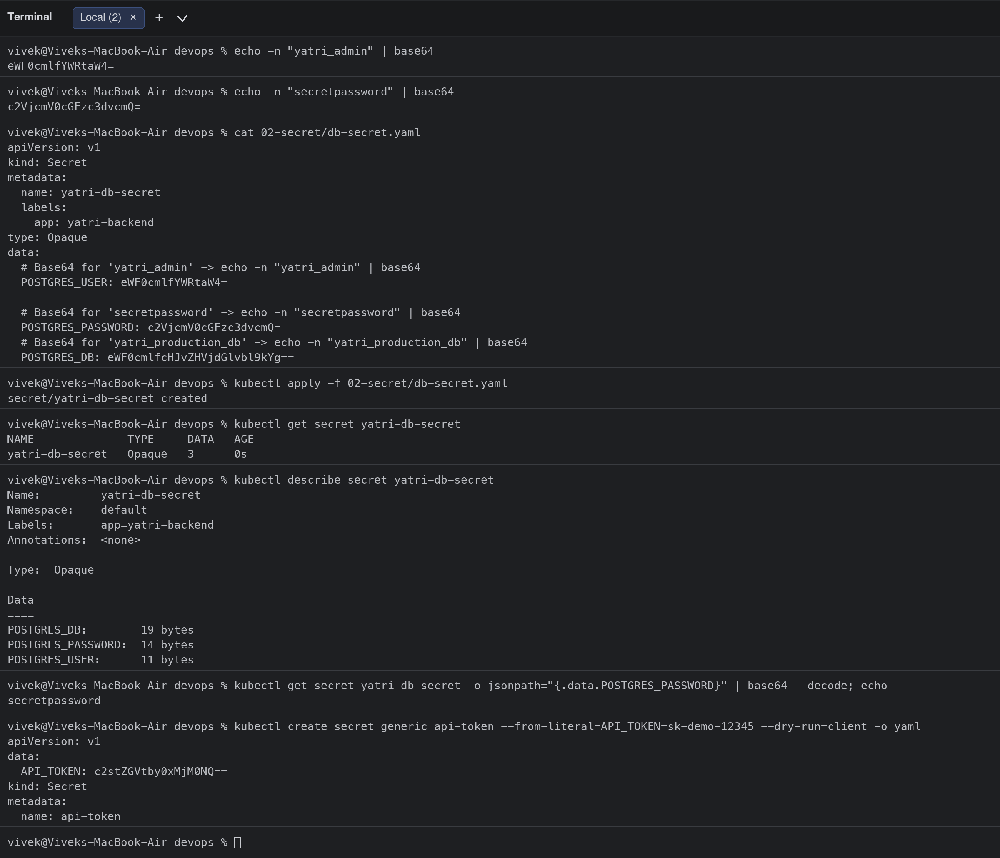
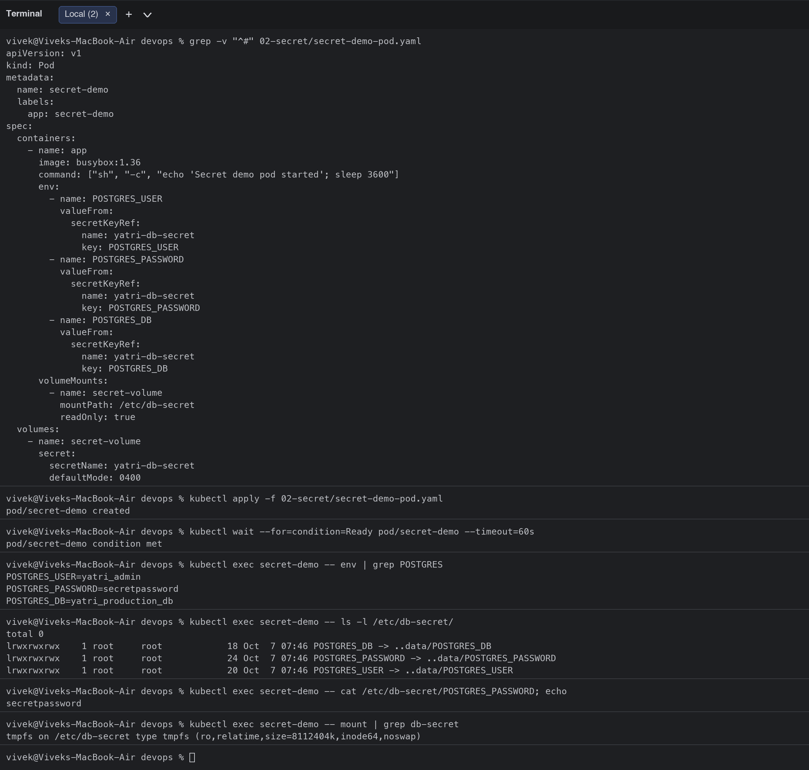

## Task 3: Ingress demo ([04-full-demo/](04-full-demo/))

Architecture:

```text
 curl -H "Host: yatri.local" http://<minikube-ip>/        curl .../api/
            |                                                  |
            v                                                  v
   +---------------------------------------------------------------+
   |   NGINX Ingress Controller  (namespace ingress-nginx)         |
   |   Ingress "yatri-ingress": host yatri.local                   |
   |     /api(/|$)(.*)  -> yatri-backend-service:80  (rewrite /$2) |
   |     /              -> yatri-frontend-service:80               |
   +---------------------------------------------------------------+
            |                                        |
   yatri-frontend-service (ClusterIP)      yatri-backend-service (ClusterIP)
            |                                        |
   nginx Pods x2                           python Pods x2  (env from ConfigMap + Secret)
```

```bash
$ cd 04-full-demo
$ kubectl get pods -n ingress-nginx
NAME                                       READY   STATUS      RESTARTS   AGE
ingress-nginx-admission-create-tgtxl       0/1     Completed   0          24m
ingress-nginx-admission-patch-chc9n        0/1     Completed   0          24m
ingress-nginx-controller-d7cd8c989-n2s8g   1/1     Running     0          24m
$ kubectl get ingressclass
NAME              CONTROLLER             PARAMETERS   AGE
nginx (default)   k8s.io/ingress-nginx   <none>       24m
$ kubectl apply -f configmap.yaml -f secret.yaml
configmap/yatri-app-config configured
secret/yatri-db-secret configured
$ kubectl apply -f frontend.yaml -f backend.yaml
deployment.apps/yatri-frontend created
service/yatri-frontend-service created
deployment.apps/yatri-backend created
service/yatri-backend-service created
$ kubectl rollout status deployment/yatri-frontend && kubectl rollout status deployment/yatri-backend
Waiting for deployment "yatri-frontend" rollout to finish: 0 of 2 updated replicas are available...
Waiting for deployment "yatri-frontend" rollout to finish: 1 of 2 updated replicas are available...
deployment "yatri-frontend" successfully rolled out
deployment "yatri-backend" successfully rolled out
$ kubectl get pods,svc -l "app in (yatri-frontend,yatri-backend)"
NAME                                 READY   STATUS    RESTARTS   AGE
pod/yatri-backend-6c58cb99c7-fwmrc   1/1     Running   0          1s
pod/yatri-backend-6c58cb99c7-s7sh4   1/1     Running   0          1s
pod/yatri-frontend-ddcfc4b5f-56pmb   1/1     Running   0          1s
pod/yatri-frontend-ddcfc4b5f-ng8s6   1/1     Running   0          1s

NAME                             TYPE        CLUSTER-IP      EXTERNAL-IP   PORT(S)   AGE
service/yatri-backend-service    ClusterIP   10.97.119.191   <none>        80/TCP    1s
service/yatri-frontend-service   ClusterIP   10.111.152.23   <none>        80/TCP    1s
$ cat ingress.yaml
apiVersion: networking.k8s.io/v1
kind: Ingress
metadata:
  name: yatri-ingress
  namespace: default
  labels:
    app: yatri-app
  annotations:
    # Do not force HTTP -> HTTPS redirect (no TLS cert in this demo)
    nginx.ingress.kubernetes.io/ssl-redirect: "false"
    # Allow regex capture groups in path rules
    nginx.ingress.kubernetes.io/use-regex: "true"
    # Strip /api prefix before forwarding to backend pods
    nginx.ingress.kubernetes.io/rewrite-target: /$2
spec:
  ingressClassName: nginx
  rules:
    - host: yatri.local
      http:
        paths:
          # Route /api/* to the backend Python service
          - path: /api(/|$)(.*)
            pathType: ImplementationSpecific
            backend:
              service:
                name: yatri-backend-service
                port:
                  number: 80
          # Route / (root) to the frontend Nginx service
          - path: /
            pathType: Prefix
            backend:
              service:
                name: yatri-frontend-service
                port:
                  number: 80
$ kubectl apply -f ingress.yaml
ingress.networking.k8s.io/yatri-ingress created
$ kubectl get ingress yatri-ingress
NAME            CLASS   HOSTS         ADDRESS        PORTS   AGE
yatri-ingress   nginx   yatri.local   192.168.49.2   80      15s
$ kubectl describe ingress yatri-ingress | grep -A 6 "^Rules"
Rules:
  Host         Path  Backends
  ----         ----  --------
  yatri.local  
               /api(/|$)(.*)   yatri-backend-service:80 (10.244.0.108:5000,10.244.0.107:5000)
               /               yatri-frontend-service:80 (10.244.0.106:80,10.244.0.105:80)
Annotations:   nginx.ingress.kubernetes.io/rewrite-target: /$2
$ colima ssh -- curl -s --resolve yatri.local:80:192.168.49.2 http://yatri.local/ | grep -o '<title>.*</title>'
<title>Welcome to nginx!</title>
$ colima ssh -- curl -s --resolve yatri.local:80:192.168.49.2 http://yatri.local/api/
Yatri Backend API
=================
ENVIRONMENT     : production
LOG_LEVEL       : INFO
DEFAULT_CURRENCY: INR
POSTGRES_USER   : yatri_admin
POSTGRES_DB     : yatri_production_db
$ colima ssh -- curl -s -o /dev/null -w 'no-Host-header -> HTTP %{http_code}
' http://192.168.49.2/
no-Host-header -> HTTP 404
$ kubectl exec deploy/yatri-backend -- env | grep -E "ENVIRONMENT|LOG_LEVEL|POSTGRES"
LOG_LEVEL=INFO
POSTGRES_USER=yatri_admin
POSTGRES_PASSWORD=secretpassword
POSTGRES_DB=yatri_production_db
ENVIRONMENT=production
$ kubectl logs -n ingress-nginx deploy/ingress-nginx-controller --tail=3 | cut -c1-160
192.168.49.1 - - [07/Oct/2026:07:47:00 +0000] "GET / HTTP/1.1" 200 615 "-" "curl/8.5.0" 74 0.000 [default-yatri-frontend-service-80] [] 10.244.0.106:80 615 0.00
192.168.49.1 - - [07/Oct/2026:07:47:00 +0000] "GET /api/ HTTP/1.1" 200 178 "-" "curl/8.5.0" 78 0.001 [default-yatri-backend-service-80] [] 10.244.0.108:5000 178
192.168.49.1 - - [07/Oct/2026:07:47:00 +0000] "HEAD /api/ HTTP/1.1" 501 0 "-" "curl/8.5.0" 79 0.000 [default-yatri-backend-service-80] [] 10.244.0.108:5000 0 0.
```

**Routing verified**
- `/` was answered by the nginx frontend (`Welcome to nginx!`), `/api/` by the Python backend (which prints the ConfigMap and Secret values injected into it).
- The ingress-controller access log shows each request with the upstream it chose (`default-yatri-frontend-service-80` vs `default-yatri-backend-service-80`).
- A request **without** the `Host: yatri.local` header gets 404 from the controller because no rule matches.
- On macOS the minikube node IP is only reachable from the Docker host VM, so I used `curl --resolve yatri.local:80:<minikube-ip>` from there instead of editing `/etc/hosts`.

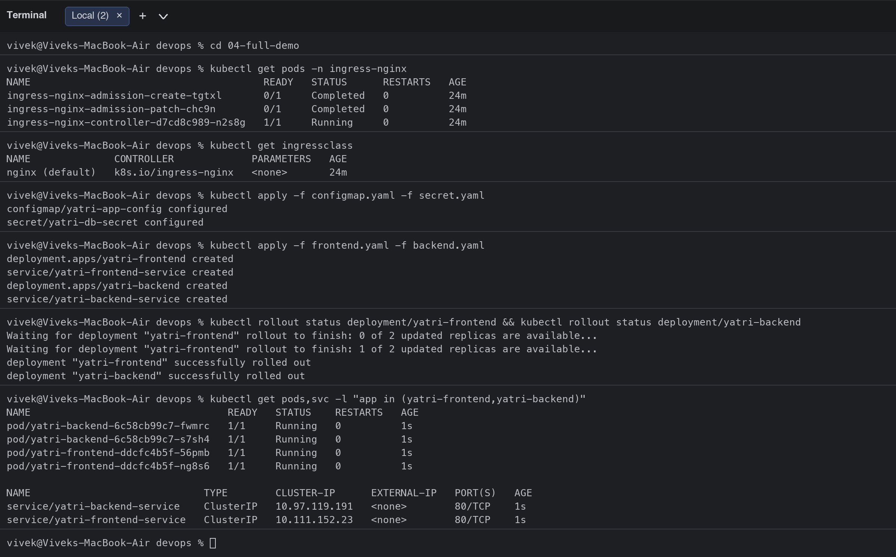
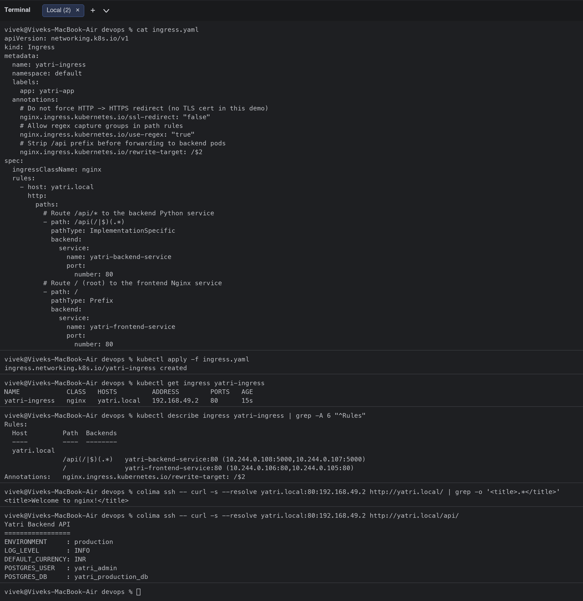
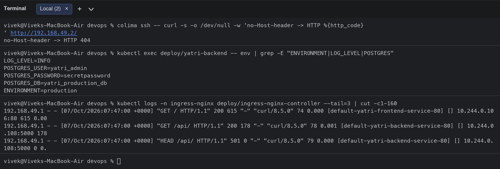

## Task 4: Ingress vs Ingress Controller
See [04-ingress-vs-ingress-controller/README.md](04-ingress-vs-ingress-controller/README.md).

## Task 5: Troubleshooting ([05-troubleshooting/](05-troubleshooting/), based on [troubleshooting/secret-base64-gotcha.md](troubleshooting/secret-base64-gotcha.md))

### Scenario 1: Secret encoded with a trailing newline

| Step | Result |
|---|---|
| 1. Identify the problem | MySQL Pod restarts in `Error`/`CrashLoopBackOff`; the client cannot connect (`ERROR 2003 Can't connect to MySQL server`) |
| 2. Troubleshooting commands | `kubectl get pods`, `kubectl logs deploy/mysql`, `kubectl get secret ... -o jsonpath \| base64 --decode \| od -c`, `kubectl exec ... od -c` |
| 3. Root cause | The password was encoded with `echo "secretpassword" \| base64`, so the Secret contains `secretpassword
`. The newline breaks the MySQL entrypoint (`unknown option '--"'`) and would make every password check fail. |
| 4. Fix | Re-encode with `echo -n`, `kubectl apply -f fixed-secret.yaml`, `kubectl rollout restart deployment/mysql` |
| 5. Verify | `od -c` shows no `\n`; `mysql -psecretpassword -e "SELECT 1"` returns `1` |

```bash
$ cd 05-troubleshooting
$ kubectl apply -f broken-secret-newline.yaml -f mysql.yaml -f db-client.yaml
secret/mysql-secret created
deployment.apps/mysql created
service/mysql created
pod/db-client created
$ kubectl rollout status deployment/mysql --timeout=180s
Waiting for deployment "mysql" rollout to finish: 0 of 1 updated replicas are available...
error: timed out waiting for the condition
$ kubectl wait --for=condition=Ready pod/db-client --timeout=120s
pod/db-client condition met
$ kubectl exec db-client -- mysql -h mysql -uroot -psecretpassword -e "SELECT 1 AS connected;"
mysql: [Warning] Using a password on the command line interface can be insecure.
ERROR 2003 (HY000): Can't connect to MySQL server on 'mysql:3306' (111)
command terminated with exit code 1
$ kubectl get pods
NAME                     READY   STATUS              RESTARTS      AGE
configmap-demo           0/1     ContainerCreating   0             4m48s
db-client                1/1     Running             0             3m6s
mysql-66f869f64c-6jdxz   0/1     Error               5 (86s ago)   3m6s
$ kubectl logs deploy/mysql --tail=2
2026-10-07 07:54:18+00:00 [Note] [Entrypoint]: Creating database demo
mysql: [ERROR] unknown option '--"'.
$ kubectl get secret mysql-secret -o jsonpath="{.data.MYSQL_ROOT_PASSWORD}"; echo
c2VjcmV0cGFzc3dvcmQK
$ kubectl get secret mysql-secret -o jsonpath="{.data.MYSQL_ROOT_PASSWORD}" | base64 --decode | od -c
0000000    s   e   c   r   e   t   p   a   s   s   w   o   r   d  \n    
0000017
$ echo "secretpassword" | base64
c2VjcmV0cGFzc3dvcmQK
$ echo -n "secretpassword" | base64
c2VjcmV0cGFzc3dvcmQ=
$ diff broken-secret-newline.yaml fixed-secret.yaml
1,4c1
< # BROKEN on purpose: MYSQL_ROOT_PASSWORD was produced with
< #   echo "secretpassword" | base64      ->  c2VjcmV0cGFzc3dvcmQK   (ends in "K" = trailing newline!)
< # instead of
< #   echo -n "secretpassword" | base64   ->  c2VjcmV0cGFzc3dvcmQ=
---
> # FIXED: value encoded with  echo -n "secretpassword" | base64
11c8
<   MYSQL_ROOT_PASSWORD: c2VjcmV0cGFzc3dvcmQK
---
>   MYSQL_ROOT_PASSWORD: c2VjcmV0cGFzc3dvcmQ=
$ kubectl apply -f fixed-secret.yaml
secret/mysql-secret configured
$ kubectl rollout restart deployment/mysql && kubectl rollout status deployment/mysql --timeout=180s
deployment.apps/mysql restarted
Waiting for deployment "mysql" rollout to finish: 1 old replicas are pending termination...
Waiting for deployment "mysql" rollout to finish: 1 old replicas are pending termination...
Waiting for deployment "mysql" rollout to finish: 1 old replicas are pending termination...
deployment "mysql" successfully rolled out
$ kubectl exec deploy/mysql -- sh -c "printf \"%s\" \"\$MYSQL_ROOT_PASSWORD\" | od -c"
0000000   s   e   c   r   e   t   p   a   s   s   w   o   r   d
0000016
$ kubectl exec db-client -- mysql -h mysql -uroot -psecretpassword -e "SELECT 1 AS connected;"
mysql: [Warning] Using a password on the command line interface can be insecure.
connected
1
$ kubectl delete -f broken-secret-newline.yaml -f mysql.yaml -f db-client.yaml
secret "mysql-secret" deleted from default namespace
deployment.apps "mysql" deleted from default namespace
service "mysql" deleted from default namespace
pod "db-client" deleted from default namespace
```

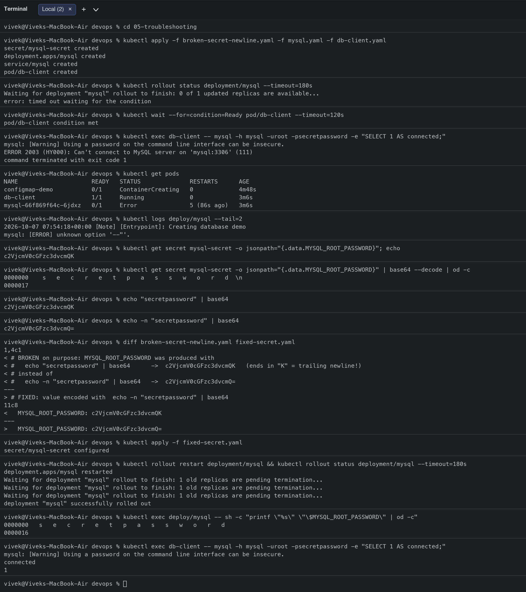
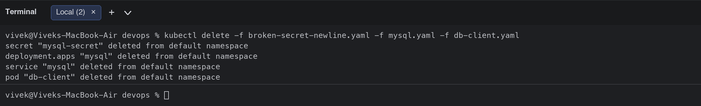

### Scenario 2: Ingress backend points to a non-existent Service (503)

| Step | Result |
|---|---|
| 1. Identify | `curl http://yatri.local/api/` returns `503 Service Temporarily Unavailable` while `/` still works |
| 2. Investigate | `kubectl describe ingress` shows `yatri-backend-svc:80 (<error: services "yatri-backend-svc" not found>)`; `kubectl get svc` lists `yatri-backend-service` |
| 3. Root cause | Typo in the Ingress backend Service name |
| 4. Fix | Apply the correct `ingress.yaml` |
| 5. Verify | Backends resolve to Pod IPs and `/api/` returns the backend response |

```bash
$ kubectl apply -f broken-ingress.yaml
ingress.networking.k8s.io/yatri-ingress configured
$ colima ssh -- curl -s --resolve yatri.local:80:192.168.49.2 http://yatri.local/api/ | head -n 3
<html>
<head><title>503 Service Temporarily Unavailable</title></head>
<body>
$ colima ssh -- curl -s --resolve yatri.local:80:192.168.49.2 http://yatri.local/ | grep -o '<title>.*</title>'
<title>Welcome to nginx!</title>
$ kubectl get ingress yatri-ingress
NAME            CLASS   HOSTS         ADDRESS        PORTS   AGE
yatri-ingress   nginx   yatri.local   192.168.49.2   80      76s
$ kubectl describe ingress yatri-ingress | grep -A 6 "^Rules"
Rules:
  Host         Path  Backends
  ----         ----  --------
  yatri.local  
               /api(/|$)(.*)   yatri-backend-svc:80 (<error: services "yatri-backend-svc" not found>)
               /               yatri-frontend-service:80 (10.244.0.106:80,10.244.0.105:80)
Annotations:   nginx.ingress.kubernetes.io/rewrite-target: /$2
$ kubectl get svc
NAME                     TYPE        CLUSTER-IP      EXTERNAL-IP   PORT(S)   AGE
kubernetes               ClusterIP   10.96.0.1       <none>        443/TCP   26m
yatri-backend-service    ClusterIP   10.97.119.191   <none>        80/TCP    77s
yatri-frontend-service   ClusterIP   10.111.152.23   <none>        80/TCP    77s
$ kubectl get endpointslices
NAME                           ADDRESSTYPE   PORTS   ENDPOINTS                   AGE
kubernetes                     IPv4          8443    192.168.49.2                26m
yatri-backend-service-j6gt4    IPv4          5000    10.244.0.108,10.244.0.107   77s
yatri-frontend-service-x5c6k   IPv4          80      10.244.0.106,10.244.0.105   77s
$ kubectl apply -f ../04-full-demo/ingress.yaml
ingress.networking.k8s.io/yatri-ingress configured
$ kubectl describe ingress yatri-ingress | grep -A 6 "^Rules"
Rules:
  Host         Path  Backends
  ----         ----  --------
  yatri.local  
               /api(/|$)(.*)   yatri-backend-service:80 (10.244.0.108:5000,10.244.0.107:5000)
               /               yatri-frontend-service:80 (10.244.0.106:80,10.244.0.105:80)
Annotations:   nginx.ingress.kubernetes.io/rewrite-target: /$2
$ colima ssh -- curl -s --resolve yatri.local:80:192.168.49.2 http://yatri.local/api/
Yatri Backend API
=================
ENVIRONMENT     : production
LOG_LEVEL       : INFO
DEFAULT_CURRENCY: INR
POSTGRES_USER   : yatri_admin
POSTGRES_DB     : yatri_production_db
```

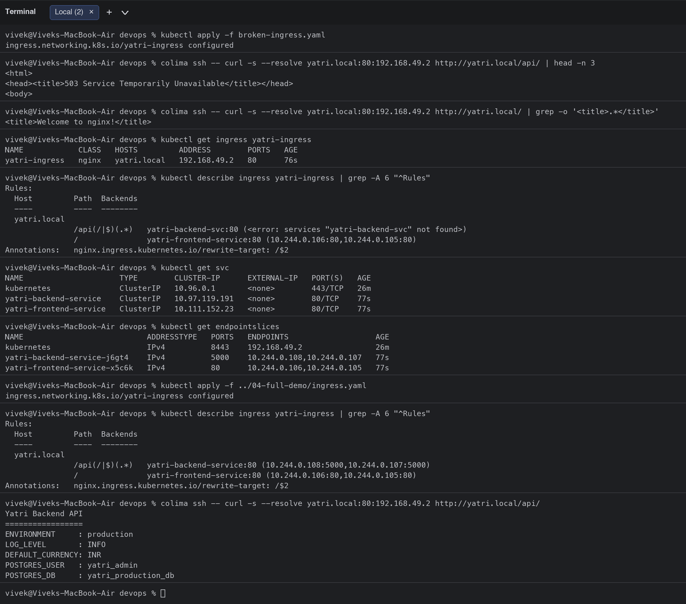

## Clean-up

```bash
$ kubectl delete -f 04-full-demo/configmap.yaml -f 04-full-demo/secret.yaml -f 04-full-demo/frontend.yaml -f 04-full-demo/backend.yaml -f 04-full-demo/ingress.yaml
configmap "yatri-app-config" deleted from default namespace
secret "yatri-db-secret" deleted from default namespace
deployment.apps "yatri-frontend" deleted from default namespace
service "yatri-frontend-service" deleted from default namespace
deployment.apps "yatri-backend" deleted from default namespace
service "yatri-backend-service" deleted from default namespace
ingress.networking.k8s.io "yatri-ingress" deleted from default namespace
$ kubectl delete pod configmap-demo secret-demo
pod "configmap-demo" deleted from default namespace
pod "secret-demo" deleted from default namespace
$ kubectl delete configmap demo-literal
configmap "demo-literal" deleted from default namespace
```
