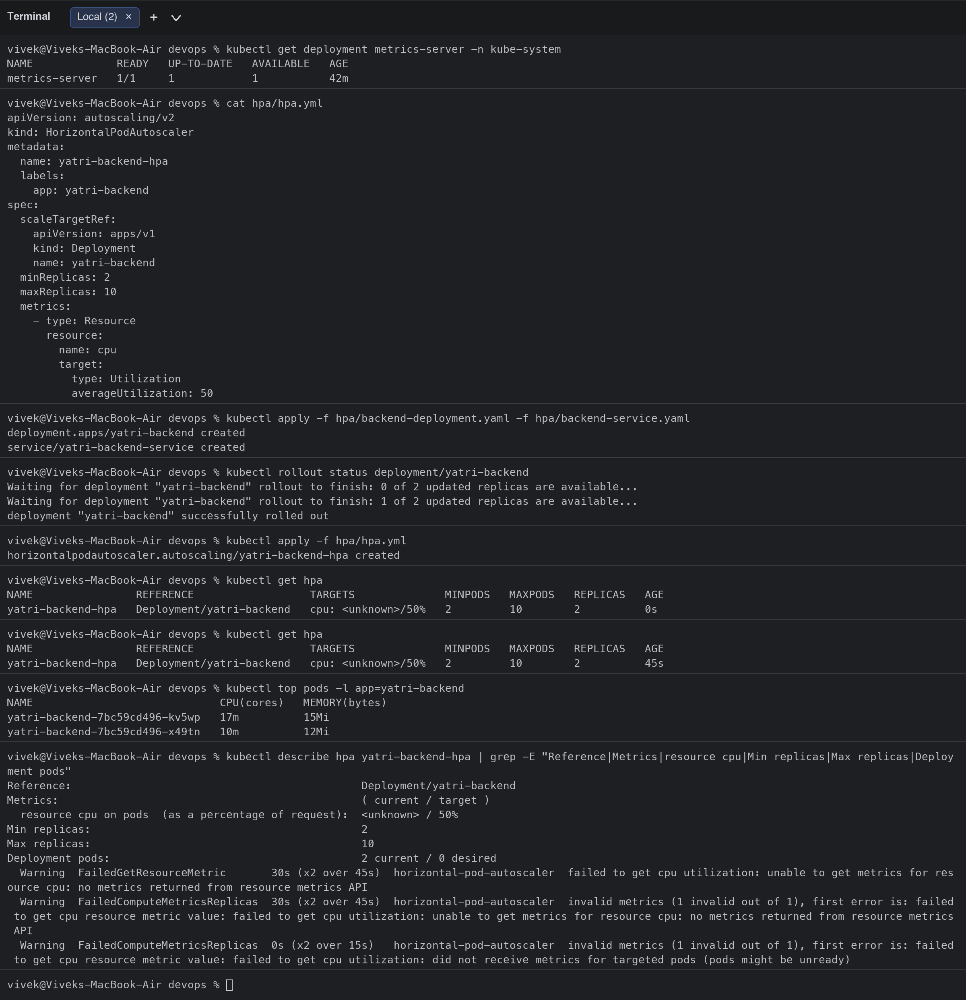
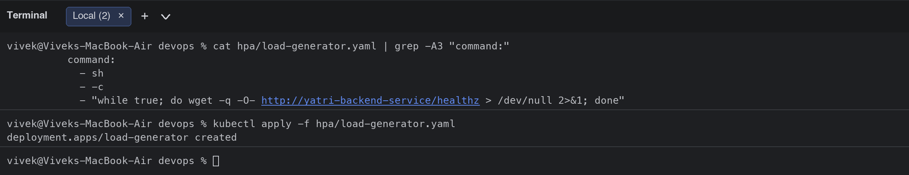
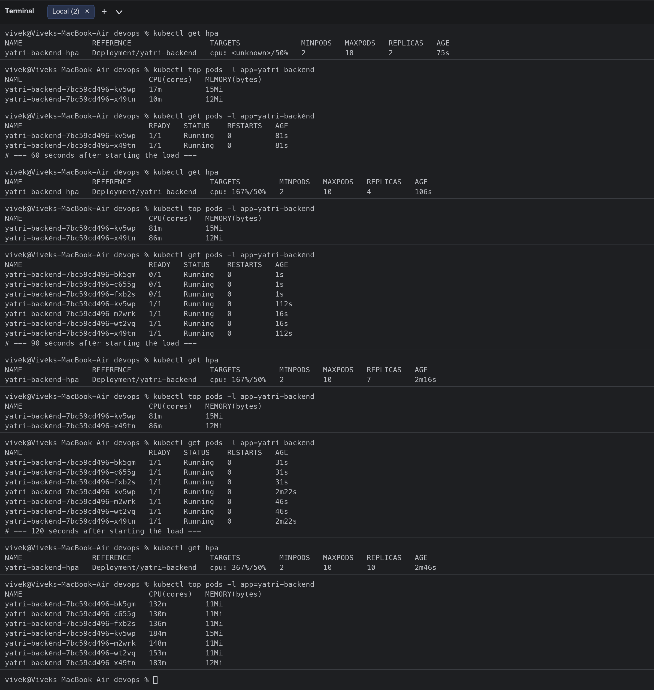
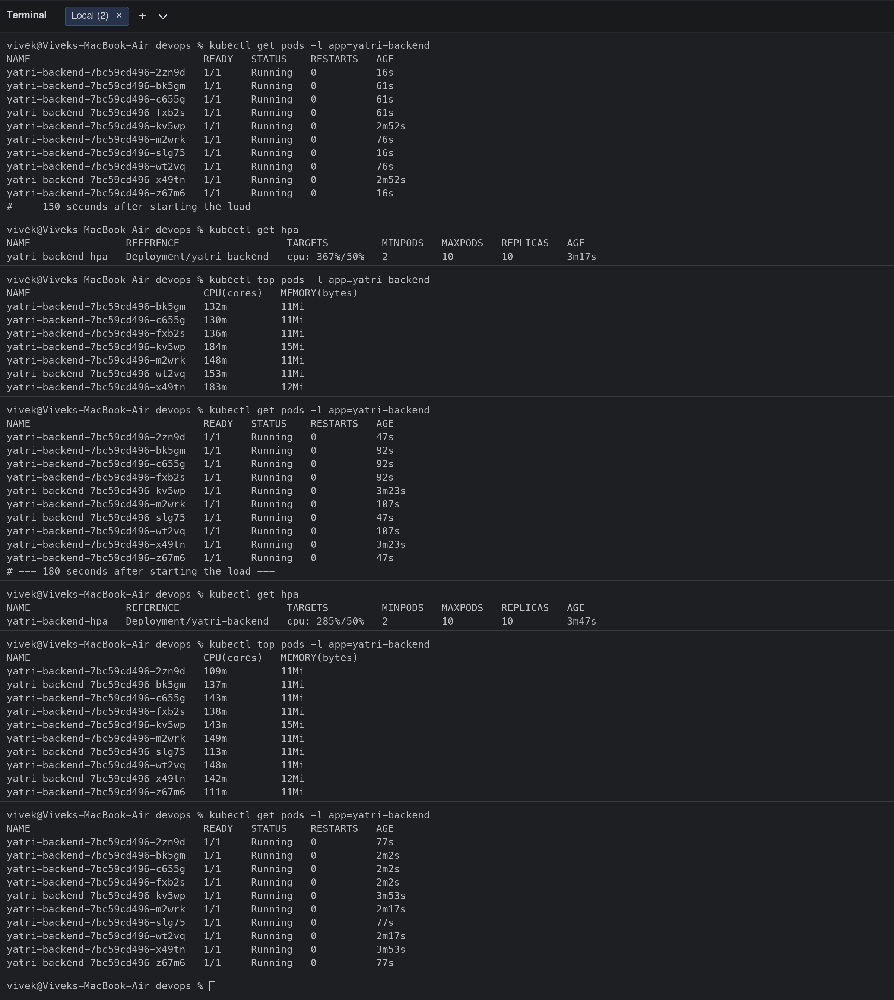
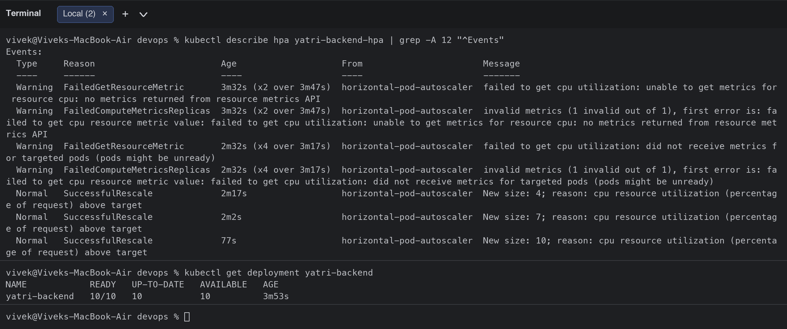
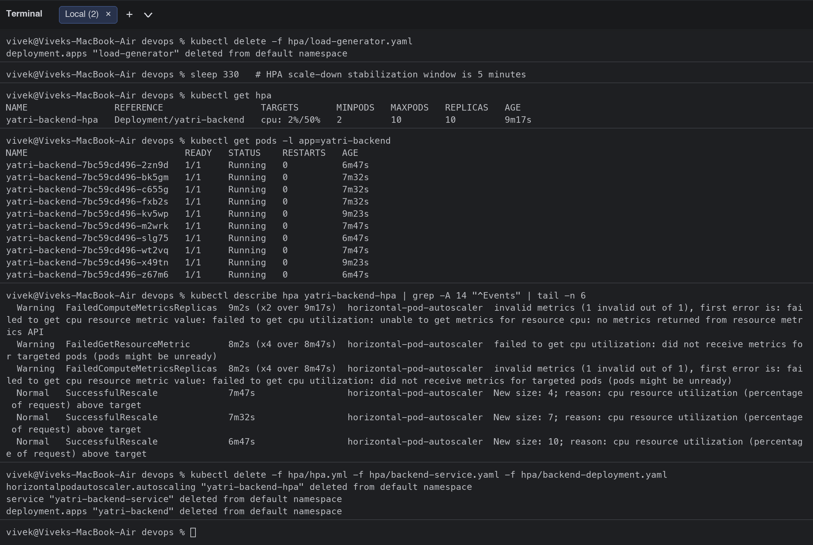
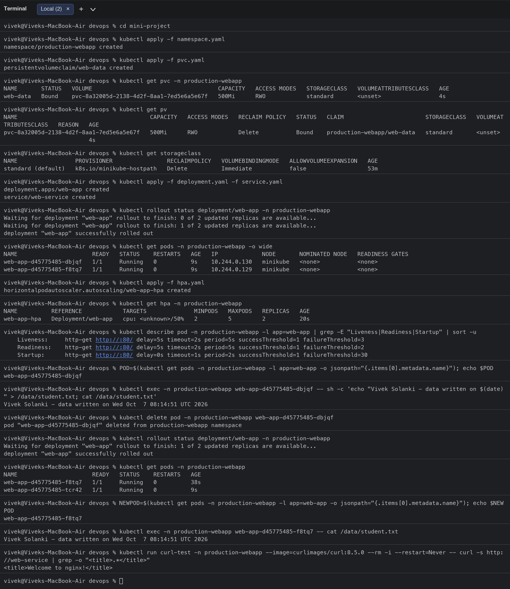
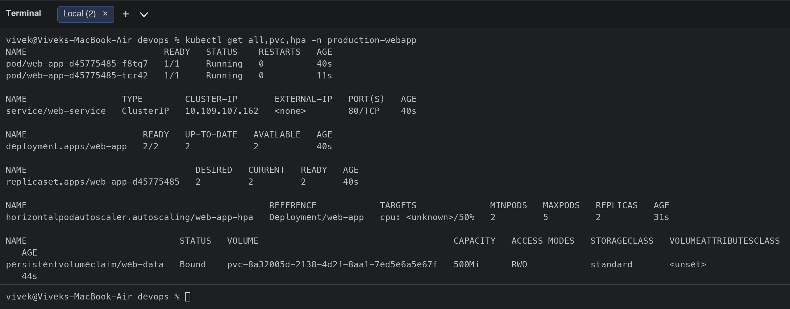
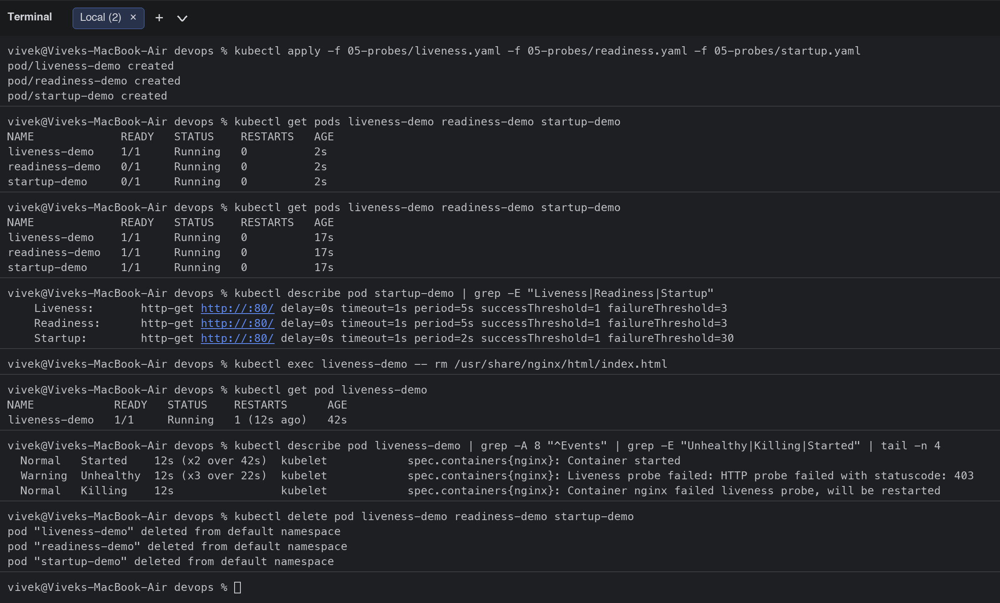

# Session 13: Kubernetes Storage, HPA & Probes

**Student:** Vivek Singh Solanki | **Roll number:** 24bcs10338
**Cluster:** minikube with `metrics-server` addon enabled

## Task 1: Kubernetes Volumes
Documentation with examples for emptyDir, hostPath, PersistentVolume, PersistentVolumeClaim, StorageClass and dynamic provisioning: [01-kubernetes-volumes/README.md](01-kubernetes-volumes/README.md)

## Task 2: HPA hands-on ([hpa/](hpa/))

Files: [`hpa.yml`](hpa/hpa.yml) (HorizontalPodAutoscaler, CPU target 50%, 2-10 replicas), [`backend-deployment.yaml`](hpa/backend-deployment.yaml) (CPU-bound Python backend, `requests.cpu: 50m`), [`backend-service.yaml`](hpa/backend-service.yaml), [`load-generator.yaml`](hpa/load-generator.yaml) (3 busybox Pods looping `wget` against the Service), plus the course script [`load_generator.sh`](hpa/load_generator.sh).

### 1-3. Deploy the application, configure and verify the HPA

```bash
$ kubectl get deployment metrics-server -n kube-system
NAME             READY   UP-TO-DATE   AVAILABLE   AGE
metrics-server   1/1     1            1           42m
$ cat hpa/hpa.yml
apiVersion: autoscaling/v2
kind: HorizontalPodAutoscaler
metadata:
  name: yatri-backend-hpa
  labels:
    app: yatri-backend
spec:
  scaleTargetRef:
    apiVersion: apps/v1
    kind: Deployment
    name: yatri-backend
  minReplicas: 2
  maxReplicas: 10
  metrics:
    - type: Resource
      resource:
        name: cpu
        target:
          type: Utilization
          averageUtilization: 50
$ kubectl apply -f hpa/backend-deployment.yaml -f hpa/backend-service.yaml
deployment.apps/yatri-backend created
service/yatri-backend-service created
$ kubectl rollout status deployment/yatri-backend
Waiting for deployment "yatri-backend" rollout to finish: 0 of 2 updated replicas are available...
Waiting for deployment "yatri-backend" rollout to finish: 1 of 2 updated replicas are available...
deployment "yatri-backend" successfully rolled out
$ kubectl apply -f hpa/hpa.yml
horizontalpodautoscaler.autoscaling/yatri-backend-hpa created
$ kubectl get hpa
NAME                REFERENCE                  TARGETS              MINPODS   MAXPODS   REPLICAS   AGE
yatri-backend-hpa   Deployment/yatri-backend   cpu: <unknown>/50%   2         10        2          0s
$ kubectl get hpa
NAME                REFERENCE                  TARGETS              MINPODS   MAXPODS   REPLICAS   AGE
yatri-backend-hpa   Deployment/yatri-backend   cpu: <unknown>/50%   2         10        2          45s
$ kubectl top pods -l app=yatri-backend
NAME                             CPU(cores)   MEMORY(bytes)   
yatri-backend-7bc59cd496-kv5wp   17m          15Mi            
yatri-backend-7bc59cd496-x49tn   10m          12Mi            
$ kubectl describe hpa yatri-backend-hpa | grep -E "Reference|Metrics|resource cpu|Min replicas|Max replicas|Deployment pods"
Reference:                                             Deployment/yatri-backend
Metrics:                                               ( current / target )
  resource cpu on pods  (as a percentage of request):  <unknown> / 50%
Min replicas:                                          2
Max replicas:                                          10
Deployment pods:                                       2 current / 0 desired
  Warning  FailedGetResourceMetric       30s (x2 over 45s)  horizontal-pod-autoscaler  failed to get cpu utilization: unable to get metrics for resource cpu: no metrics returned from resource metrics API
  Warning  FailedComputeMetricsReplicas  30s (x2 over 45s)  horizontal-pod-autoscaler  invalid metrics (1 invalid out of 1), first error is: failed to get cpu resource metric value: failed to get cpu utilization: unable to get metrics for resource cpu: no metrics returned from resource metrics API
  Warning  FailedComputeMetricsReplicas  0s (x2 over 15s)   horizontal-pod-autoscaler  invalid metrics (1 invalid out of 1), first error is: failed to get cpu resource metric value: failed to get cpu utilization: did not receive metrics for targeted pods (pods might be unready)
$ cat hpa/load-generator.yaml | grep -A3 "command:"
          command:
            - sh
            - -c
            - "while true; do wget -q -O- http://yatri-backend-service/healthz > /dev/null 2>&1; done"
$ kubectl apply -f hpa/load-generator.yaml
deployment.apps/load-generator created
```

Right after creation the HPA shows `<unknown>` because metrics-server needs ~1 minute of samples; `kubectl top pods` already shows the idle usage (10-17m of the 50m request).




### 4-8. Load generator, CPU utilisation and Pod scaling (observed every 30 s)

```bash
# --- 30 seconds after starting the load ---
$ kubectl get hpa
NAME                REFERENCE                  TARGETS              MINPODS   MAXPODS   REPLICAS   AGE
yatri-backend-hpa   Deployment/yatri-backend   cpu: <unknown>/50%   2         10        2          75s
$ kubectl top pods -l app=yatri-backend
NAME                             CPU(cores)   MEMORY(bytes)   
yatri-backend-7bc59cd496-kv5wp   17m          15Mi            
yatri-backend-7bc59cd496-x49tn   10m          12Mi            
$ kubectl get pods -l app=yatri-backend
NAME                             READY   STATUS    RESTARTS   AGE
yatri-backend-7bc59cd496-kv5wp   1/1     Running   0          81s
yatri-backend-7bc59cd496-x49tn   1/1     Running   0          81s
# --- 60 seconds after starting the load ---
$ kubectl get hpa
NAME                REFERENCE                  TARGETS         MINPODS   MAXPODS   REPLICAS   AGE
yatri-backend-hpa   Deployment/yatri-backend   cpu: 167%/50%   2         10        4          106s
$ kubectl top pods -l app=yatri-backend
NAME                             CPU(cores)   MEMORY(bytes)   
yatri-backend-7bc59cd496-kv5wp   81m          15Mi            
yatri-backend-7bc59cd496-x49tn   86m          12Mi            
$ kubectl get pods -l app=yatri-backend
NAME                             READY   STATUS    RESTARTS   AGE
yatri-backend-7bc59cd496-bk5gm   0/1     Running   0          1s
yatri-backend-7bc59cd496-c655g   0/1     Running   0          1s
yatri-backend-7bc59cd496-fxb2s   0/1     Running   0          1s
yatri-backend-7bc59cd496-kv5wp   1/1     Running   0          112s
yatri-backend-7bc59cd496-m2wrk   1/1     Running   0          16s
yatri-backend-7bc59cd496-wt2vq   1/1     Running   0          16s
yatri-backend-7bc59cd496-x49tn   1/1     Running   0          112s
# --- 90 seconds after starting the load ---
$ kubectl get hpa
NAME                REFERENCE                  TARGETS         MINPODS   MAXPODS   REPLICAS   AGE
yatri-backend-hpa   Deployment/yatri-backend   cpu: 167%/50%   2         10        7          2m16s
$ kubectl top pods -l app=yatri-backend
NAME                             CPU(cores)   MEMORY(bytes)   
yatri-backend-7bc59cd496-kv5wp   81m          15Mi            
yatri-backend-7bc59cd496-x49tn   86m          12Mi            
$ kubectl get pods -l app=yatri-backend
NAME                             READY   STATUS    RESTARTS   AGE
yatri-backend-7bc59cd496-bk5gm   1/1     Running   0          31s
yatri-backend-7bc59cd496-c655g   1/1     Running   0          31s
yatri-backend-7bc59cd496-fxb2s   1/1     Running   0          31s
yatri-backend-7bc59cd496-kv5wp   1/1     Running   0          2m22s
yatri-backend-7bc59cd496-m2wrk   1/1     Running   0          46s
yatri-backend-7bc59cd496-wt2vq   1/1     Running   0          46s
yatri-backend-7bc59cd496-x49tn   1/1     Running   0          2m22s
# --- 120 seconds after starting the load ---
$ kubectl get hpa
NAME                REFERENCE                  TARGETS         MINPODS   MAXPODS   REPLICAS   AGE
yatri-backend-hpa   Deployment/yatri-backend   cpu: 367%/50%   2         10        10         2m46s
$ kubectl top pods -l app=yatri-backend
NAME                             CPU(cores)   MEMORY(bytes)   
yatri-backend-7bc59cd496-bk5gm   132m         11Mi            
yatri-backend-7bc59cd496-c655g   130m         11Mi            
yatri-backend-7bc59cd496-fxb2s   136m         11Mi            
yatri-backend-7bc59cd496-kv5wp   184m         15Mi            
yatri-backend-7bc59cd496-m2wrk   148m         11Mi            
yatri-backend-7bc59cd496-wt2vq   153m         11Mi            
yatri-backend-7bc59cd496-x49tn   183m         12Mi            
$ kubectl get pods -l app=yatri-backend
NAME                             READY   STATUS    RESTARTS   AGE
yatri-backend-7bc59cd496-2zn9d   1/1     Running   0          16s
yatri-backend-7bc59cd496-bk5gm   1/1     Running   0          61s
yatri-backend-7bc59cd496-c655g   1/1     Running   0          61s
yatri-backend-7bc59cd496-fxb2s   1/1     Running   0          61s
yatri-backend-7bc59cd496-kv5wp   1/1     Running   0          2m52s
yatri-backend-7bc59cd496-m2wrk   1/1     Running   0          76s
yatri-backend-7bc59cd496-slg75   1/1     Running   0          16s
yatri-backend-7bc59cd496-wt2vq   1/1     Running   0          76s
yatri-backend-7bc59cd496-x49tn   1/1     Running   0          2m52s
yatri-backend-7bc59cd496-z67m6   1/1     Running   0          16s
# --- 150 seconds after starting the load ---
$ kubectl get hpa
NAME                REFERENCE                  TARGETS         MINPODS   MAXPODS   REPLICAS   AGE
yatri-backend-hpa   Deployment/yatri-backend   cpu: 367%/50%   2         10        10         3m17s
$ kubectl top pods -l app=yatri-backend
NAME                             CPU(cores)   MEMORY(bytes)   
yatri-backend-7bc59cd496-bk5gm   132m         11Mi            
yatri-backend-7bc59cd496-c655g   130m         11Mi            
yatri-backend-7bc59cd496-fxb2s   136m         11Mi            
yatri-backend-7bc59cd496-kv5wp   184m         15Mi            
yatri-backend-7bc59cd496-m2wrk   148m         11Mi            
yatri-backend-7bc59cd496-wt2vq   153m         11Mi            
yatri-backend-7bc59cd496-x49tn   183m         12Mi            
$ kubectl get pods -l app=yatri-backend
NAME                             READY   STATUS    RESTARTS   AGE
yatri-backend-7bc59cd496-2zn9d   1/1     Running   0          47s
yatri-backend-7bc59cd496-bk5gm   1/1     Running   0          92s
yatri-backend-7bc59cd496-c655g   1/1     Running   0          92s
yatri-backend-7bc59cd496-fxb2s   1/1     Running   0          92s
yatri-backend-7bc59cd496-kv5wp   1/1     Running   0          3m23s
yatri-backend-7bc59cd496-m2wrk   1/1     Running   0          107s
yatri-backend-7bc59cd496-slg75   1/1     Running   0          47s
yatri-backend-7bc59cd496-wt2vq   1/1     Running   0          107s
yatri-backend-7bc59cd496-x49tn   1/1     Running   0          3m23s
yatri-backend-7bc59cd496-z67m6   1/1     Running   0          47s
# --- 180 seconds after starting the load ---
$ kubectl get hpa
NAME                REFERENCE                  TARGETS         MINPODS   MAXPODS   REPLICAS   AGE
yatri-backend-hpa   Deployment/yatri-backend   cpu: 285%/50%   2         10        10         3m47s
$ kubectl top pods -l app=yatri-backend
NAME                             CPU(cores)   MEMORY(bytes)   
yatri-backend-7bc59cd496-2zn9d   109m         11Mi            
yatri-backend-7bc59cd496-bk5gm   137m         11Mi            
yatri-backend-7bc59cd496-c655g   143m         11Mi            
yatri-backend-7bc59cd496-fxb2s   138m         11Mi            
yatri-backend-7bc59cd496-kv5wp   143m         15Mi            
yatri-backend-7bc59cd496-m2wrk   149m         11Mi            
yatri-backend-7bc59cd496-slg75   113m         11Mi            
yatri-backend-7bc59cd496-wt2vq   148m         11Mi            
yatri-backend-7bc59cd496-x49tn   142m         12Mi            
yatri-backend-7bc59cd496-z67m6   111m         11Mi            
$ kubectl get pods -l app=yatri-backend
NAME                             READY   STATUS    RESTARTS   AGE
yatri-backend-7bc59cd496-2zn9d   1/1     Running   0          77s
yatri-backend-7bc59cd496-bk5gm   1/1     Running   0          2m2s
yatri-backend-7bc59cd496-c655g   1/1     Running   0          2m2s
yatri-backend-7bc59cd496-fxb2s   1/1     Running   0          2m2s
yatri-backend-7bc59cd496-kv5wp   1/1     Running   0          3m53s
yatri-backend-7bc59cd496-m2wrk   1/1     Running   0          2m17s
yatri-backend-7bc59cd496-slg75   1/1     Running   0          77s
yatri-backend-7bc59cd496-wt2vq   1/1     Running   0          2m17s
yatri-backend-7bc59cd496-x49tn   1/1     Running   0          3m53s
yatri-backend-7bc59cd496-z67m6   1/1     Running   0          77s
$ kubectl describe hpa yatri-backend-hpa | grep -A 12 "^Events"
Events:
  Type     Reason                        Age                    From                       Message
  ----     ------                        ----                   ----                       -------
  Warning  FailedGetResourceMetric       3m32s (x2 over 3m47s)  horizontal-pod-autoscaler  failed to get cpu utilization: unable to get metrics for resource cpu: no metrics returned from resource metrics API
  Warning  FailedComputeMetricsReplicas  3m32s (x2 over 3m47s)  horizontal-pod-autoscaler  invalid metrics (1 invalid out of 1), first error is: failed to get cpu resource metric value: failed to get cpu utilization: unable to get metrics for resource cpu: no metrics returned from resource metrics API
  Warning  FailedGetResourceMetric       2m32s (x4 over 3m17s)  horizontal-pod-autoscaler  failed to get cpu utilization: did not receive metrics for targeted pods (pods might be unready)
  Warning  FailedComputeMetricsReplicas  2m32s (x4 over 3m17s)  horizontal-pod-autoscaler  invalid metrics (1 invalid out of 1), first error is: failed to get cpu resource metric value: failed to get cpu utilization: did not receive metrics for targeted pods (pods might be unready)
  Normal   SuccessfulRescale             2m17s                  horizontal-pod-autoscaler  New size: 4; reason: cpu resource utilization (percentage of request) above target
  Normal   SuccessfulRescale             2m2s                   horizontal-pod-autoscaler  New size: 7; reason: cpu resource utilization (percentage of request) above target
  Normal   SuccessfulRescale             77s                    horizontal-pod-autoscaler  New size: 10; reason: cpu resource utilization (percentage of request) above target
$ kubectl get deployment yatri-backend
NAME            READY   UP-TO-DATE   AVAILABLE   AGE
yatri-backend   10/10   10           10          3m53s
```

**What I observed**
- Utilisation jumped to **167 %** of the request, so the HPA scaled 2 -> 4 -> 7 -> 10 (the `maxReplicas`). The formula is `desired = ceil(current * (currentUtil / targetUtil))`, limited by the scale-up policy (double every 15 s).
- `kubectl top pods` showed every backend Pod near its CPU limit while the load ran.
- `kubectl describe hpa` lists the `SuccessfulRescale` events with the reason.





### Scale-down after removing the load

```bash
$ kubectl delete -f hpa/load-generator.yaml
deployment.apps "load-generator" deleted from default namespace
$ sleep 330   # HPA scale-down stabilization window is 5 minutes
$ kubectl get hpa
NAME                REFERENCE                  TARGETS       MINPODS   MAXPODS   REPLICAS   AGE
yatri-backend-hpa   Deployment/yatri-backend   cpu: 2%/50%   2         10        10         9m17s
$ kubectl get pods -l app=yatri-backend
NAME                             READY   STATUS    RESTARTS   AGE
yatri-backend-7bc59cd496-2zn9d   1/1     Running   0          6m47s
yatri-backend-7bc59cd496-bk5gm   1/1     Running   0          7m32s
yatri-backend-7bc59cd496-c655g   1/1     Running   0          7m32s
yatri-backend-7bc59cd496-fxb2s   1/1     Running   0          7m32s
yatri-backend-7bc59cd496-kv5wp   1/1     Running   0          9m23s
yatri-backend-7bc59cd496-m2wrk   1/1     Running   0          7m47s
yatri-backend-7bc59cd496-slg75   1/1     Running   0          6m47s
yatri-backend-7bc59cd496-wt2vq   1/1     Running   0          7m47s
yatri-backend-7bc59cd496-x49tn   1/1     Running   0          9m23s
yatri-backend-7bc59cd496-z67m6   1/1     Running   0          6m47s
$ kubectl describe hpa yatri-backend-hpa | grep -A 14 "^Events" | tail -n 6
  Warning  FailedComputeMetricsReplicas  9m2s (x2 over 9m17s)  horizontal-pod-autoscaler  invalid metrics (1 invalid out of 1), first error is: failed to get cpu resource metric value: failed to get cpu utilization: unable to get metrics for resource cpu: no metrics returned from resource metrics API
  Warning  FailedGetResourceMetric       8m2s (x4 over 8m47s)  horizontal-pod-autoscaler  failed to get cpu utilization: did not receive metrics for targeted pods (pods might be unready)
  Warning  FailedComputeMetricsReplicas  8m2s (x4 over 8m47s)  horizontal-pod-autoscaler  invalid metrics (1 invalid out of 1), first error is: failed to get cpu resource metric value: failed to get cpu utilization: did not receive metrics for targeted pods (pods might be unready)
  Normal   SuccessfulRescale             7m47s                 horizontal-pod-autoscaler  New size: 4; reason: cpu resource utilization (percentage of request) above target
  Normal   SuccessfulRescale             7m32s                 horizontal-pod-autoscaler  New size: 7; reason: cpu resource utilization (percentage of request) above target
  Normal   SuccessfulRescale             6m47s                 horizontal-pod-autoscaler  New size: 10; reason: cpu resource utilization (percentage of request) above target
$ kubectl delete -f hpa/hpa.yml -f hpa/backend-service.yaml -f hpa/backend-deployment.yaml
horizontalpodautoscaler.autoscaling "yatri-backend-hpa" deleted from default namespace
service "yatri-backend-service" deleted from default namespace
deployment.apps "yatri-backend" deleted from default namespace
```

After the load generator was deleted the CPU dropped to **2 %**, but the replica count was still 10 at this check: the HPA only scales down after the default **5-minute stabilisation window** has passed since the last scale-up recommendation, so the return to `minReplicas` happens a few minutes later than the scale-up. This asymmetry (fast up, slow down) is intentional to avoid flapping.



## Task 3: Mini project ([mini-project/](mini-project/))

Namespace `production-webapp` with a PVC-backed nginx Deployment, ClusterIP Service, HPA (2-5 replicas) and startup/readiness/liveness probes.

```bash
$ cd mini-project
$ kubectl apply -f namespace.yaml
namespace/production-webapp created
$ kubectl apply -f pvc.yaml
persistentvolumeclaim/web-data created
$ kubectl get pvc -n production-webapp
NAME       STATUS   VOLUME                                     CAPACITY   ACCESS MODES   STORAGECLASS   VOLUMEATTRIBUTESCLASS   AGE
web-data   Bound    pvc-8a32005d-2138-4d2f-8aa1-7ed5e6a5e67f   500Mi      RWO            standard       <unset>                 4s
$ kubectl get pv
NAME                                       CAPACITY   ACCESS MODES   RECLAIM POLICY   STATUS   CLAIM                        STORAGECLASS   VOLUMEATTRIBUTESCLASS   REASON   AGE
pvc-8a32005d-2138-4d2f-8aa1-7ed5e6a5e67f   500Mi      RWO            Delete           Bound    production-webapp/web-data   standard       <unset>                          4s
$ kubectl get storageclass
NAME                 PROVISIONER                RECLAIMPOLICY   VOLUMEBINDINGMODE   ALLOWVOLUMEEXPANSION   AGE
standard (default)   k8s.io/minikube-hostpath   Delete          Immediate           false                  53m
$ kubectl apply -f deployment.yaml -f service.yaml
deployment.apps/web-app created
service/web-service created
$ kubectl rollout status deployment/web-app -n production-webapp
Waiting for deployment "web-app" rollout to finish: 0 of 2 updated replicas are available...
Waiting for deployment "web-app" rollout to finish: 1 of 2 updated replicas are available...
deployment "web-app" successfully rolled out
$ kubectl get pods -n production-webapp -o wide
NAME                      READY   STATUS    RESTARTS   AGE   IP             NODE       NOMINATED NODE   READINESS GATES
web-app-d45775485-dbjqf   1/1     Running   0          9s    10.244.0.130   minikube   <none>           <none>
web-app-d45775485-f8tq7   1/1     Running   0          9s    10.244.0.129   minikube   <none>           <none>
$ kubectl apply -f hpa.yaml
horizontalpodautoscaler.autoscaling/web-app-hpa created
$ kubectl get hpa -n production-webapp
NAME          REFERENCE            TARGETS              MINPODS   MAXPODS   REPLICAS   AGE
web-app-hpa   Deployment/web-app   cpu: <unknown>/50%   2         5         2          20s
$ kubectl describe pod -n production-webapp -l app=web-app | grep -E "Liveness|Readiness|Startup" | sort -u
    Liveness:     http-get http://:80/ delay=5s timeout=2s period=5s successThreshold=1 failureThreshold=3
    Readiness:    http-get http://:80/ delay=5s timeout=2s period=5s successThreshold=1 failureThreshold=2
    Startup:      http-get http://:80/ delay=0s timeout=1s period=2s successThreshold=1 failureThreshold=30
$ POD=$(kubectl get pods -n production-webapp -l app=web-app -o jsonpath="{.items[0].metadata.name}"); echo $POD
web-app-d45775485-dbjqf
$ kubectl exec -n production-webapp web-app-d45775485-dbjqf -- sh -c 'echo "Vivek Solanki - data written on $(date)" > /data/student.txt; cat /data/student.txt'
Vivek Solanki - data written on Wed Oct  7 08:14:51 UTC 2026
$ kubectl delete pod -n production-webapp web-app-d45775485-dbjqf
pod "web-app-d45775485-dbjqf" deleted from production-webapp namespace
$ kubectl rollout status deployment/web-app -n production-webapp
Waiting for deployment "web-app" rollout to finish: 1 of 2 updated replicas are available...
deployment "web-app" successfully rolled out
$ kubectl get pods -n production-webapp
NAME                      READY   STATUS    RESTARTS   AGE
web-app-d45775485-f8tq7   1/1     Running   0          38s
web-app-d45775485-tcr42   1/1     Running   0          9s
$ NEWPOD=$(kubectl get pods -n production-webapp -l app=web-app -o jsonpath="{.items[0].metadata.name}"); echo $NEWPOD
web-app-d45775485-f8tq7
$ kubectl exec -n production-webapp web-app-d45775485-f8tq7 -- cat /data/student.txt
Vivek Solanki - data written on Wed Oct  7 08:14:51 UTC 2026
$ kubectl run curl-test -n production-webapp --image=curlimages/curl:8.5.0 --rm -i --restart=Never -- curl -s http://web-service | grep -o "<title>.*</title>"
<title>Welcome to nginx!</title>
$ kubectl get all,pvc,hpa -n production-webapp
NAME                          READY   STATUS    RESTARTS   AGE
pod/web-app-d45775485-f8tq7   1/1     Running   0          40s
pod/web-app-d45775485-tcr42   1/1     Running   0          11s

NAME                  TYPE        CLUSTER-IP       EXTERNAL-IP   PORT(S)   AGE
service/web-service   ClusterIP   10.109.107.162   <none>        80/TCP    40s

NAME                      READY   UP-TO-DATE   AVAILABLE   AGE
deployment.apps/web-app   2/2     2            2           40s

NAME                                DESIRED   CURRENT   READY   AGE
replicaset.apps/web-app-d45775485   2         2         2       40s

NAME                                              REFERENCE            TARGETS              MINPODS   MAXPODS   REPLICAS   AGE
horizontalpodautoscaler.autoscaling/web-app-hpa   Deployment/web-app   cpu: <unknown>/50%   2         5         2          31s

NAME                             STATUS   VOLUME                                     CAPACITY   ACCESS MODES   STORAGECLASS   VOLUMEATTRIBUTESCLASS   AGE
persistentvolumeclaim/web-data   Bound    pvc-8a32005d-2138-4d2f-8aa1-7ed5e6a5e67f   500Mi      RWO            standard       <unset>                 44s
```

**What I verified**
- The PVC was **dynamically provisioned**: the `standard` StorageClass (`k8s.io/minikube-hostpath`) created a PV and bound it within seconds.
- Data persistence: I wrote `/data/student.txt` in one Pod, deleted the Pod, and the replacement Pod (new name) still had the file, because the data lives on the PV, not in the container.
- The three probes are configured on every Pod and the Service answers from inside the cluster.
- The HPA for the mini project is in place with the same CPU target.




## Probes demo ([05-probes/](05-probes/))

```bash
$ kubectl apply -f 05-probes/liveness.yaml -f 05-probes/readiness.yaml -f 05-probes/startup.yaml
pod/liveness-demo created
pod/readiness-demo created
pod/startup-demo created
$ kubectl get pods liveness-demo readiness-demo startup-demo
NAME             READY   STATUS    RESTARTS   AGE
liveness-demo    1/1     Running   0          2s
readiness-demo   0/1     Running   0          2s
startup-demo     0/1     Running   0          2s
$ kubectl get pods liveness-demo readiness-demo startup-demo
NAME             READY   STATUS    RESTARTS   AGE
liveness-demo    1/1     Running   0          17s
readiness-demo   1/1     Running   0          17s
startup-demo     1/1     Running   0          17s
$ kubectl describe pod startup-demo | grep -E "Liveness|Readiness|Startup"
    Liveness:       http-get http://:80/ delay=0s timeout=1s period=5s successThreshold=1 failureThreshold=3
    Readiness:      http-get http://:80/ delay=0s timeout=1s period=5s successThreshold=1 failureThreshold=3
    Startup:        http-get http://:80/ delay=0s timeout=1s period=2s successThreshold=1 failureThreshold=30
$ kubectl exec liveness-demo -- rm /usr/share/nginx/html/index.html
$ kubectl get pod liveness-demo
NAME            READY   STATUS    RESTARTS      AGE
liveness-demo   1/1     Running   1 (12s ago)   42s
$ kubectl describe pod liveness-demo | grep -A 8 "^Events" | grep -E "Unhealthy|Killing|Started" | tail -n 4
  Normal   Started    12s (x2 over 42s)  kubelet            spec.containers{nginx}: Container started
  Warning  Unhealthy  12s (x3 over 22s)  kubelet            spec.containers{nginx}: Liveness probe failed: HTTP probe failed with statuscode: 403
  Normal   Killing    12s                kubelet            spec.containers{nginx}: Container nginx failed liveness probe, will be restarted
$ kubectl delete pod liveness-demo readiness-demo startup-demo
pod "liveness-demo" deleted from default namespace
pod "readiness-demo" deleted from default namespace
pod "startup-demo" deleted from default namespace
```

Deleting `index.html` made the HTTP liveness probe return 403 three times, so kubelet killed and restarted the container (`RESTARTS 1`), while the Pod kept its name and IP.



## Clean-up

```bash
kubectl delete namespace production-webapp
```
