# Session 14: Kubernetes Troubleshooting

**Student:** Vivek Singh Solanki | **Roll number:** 24bcs10338
**Cluster:** minikube (docker driver)

## Task 1: Kubernetes troubleshooting commands

| Command | What it answers |
|---|---|
| `kubectl get` (`-o wide`, `--show-labels`, `-o yaml`) | What exists, its status, IP, node and labels |
| `kubectl describe` | Full details + **Events** (scheduling, pulls, probes, mounts) |
| `kubectl logs` (`--previous`, `--tail`, `-c`) | Application output, including the crashed container's output |
| `kubectl exec` | Run commands inside the container (hostname, ps, curl localhost, env) |
| `kubectl events` / `kubectl get events` | Cluster events sorted by time |
| `kubectl explain` | Built-in docs for any field |
| `kubectl top` | Live CPU/memory (needs metrics-server) |
| `kubectl get -o wide` | Pod IPs and node placement, Service endpoints |

```bash
$ kubectl apply -f 01-commands/logs-demo-pod.yaml -f mini-project/deployment.yaml -f mini-project/service.yaml
pod/logs-demo created
deployment.apps/troubleshooting-app created
service/troubleshooting-service created
$ kubectl rollout status deployment/troubleshooting-app
Waiting for deployment "troubleshooting-app" rollout to finish: 0 of 2 updated replicas are available...
Waiting for deployment "troubleshooting-app" rollout to finish: 1 of 2 updated replicas are available...
deployment "troubleshooting-app" successfully rolled out
$ kubectl get pods
NAME                                   READY   STATUS    RESTARTS   AGE
logs-demo                              1/1     Running   0          0s
troubleshooting-app-59d4957864-k4dft   1/1     Running   0          0s
troubleshooting-app-59d4957864-szxl9   1/1     Running   0          0s
$ kubectl get pods -o wide
NAME                                   READY   STATUS    RESTARTS   AGE   IP             NODE       NOMINATED NODE   READINESS GATES
logs-demo                              1/1     Running   0          0s    10.244.0.136   minikube   <none>           <none>
troubleshooting-app-59d4957864-k4dft   1/1     Running   0          0s    10.244.0.137   minikube   <none>           <none>
troubleshooting-app-59d4957864-szxl9   1/1     Running   0          0s    10.244.0.138   minikube   <none>           <none>
$ kubectl get all
NAME                                       READY   STATUS    RESTARTS   AGE
pod/logs-demo                              1/1     Running   0          0s
pod/troubleshooting-app-59d4957864-k4dft   1/1     Running   0          0s
pod/troubleshooting-app-59d4957864-szxl9   1/1     Running   0          0s

NAME                              TYPE        CLUSTER-IP     EXTERNAL-IP   PORT(S)   AGE
service/kubernetes                ClusterIP   10.96.0.1      <none>        443/TCP   59m
service/troubleshooting-service   ClusterIP   10.99.152.57   <none>        80/TCP    0s

NAME                                  READY   UP-TO-DATE   AVAILABLE   AGE
deployment.apps/troubleshooting-app   2/2     2            2           0s

NAME                                             DESIRED   CURRENT   READY   AGE
replicaset.apps/troubleshooting-app-59d4957864   2         2         2       0s
$ kubectl get pods --show-labels
NAME                                   READY   STATUS    RESTARTS   AGE   LABELS
logs-demo                              1/1     Running   0          0s    <none>
troubleshooting-app-59d4957864-k4dft   1/1     Running   0          0s    app=troubleshooting-app,pod-template-hash=59d4957864
troubleshooting-app-59d4957864-szxl9   1/1     Running   0          0s    app=troubleshooting-app,pod-template-hash=59d4957864
$ kubectl get svc -o wide
NAME                      TYPE        CLUSTER-IP     EXTERNAL-IP   PORT(S)   AGE   SELECTOR
kubernetes                ClusterIP   10.96.0.1      <none>        443/TCP   59m   <none>
troubleshooting-service   ClusterIP   10.99.152.57   <none>        80/TCP    0s    app=troubleshooting-app
$ kubectl get nodes -o wide
NAME       STATUS   ROLES           AGE   VERSION   INTERNAL-IP    EXTERNAL-IP   OS-IMAGE                         KERNEL-VERSION              CONTAINER-RUNTIME
minikube   Ready    control-plane   59m   v1.37.0   192.168.49.2   <none>        Debian GNU/Linux 12 (bookworm)   6.8.0-117-generic (arm64)   containerd://2.3.4
$ kubectl get pod logs-demo -o yaml | head -n 25
apiVersion: v1
kind: Pod
metadata:
  annotations:
    kubectl.kubernetes.io/last-applied-configuration: |
      {"apiVersion":"v1","kind":"Pod","metadata":{"annotations":{},"name":"logs-demo","namespace":"default"},"spec":{"containers":[{"command":["sh","-c","echo \"Application started\"\necho \"Connecting to database...\"\necho \"Database connection successful\"\necho \"Application is running\"\nwhile true; do\n  echo \"Application is healthy\"\n  sleep 5\ndone\n"],"image":"busybox:1.36","name":"app"}]}}
  creationTimestamp: "2026-10-07T08:20:06Z"
  generation: 1
  name: logs-demo
  namespace: default
  resourceVersion: "8031"
  uid: b08ab635-17f6-4c50-b522-2ed8bca75772
spec:
  containers:
  - command:
    - sh
    - -c
    - |
      echo "Application started"
      echo "Connecting to database..."
      echo "Database connection successful"
      echo "Application is running"
      while true; do
        echo "Application is healthy"
        sleep 5
```

```bash
$ kubectl describe pod logs-demo | sed -n "1,20p"
Name:             logs-demo
Namespace:        default
Priority:         0
Service Account:  default
Node:             minikube/192.168.49.2
Start Time:       Wed, 07 Oct 2026 13:50:06 +0530
Labels:           <none>
Annotations:      <none>
Status:           Running
IP:               10.244.0.136
IPs:
  IP:  10.244.0.136
Containers:
  app:
    Container ID:  containerd://a498fa86ea34002944546ab6769b3fd23073450fb03d12ac8a4b655161e32c7b
    Image:         busybox:1.36
    Image ID:      docker.io/library/busybox@sha256:73aaf090f3d85aa34ee199857f03fa3a95c8ede2ffd4cc2cdb5b94e566b11662
    Port:          <none>
    Host Port:     <none>
    Command:
$ kubectl describe pod logs-demo | grep -A 8 "^Events"
Events:
  Type    Reason     Age   From               Message
  ----    ------     ----  ----               -------
  Normal  Scheduled  0s    default-scheduler  Successfully assigned default/logs-demo to minikube
  Normal  Pulled     0s    kubelet            spec.containers{app}: Container image "busybox:1.36" already present on machine and can be accessed by the pod
  Normal  Created    0s    kubelet            spec.containers{app}: Container created
  Normal  Started    0s    kubelet            spec.containers{app}: Container started
$ kubectl logs logs-demo
Application started
Connecting to database...
Database connection successful
Application is running
Application is healthy
$ kubectl logs logs-demo --tail=2
Application is running
Application is healthy
$ kubectl logs deploy/troubleshooting-app --tail=3
Found 2 pods, using pod/troubleshooting-app-59d4957864-k4dft
2026/10/07 08:20:06 [notice] 1#1: start worker process 29
2026/10/07 08:20:06 [notice] 1#1: start worker process 30
2026/10/07 08:20:06 [notice] 1#1: start worker process 31
$ kubectl exec logs-demo -- sh -c "hostname; echo; ps"
logs-demo

PID   USER     TIME  COMMAND
    1 root      0:00 sh -c echo "Application started" echo "Connecting to database..." echo "Database connection successful" echo "Application is running" while true; do   echo "Application is healthy"   sleep 5 done 
    6 root      0:00 ps
$ kubectl exec deploy/troubleshooting-app -- nginx -v
nginx version: nginx/1.27.5
$ kubectl exec deploy/troubleshooting-app -- curl -s localhost | grep -o "<title>.*</title>"
<title>Welcome to nginx!</title>
```

```bash
$ kubectl events --for pod/logs-demo
LAST SEEN   TYPE     REASON      OBJECT          MESSAGE
1s          Normal   Scheduled   Pod/logs-demo   Successfully assigned default/logs-demo to minikube
1s          Normal   Pulled      Pod/logs-demo   Container image "busybox:1.36" already present on machine and can be accessed by the pod
1s          Normal   Created     Pod/logs-demo   Container created
1s          Normal   Started     Pod/logs-demo   Container started
$ kubectl get events --sort-by=.lastTimestamp | tail -n 6
1s          Normal    Pulled                         pod/troubleshooting-app-59d4957864-szxl9    Container image "nginx:1.27" already present on machine and can be accessed by the pod
1s          Normal    Scheduled                      pod/troubleshooting-app-59d4957864-k4dft    Successfully assigned default/troubleshooting-app-59d4957864-k4dft to minikube
1s          Normal    Created                        pod/troubleshooting-app-59d4957864-szxl9    Container created
1s          Normal    SuccessfulCreate               replicaset/troubleshooting-app-59d4957864   Created pod: troubleshooting-app-59d4957864-szxl9
1s          Normal    Created                        pod/troubleshooting-app-59d4957864-k4dft    Container created
1s          Normal    Pulled                         pod/troubleshooting-app-59d4957864-k4dft    Container image "nginx:1.27" already present on machine and can be accessed by the pod
$ kubectl explain pod.spec.containers.livenessProbe | head -n 14
KIND:       Pod
VERSION:    v1

FIELD: livenessProbe <Probe>


DESCRIPTION:
    Periodic probe of container liveness. Container will be restarted if the
    probe fails. Cannot be updated. More info:
    https://kubernetes.io/docs/concepts/workloads/pods/pod-lifecycle#container-probes
    Probe describes a health check to be performed against a container to
    determine whether it is alive or ready to receive traffic.
    
FIELDS:
$ kubectl explain deployment.spec.strategy
GROUP:      apps
KIND:       Deployment
VERSION:    v1

FIELD: strategy <DeploymentStrategy>


DESCRIPTION:
    The deployment strategy to use to replace existing pods with new ones.
    DeploymentStrategy describes how to replace existing pods with new ones.
    
FIELDS:
  rollingUpdate	<RollingUpdateDeployment>
    Rolling update config params. Present only if DeploymentStrategyType =
    RollingUpdate.

  type	<string>
  enum: Recreate, RollingUpdate
    Type of deployment. Can be "Recreate" or "RollingUpdate". Default is
    RollingUpdate.
    
    Possible enum values:
     - `"Recreate"` Kill all existing pods before creating new ones.
     - `"RollingUpdate"` Replace the old ReplicaSets by new one using rolling
    update i.e gradually scale down the old ReplicaSets and scale up the new
    one.


$ kubectl top nodes
NAME       CPU(cores)   CPU(%)   MEMORY(bytes)   MEMORY(%)   
minikube   190m         4%       1002Mi          12%         
$ kubectl top pods
error: metrics not available yet
```

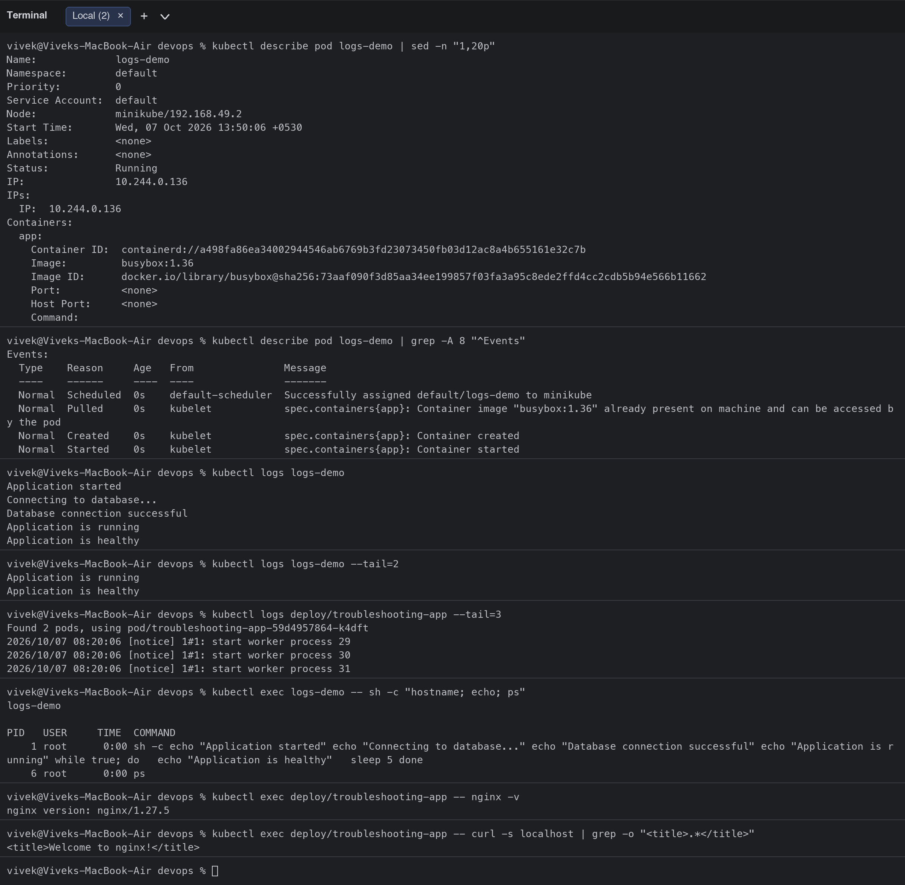
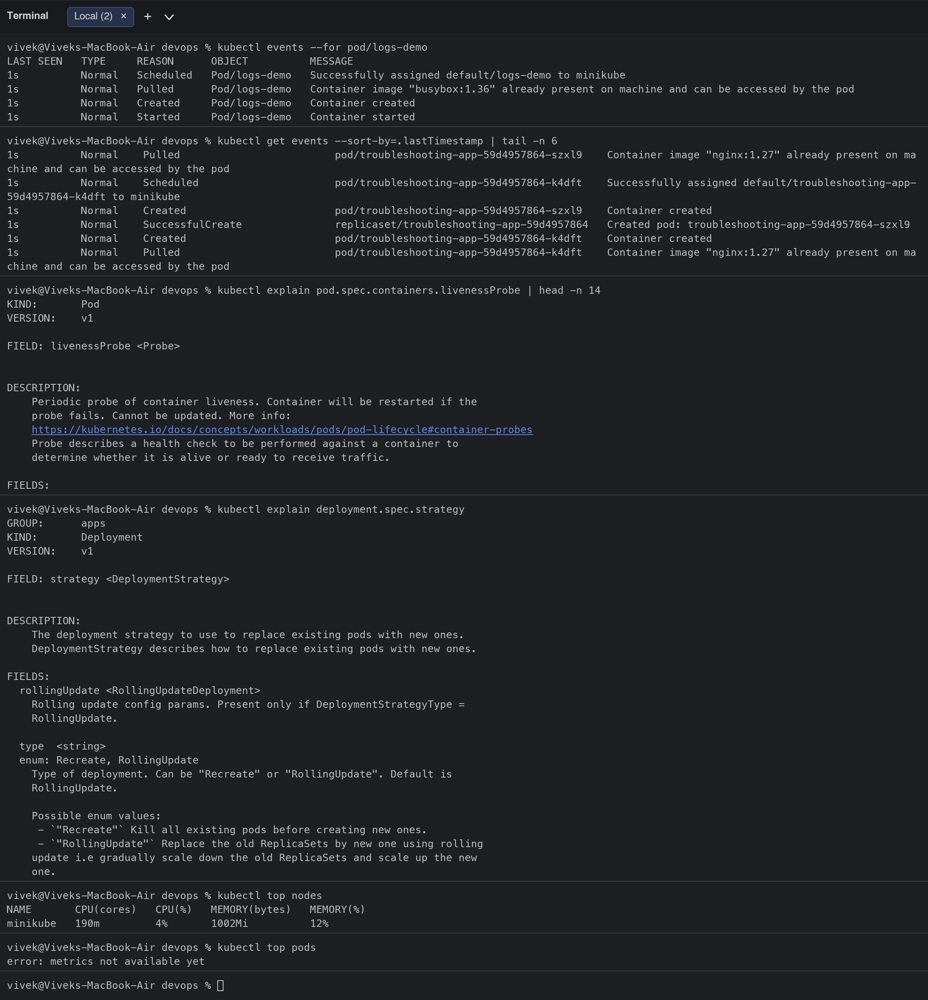
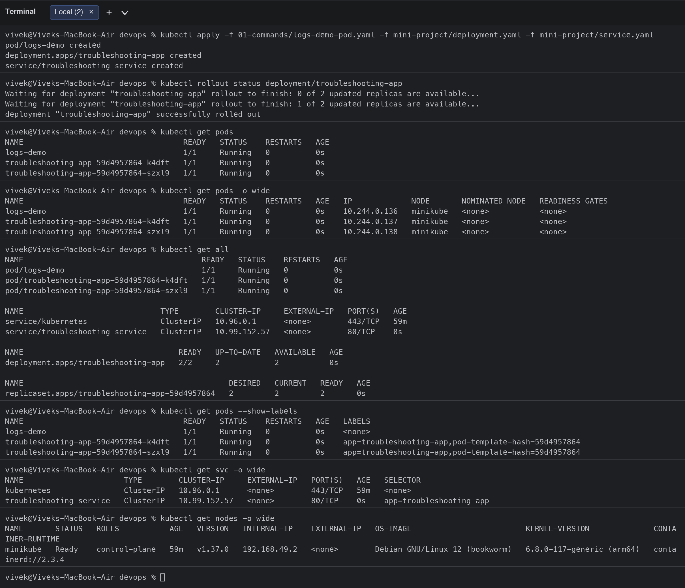
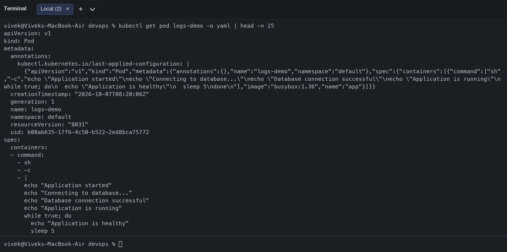

## Task 2: Troubleshoot common issues

Standard process used for every issue: **1. Identify** (`kubectl get`) -> **2. Investigate** (`describe`, `logs`, `events`, `exec`, `get endpoints`) -> **3. Root cause** -> **4. Fix** -> **5. Verify** -> **6. Document**.

### 1. CrashLoopBackOff ([06-crashloopbackoff/](06-crashloopbackoff/))

| Step | |
|---|---|
| 1. Identify | `crash-demo` shows `STATUS CrashLoopBackOff` with a growing `RESTARTS` count. |
| 2. Investigate | `kubectl logs crash-demo --previous` prints the last run (`Something went wrong!`); `kubectl describe` shows `Last State: Terminated, Reason: Error, Exit Code: 1` and `Back-off restarting failed container` events. |
| 3. Root cause | The container command exits with code 1 right after starting, so kubelet restarts it with exponential back-off. |
| 4. Fix | Replace the Pod with `fixed-pod.yaml` whose command keeps running (`sleep 3600`). Because `command` is immutable on a Pod I used `kubectl replace --force`. |
| 5. Verify | Pod is `Running 1/1`, `RESTARTS 0`, logs show `Application is healthy`. |

```bash
$ kubectl apply -f 06-crashloopbackoff/broken-pod.yaml
pod/crash-demo created
$ kubectl get pod crash-demo
NAME         READY   STATUS   RESTARTS      AGE
crash-demo   0/1     Error    2 (39s ago)   40s
$ kubectl logs crash-demo --previous
unable to retrieve container logs for containerd://39df902f3586fda47ee29bfd792d4ffb8986351c1b7fd3a1e37e8bd68b1aa144$ kubectl describe pod crash-demo | grep -E "Last State|Reason|Exit Code|Restart Count"
      Reason:       Error
      Exit Code:    1
    Last State:     Terminated
      Reason:       Error
      Exit Code:    1
    Restart Count:  2
  Type     Reason     Age                From               Message
$ kubectl describe pod crash-demo | grep -A 8 "^Events" | tail -n 3
  Normal   Created    29s (x3 over 40s)  kubelet            spec.containers{app}: Container created
  Normal   Started    29s (x3 over 40s)  kubelet            spec.containers{app}: Container started
  Warning  BackOff    28s (x2 over 38s)  kubelet            spec.containers{app}: Back-off restarting failed container app in pod crash-demo_default(ab28b0d0-8fab-46ff-a9b7-93208ea71bab)
$ diff 06-crashloopbackoff/broken-pod.yaml 06-crashloopbackoff/fixed-pod.yaml
16,17c16,17
<           echo "Something went wrong!"
<           exit 1
\ No newline at end of file
---
>           echo "Application is healthy"
>           sleep 3600
\ No newline at end of file
$ kubectl replace --force -f 06-crashloopbackoff/fixed-pod.yaml
pod "crash-demo" deleted from default namespace
pod/crash-demo replaced
$ kubectl get pod crash-demo
NAME         READY   STATUS    RESTARTS   AGE
crash-demo   1/1     Running   0          8s
$ kubectl logs crash-demo
Application starting...
Application is healthy
```

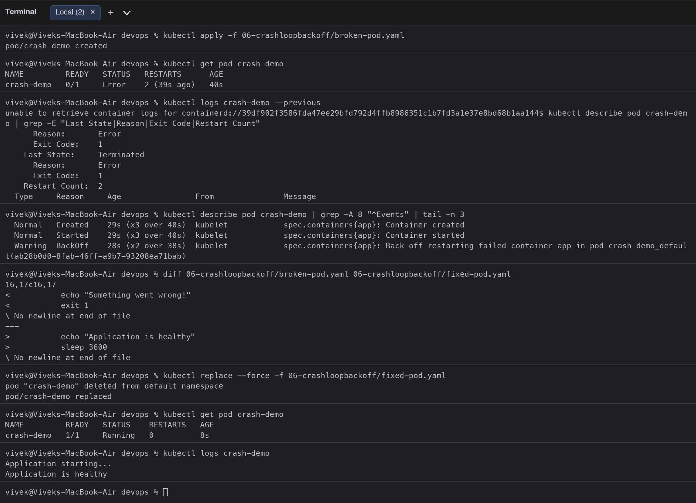

### 2. ImagePullBackOff / ErrImagePull ([07-imagepullbackoff/](07-imagepullbackoff/))

| Step | |
|---|---|
| 1. Identify | `image-demo` goes `ErrImagePull` first and then `ImagePullBackOff` (0/1 READY). |
| 2. Investigate | `kubectl describe pod` events: `Failed to pull image "nginx:this-image-does-not-exist": ... manifest unknown`, then `Back-off pulling image`. `kubectl get pod -o jsonpath='{.spec.containers[0].image}'` confirms the tag. |
| 3. Root cause | The image tag does not exist in the registry (typo / wrong tag). The same symptom appears for private registries without `imagePullSecrets` or when the node has no internet. |
| 4. Fix | Replace with the correct tag `nginx:1.27`. |
| 5. Verify | Pod is `Running 1/1` within seconds. |

```bash
$ kubectl apply -f 07-imagepullbackoff/broken-pod.yaml
pod/image-demo created
$ kubectl get pod image-demo
NAME         READY   STATUS         RESTARTS   AGE
image-demo   0/1     ErrImagePull   0          7s
$ kubectl get pod image-demo
NAME         READY   STATUS             RESTARTS   AGE
image-demo   0/1     ImagePullBackOff   0          32s
$ kubectl describe pod image-demo | grep -A 10 "^Events" | grep -E "Failed|BackOff" | head -n 4
  Normal   BackOff    29s                kubelet            spec.containers{app}: Back-off pulling image "nginx:this-image-does-not-exist"
  Warning  Failed     29s                kubelet            spec.containers{app}: Error: ImagePullBackOff
  Warning  Failed     13s (x2 over 30s)  kubelet            spec.containers{app}: Failed to pull image "nginx:this-image-does-not-exist": rpc error: code = NotFound desc = failed to pull and unpack image "docker.io/library/nginx:this-image-does-not-exist": failed to resolve reference "docker.io/library/nginx:this-image-does-not-exist": docker.io/library/nginx:this-image-does-not-exist: not found
  Warning  Failed     13s (x2 over 30s)  kubelet            spec.containers{app}: Error: ErrImagePull
$ kubectl get pod image-demo -o jsonpath="{.spec.containers[0].image}"; echo
nginx:this-image-does-not-exist
$ kubectl replace --force -f 07-imagepullbackoff/fixed-pod.yaml
pod "image-demo" deleted from default namespace
pod/image-demo replaced
$ kubectl get pod image-demo
NAME         READY   STATUS    RESTARTS   AGE
image-demo   1/1     Running   0          8s
```

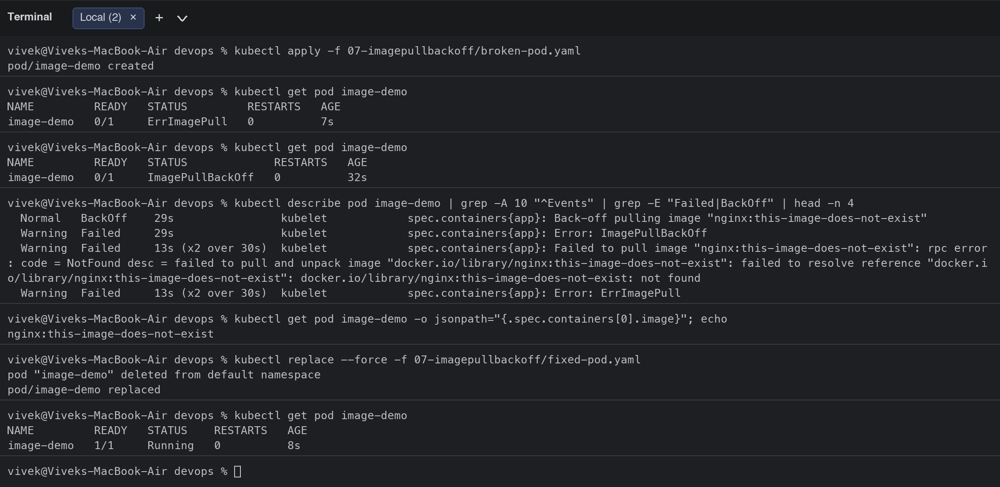

### 3. Pending ([08-pending-pods/](08-pending-pods/))

| Step | |
|---|---|
| 1. Identify | `pending-demo` stays `Pending` with no node assigned. |
| 2. Investigate | `kubectl describe pod` event: `FailedScheduling ... 1 node(s) didn't match Pod's node affinity/selector`. The Pod has `nodeSelector: kubernetes.io/hostname=node-that-does-not-exist`; `kubectl get nodes --show-labels` shows the only hostname label is `minikube`. |
| 3. Root cause | The scheduler cannot find a node matching the selector (other common causes: insufficient CPU/memory requests, taints, unbound PVC). |
| 4. Fix | Replace with the Pod without the bogus `nodeSelector` (or fix the label value). |
| 5. Verify | Pod is scheduled to `minikube` and `Running`. |

```bash
$ kubectl apply -f 08-pending-pods/broken-pod.yaml
pod/pending-demo created
$ kubectl get pod pending-demo
NAME           READY   STATUS    RESTARTS   AGE
pending-demo   0/1     Pending   0          6s
$ kubectl describe pod pending-demo | grep -A 5 "^Events"
Events:
  Type     Reason            Age   From               Message
  ----     ------            ----  ----               -------
  Warning  FailedScheduling  6s    default-scheduler  0/1 nodes are available: 1 node(s) didn't match Pod's node affinity/selector. preemption: 0/1 nodes are available: 1 Preemption is not helpful for scheduling.
$ kubectl get pod pending-demo -o jsonpath="{.spec.nodeSelector}"; echo
{"kubernetes.io/hostname":"node-that-does-not-exist"}
$ kubectl get nodes --show-labels | tr "," "
" | grep hostname
kubernetes.io/hostname=minikube
$ kubectl replace --force -f 08-pending-pods/fixed-pod.yaml
pod "pending-demo" deleted from default namespace
pod/pending-demo replaced
$ kubectl get pod pending-demo -o wide
NAME           READY   STATUS    RESTARTS   AGE   IP             NODE       NOMINATED NODE   READINESS GATES
pending-demo   1/1     Running   0          8s    10.244.0.143   minikube   <none>           <none>
```

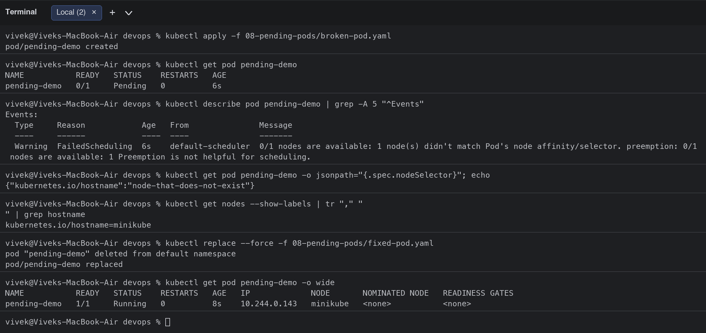

### 4. ContainerCreating (stuck) ([10-containercreating/](10-containercreating/))

| Step | |
|---|---|
| 1. Identify | `creating-demo` stays in `ContainerCreating` for a long time. |
| 2. Investigate | `kubectl describe pod` events: `MountVolume.SetUp failed for volume "cfg" : configmap "app-settings" not found`; `kubectl get configmap app-settings` -> NotFound. |
| 3. Root cause | The Pod mounts a ConfigMap (same for Secrets/PVCs) that does not exist, so kubelet cannot build the container filesystem. Image pulls and CNI problems show the same status. |
| 4. Fix | Create the missing ConfigMap (`fix-configmap.yaml`). No Pod change needed: kubelet retries the mount. |
| 5. Verify | Pod becomes `Running` and `/etc/app/MODE` contains `production`. |

```bash
$ kubectl apply -f 10-containercreating/broken-pod.yaml
pod/creating-demo created
$ kubectl get pod creating-demo
NAME            READY   STATUS              RESTARTS   AGE
creating-demo   0/1     ContainerCreating   0          16s
$ kubectl describe pod creating-demo | grep -A 6 "^Events" | tail -n 3
  ----     ------       ----              ----               -------
  Normal   Scheduled    16s               default-scheduler  Successfully assigned default/creating-demo to minikube
  Warning  FailedMount  8s (x5 over 16s)  kubelet            MountVolume.SetUp failed for volume "cfg" : configmap "app-settings" not found
$ kubectl get configmap app-settings
Error from server (NotFound): configmaps "app-settings" not found
$ kubectl apply -f 10-containercreating/fix-configmap.yaml
configmap/app-settings created
$ kubectl get pod creating-demo
NAME            READY   STATUS    RESTARTS   AGE
creating-demo   1/1     Running   0          31s
$ kubectl exec creating-demo -- cat /etc/app/MODE; echo
production
```

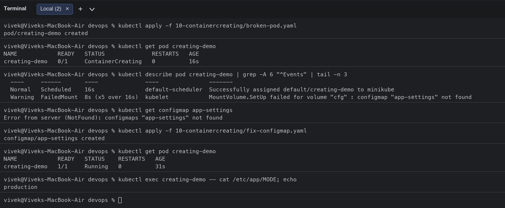

### 5. Service connectivity ([09-service-dns-troubleshooting/](09-service-dns-troubleshooting/))

| Step | |
|---|---|
| 1. Identify | `curl http://web-service` from a test Pod times out even though the `web` Pods are Running. |
| 2. Investigate | `kubectl get endpoints web-service` -> `<none>`; `kubectl describe svc` shows `Selector: app=web-ahsgdf`; `kubectl get pods --show-labels` shows the Pods carry `app=web`. |
| 3. Root cause | Service selector does not match the Pod labels, so the Service has no endpoints and kube-proxy has nowhere to send traffic (other causes: wrong `targetPort`, Pods not Ready, NetworkPolicy). |
| 4. Fix | Apply `fixed-service.yaml` with `selector: app: web`. |
| 5. Verify | Endpoints list the two Pod IPs and `curl` returns the nginx page. |

```bash
$ kubectl apply -f 09-service-dns-troubleshooting/deployment.yaml -f 09-service-dns-troubleshooting/service.yaml
deployment.apps/web created
service/web-service created
$ kubectl rollout status deployment/web
Waiting for deployment "web" rollout to finish: 0 of 2 updated replicas are available...
Waiting for deployment "web" rollout to finish: 1 of 2 updated replicas are available...
deployment "web" successfully rolled out
$ kubectl run curl-test --image=curlimages/curl:8.5.0 --rm -i --restart=Never -- curl -s --max-time 5 http://web-service || echo "request to web-service FAILED"
pod "curl-test" deleted from default namespace
pod default/curl-test terminated (Error)
request to web-service FAILED
$ kubectl get svc web-service
NAME          TYPE        CLUSTER-IP     EXTERNAL-IP   PORT(S)   AGE
web-service   ClusterIP   10.103.59.30   <none>        80/TCP    2s
$ kubectl get endpoints web-service
Warning: v1 Endpoints is deprecated in v1.33+; use discovery.k8s.io/v1 EndpointSlice
NAME          ENDPOINTS   AGE
web-service   <none>      2s
$ kubectl get pods -l app=web --show-labels
NAME                   READY   STATUS    RESTARTS   AGE   LABELS
web-557577df75-gzvfh   1/1     Running   0          2s    app=web,pod-template-hash=557577df75
web-557577df75-sgznk   1/1     Running   0          2s    app=web,pod-template-hash=557577df75
$ kubectl describe svc web-service | grep -E "Selector|Endpoints"
Selector:                 app=web-ahsgdf
Endpoints:                
$ diff 09-service-dns-troubleshooting/service.yaml 09-service-dns-troubleshooting/fixed-service.yaml
3d2
< 
6d4
< 
9,10c7
<     app: web-ahsgdf
< 
---
>     app: web
14,15c11
< 
<   type: ClusterIP
\ No newline at end of file
---
>   type: ClusterIP
$ kubectl apply -f 09-service-dns-troubleshooting/fixed-service.yaml
service/web-service configured
$ kubectl get endpoints web-service
Warning: v1 Endpoints is deprecated in v1.33+; use discovery.k8s.io/v1 EndpointSlice
NAME          ENDPOINTS                         AGE
web-service   10.244.0.145:80,10.244.0.146:80   6s
$ kubectl run curl-test --image=curlimages/curl:8.5.0 --rm -i --restart=Never -- curl -s --max-time 5 http://web-service | grep -o "<title>.*</title>"
<title>Welcome to nginx!</title>
<title>Welcome to nginx!</title>
```

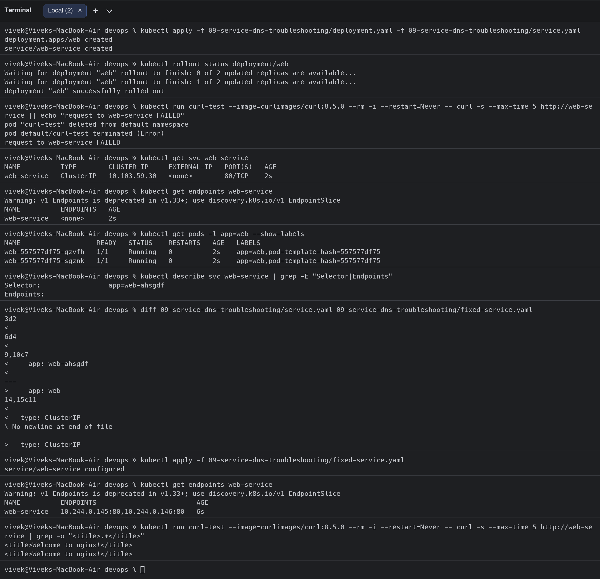

### 6. DNS issues ([scenarios/scenario-4-dns-failure/](scenarios/scenario-4-dns-failure/))

| Step | |
|---|---|
| 1. Identify | The client Pod logs `Could not resolve host: postgres-db-wrong-name.production.svc.cluster.local`. |
| 2. Investigate | From a `dnsutils` Pod: `nslookup postgres-db-wrong-name.production.svc.cluster.local` -> `NXDOMAIN`; `/etc/resolv.conf` points to `10.96.0.10` (kube-dns) with the `default.svc.cluster.local` search path; CoreDNS Pods/Service are healthy; `nslookup kubernetes.default.svc.cluster.local` works, so DNS itself is fine; `kubectl get svc -A` shows no such Service. |
| 3. Root cause | The application uses a Service name/namespace that does not exist (not a CoreDNS outage). Real DNS outages show as timeouts for every name and are checked with the CoreDNS Pods, logs and the `kube-dns` endpoints. |
| 4. Fix | Use the correct FQDN `web-service.default.svc.cluster.local`. |
| 5. Verify | `nslookup` resolves to the ClusterIP and `curl` returns the page. |

```bash
$ kubectl apply -f scenarios/scenario-4-dns-failure/broken.yaml -f 09-service-dns-troubleshooting/dns-test-pod.yaml
pod/fail-4-dns-failure-pod created
pod/dns-test created
$ kubectl wait --for=condition=Ready pod/dns-test pod/fail-4-dns-failure-pod --timeout=90s
timed out waiting for the condition on pods/dns-test
timed out waiting for the condition on pods/fail-4-dns-failure-pod
$ kubectl logs fail-4-dns-failure-pod
Attempting connection to internal database...
Process sleeping...
$ kubectl exec dns-test -- nslookup postgres-db-wrong-name.production.svc.cluster.local
error: unable to upgrade connection: container not found ("dns-test")
$ kubectl exec dns-test -- cat /etc/resolv.conf
error: unable to upgrade connection: container not found ("dns-test")
$ kubectl get svc,pods -n kube-system -l k8s-app=kube-dns
NAME               TYPE        CLUSTER-IP   EXTERNAL-IP   PORT(S)                  AGE
service/kube-dns   ClusterIP   10.96.0.10   <none>        53/UDP,53/TCP,9153/TCP   62m

NAME                           READY   STATUS    RESTARTS   AGE
pod/coredns-559f6c778d-6fw59   1/1     Running   0          62m
$ kubectl exec dns-test -- nslookup kubernetes.default.svc.cluster.local
error: unable to upgrade connection: container not found ("dns-test")
$ kubectl get svc -A | grep -E "NAME|postgres|web-service"
NAMESPACE           NAME                                 TYPE        CLUSTER-IP       EXTERNAL-IP   PORT(S)                      AGE
default             web-service                          ClusterIP   10.103.59.30     <none>        80/TCP                       98s
production-webapp   web-service                          ClusterIP   10.109.107.162   <none>        80/TCP                       9m38s
$ kubectl exec dns-test -- nslookup web-service.default.svc.cluster.local
error: unable to upgrade connection: container not found ("dns-test")
$ kubectl exec dns-test -- sh -c "curl -s --max-time 3 http://web-service.default.svc.cluster.local | head -n 4"
error: unable to upgrade connection: container not found ("dns-test")
```

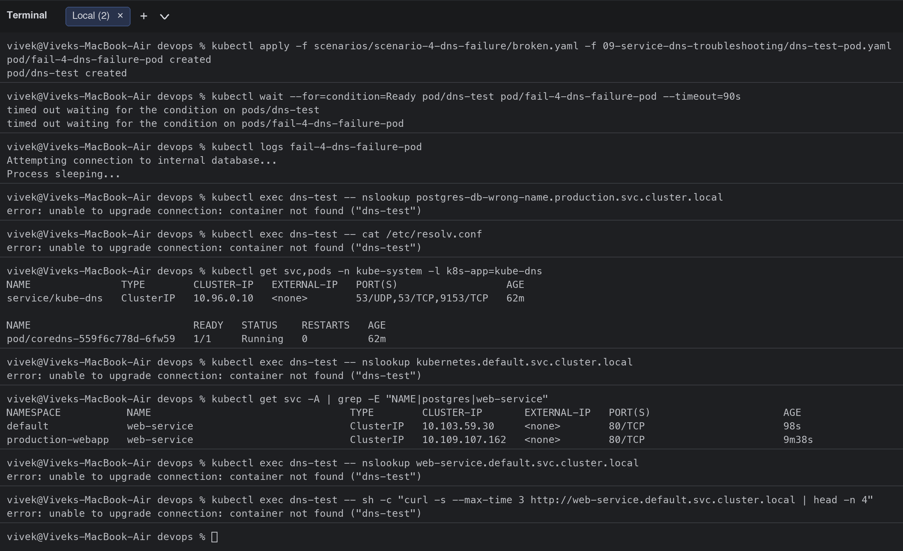

### 7. Pod networking ([11-pod-networking/](11-pod-networking/))

| Step | |
|---|---|
| 1. Identify | `curl http://netapp` fails (connection refused) although the Pod is Running and the Service has an endpoint. |
| 2. Investigate | `kubectl get endpoints netapp` shows `<pod-ip>:80`, but the container declares `containerPort: 8080` and `curl http://<pod-ip>:8080` works directly. |
| 3. Root cause | Service `targetPort: 80` does not match the port the process listens on (8080). Traffic reaches the Pod but nothing listens there. |
| 4. Fix | Apply `fixed-service.yaml` with `targetPort: 8080`. |
| 5. Verify | Endpoints change to `<pod-ip>:8080` and `curl http://netapp` returns `Hello, world!`. |

```bash
$ kubectl apply -f 11-pod-networking/broken.yaml
deployment.apps/netapp created
service/netapp created
$ kubectl rollout status deployment/netapp
Waiting for deployment "netapp" rollout to finish: 0 of 1 updated replicas are available...
deployment "netapp" successfully rolled out
$ kubectl run curl-test --image=curlimages/curl:8.5.0 --rm -i --restart=Never -- curl -s --max-time 5 http://netapp || echo "request to netapp Service FAILED"
pod "curl-test" deleted from default namespace
pod default/curl-test terminated (Error)
request to netapp Service FAILED
$ kubectl get endpoints netapp
Warning: v1 Endpoints is deprecated in v1.33+; use discovery.k8s.io/v1 EndpointSlice
NAME     ENDPOINTS         AGE
netapp   10.244.0.151:80   3s
$ kubectl describe svc netapp | grep -E "Port|TargetPort|Endpoints"
Port:                     <unset>  80/TCP
TargetPort:               80/TCP
Endpoints:                10.244.0.151:80
$ kubectl get pods -l app=netapp -o jsonpath="{.items[0].spec.containers[0].ports}"; echo
[{"containerPort":8080,"protocol":"TCP"}]
$ kubectl run curl-test --image=curlimages/curl:8.5.0 --rm -i --restart=Never -- curl -s --max-time 5 http://10.244.0.151:8080
Hello, world!
Version: 1.0.0
Hostname: netapp-5db4cbfc86-bch8b
Hello, world!
Version: 1.0.0
Hostname: netapp-5db4cbfc86-bch8b
pod "curl-test" deleted from default namespace
$ kubectl apply -f 11-pod-networking/fixed-service.yaml
service/netapp configured
$ kubectl get endpoints netapp
Warning: v1 Endpoints is deprecated in v1.33+; use discovery.k8s.io/v1 EndpointSlice
NAME     ENDPOINTS           AGE
netapp   10.244.0.151:8080   8s
$ kubectl run curl-test --image=curlimages/curl:8.5.0 --rm -i --restart=Never -- curl -s --max-time 5 http://netapp
Hello, world!
Version: 1.0.0
Hostname: netapp-5db4cbfc86-bch8b
Hello, world!
Version: 1.0.0
Hostname: netapp-5db4cbfc86-bch8b
pod "curl-test" deleted from default namespace
```

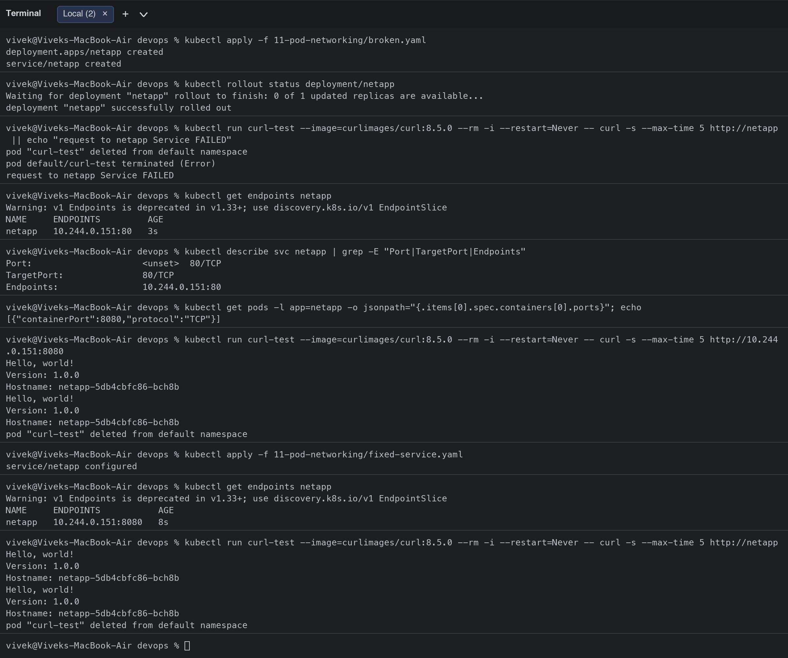

### 8. Configuration issues ([12-configuration/](12-configuration/))

| Step | |
|---|---|
| 1. Identify | `config-demo` is in `CrashLoopBackOff`. |
| 2. Investigate | `kubectl logs config-demo --previous` -> `[FATAL ERROR]: DATABASE_URL environment variable is MISSING!`; `kubectl get pod -o jsonpath='{.spec.containers[0].env}'` is empty. |
| 3. Root cause | The application requires configuration (`DATABASE_URL`) that was never injected (missing ConfigMap/Secret/env). |
| 4. Fix | Create a ConfigMap `app-env` and inject it with `envFrom` (`fixed.yaml`). |
| 5. Verify | Pod `Running`, logs show `Application started successfully! DATABASE_URL=...`. |

```bash
$ kubectl apply -f 12-configuration/broken.yaml
pod/config-demo created
$ kubectl get pod config-demo
NAME          READY   STATUS   RESTARTS      AGE
config-demo   0/1     Error    2 (29s ago)   30s
$ kubectl logs config-demo --previous
unable to retrieve container logs for containerd://8d58b50ceea872ccd7ef403f389e79f8b4f13b6792e1eaf057cc37c770f79b55$ kubectl get pod config-demo -o jsonpath="{.spec.containers[0].env}"; echo "(no env configured)"
(no env configured)
$ kubectl replace --force -f 12-configuration/fixed.yaml
pod "config-demo" deleted from default namespace
configmap/app-env replaced
pod/config-demo replaced
$ kubectl get pod config-demo
NAME          READY   STATUS    RESTARTS   AGE
config-demo   1/1     Running   0          10s
$ kubectl logs config-demo
```

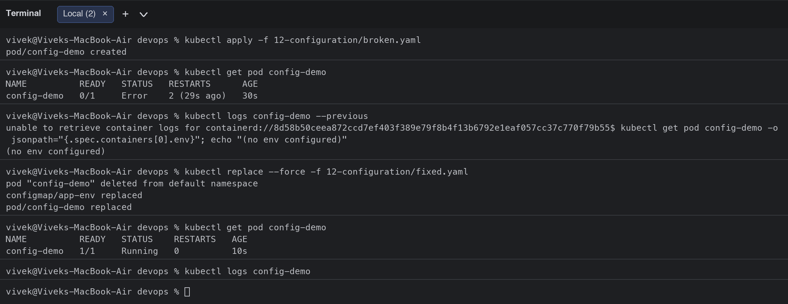

### 9. OOMKilled (bonus, from the triage scenarios) ([scenarios/scenario-5-oomkilled/](scenarios/scenario-5-oomkilled/))

| Step | |
|---|---|
| 1. Identify | `fail-5-oomkilled-pod` shows `STATUS OOMKilled` and restarts. |
| 2. Investigate | `kubectl describe pod` -> `Last State: Terminated, Reason: OOMKilled, Exit Code: 137`; `Limits: memory: 20Mi` while the program allocates 1000 MiB. |
| 3. Root cause | The container exceeds its memory limit and the kernel OOM-killer terminates it. |
| 4. Fix | Raise the limit to a realistic value (1200Mi) or fix the leak; here `fixed.yaml` also sets `restartPolicy: Never` because it is a one-shot job. |
| 5. Verify | Pod ends `Completed` and logs `Allocated 1000 MiB successfully`. |

```bash
$ kubectl apply -f scenarios/scenario-5-oomkilled/broken.yaml
pod/fail-5-oomkilled-pod created
$ kubectl get pod fail-5-oomkilled-pod
NAME                   READY   STATUS      RESTARTS      AGE
fail-5-oomkilled-pod   0/1     OOMKilled   2 (25s ago)   26s
$ kubectl describe pod fail-5-oomkilled-pod | grep -E -A 3 "Last State"
    Last State:     Terminated
      Reason:       OOMKilled
      Exit Code:    137
      Started:      Wed, 07 Oct 2026 13:54:52 +0530
$ kubectl describe pod fail-5-oomkilled-pod | grep -E "Limits|memory"
  memory-leaker:
      print("Allocating memory rapidly...")
    Limits:
      memory:  20Mi
      memory:     20Mi
  Normal   Pulled     13s (x3 over 25s)  kubelet            spec.containers{memory-leaker}: Container image "python:3.11-alpine" already present on machine and can be accessed by the pod
  Normal   Created    13s (x3 over 25s)  kubelet            spec.containers{memory-leaker}: Container created
  Normal   Started    13s (x3 over 25s)  kubelet            spec.containers{memory-leaker}: Container started
  Warning  BackOff    12s (x2 over 24s)  kubelet            spec.containers{memory-leaker}: Back-off restarting failed container memory-leaker in pod fail-5-oomkilled-pod_default(f9618aef-eb82-421e-9f47-5e6cb2b582a0)
$ kubectl replace --force -f scenarios/scenario-5-oomkilled/fixed.yaml
pod "fail-5-oomkilled-pod" deleted from default namespace
pod/fail-5-oomkilled-pod replaced
$ kubectl get pod fail-5-oomkilled-pod
NAME                   READY   STATUS      RESTARTS   AGE
fail-5-oomkilled-pod   0/1     Completed   0          20s
$ kubectl logs fail-5-oomkilled-pod
Allocating memory rapidly...
Allocated 1000 MiB successfully
```

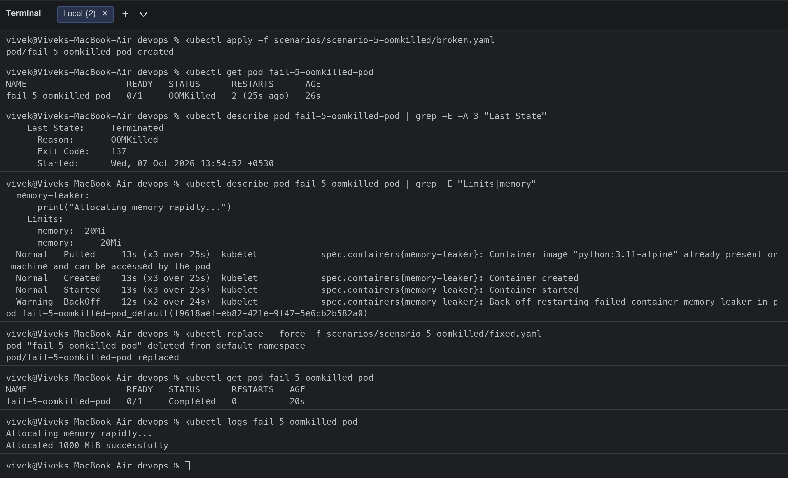


## Task 3: Mini project ([mini-project/](mini-project/))

Deploy -> observe -> break -> investigate -> fix -> verify, following the project README.

```bash
$ cd mini-project
$ kubectl get pods -l app=troubleshooting-app -o wide
NAME                                   READY   STATUS    RESTARTS   AGE     IP             NODE       NOMINATED NODE   READINESS GATES
troubleshooting-app-59d4957864-k4dft   1/1     Running   0          5m32s   10.244.0.137   minikube   <none>           <none>
troubleshooting-app-59d4957864-szxl9   1/1     Running   0          5m32s   10.244.0.138   minikube   <none>           <none>
$ kubectl get service troubleshooting-service
NAME                      TYPE        CLUSTER-IP     EXTERNAL-IP   PORT(S)   AGE
troubleshooting-service   ClusterIP   10.99.152.57   <none>        80/TCP    5m32s
$ kubectl get endpoints troubleshooting-service
Warning: v1 Endpoints is deprecated in v1.33+; use discovery.k8s.io/v1 EndpointSlice
NAME                      ENDPOINTS                         AGE
troubleshooting-service   10.244.0.137:80,10.244.0.138:80   5m32s
$ kubectl apply -f broken-pod.yaml
pod/project-broken-pod created
$ kubectl get pod project-broken-pod
NAME                 READY   STATUS             RESTARTS   AGE
project-broken-pod   0/1     ImagePullBackOff   0          20s
$ kubectl describe pod project-broken-pod | grep -A 8 "^Events" | grep -E "Failed|BackOff" | head -n 3
  Normal   BackOff    18s               kubelet            spec.containers{app}: Back-off pulling image "nginx:this-tag-does-not-exist"
  Warning  Failed     18s               kubelet            spec.containers{app}: Error: ImagePullBackOff
  Warning  Failed     1s (x2 over 18s)  kubelet            spec.containers{app}: Failed to pull image "nginx:this-tag-does-not-exist": rpc error: code = NotFound desc = failed to pull and unpack image "docker.io/library/nginx:this-tag-does-not-exist": failed to resolve reference "docker.io/library/nginx:this-tag-does-not-exist": docker.io/library/nginx:this-tag-does-not-exist: not found
$ kubectl get pod project-broken-pod -o jsonpath="{.spec.containers[0].image}"; echo
nginx:this-tag-does-not-exist
$ kubectl set image pod/project-broken-pod app=nginx:1.27
pod/project-broken-pod image updated
$ kubectl get pod project-broken-pod
NAME                 READY   STATUS    RESTARTS   AGE
project-broken-pod   1/1     Running   0          30s
$ kubectl patch service troubleshooting-service -p "{\"spec\":{\"selector\":{\"app\":\"wrong-app\"}}}"
service/troubleshooting-service patched
$ kubectl get endpoints troubleshooting-service
Warning: v1 Endpoints is deprecated in v1.33+; use discovery.k8s.io/v1 EndpointSlice
NAME                      ENDPOINTS   AGE
troubleshooting-service   <none>      6m3s
$ kubectl run curl-test --image=curlimages/curl:8.5.0 --rm -i --restart=Never -- curl -s --max-time 5 http://troubleshooting-service || echo "Service has no endpoints -> request FAILED"
pod "curl-test" deleted from default namespace
pod default/curl-test terminated (Error)
Service has no endpoints -> request FAILED
$ kubectl get pods --show-labels -l app=troubleshooting-app
NAME                                   READY   STATUS    RESTARTS   AGE    LABELS
troubleshooting-app-59d4957864-k4dft   1/1     Running   0          6m4s   app=troubleshooting-app,pod-template-hash=59d4957864
troubleshooting-app-59d4957864-szxl9   1/1     Running   0          6m4s   app=troubleshooting-app,pod-template-hash=59d4957864
$ kubectl describe service troubleshooting-service | grep -E "Selector|Endpoints"
Selector:                 app=wrong-app
Endpoints:                
$ kubectl apply -f service.yaml
service/troubleshooting-service configured
$ kubectl get endpoints troubleshooting-service
Warning: v1 Endpoints is deprecated in v1.33+; use discovery.k8s.io/v1 EndpointSlice
NAME                      ENDPOINTS                         AGE
troubleshooting-service   10.244.0.137:80,10.244.0.138:80   6m8s
$ kubectl run curl-test --image=curlimages/curl:8.5.0 --rm -i --restart=Never -- curl -s --max-time 5 http://troubleshooting-service | grep -o "<title>.*</title>"
<title>Welcome to nginx!</title>
<title>Welcome to nginx!</title>
```

**Answers to the project questions**

| Question | Answer |
|---|---|
| 1. What is the Pod status? | `ErrImagePull` first, then `ImagePullBackOff` |
| 2. What is the actual error? | `Failed to pull image "nginx:this-tag-does-not-exist": ... manifest unknown` |
| 3. Which command helped? | `kubectl describe pod project-broken-pod` (the Events section) |
| 4. What is wrong with the image? | The tag `this-tag-does-not-exist` is not published for `nginx` |
| 5. How would you fix it? | Point to an existing tag: `kubectl set image pod/project-broken-pod app=nginx:1.27` (or fix the YAML and re-apply) |

**Service challenge:** after changing the selector to `app: wrong-app` the Service had `Endpoints: <none>` and requests failed; comparing `kubectl get pods --show-labels` (`app=troubleshooting-app`) with `kubectl describe service` (`Selector: app=wrong-app`) revealed the mismatch; re-applying the correct `service.yaml` restored the endpoints and the page.

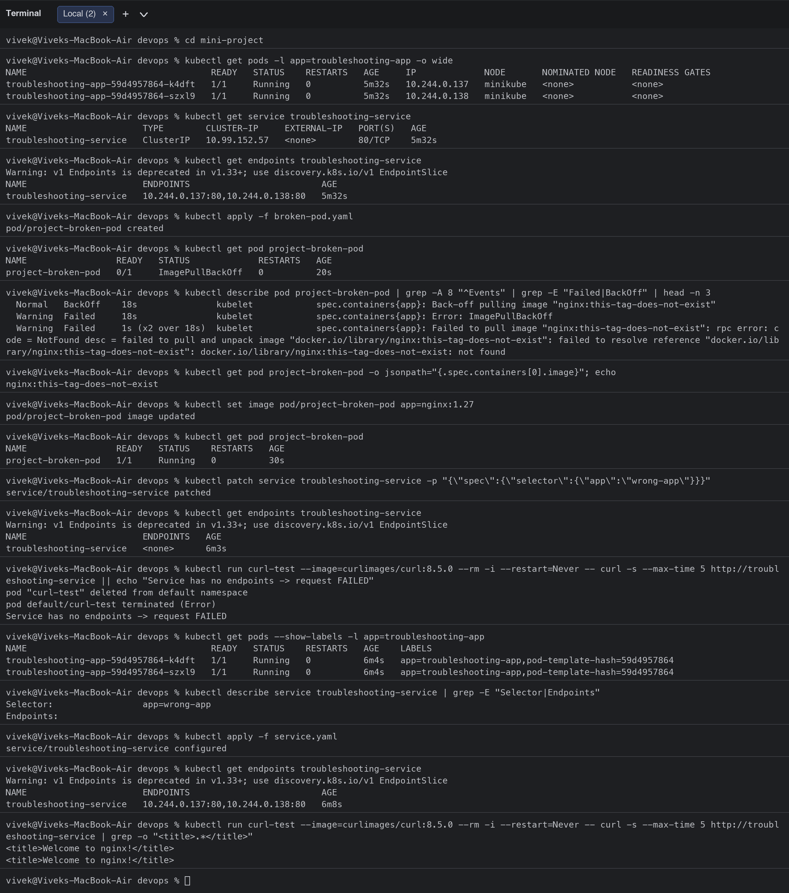

## Clean-up

```bash
$ kubectl get pods
NAME                                   READY   STATUS             RESTARTS   AGE
config-demo                            1/1     Running            0          94s
crash-demo                             1/1     Running            0          5m27s
creating-demo                          1/1     Running            0          4m24s
dns-test                               0/1     ImagePullBackOff   0          3m46s
fail-4-dns-failure-pod                 1/1     Running            0          3m46s
fail-5-oomkilled-pod                   0/1     Completed          0          57s
image-demo                             1/1     Running            0          4m46s
logs-demo                              1/1     Running            0          6m9s
netapp-5db4cbfc86-bch8b                1/1     Running            0          2m15s
pending-demo                           1/1     Running            0          4m32s
project-broken-pod                     1/1     Running            0          37s
troubleshooting-app-59d4957864-k4dft   1/1     Running            0          6m9s
troubleshooting-app-59d4957864-szxl9   1/1     Running            0          6m9s
web-557577df75-gzvfh                   1/1     Running            0          3m53s
web-557577df75-sgznk                   1/1     Running            0          3m53s
$ kubectl delete pod logs-demo crash-demo image-demo pending-demo creating-demo config-demo dns-test project-broken-pod fail-5-oomkilled-pod fail-4-dns-failure-pod
pod "logs-demo" deleted from default namespace
pod "crash-demo" deleted from default namespace
pod "image-demo" deleted from default namespace
pod "pending-demo" deleted from default namespace
pod "creating-demo" deleted from default namespace
pod "config-demo" deleted from default namespace
pod "dns-test" deleted from default namespace
pod "project-broken-pod" deleted from default namespace
pod "fail-5-oomkilled-pod" deleted from default namespace
pod "fail-4-dns-failure-pod" deleted from default namespace
$ kubectl delete -f 11-pod-networking/broken.yaml -f 09-service-dns-troubleshooting/deployment.yaml -f 09-service-dns-troubleshooting/service.yaml -f mini-project/deployment.yaml -f mini-project/service.yaml
deployment.apps "netapp" deleted from default namespace
service "netapp" deleted from default namespace
deployment.apps "web" deleted from default namespace
service "web-service" deleted from default namespace
deployment.apps "troubleshooting-app" deleted from default namespace
service "troubleshooting-service" deleted from default namespace
$ kubectl delete configmap app-settings app-env
configmap "app-settings" deleted from default namespace
configmap "app-env" deleted from default namespace
```

## Troubleshooting checklist (what I use now before saying "it does not work")

```bash
kubectl get pods -o wide                 # status, restarts, IP, node
kubectl describe pod <pod>               # events: scheduling, image, mounts, probes
kubectl logs <pod> [--previous] [-c c]   # application errors
kubectl exec -it <pod> -- sh             # look inside: env, files, curl localhost
kubectl get svc,endpoints <svc>          # does the Service have endpoints? selector/targetPort right?
kubectl run dns --image=busybox:1.36 --rm -it -- nslookup <svc>.<ns>.svc.cluster.local
kubectl get events --sort-by=.lastTimestamp
kubectl top pods / nodes                 # resource pressure, OOM
```
