# Session 15: Helm

**Student:** Vivek Singh Solanki | **Roll number:** 24bcs10338
**Helm:** v4 on minikube

Helm is the package manager for Kubernetes: a **chart** (templates + `values.yaml`) is rendered into manifests and installed as a **release** whose every change is stored as a numbered **revision**, which is what makes `helm rollback` possible.

## Task 1: Helm commands

| Command | What it does |
|---|---|
| `helm create <name>` | Scaffold a chart: `Chart.yaml`, `values.yaml`, `templates/` (deployment, service, ingress, hpa, serviceaccount, helpers, NOTES.txt) |
| `helm lint` / `helm template` | Validate the chart / render the manifests locally without installing |
| `helm install <release> <chart>` | Render + apply, creates revision 1 |
| `helm list` | Releases in the namespace with revision, status and chart version |
| `helm status <release>` | Status, revision, resources and NOTES of a release |
| `helm get values/manifest/all <release>` | What was deployed: user-supplied values, rendered manifests, everything |
| `helm upgrade <release> <chart> --set k=v / -f file` | Apply a change: new revision |
| `helm history <release>` | List revisions (deployed / superseded) |
| `helm rollback <release> <rev>` | Restore an earlier revision (creates a new revision "Rollback to N") |
| `helm uninstall <release>` | Delete every resource of the release |
| `helm repo add/update/list` | Manage chart repositories |
| `helm search repo/hub` | Find charts in added repos / on Artifact Hub |

### `helm create`, `helm lint`, `helm template` (chart kept in [mychart/](mychart/))

```bash
$ helm version
version.BuildInfo{Version:"v4.3.0", GitCommit:"bec5b06ed841fe5269972d864d5177944fd5970f", GitTreeState:"clean", GoVersion:"go1.27.1", KubeClientVersion:"v1.37"}
$ helm create mychart
Creating mychart
$ find mychart -type f | sort
mychart/.helmignore
mychart/Chart.yaml
mychart/templates/NOTES.txt
mychart/templates/_helpers.tpl
mychart/templates/deployment.yaml
mychart/templates/hpa.yaml
mychart/templates/httproute.yaml
mychart/templates/ingress.yaml
mychart/templates/service.yaml
mychart/templates/serviceaccount.yaml
mychart/templates/tests/test-connection.yaml
mychart/values.yaml
$ cat mychart/Chart.yaml
apiVersion: v2
name: mychart
description: A Helm chart for Kubernetes

# A chart can be either an 'application' or a 'library' chart.
#
# Application charts are a collection of templates that can be packaged into versioned archives
# to be deployed.
#
# Library charts provide useful utilities or functions for the chart developer. They're included as
# a dependency of application charts to inject those utilities and functions into the rendering
# pipeline. Library charts do not define any templates and therefore cannot be deployed.
type: application

# This is the chart version. This version number should be incremented each time you make changes
# to the chart and its templates, including the app version.
# Versions are expected to follow Semantic Versioning (https://semver.org/)
version: 0.1.0

# This is the version number of the application being deployed. This version number should be
# incremented each time you make changes to the application. Versions are not expected to
# follow Semantic Versioning. They should reflect the version the application is using.
# It is recommended to use it with quotes.
appVersion: "1.16.0"
$ grep -vE "^\s*#|^\s*$" mychart/values.yaml | head -n 30
replicaCount: 1
image:
  repository: nginx
  pullPolicy: IfNotPresent
  tag: ""
imagePullSecrets: []
nameOverride: ""
fullnameOverride: ""
serviceAccount:
  create: true
  automount: true
  annotations: {}
  name: ""
podAnnotations: {}
podLabels: {}
podSecurityContext: {}
securityContext: {}
service:
  type: ClusterIP
  port: 80
ingress:
  enabled: false
  className: ""
  annotations: {}
  hosts:
    - host: chart-example.local
      paths:
        - path: /
          pathType: ImplementationSpecific
  tls: []
$ helm lint mychart
==> Linting mychart
[INFO] Chart.yaml: icon is recommended

1 chart(s) linted, 0 chart(s) failed
$ helm template demo mychart | head -n 40
---
# Source: mychart/templates/serviceaccount.yaml
apiVersion: v1
kind: ServiceAccount
metadata:
  name: demo-mychart
  labels:
    helm.sh/chart: mychart-0.1.0
    app.kubernetes.io/name: mychart
    app.kubernetes.io/instance: demo
    app.kubernetes.io/version: "1.16.0"
    app.kubernetes.io/managed-by: Helm
automountServiceAccountToken: true

---
# Source: mychart/templates/service.yaml
apiVersion: v1
kind: Service
metadata:
  name: demo-mychart
  labels:
    helm.sh/chart: mychart-0.1.0
    app.kubernetes.io/name: mychart
    app.kubernetes.io/instance: demo
    app.kubernetes.io/version: "1.16.0"
    app.kubernetes.io/managed-by: Helm
spec:
  type: ClusterIP
  ports:
    - port: 80
      targetPort: http
      protocol: TCP
      name: http
  selector:
    app.kubernetes.io/name: mychart
    app.kubernetes.io/instance: demo

---
# Source: mychart/templates/deployment.yaml
apiVersion: apps/v1
```

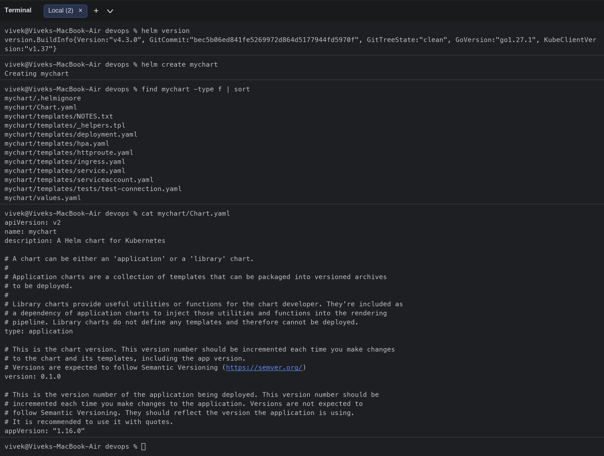
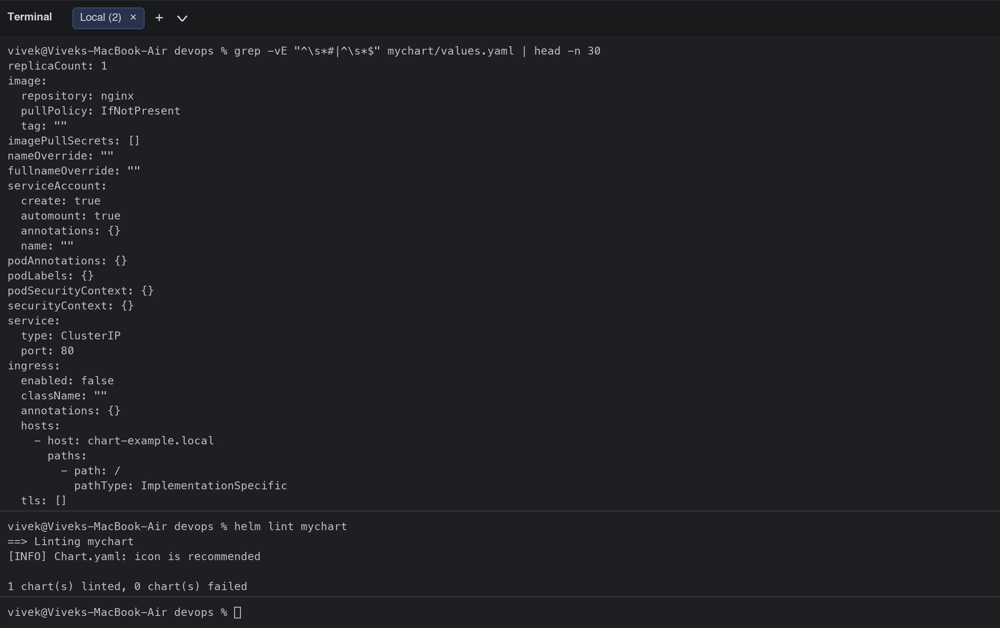
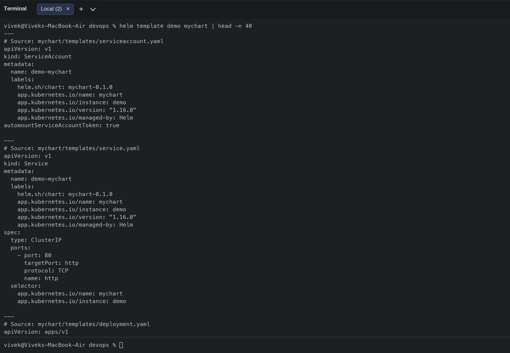

### `helm install`, `helm list`, `helm status`, `helm get`

```bash
$ helm install mychart-release mychart
NAME: mychart-release
LAST DEPLOYED: Wed Oct  7 13:58:04 2026
NAMESPACE: default
STATUS: deployed
REVISION: 1
DESCRIPTION: Install complete
NOTES:
1. Get the application URL by running these commands:
  export POD_NAME=$(kubectl get pods --namespace default -l "app.kubernetes.io/name=mychart,app.kubernetes.io/instance=mychart-release" -o jsonpath="{.items[0].metadata.name}")
  export CONTAINER_PORT=$(kubectl get pod --namespace default $POD_NAME -o jsonpath="{.spec.containers[0].ports[0].containerPort}")
  echo "Visit http://127.0.0.1:8080 to use your application"
  kubectl --namespace default port-forward $POD_NAME 8080:$CONTAINER_PORT
$ helm list
NAME           	NAMESPACE	REVISION	UPDATED                             	STATUS  	CHART        	APP VERSION
mychart-release	default  	1       	2026-10-07 13:58:04.002576 +0530 IST	deployed	mychart-0.1.0	1.16.0     
$ kubectl get pods,svc -l app.kubernetes.io/instance=mychart-release
NAME                                   READY   STATUS              RESTARTS   AGE
pod/mychart-release-7fdc8875c7-6ftpd   0/1     ContainerCreating   0          0s

NAME                      TYPE        CLUSTER-IP       EXTERNAL-IP   PORT(S)   AGE
service/mychart-release   ClusterIP   10.109.137.144   <none>        80/TCP    0s
$ helm status mychart-release
NAME: mychart-release
LAST DEPLOYED: Wed Oct  7 13:58:04 2026
NAMESPACE: default
STATUS: deployed
REVISION: 1
DESCRIPTION: Install complete
RESOURCES:
==> v1/ServiceAccount
NAME              AGE
mychart-release   0s

==> v1/Service
NAME              TYPE        CLUSTER-IP       EXTERNAL-IP   PORT(S)   AGE
mychart-release   ClusterIP   10.109.137.144   <none>        80/TCP    0s

==> v1/Deployment
NAME              READY   UP-TO-DATE   AVAILABLE   AGE
mychart-release   0/1     1            0           0s

==> v1/Pod(related)
NAME                               READY   STATUS              RESTARTS   AGE
mychart-release-7fdc8875c7-6ftpd   0/1     ContainerCreating   0          0s


NOTES:
1. Get the application URL by running these commands:
  export POD_NAME=$(kubectl get pods --namespace default -l "app.kubernetes.io/name=mychart,app.kubernetes.io/instance=mychart-release" -o jsonpath="{.items[0].metadata.name}")
  export CONTAINER_PORT=$(kubectl get pod --namespace default $POD_NAME -o jsonpath="{.spec.containers[0].ports[0].containerPort}")
  echo "Visit http://127.0.0.1:8080 to use your application"
  kubectl --namespace default port-forward $POD_NAME 8080:$CONTAINER_PORT
$ helm get values mychart-release
USER-SUPPLIED VALUES:
null
$ helm get manifest mychart-release | head -n 30
---
# Source: mychart/templates/serviceaccount.yaml
apiVersion: v1
kind: ServiceAccount
metadata:
  name: mychart-release
  labels:
    helm.sh/chart: mychart-0.1.0
    app.kubernetes.io/name: mychart
    app.kubernetes.io/instance: mychart-release
    app.kubernetes.io/version: "1.16.0"
    app.kubernetes.io/managed-by: Helm
automountServiceAccountToken: true

---
# Source: mychart/templates/service.yaml
apiVersion: v1
kind: Service
metadata:
  name: mychart-release
  labels:
    helm.sh/chart: mychart-0.1.0
    app.kubernetes.io/name: mychart
    app.kubernetes.io/instance: mychart-release
    app.kubernetes.io/version: "1.16.0"
    app.kubernetes.io/managed-by: Helm
spec:
  type: ClusterIP
  ports:
    - port: 80
$ helm get all mychart-release | grep -E "^(NAME|REVISION|STATUS|CHART)"
NAME: mychart-release
NAMESPACE: default
STATUS: deployed
REVISION: 1
CHART: mychart
```

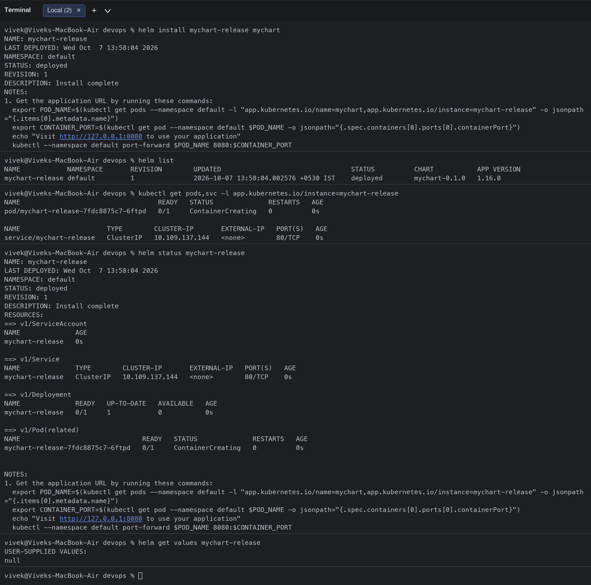
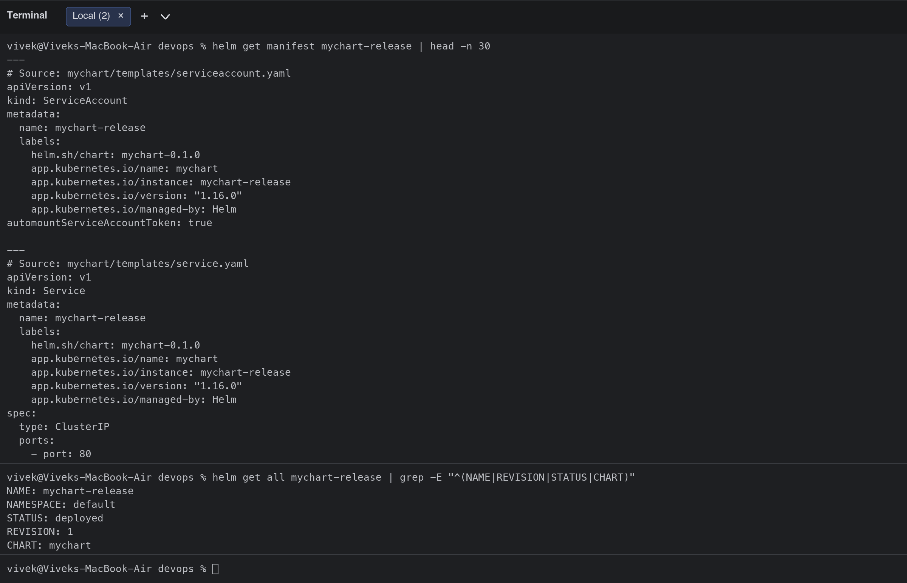

### `helm upgrade`, `helm history`, `helm rollback`, `helm uninstall`

```bash
$ helm upgrade mychart-release mychart --set replicaCount=3 --set image.tag=1.27-alpine
Release "mychart-release" has been upgraded. Happy Helming!
NAME: mychart-release
LAST DEPLOYED: Wed Oct  7 13:58:04 2026
NAMESPACE: default
STATUS: deployed
REVISION: 2
DESCRIPTION: Upgrade complete
NOTES:
1. Get the application URL by running these commands:
  export POD_NAME=$(kubectl get pods --namespace default -l "app.kubernetes.io/name=mychart,app.kubernetes.io/instance=mychart-release" -o jsonpath="{.items[0].metadata.name}")
  export CONTAINER_PORT=$(kubectl get pod --namespace default $POD_NAME -o jsonpath="{.spec.containers[0].ports[0].containerPort}")
  echo "Visit http://127.0.0.1:8080 to use your application"
  kubectl --namespace default port-forward $POD_NAME 8080:$CONTAINER_PORT
$ kubectl get pods -l app.kubernetes.io/instance=mychart-release
NAME                               READY   STATUS              RESTARTS   AGE
mychart-release-5898cdccff-4mpxn   0/1     ContainerCreating   0          0s
mychart-release-7fdc8875c7-6ftpd   0/1     ContainerCreating   0          0s
mychart-release-7fdc8875c7-bhxzj   0/1     ContainerCreating   0          0s
mychart-release-7fdc8875c7-f5kph   0/1     ContainerCreating   0          0s
$ helm get values mychart-release
USER-SUPPLIED VALUES:
image:
  tag: 1.27-alpine
replicaCount: 3
$ helm history mychart-release
REVISION	UPDATED                 	STATUS    	CHART        	APP VERSION	DESCRIPTION     
1       	Wed Oct  7 13:58:04 2026	superseded	mychart-0.1.0	1.16.0     	Install complete
2       	Wed Oct  7 13:58:04 2026	deployed  	mychart-0.1.0	1.16.0     	Upgrade complete
$ helm rollback mychart-release 1
Rollback was a success! Happy Helming!
$ helm history mychart-release
REVISION	UPDATED                 	STATUS    	CHART        	APP VERSION	DESCRIPTION     
1       	Wed Oct  7 13:58:04 2026	superseded	mychart-0.1.0	1.16.0     	Install complete
2       	Wed Oct  7 13:58:04 2026	superseded	mychart-0.1.0	1.16.0     	Upgrade complete
3       	Wed Oct  7 13:58:04 2026	deployed  	mychart-0.1.0	1.16.0     	Rollback to 1   
$ kubectl get pods -l app.kubernetes.io/instance=mychart-release
NAME                               READY   STATUS              RESTARTS   AGE
mychart-release-5898cdccff-4mpxn   0/1     ContainerCreating   0          0s
mychart-release-7fdc8875c7-6ftpd   0/1     Terminating         0          0s
mychart-release-7fdc8875c7-bhxzj   0/1     Terminating         0          0s
mychart-release-7fdc8875c7-f5kph   0/1     ContainerCreating   0          0s
$ helm uninstall mychart-release
release "mychart-release" uninstalled
$ helm list
NAME	NAMESPACE	REVISION	UPDATED	STATUS	CHART	APP VERSION
```

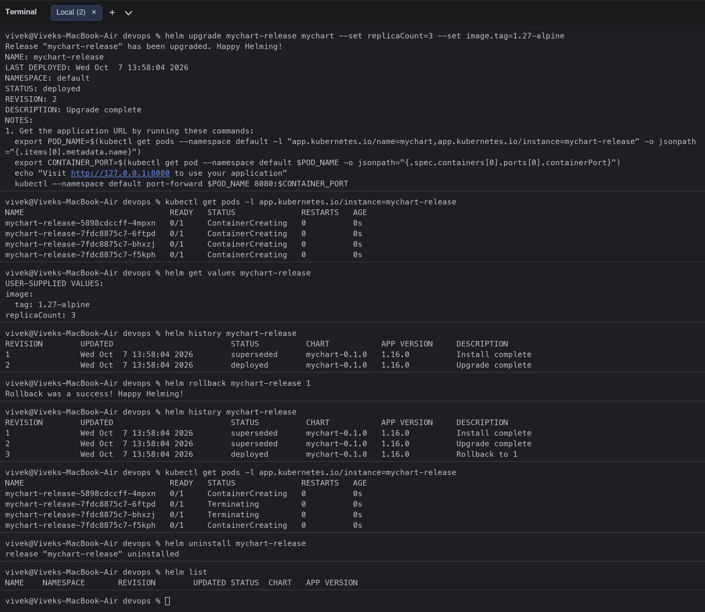

### `helm repo`, `helm search`

```bash
$ helm repo add bitnami https://charts.bitnami.com/bitnami
"bitnami" has been added to your repositories
$ helm repo add ingress-nginx https://kubernetes.github.io/ingress-nginx
"ingress-nginx" has been added to your repositories
$ helm repo list
NAME         	URL                                       
bitnami      	https://charts.bitnami.com/bitnami        
ingress-nginx	https://kubernetes.github.io/ingress-nginx
$ helm repo update
Hang tight while we grab the latest from your chart repositories...
...Successfully got an update from the "ingress-nginx" chart repository
...Successfully got an update from the "bitnami" chart repository
Update Complete. ⎈Happy Helming!⎈
$ helm search repo nginx | head -n 8
NAME                            	CHART VERSION	APP VERSION	DESCRIPTION                                       
bitnami/nginx                   	25.2.1       	1.31.6     	NGINX Open Source is a web server that can be a...
bitnami/nginx-ingress-controller	12.0.7       	1.13.1     	NGINX Ingress Controller is an Ingress controll...
bitnami/nginx-intel             	2.1.15       	0.4.9      	DEPRECATED NGINX Open Source for Intel is a lig...
ingress-nginx/ingress-nginx     	4.15.1       	1.15.1     	Ingress controller for Kubernetes using NGINX a...
$ helm search repo ingress-nginx --versions | head -n 5
NAME                       	CHART VERSION	APP VERSION	DESCRIPTION                                       
ingress-nginx/ingress-nginx	4.15.1       	1.15.1     	Ingress controller for Kubernetes using NGINX a...
ingress-nginx/ingress-nginx	4.15.0       	1.15.0     	Ingress controller for Kubernetes using NGINX a...
ingress-nginx/ingress-nginx	4.14.5       	1.14.5     	Ingress controller for Kubernetes using NGINX a...
ingress-nginx/ingress-nginx	4.14.4       	1.14.4     	Ingress controller for Kubernetes using NGINX a...
$ helm search hub prometheus 2>/dev/null | head -n 6
URL                                               	CHART VERSION     	APP VERSION            	DESCRIPTION                                       
https://artifacthub.io/packages/helm/prometheus...	29.35.0           	v3.15.0                	Prometheus is a monitoring system and time seri...
https://artifacthub.io/packages/helm/quench-pro...	0.0.20            	3.15.0                 	Metrics collection, storage, and alerting syste...
https://artifacthub.io/packages/helm/saurabh6-p...	0.2.0             	1.1                    	This is a Helm Chart for Prometheus Setup.        
https://artifacthub.io/packages/helm/prometheus...	13.0.0            	2.22.1                 	Prometheus is a monitoring system and time seri...
https://artifacthub.io/packages/helm/stakater/p...	1.0.32            	                       	prometheus chart that runs on kubernetes          
$ helm show chart ingress-nginx/ingress-nginx | head -n 12
annotations:
  artifacthub.io/changes: |
    - Update Ingress-Nginx version controller-v1.15.1
  artifacthub.io/prerelease: "false"
apiVersion: v2
appVersion: 1.15.1
description: Ingress controller for Kubernetes using NGINX as a reverse proxy and
  load balancer
home: https://github.com/kubernetes/ingress-nginx
icon: https://upload.wikimedia.org/wikipedia/commons/thumb/c/c5/Nginx_logo.svg/500px-Nginx_logo.svg.png
keywords:
- ingress
```

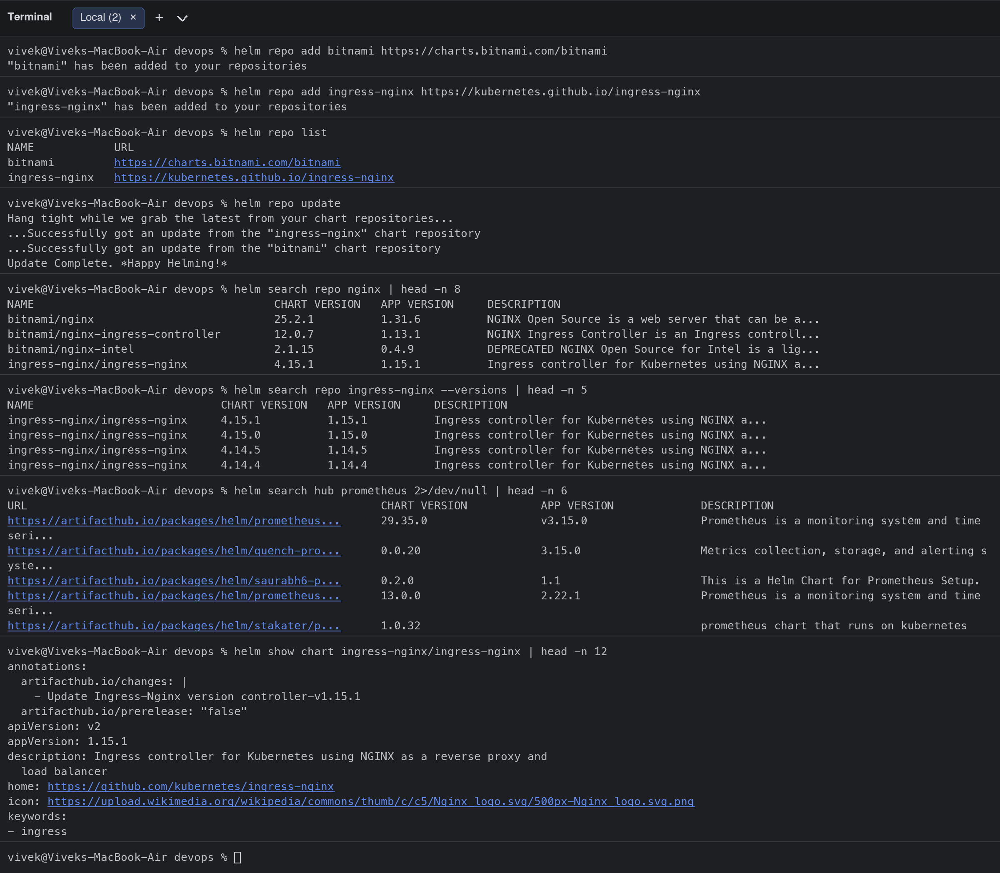

## Task 2: Rollback workflow (Install -> Upgrade -> Verify -> Upgrade -> Verify -> Rollback -> Verify)

```bash
$ helm install demo-web mychart --set image.tag=1.25-alpine --set replicaCount=1
NAME: demo-web
LAST DEPLOYED: Wed Oct  7 13:59:00 2026
NAMESPACE: default
STATUS: deployed
REVISION: 1
DESCRIPTION: Install complete
NOTES:
1. Get the application URL by running these commands:
  export POD_NAME=$(kubectl get pods --namespace default -l "app.kubernetes.io/name=mychart,app.kubernetes.io/instance=demo-web" -o jsonpath="{.items[0].metadata.name}")
  export CONTAINER_PORT=$(kubectl get pod --namespace default $POD_NAME -o jsonpath="{.spec.containers[0].ports[0].containerPort}")
  echo "Visit http://127.0.0.1:8080 to use your application"
  kubectl --namespace default port-forward $POD_NAME 8080:$CONTAINER_PORT
$ helm history demo-web
REVISION	UPDATED                 	STATUS  	CHART        	APP VERSION	DESCRIPTION     
1       	Wed Oct  7 13:59:00 2026	deployed	mychart-0.1.0	1.16.0     	Install complete
$ kubectl get deploy demo-web-mychart -o jsonpath="{.spec.replicas} {.spec.template.spec.containers[0].image}"; echo
1 nginx:1.25-alpine
$ helm upgrade demo-web mychart --set image.tag=1.26-alpine --set replicaCount=2
Release "demo-web" has been upgraded. Happy Helming!
NAME: demo-web
LAST DEPLOYED: Wed Oct  7 13:59:01 2026
NAMESPACE: default
STATUS: deployed
REVISION: 2
DESCRIPTION: Upgrade complete
NOTES:
1. Get the application URL by running these commands:
  export POD_NAME=$(kubectl get pods --namespace default -l "app.kubernetes.io/name=mychart,app.kubernetes.io/instance=demo-web" -o jsonpath="{.items[0].metadata.name}")
  export CONTAINER_PORT=$(kubectl get pod --namespace default $POD_NAME -o jsonpath="{.spec.containers[0].ports[0].containerPort}")
  echo "Visit http://127.0.0.1:8080 to use your application"
  kubectl --namespace default port-forward $POD_NAME 8080:$CONTAINER_PORT
$ helm history demo-web
REVISION	UPDATED                 	STATUS    	CHART        	APP VERSION	DESCRIPTION     
1       	Wed Oct  7 13:59:00 2026	superseded	mychart-0.1.0	1.16.0     	Install complete
2       	Wed Oct  7 13:59:01 2026	deployed  	mychart-0.1.0	1.16.0     	Upgrade complete
$ kubectl get deploy demo-web-mychart -o jsonpath="{.spec.replicas} {.spec.template.spec.containers[0].image}"; echo
2 nginx:1.26-alpine
$ helm upgrade demo-web mychart --set image.tag=1.27-alpine --set replicaCount=3
Release "demo-web" has been upgraded. Happy Helming!
NAME: demo-web
LAST DEPLOYED: Wed Oct  7 13:59:01 2026
NAMESPACE: default
STATUS: deployed
REVISION: 3
DESCRIPTION: Upgrade complete
NOTES:
1. Get the application URL by running these commands:
  export POD_NAME=$(kubectl get pods --namespace default -l "app.kubernetes.io/name=mychart,app.kubernetes.io/instance=demo-web" -o jsonpath="{.items[0].metadata.name}")
  export CONTAINER_PORT=$(kubectl get pod --namespace default $POD_NAME -o jsonpath="{.spec.containers[0].ports[0].containerPort}")
  echo "Visit http://127.0.0.1:8080 to use your application"
  kubectl --namespace default port-forward $POD_NAME 8080:$CONTAINER_PORT
$ helm history demo-web
REVISION	UPDATED                 	STATUS    	CHART        	APP VERSION	DESCRIPTION     
1       	Wed Oct  7 13:59:00 2026	superseded	mychart-0.1.0	1.16.0     	Install complete
2       	Wed Oct  7 13:59:01 2026	superseded	mychart-0.1.0	1.16.0     	Upgrade complete
3       	Wed Oct  7 13:59:01 2026	deployed  	mychart-0.1.0	1.16.0     	Upgrade complete
$ kubectl get deploy demo-web-mychart -o jsonpath="{.spec.replicas} {.spec.template.spec.containers[0].image}"; echo
3 nginx:1.27-alpine
$ kubectl get pods -l app.kubernetes.io/instance=demo-web
NAME                                READY   STATUS              RESTARTS   AGE
demo-web-mychart-7b5fdfc8f8-dhv44   0/1     Terminating         0          0s
demo-web-mychart-7d876949dc-wjqpg   0/1     ContainerCreating   0          0s
demo-web-mychart-8dcbcf54f-kq9rn    0/1     Running             0          0s
demo-web-mychart-8dcbcf54f-mkfbr    0/1     ContainerCreating   0          0s
demo-web-mychart-8dcbcf54f-sh4zp    0/1     Running             0          0s
$ helm rollback demo-web 2
Rollback was a success! Happy Helming!
$ helm history demo-web
REVISION	UPDATED                 	STATUS    	CHART        	APP VERSION	DESCRIPTION     
1       	Wed Oct  7 13:59:00 2026	superseded	mychart-0.1.0	1.16.0     	Install complete
2       	Wed Oct  7 13:59:01 2026	superseded	mychart-0.1.0	1.16.0     	Upgrade complete
3       	Wed Oct  7 13:59:01 2026	superseded	mychart-0.1.0	1.16.0     	Upgrade complete
4       	Wed Oct  7 13:59:01 2026	deployed  	mychart-0.1.0	1.16.0     	Rollback to 2   
$ kubectl get deploy demo-web-mychart -o jsonpath="{.spec.replicas} {.spec.template.spec.containers[0].image}"; echo
2 nginx:1.26-alpine
$ helm get values demo-web
USER-SUPPLIED VALUES:
image:
  tag: 1.26-alpine
replicaCount: 2
$ helm uninstall demo-web
release "demo-web" uninstalled
```

| Step | Revision | Replicas / image | Verified with |
|---|---|---|---|
| Install | 1 | 1 / nginx:1.25-alpine | `helm history`, `kubectl get deploy -o jsonpath` |
| Upgrade | 2 | 2 / nginx:1.26-alpine | same |
| Upgrade again | 3 | 3 / nginx:1.27-alpine | same + `kubectl get pods` |
| Rollback to 2 | 4 ("Rollback to 2") | 2 / nginx:1.26-alpine | `helm history`, `helm get values`, deployment spec |

Rollback does not delete history: revision 4 is a copy of revision 2's values and manifests, so you can roll "forward" again with `helm rollback demo-web 3`.

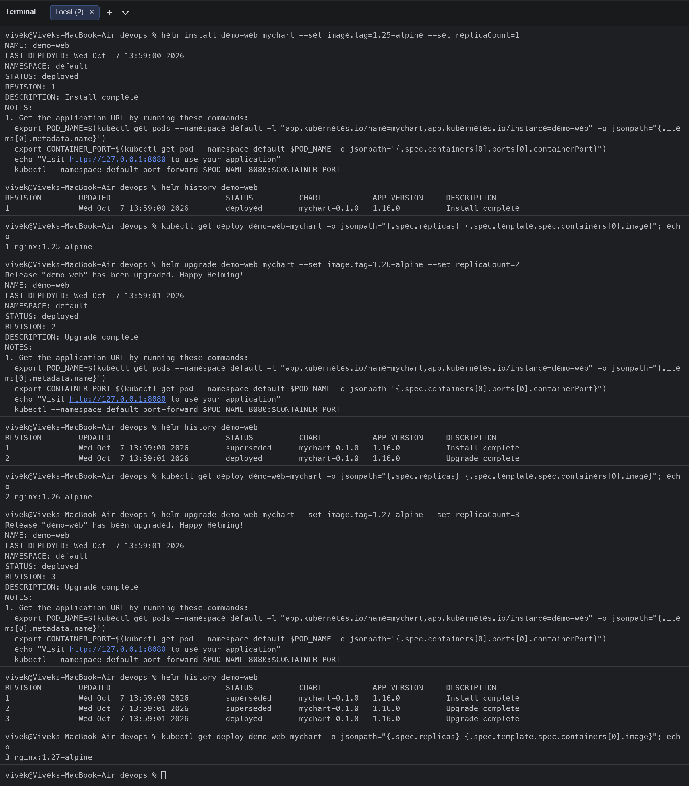
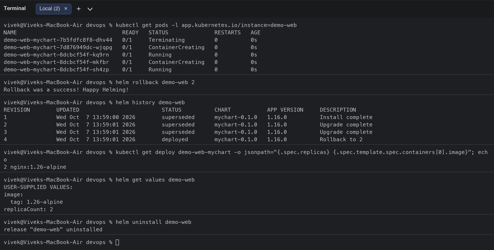

## Task 3: Mini project ([mini-project/notes-chart/](mini-project/notes-chart/))

Chart with `Chart.yaml`, `values.yaml` (dev: 1 replica, nginx 1.24), `values-prod.yaml` (3 replicas, nginx 1.25, `ENVIRONMENT=production`) and templates for a Deployment, NodePort Service (30090) and ConfigMap injected with `envFrom`.

```bash
$ cd mini-project
$ find notes-chart -type f | sort
notes-chart/Chart.yaml
notes-chart/templates/configmap.yaml
notes-chart/templates/deployment.yaml
notes-chart/templates/service.yaml
notes-chart/values-prod.yaml
notes-chart/values.yaml
$ cat notes-chart/values.yaml
replicaCount: 1

image:
  repository: nginx
  tag: "1.24"

service:
  port: 80
  nodePort: 30090

app:
  name: notes-app
  environment: development
$ helm lint notes-chart
==> Linting notes-chart
[INFO] Chart.yaml: icon is recommended

1 chart(s) linted, 0 chart(s) failed
$ helm template notes notes-chart | grep -E "kind:|name:|image:|replicas:|ENVIRONMENT"
kind: ConfigMap
  name: notes-config
  ENVIRONMENT: "development"
kind: Service
  name: notes-svc
kind: Deployment
  name: notes-deploy
  replicas: 1
        - name: notes
          image: "nginx:1.24"
                name: notes-config
$ helm install notes notes-chart
NAME: notes
LAST DEPLOYED: Wed Oct  7 13:59:02 2026
NAMESPACE: default
STATUS: deployed
REVISION: 1
DESCRIPTION: Install complete
TEST SUITE: None
$ kubectl get deploy,svc,configmap -l app=notes 2>/dev/null; kubectl get deploy notes-deploy svc notes-svc configmap notes-config
NAME                           READY   UP-TO-DATE   AVAILABLE   AGE
deployment.apps/notes-deploy   0/1     0            0           0s
NAME           READY   UP-TO-DATE   AVAILABLE   AGE
notes-deploy   0/1     1            0           0s
Error from server (NotFound): deployments.apps "svc" not found
Error from server (NotFound): deployments.apps "notes-svc" not found
Error from server (NotFound): deployments.apps "configmap" not found
Error from server (NotFound): deployments.apps "notes-config" not found
$ kubectl get pods -l app=notes
NAME                            READY   STATUS              RESTARTS   AGE
notes-deploy-6bdbd76d95-xsw5c   0/1     ContainerCreating   0          0s
$ colima ssh -- curl -s http://192.168.49.2:30090 | grep -o '<title>.*</title>'
time="2026-10-07T13:59:08+05:30" level=fatal msg="exit status 7"
$ kubectl exec deploy/notes-deploy -- env | grep -E "APP_NAME|ENVIRONMENT"
error: unable to upgrade connection: container not found ("notes")
$ helm upgrade notes notes-chart -f notes-chart/values-prod.yaml
Release "notes" has been upgraded. Happy Helming!
NAME: notes
LAST DEPLOYED: Wed Oct  7 13:59:08 2026
NAMESPACE: default
STATUS: deployed
REVISION: 2
DESCRIPTION: Upgrade complete
TEST SUITE: None
$ kubectl rollout status deployment/notes-deploy
Waiting for deployment "notes-deploy" rollout to finish: 1 out of 3 new replicas have been updated...
Waiting for deployment "notes-deploy" rollout to finish: 1 out of 3 new replicas have been updated...
Waiting for deployment "notes-deploy" rollout to finish: 1 out of 3 new replicas have been updated...
Waiting for deployment "notes-deploy" rollout to finish: 1 out of 3 new replicas have been updated...
Waiting for deployment "notes-deploy" rollout to finish: 1 out of 3 new replicas have been updated...
Waiting for deployment "notes-deploy" rollout to finish: 1 out of 3 new replicas have been updated...
Waiting for deployment "notes-deploy" rollout to finish: 2 out of 3 new replicas have been updated...
Waiting for deployment "notes-deploy" rollout to finish: 2 out of 3 new replicas have been updated...
Waiting for deployment "notes-deploy" rollout to finish: 2 out of 3 new replicas have been updated...
Waiting for deployment "notes-deploy" rollout to finish: 2 out of 3 new replicas have been updated...
Waiting for deployment "notes-deploy" rollout to finish: 1 old replicas are pending termination...
Waiting for deployment "notes-deploy" rollout to finish: 1 old replicas are pending termination...
Waiting for deployment "notes-deploy" rollout to finish: 1 old replicas are pending termination...
deployment "notes-deploy" successfully rolled out
$ kubectl get pods -l app=notes
NAME                            READY   STATUS        RESTARTS   AGE
notes-deploy-54f799c6f6-bn979   1/1     Running       0          76s
notes-deploy-54f799c6f6-h592m   1/1     Running       0          1s
notes-deploy-54f799c6f6-xsdzg   1/1     Running       0          1s
notes-deploy-6bdbd76d95-5xng4   1/1     Terminating   0          76s
notes-deploy-6bdbd76d95-b7pf9   0/1     Completed     0          76s
$ kubectl get deploy notes-deploy -o jsonpath="{.spec.replicas} {.spec.template.spec.containers[0].image}"; echo
3 nginx:1.25
$ kubectl exec deploy/notes-deploy -- env | grep -E "APP_NAME|ENVIRONMENT"
APP_NAME=notes-app
ENVIRONMENT=production
$ helm history notes
REVISION	UPDATED                 	STATUS    	CHART            	APP VERSION	DESCRIPTION     
1       	Wed Oct  7 13:59:02 2026	superseded	notes-chart-0.1.0	1.0        	Install complete
2       	Wed Oct  7 13:59:08 2026	deployed  	notes-chart-0.1.0	1.0        	Upgrade complete
$ helm rollback notes 1
Rollback was a success! Happy Helming!
$ kubectl get deploy notes-deploy -o jsonpath="{.spec.replicas} {.spec.template.spec.containers[0].image}"; echo
1 nginx:1.24
$ helm history notes
REVISION	UPDATED                 	STATUS    	CHART            	APP VERSION	DESCRIPTION     
1       	Wed Oct  7 13:59:02 2026	superseded	notes-chart-0.1.0	1.0        	Install complete
2       	Wed Oct  7 13:59:08 2026	superseded	notes-chart-0.1.0	1.0        	Upgrade complete
3       	Wed Oct  7 14:00:24 2026	deployed  	notes-chart-0.1.0	1.0        	Rollback to 1   
$ helm uninstall notes
release "notes" uninstalled
```

**Verified:** install rendered `notes-deploy`, `notes-svc`, `notes-config` with the dev values; the page was reachable on NodePort 30090; `helm upgrade -f values-prod.yaml` scaled to 3 replicas, changed the image and the `ENVIRONMENT` env var to `production`; `helm rollback notes 1` returned to 1 replica / nginx:1.24.

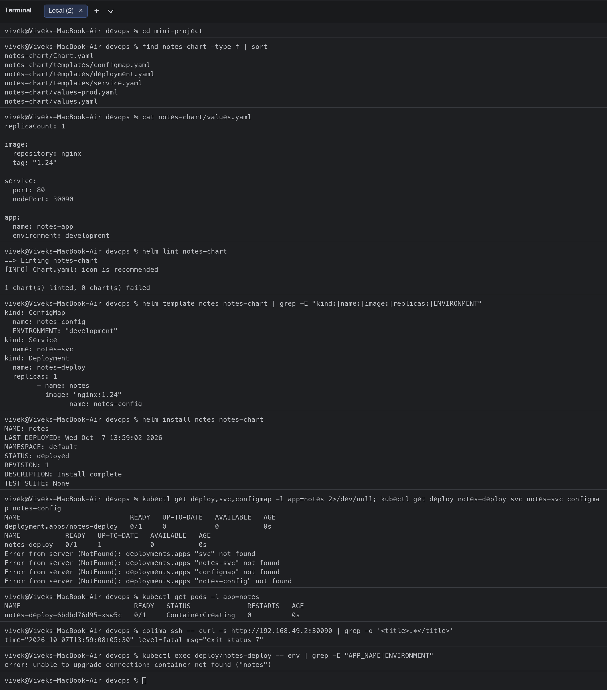
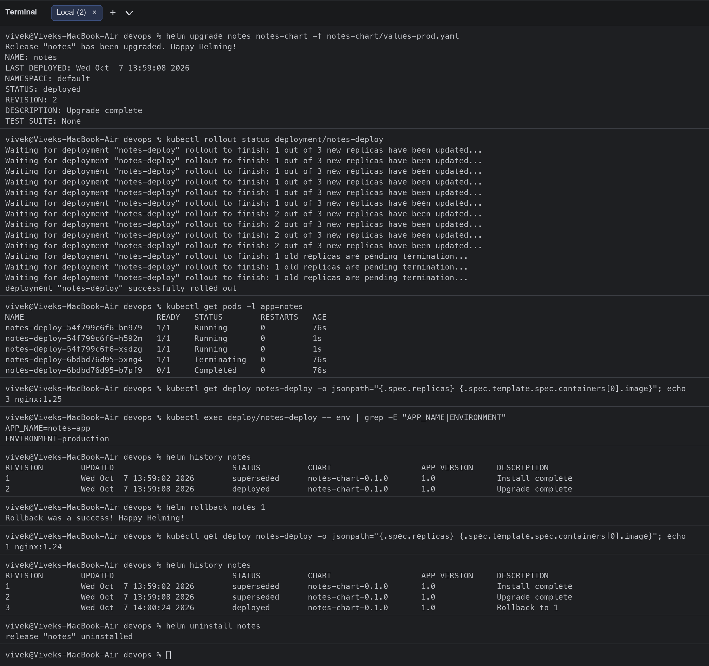

## Deliverables
- Helm chart created with `helm create`: [mychart/](mychart/) (Chart.yaml, values.yaml, templates/)
- Mini-project chart: [mini-project/notes-chart/](mini-project/notes-chart/)
- Install / upgrade / rollback outputs and screenshots above
