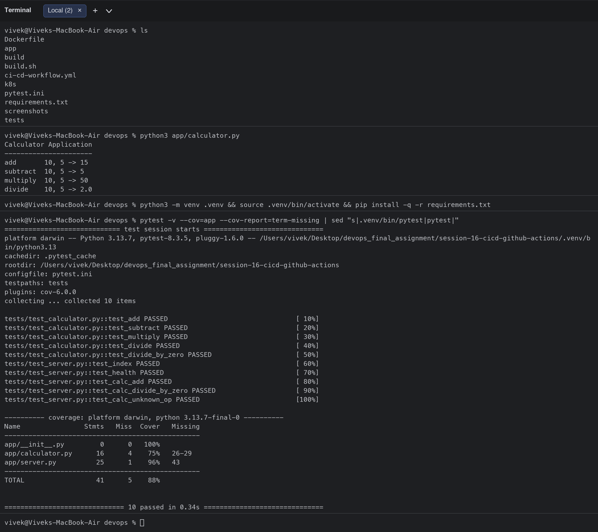
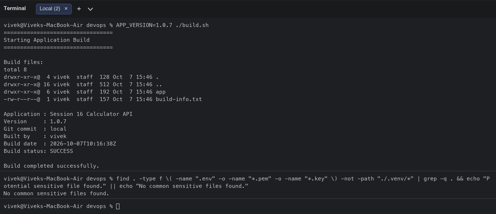
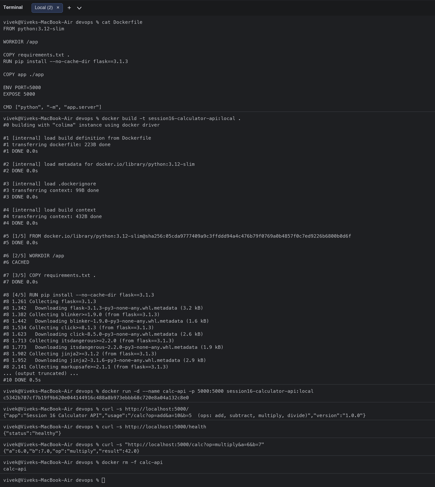
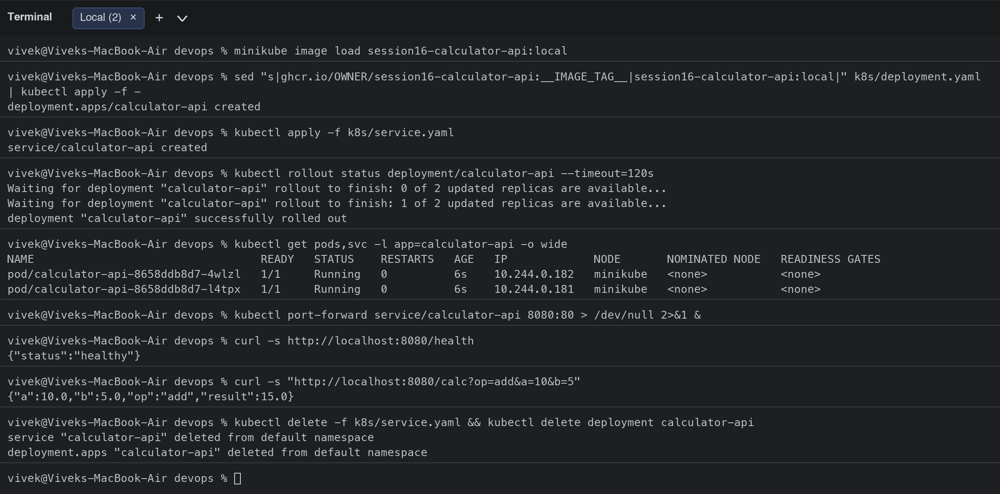
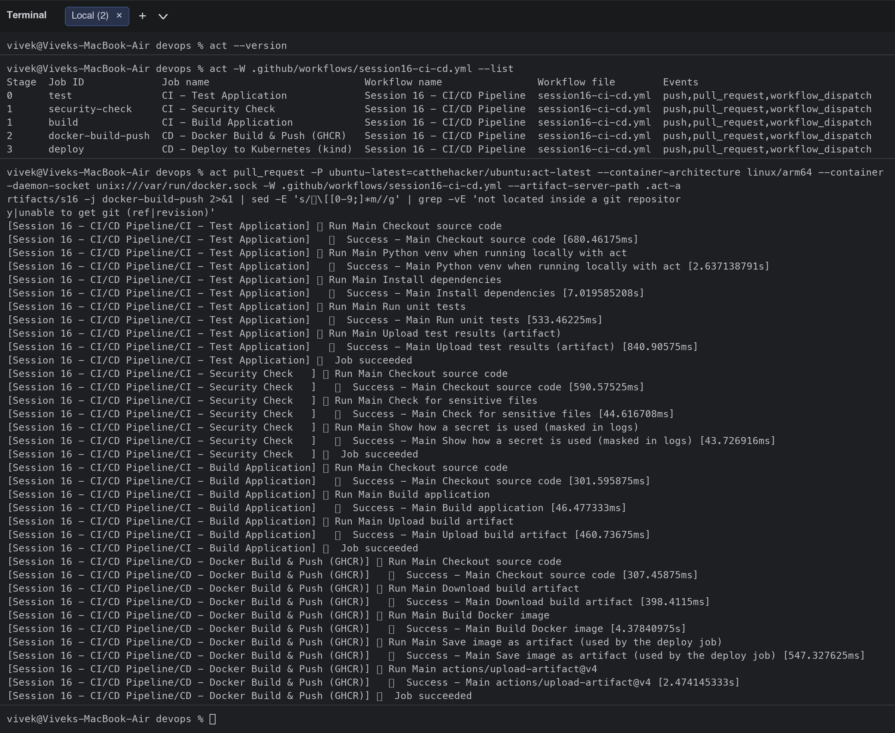

# Session 16: CI/CD & GitHub Actions - Demo Project

**Student:** Vivek Singh Solanki | **Roll number:** 24bcs10338
**Project:** Calculator API (Python/Flask) with a complete CI/CD pipeline in GitHub Actions
**Workflow:** [`.github/workflows/session16-ci-cd.yml`](../.github/workflows/session16-ci-cd.yml) (copy: [ci-cd-workflow.yml](ci-cd-workflow.yml))

## 1. Concepts covered

| Concept | How it appears in this project |
|---|---|
| **CI vs CD** | CI jobs (`test`, `build`, `security-check`) validate every push/PR; CD jobs (`docker-build-push`, `deploy`) ship the validated commit as a container image and deploy it to a Kubernetes cluster |
| **CI/CD pipeline** | `test -> build -> security-check -> docker-build-push -> deploy` expressed with `needs:` so a failing stage stops the pipeline |
| **GitHub Actions / Workflow** | One YAML workflow in `.github/workflows/`, triggered by `push`, `pull_request` (paths filter) and `workflow_dispatch` |
| **Jobs** | 5 jobs, each on its own runner; `build` and `security-check` run in parallel after `test` |
| **Steps** | `uses:` (checkout, setup-python, upload/download-artifact, docker/login-action, helm/kind-action) and `run:` (pytest, build.sh, docker build, kubectl) |
| **Runners** | `runs-on: ubuntu-latest` GitHub-hosted runners; the same workflow was executed locally with `act` (self-hosted style runner in Docker) |
| **Secrets** | `secrets.GITHUB_TOKEN` logs in to GHCR; optional `secrets.DEMO_SECRET` is read and shown masked |
| **Artifacts** | `test-results` (JUnit XML), `calculator-build` (build/ folder with build-info.txt), `docker-image` (image.tar handed from the build job to the deploy job) |
| **Build / Test** | `build.sh` packages the app, `pytest` runs 10 unit tests with coverage |
| **Pipeline execution** | Executed locally with `act` (output below); on GitHub it runs automatically on every push touching this folder |

```text
                 push / pull_request / workflow_dispatch
                                 |
                         +-------v-------+
                         |  test (CI)    |  pytest + coverage -> artifact test-results
                         +---+-------+---+
                             |       |
             +---------------v+     +v-----------------+
             | build (CI)     |     | security-check   |  sensitive-file scan + masked secret demo
             | build.sh ->    |     | (CI)             |
             | artifact       |     +---------+--------+
             +-------+--------+               |
                     +-----------+------------+
                                 v
                   +-------------+--------------+
                   | docker-build-push (CD)     |  docker build, smoke test, save image.tar artifact,
                   | login GHCR + push on main  |  push ghcr.io/vivek-0509/session16-calculator-api:<commit-sha>
                   +-------------+--------------+
                                 v
                   +-------------+--------------+
                   | deploy (CD)                |  kind cluster on the runner, kind load image,
                   | kubectl apply k8s/, curl   |  rollout status, smoke test via port-forward
                   +----------------------------+
```

## 2. Application source code

```text
session-16-cicd-github-actions/
├── app/calculator.py       add/subtract/multiply/divide library + CLI
├── app/server.py           Flask API: /  /health  /calc?op=add&a=10&b=5
├── tests/test_calculator.py, tests/test_server.py   10 pytest tests
├── requirements.txt, pytest.ini
├── build.sh                build step -> build/ (app + build-info.txt)
├── Dockerfile              python:3.12-slim image running the API on 5000
├── k8s/deployment.yaml, k8s/service.yaml   manifests used by the CD job
└── ci-cd-workflow.yml      copy of the workflow
```

## 3. Workflow file

```yaml
# Session 16 - CI/CD demo pipeline (GitHub Actions)
#   CI : test -> build (artifact) -> security-check
#   CD : docker-build-push (GHCR) -> deploy (kind cluster on the runner) -> smoke test
name: Session 16 - CI/CD Pipeline

on:
  push:
    branches: [main]
    paths:
      - "session-16-cicd-github-actions/**"
      - ".github/workflows/session16-ci-cd.yml"
  pull_request:
    branches: [main]
    paths:
      - "session-16-cicd-github-actions/**"
  workflow_dispatch:

env:
  IMAGE_TAG: ${{ github.sha || 'local' }}   # commit SHA on GitHub, 'local' when run with act
  WORKDIR: session-16-cicd-github-actions
  IMAGE_NAME: ghcr.io/${{ github.repository_owner }}/session16-calculator-api

defaults:
  run:
    working-directory: session-16-cicd-github-actions

jobs:
  # ---------------------------- CI ----------------------------
  test:
    name: CI - Test Application
    runs-on: ubuntu-latest
    steps:
      - name: Checkout source code
        uses: actions/checkout@v4

      - name: Setup Python
        if: ${{ !env.ACT }}   # act (local run) uses the runner image's Python instead
        uses: actions/setup-python@v5
        with:
          python-version: "3.12"
      - name: Python venv when running locally with act
        if: ${{ env.ACT }}
        run: |
          python3 -m venv /tmp/venv && echo "/tmp/venv/bin" >> $GITHUB_PATH

      - name: Install dependencies
        run: |
          python -m pip install --upgrade pip
          pip install -r requirements.txt

      - name: Run unit tests
        run: pytest -v --junitxml=test-results.xml --cov=app --cov-report=term-missing

      - name: Upload test results (artifact)
        uses: actions/upload-artifact@v4
        if: always()
        with:
          name: test-results
          path: session-16-cicd-github-actions/test-results.xml

  build:
    name: CI - Build Application
    needs: test
    runs-on: ubuntu-latest
    steps:
      - name: Checkout source code
        uses: actions/checkout@v4

      - name: Build application
        run: ./build.sh
        env:
          APP_VERSION: 1.0.${{ github.run_number }}

      - name: Upload build artifact
        uses: actions/upload-artifact@v4
        with:
          name: calculator-build
          path: session-16-cicd-github-actions/build/

  security-check:
    name: CI - Security Check
    needs: test
    runs-on: ubuntu-latest
    steps:
      - name: Checkout source code
        uses: actions/checkout@v4

      - name: Check for sensitive files
        run: |
          echo "Checking repository for common sensitive files..."
          if find . -type f \( -name ".env" -o -name "*.pem" -o -name "*.key" \) | grep -q .; then
            echo "Potential sensitive file found."; exit 1
          else
            echo "No common sensitive files found."
          fi

      - name: Show how a secret is used (masked in logs)
        env:
          DEMO_SECRET: ${{ secrets.DEMO_SECRET }}
        run: |
          if [ -z "$DEMO_SECRET" ]; then
            echo "DEMO_SECRET is not configured in repository settings (optional for this demo)."
          else
            echo "DEMO_SECRET is configured, length=${#DEMO_SECRET} (value is masked: $DEMO_SECRET)"
          fi

  # ---------------------------- CD ----------------------------
  docker-build-push:
    name: CD - Docker Build & Push (GHCR)
    needs: [build, security-check]
    runs-on: ubuntu-latest
    permissions:
      contents: read
      packages: write
    steps:
      - name: Checkout source code
        uses: actions/checkout@v4

      - name: Download build artifact
        uses: actions/download-artifact@v4
        with:
          name: calculator-build
          path: session-16-cicd-github-actions/build

      - name: Build Docker image
        run: |
          docker build -t $IMAGE_NAME:${{ env.IMAGE_TAG }} -t $IMAGE_NAME:latest .
          docker run --rm $IMAGE_NAME:${{ env.IMAGE_TAG }} python -c "from app.calculator import add; print('image smoke test ok, add(2,3)=', add(2,3))"

      - name: Save image as artifact (used by the deploy job)
        run: docker save $IMAGE_NAME:${{ env.IMAGE_TAG }} -o image.tar

      - uses: actions/upload-artifact@v4
        with:
          name: docker-image
          path: session-16-cicd-github-actions/image.tar

      - name: Login to GHCR
        if: github.event_name == 'push'
        uses: docker/login-action@v3
        with:
          registry: ghcr.io
          username: ${{ github.actor }}
          password: ${{ secrets.GITHUB_TOKEN }}

      - name: Push image
        if: github.event_name == 'push'
        run: |
          docker push $IMAGE_NAME:${{ env.IMAGE_TAG }}
          docker push $IMAGE_NAME:latest

  deploy:
    name: CD - Deploy to Kubernetes (kind)
    needs: docker-build-push
    runs-on: ubuntu-latest
    steps:
      - name: Checkout source code
        uses: actions/checkout@v4

      - name: Create kind cluster
        uses: helm/kind-action@v1.12.0

      - name: Download image artifact
        uses: actions/download-artifact@v4
        with:
          name: docker-image
          path: session-16-cicd-github-actions

      - name: Load image into kind
        run: |
          docker load -i image.tar
          kind load docker-image $IMAGE_NAME:${{ env.IMAGE_TAG }} --name chart-testing

      - name: Deploy manifests
        run: |
          sed -i "s|ghcr.io/OWNER/session16-calculator-api:__IMAGE_TAG__|$IMAGE_NAME:${{ env.IMAGE_TAG }}|" k8s/deployment.yaml
          kubectl apply -f k8s/
          kubectl rollout status deployment/calculator-api --timeout=120s
          kubectl get pods,svc -o wide

      - name: Smoke test the deployment
        run: |
          kubectl port-forward service/calculator-api 8080:80 &
          sleep 5
          curl -sf http://localhost:8080/health
          curl -sf "http://localhost:8080/calc?op=multiply&a=6&b=7"
```

## 4. CI stages executed locally (test, build, security check)

```bash
$ ls
Dockerfile
app
build
build.sh
ci-cd-workflow.yml
k8s
pytest.ini
requirements.txt
screenshots
tests
$ python3 app/calculator.py
Calculator Application
----------------------
add       10, 5 -> 15
subtract  10, 5 -> 5
multiply  10, 5 -> 50
divide    10, 5 -> 2.0
$ python3 -m venv .venv && source .venv/bin/activate && pip install -q -r requirements.txt
$ pytest -v --cov=app --cov-report=term-missing | sed "s|.venv/bin/pytest|pytest|"
============================= test session starts ==============================
platform darwin -- Python 3.13.7, pytest-8.3.5, pluggy-1.6.0 -- /Users/vivek/Desktop/devops_final_assignment/session-16-cicd-github-actions/.venv/bin/python3.13
cachedir: .pytest_cache
rootdir: /Users/vivek/Desktop/devops_final_assignment/session-16-cicd-github-actions
configfile: pytest.ini
testpaths: tests
plugins: cov-6.0.0
collecting ... collected 10 items

tests/test_calculator.py::test_add PASSED                                [ 10%]
tests/test_calculator.py::test_subtract PASSED                           [ 20%]
tests/test_calculator.py::test_multiply PASSED                           [ 30%]
tests/test_calculator.py::test_divide PASSED                             [ 40%]
tests/test_calculator.py::test_divide_by_zero PASSED                     [ 50%]
tests/test_server.py::test_index PASSED                                  [ 60%]
tests/test_server.py::test_health PASSED                                 [ 70%]
tests/test_server.py::test_calc_add PASSED                               [ 80%]
tests/test_server.py::test_calc_divide_by_zero PASSED                    [ 90%]
tests/test_server.py::test_calc_unknown_op PASSED                        [100%]

---------- coverage: platform darwin, python 3.13.7-final-0 ----------
Name                Stmts   Miss  Cover   Missing
-------------------------------------------------
app/__init__.py         0      0   100%
app/calculator.py      16      4    75%   26-29
app/server.py          25      1    96%   43
-------------------------------------------------
TOTAL                  41      5    88%


============================== 10 passed in 0.34s ==============================
$ APP_VERSION=1.0.7 ./build.sh
=================================
Starting Application Build
=================================

Build files:
total 8
drwxr-xr-x@  4 vivek  staff  128 Oct  7 15:46 .
drwxr-xr-x@ 16 vivek  staff  512 Oct  7 15:46 ..
drwxr-xr-x@  6 vivek  staff  192 Oct  7 15:46 app
-rw-r--r--@  1 vivek  staff  157 Oct  7 15:46 build-info.txt

Application : Session 16 Calculator API
Version     : 1.0.7
Git commit  : local
Built by    : vivek
Build date  : 2026-10-07T10:16:38Z
Build status: SUCCESS

Build completed successfully.
$ find . -type f \( -name ".env" -o -name "*.pem" -o -name "*.key" \) -not -path "./.venv/*" | grep -q . && echo "Potential sensitive file found." || echo "No common sensitive files found."
No common sensitive files found.
```




## 5. CD stages executed locally (Docker build, run, deploy to Kubernetes)

```bash
$ cat Dockerfile
FROM python:3.12-slim

WORKDIR /app

COPY requirements.txt .
RUN pip install --no-cache-dir flask==3.1.3

COPY app ./app

ENV PORT=5000
EXPOSE 5000

CMD ["python", "-m", "app.server"]
$ docker build -t session16-calculator-api:local .
#0 building with "colima" instance using docker driver

#1 [internal] load build definition from Dockerfile
#1 transferring dockerfile: 223B done
#1 DONE 0.0s

#2 [internal] load metadata for docker.io/library/python:3.12-slim
#2 DONE 0.0s

#3 [internal] load .dockerignore
#3 transferring context: 99B done
#3 DONE 0.0s

#4 [internal] load build context
#4 transferring context: 432B done
#4 DONE 0.0s

#5 [1/5] FROM docker.io/library/python:3.12-slim@sha256:05cda9777409a9c3ffddd94a4c476b79f0769a0b4857f0c7ed9226b6800b0d6f
#5 DONE 0.0s

#6 [2/5] WORKDIR /app
#6 CACHED

#7 [3/5] COPY requirements.txt .
#7 DONE 0.0s

#8 [4/5] RUN pip install --no-cache-dir flask==3.1.3
#8 1.261 Collecting flask==3.1.3
#8 1.342   Downloading flask-3.1.3-py3-none-any.whl.metadata (3.2 kB)
#8 1.382 Collecting blinker>=1.9.0 (from flask==3.1.3)
#8 1.442   Downloading blinker-1.9.0-py3-none-any.whl.metadata (1.6 kB)
#8 1.534 Collecting click>=8.1.3 (from flask==3.1.3)
#8 1.623   Downloading click-8.5.0-py3-none-any.whl.metadata (2.6 kB)
#8 1.713 Collecting itsdangerous>=2.2.0 (from flask==3.1.3)
#8 1.773   Downloading itsdangerous-2.2.0-py3-none-any.whl.metadata (1.9 kB)
#8 1.902 Collecting jinja2>=3.1.2 (from flask==3.1.3)
#8 1.952   Downloading jinja2-3.1.6-py3-none-any.whl.metadata (2.9 kB)
#8 2.141 Collecting markupsafe>=2.1.1 (from flask==3.1.3)
#8 2.166   Downloading markupsafe-3.0.4-cp312-cp312-manylinux2014_aarch64.manylinux_2_17_aarch64.manylinux_2_28_aarch64.whl.metadata (2.7 kB)
#8 2.254 Collecting werkzeug>=3.1.0 (from flask==3.1.3)
#8 2.278   Downloading werkzeug-3.1.9-py3-none-any.whl.metadata (4.1 kB)
#8 2.312 Downloading flask-3.1.3-py3-none-any.whl (103 kB)
#8 2.450 Downloading blinker-1.9.0-py3-none-any.whl (8.5 kB)
#8 2.478 Downloading click-8.5.0-py3-none-any.whl (125 kB)
#8 2.647 Downloading itsdangerous-2.2.0-py3-none-any.whl (16 kB)
#8 2.689 Downloading jinja2-3.1.6-py3-none-any.whl (134 kB)
#8 2.852 Downloading markupsafe-3.0.4-cp312-cp312-manylinux2014_aarch64.manylinux_2_17_aarch64.manylinux_2_28_aarch64.whl (24 kB)
#8 2.897 Downloading werkzeug-3.1.9-py3-none-any.whl (228 kB)
#8 3.110 Installing collected packages: markupsafe, itsdangerous, click, blinker, werkzeug, jinja2, flask
#8 3.318 Successfully installed blinker-1.9.0 click-8.5.0 flask-3.1.3 itsdangerous-2.2.0 jinja2-3.1.6 markupsafe-3.0.4 werkzeug-3.1.9
#8 3.318 WARNING: Running pip as the 'root' user can result in broken permissions and conflicting behaviour with the system package manager, possibly rendering your system unusable. It is recommended to use a virtual environment instead: https://pip.pypa.io/warnings/venv. Use the --root-user-action option if you know what you are doing and want to suppress this warning.
#8 3.440 
#8 3.440 [notice] A new release of pip is available: 25.0.1 -> 26.2.1
#8 3.440 [notice] To update, run: pip install --upgrade pip
#8 DONE 3.6s

#9 [5/5] COPY app ./app
#9 DONE 0.0s

#10 exporting to image
#10 exporting layers
#10 exporting layers 0.3s done
#10 exporting manifest sha256:b02136b47e572d2743cda495b5359f0d78d6cab61b1c052ae62a1c6448ce83f6 done
#10 exporting config sha256:c6fa2e6c6d1ce31529bee0f1f5ba9f02f9867421be7c995bc0db74c1865da953 done
#10 exporting attestation manifest sha256:d0b2aadd7fd02cbeb80e98999c0ba2f63a7d68ab093ca9c74dd971425fdf1630 done
#10 exporting manifest list sha256:3b6bc668b13d61a64c2b5f2eb10294db1d908ce5bc026e0307002f53866bac84 done
#10 naming to docker.io/library/session16-calculator-api:local done
#10 unpacking to docker.io/library/session16-calculator-api:local 0.1s done
#10 DONE 0.5s
$ docker run -d --name calc-api -p 5000:5000 session16-calculator-api:local
c5342b707cf7b19f9b620e044144916c488a8b973ebbb68c720e8a04a132c8e0
$ curl -s http://localhost:5000/
{"app":"Session 16 Calculator API","usage":"/calc?op=add&a=10&b=5  (ops: add, subtract, multiply, divide)","version":"1.0.0"}
$ curl -s http://localhost:5000/health
{"status":"healthy"}
$ curl -s "http://localhost:5000/calc?op=multiply&a=6&b=7"
{"a":6.0,"b":7.0,"op":"multiply","result":42.0}
$ docker rm -f calc-api
calc-api
```



Deployment of the built image to my minikube cluster with the same manifests the `deploy` job uses (the GitHub job does this on a kind cluster created on the runner):

```bash
$ minikube image load session16-calculator-api:local
$ sed "s|ghcr.io/OWNER/session16-calculator-api:__IMAGE_TAG__|session16-calculator-api:local|" k8s/deployment.yaml | kubectl apply -f -
deployment.apps/calculator-api created
$ kubectl apply -f k8s/service.yaml
service/calculator-api created
$ kubectl rollout status deployment/calculator-api --timeout=120s
Waiting for deployment "calculator-api" rollout to finish: 0 of 2 updated replicas are available...
Waiting for deployment "calculator-api" rollout to finish: 1 of 2 updated replicas are available...
deployment "calculator-api" successfully rolled out
$ kubectl get pods,svc -l app=calculator-api -o wide
NAME                                  READY   STATUS    RESTARTS   AGE   IP             NODE       NOMINATED NODE   READINESS GATES
pod/calculator-api-8658ddb8d7-4wlzl   1/1     Running   0          6s    10.244.0.182   minikube   <none>           <none>
pod/calculator-api-8658ddb8d7-l4tpx   1/1     Running   0          6s    10.244.0.181   minikube   <none>           <none>
$ kubectl port-forward service/calculator-api 8080:80 > /dev/null 2>&1 &
$ curl -s http://localhost:8080/health
{"status":"healthy"}
$ curl -s "http://localhost:8080/calc?op=add&a=10&b=5"
{"a":10.0,"b":5.0,"op":"add","result":15.0}
$ kubectl delete -f k8s/service.yaml && kubectl delete deployment calculator-api
service "calculator-api" deleted from default namespace
deployment.apps "calculator-api" deleted from default namespace
```



## 6. Pipeline execution with `act` (GitHub Actions run locally in Docker)

`act` executes the real workflow file with the `catthehacker/ubuntu:act-latest` runner image. The `pull_request` event was used so that the GHCR push step (which needs the GitHub token) is skipped, exactly like it is for pull requests on GitHub.

```bash
$ act --version
$ act -W .github/workflows/session16-ci-cd.yml --list
Stage  Job ID             Job name                          Workflow name                Workflow file        Events                             
0      test               CI - Test Application             Session 16 - CI/CD Pipeline  session16-ci-cd.yml  push,pull_request,workflow_dispatch
1      security-check     CI - Security Check               Session 16 - CI/CD Pipeline  session16-ci-cd.yml  push,pull_request,workflow_dispatch
1      build              CI - Build Application            Session 16 - CI/CD Pipeline  session16-ci-cd.yml  push,pull_request,workflow_dispatch
2      docker-build-push  CD - Docker Build & Push (GHCR)   Session 16 - CI/CD Pipeline  session16-ci-cd.yml  push,pull_request,workflow_dispatch
3      deploy             CD - Deploy to Kubernetes (kind)  Session 16 - CI/CD Pipeline  session16-ci-cd.yml  push,pull_request,workflow_dispatch
$ act pull_request -P ubuntu-latest=catthehacker/ubuntu:act-latest --container-architecture linux/arm64 --container-daemon-socket unix:///var/run/docker.sock -W .github/workflows/session16-ci-cd.yml --artifact-server-path .act-artifacts/s16 -j docker-build-push 2>&1 | sed -E 's/\[[0-9;]*m//g' | grep -vE 'not located inside a git repository|unable to get git (ref|revision)'
[Session 16 - CI/CD Pipeline/CI - Test Application] ⭐ Run Main Checkout source code
[Session 16 - CI/CD Pipeline/CI - Test Application]   ✅  Success - Main Checkout source code [680.46175ms]
[Session 16 - CI/CD Pipeline/CI - Test Application] ⭐ Run Main Python venv when running locally with act
[Session 16 - CI/CD Pipeline/CI - Test Application]   ✅  Success - Main Python venv when running locally with act [2.637138791s]
[Session 16 - CI/CD Pipeline/CI - Test Application] ⭐ Run Main Install dependencies
[Session 16 - CI/CD Pipeline/CI - Test Application]   ✅  Success - Main Install dependencies [7.019585208s]
[Session 16 - CI/CD Pipeline/CI - Test Application] ⭐ Run Main Run unit tests
[Session 16 - CI/CD Pipeline/CI - Test Application]   ✅  Success - Main Run unit tests [533.46225ms]
[Session 16 - CI/CD Pipeline/CI - Test Application] ⭐ Run Main Upload test results (artifact)
[Session 16 - CI/CD Pipeline/CI - Test Application]   ✅  Success - Main Upload test results (artifact) [840.90575ms]
[Session 16 - CI/CD Pipeline/CI - Test Application] 🏁  Job succeeded
[Session 16 - CI/CD Pipeline/CI - Security Check   ] ⭐ Run Main Checkout source code
[Session 16 - CI/CD Pipeline/CI - Security Check   ]   ✅  Success - Main Checkout source code [590.57525ms]
[Session 16 - CI/CD Pipeline/CI - Security Check   ] ⭐ Run Main Check for sensitive files
[Session 16 - CI/CD Pipeline/CI - Security Check   ]   ✅  Success - Main Check for sensitive files [44.616708ms]
[Session 16 - CI/CD Pipeline/CI - Security Check   ] ⭐ Run Main Show how a secret is used (masked in logs)
[Session 16 - CI/CD Pipeline/CI - Security Check   ]   ✅  Success - Main Show how a secret is used (masked in logs) [43.726916ms]
[Session 16 - CI/CD Pipeline/CI - Security Check   ] 🏁  Job succeeded
[Session 16 - CI/CD Pipeline/CI - Build Application] ⭐ Run Main Checkout source code
[Session 16 - CI/CD Pipeline/CI - Build Application]   ✅  Success - Main Checkout source code [301.595875ms]
[Session 16 - CI/CD Pipeline/CI - Build Application] ⭐ Run Main Build application
[Session 16 - CI/CD Pipeline/CI - Build Application]   ✅  Success - Main Build application [46.477333ms]
[Session 16 - CI/CD Pipeline/CI - Build Application] ⭐ Run Main Upload build artifact
[Session 16 - CI/CD Pipeline/CI - Build Application]   ✅  Success - Main Upload build artifact [460.73675ms]
[Session 16 - CI/CD Pipeline/CI - Build Application] 🏁  Job succeeded
[Session 16 - CI/CD Pipeline/CD - Docker Build & Push (GHCR)] ⭐ Run Main Checkout source code
[Session 16 - CI/CD Pipeline/CD - Docker Build & Push (GHCR)]   ✅  Success - Main Checkout source code [307.45875ms]
[Session 16 - CI/CD Pipeline/CD - Docker Build & Push (GHCR)] ⭐ Run Main Download build artifact
[Session 16 - CI/CD Pipeline/CD - Docker Build & Push (GHCR)]   ✅  Success - Main Download build artifact [398.4115ms]
[Session 16 - CI/CD Pipeline/CD - Docker Build & Push (GHCR)] ⭐ Run Main Build Docker image
[Session 16 - CI/CD Pipeline/CD - Docker Build & Push (GHCR)]   ✅  Success - Main Build Docker image [4.37840975s]
[Session 16 - CI/CD Pipeline/CD - Docker Build & Push (GHCR)] ⭐ Run Main Save image as artifact (used by the deploy job)
[Session 16 - CI/CD Pipeline/CD - Docker Build & Push (GHCR)]   ✅  Success - Main Save image as artifact (used by the deploy job) [547.327625ms]
[Session 16 - CI/CD Pipeline/CD - Docker Build & Push (GHCR)] ⭐ Run Main actions/upload-artifact@v4
[Session 16 - CI/CD Pipeline/CD - Docker Build & Push (GHCR)]   ✅  Success - Main actions/upload-artifact@v4 [2.474145333s]
[Session 16 - CI/CD Pipeline/CD - Docker Build & Push (GHCR)] 🏁  Job succeeded
```



## 7. Running it on GitHub
1. Push this repository to GitHub (the workflow is already in `.github/workflows/`).
2. Every push that touches `session-16-cicd-github-actions/` triggers the pipeline; the Actions tab shows the five jobs, the artifacts (`test-results`, `calculator-build`, `docker-image`) and the GHCR package `session16-calculator-api`.
3. Optional: add a repository secret `DEMO_SECRET` to see the masked-secret step print its length.
