# Session 17: Complete CI/CD & DevSecOps Pipeline

**Student:** Vivek Singh Solanki | **Roll number:** 24bcs10338
**Project:** DevSecOps Dashboard (Python/Flask) with a security-gated pipeline
**Workflow:** [`.github/workflows/session17-devsecops.yml`](../.github/workflows/session17-devsecops.yml) (copy: [devsecops-workflow.yml](devsecops-workflow.yml))

## Pipeline flow

```text
 Code -> Build -> Unit Test -> SAST -> SCA -> Secret Scan -> Docker Build -> Image Scan -> Security Gate -> Push Image -> Deploy to Kubernetes
         (pip install,   (pytest    (Bandit +  (pip-audit) (gitleaks)   (multi-stage,  (Trivy      (fails the run if   (GHCR,      (kind cluster on the
          compileall)     + cov)     CodeQL)                             non-root,       HIGH/CRIT)  any scan failed)    main only)  runner, kubectl)
                                                                         Alpine)
```

| Stage | Tool | Job in workflow | What blocks the pipeline |
|---|---|---|---|
| Application build + unit tests | pip, `compileall`, pytest | `build-and-test` | failing test |
| **SAST** (static application security testing) | Bandit (local + CI), CodeQL (GitHub) | `sast` | Bandit issue of severity >= medium, CodeQL alert |
| **SCA** (software composition analysis) | pip-audit against the pinned `requirements.txt` | `sca` | any known CVE in a dependency (`--strict`) |
| **Secret scanning** | gitleaks (action on GitHub, CLI locally) | `secret-scan` | any leaked credential pattern |
| Docker image build | docker build (multi-stage, non-root user 10001) | `docker-build` | build error |
| **Container image scanning** | Trivy, `security/trivy.yaml` | `image-scan` | HIGH/CRITICAL vulnerability with a fix available |
| **Security gate** | `security/security-gate.sh` | `security-gate` (`if: always()`) | any of the four security jobs not `success` |
| Container registry | GHCR via `docker/login-action` + `GITHUB_TOKEN` | `push-image` | only runs on push to `main` after the gate |
| Kubernetes deployment | kind cluster + `k8s/deployment.yaml`, `k8s/service.yaml` | `deploy` | rollout / smoke-test failure |

## Project structure

```text
session-17-cicd-devsecops/
├── app/app.py, app/templates/index.html    Flask app: / , /health, /api/status, /api/greet/<name>, POST /api/add
├── tests/test_app.py                       6 unit tests
├── requirements.txt / requirements-dev.txt
├── Dockerfile                              multi-stage, python:3.12-alpine, non-root, gunicorn
├── k8s/deployment.yaml, k8s/service.yaml   hardened Pod (runAsNonRoot, read-only root FS, drop ALL caps), NodePort 30017
├── security/bandit.yaml, .gitleaks.toml, trivy.yaml, security-gate.sh   security tool configuration + gate script
├── security/reports/                       bandit + gitleaks reports from the local run
└── devsecops-workflow.yml                  copy of the GitHub Actions workflow
```

## Workflow file

```yaml
# Session 17 - Complete CI/CD + DevSecOps pipeline
# Code -> Build -> Unit Test -> SAST -> SCA -> Secret Scan -> Docker Build -> Image Scan -> Security Gate -> Push -> Deploy
name: Session 17 - DevSecOps Pipeline

on:
  push:
    branches: [main]
    paths:
      - "session-17-cicd-devsecops/**"
      - ".github/workflows/session17-devsecops.yml"
  pull_request:
    branches: [main]
    paths:
      - "session-17-cicd-devsecops/**"
  workflow_dispatch:

env:
  IMAGE_TAG: ${{ github.sha || 'local' }}   # commit SHA on GitHub, 'local' when run with act
  WORKDIR: session-17-cicd-devsecops
  IMAGE_NAME: ghcr.io/${{ github.repository_owner }}/session17-devsecops

defaults:
  run:
    working-directory: session-17-cicd-devsecops

jobs:
  build-and-test:
    name: Build & Unit Test
    runs-on: ubuntu-latest
    steps:
      - uses: actions/checkout@v4
      - uses: actions/setup-python@v5
        if: ${{ !env.ACT }}   # act (local run) uses the runner image's Python instead
        with:
          python-version: "3.12"
      - name: Python venv when running locally with act
        if: ${{ env.ACT }}
        run: |
          python3 -m venv /tmp/venv && echo "/tmp/venv/bin" >> $GITHUB_PATH
      - name: Build (install dependencies, byte-compile)
        run: |
          pip install -r requirements-dev.txt
          python -m compileall -q app
      - name: Unit tests
        run: pytest -v --cov=app --cov-report=term-missing --junitxml=test-results.xml
      - uses: actions/upload-artifact@v4
        if: always()
        with:
          name: test-results
          path: session-17-cicd-devsecops/test-results.xml

  sast:
    name: SAST (Bandit + CodeQL)
    needs: build-and-test
    runs-on: ubuntu-latest
    permissions:
      contents: read
      security-events: write
    steps:
      - uses: actions/checkout@v4
      - uses: actions/setup-python@v5
        if: ${{ !env.ACT }}   # act (local run) uses the runner image's Python instead
        with:
          python-version: "3.12"
      - name: Python venv when running locally with act
        if: ${{ env.ACT }}
        run: |
          python3 -m venv /tmp/venv && echo "/tmp/venv/bin" >> $GITHUB_PATH
      - name: Bandit static analysis
        run: |
          pip install bandit==1.8.3
          bandit -r app -c security/bandit.yaml -f txt -o bandit-report.txt --severity-level medium
          cat bandit-report.txt
      - uses: actions/upload-artifact@v4
        if: always()
        with:
          name: bandit-report
          path: session-17-cicd-devsecops/bandit-report.txt
      - name: Initialize CodeQL
        if: ${{ !env.ACT }}   # GitHub-only action, skipped under act
        uses: github/codeql-action/init@v3
        with:
          languages: python
      - name: CodeQL analysis
        if: ${{ !env.ACT }}   # GitHub-only action, skipped under act
        uses: github/codeql-action/analyze@v3

  sca:
    name: SCA (pip-audit)
    needs: build-and-test
    runs-on: ubuntu-latest
    steps:
      - uses: actions/checkout@v4
      - uses: actions/setup-python@v5
        if: ${{ !env.ACT }}   # act (local run) uses the runner image's Python instead
        with:
          python-version: "3.12"
      - name: Python venv when running locally with act
        if: ${{ env.ACT }}
        run: |
          python3 -m venv /tmp/venv && echo "/tmp/venv/bin" >> $GITHUB_PATH
      - name: Dependency vulnerability scan
        run: |
          pip install pip-audit==2.9.0
          pip-audit -r requirements.txt --strict --desc

  secret-scan:
    name: Secret Scanning (gitleaks)
    needs: build-and-test
    runs-on: ubuntu-latest
    steps:
      - uses: actions/checkout@v4
        with:
          fetch-depth: 0
      - name: gitleaks
        if: ${{ !env.ACT }}   # GitHub-only action, skipped under act
        uses: gitleaks/gitleaks-action@v2
        env:
          GITHUB_TOKEN: ${{ secrets.GITHUB_TOKEN }}
          GITLEAKS_CONFIG: session-17-cicd-devsecops/security/.gitleaks.toml
      - name: gitleaks (local act fallback, same rules)
        if: ${{ env.ACT }}
        working-directory: .
        run: docker run --rm -v "$PWD:/repo" ghcr.io/gitleaks/gitleaks:v8.30.1 dir /repo/session-17-cicd-devsecops -c /repo/session-17-cicd-devsecops/security/.gitleaks.toml --no-banner

  docker-build:
    name: Docker Build
    needs: [sast, sca, secret-scan]
    runs-on: ubuntu-latest
    steps:
      - uses: actions/checkout@v4
      - name: Build image
        run: |
          docker build -t $IMAGE_NAME:${{ env.IMAGE_TAG }} .
          docker save $IMAGE_NAME:${{ env.IMAGE_TAG }} -o image.tar
      - uses: actions/upload-artifact@v4
        with:
          name: docker-image
          path: session-17-cicd-devsecops/image.tar

  image-scan:
    name: Container Image Scan (Trivy)
    needs: docker-build
    runs-on: ubuntu-latest
    permissions:
      contents: read
      security-events: write
    steps:
      - uses: actions/checkout@v4
      - uses: actions/download-artifact@v4
        with:
          name: docker-image
          path: session-17-cicd-devsecops
      - run: docker load -i image.tar
      - name: Trivy scan (fails on HIGH/CRITICAL)
        if: ${{ !env.ACT }}   # marketplace action on GitHub
        uses: aquasecurity/trivy-action@v0.36.0
        with:
          image-ref: ${{ env.IMAGE_NAME }}:${{ env.IMAGE_TAG }}
          format: table
          exit-code: "1"
          ignore-unfixed: true
          severity: HIGH,CRITICAL
          trivy-config: session-17-cicd-devsecops/security/trivy.yaml
      - name: Trivy scan (local act fallback, same settings via the Trivy container)
        if: ${{ env.ACT }}
        run: |
          docker run --rm -v /var/run/docker.sock:/var/run/docker.sock -v "$PWD/security/trivy.yaml:/trivy.yaml:ro" \
            aquasec/trivy:0.66.0 image --config /trivy.yaml --scanners vuln --format table ${{ env.IMAGE_NAME }}:${{ env.IMAGE_TAG }}

  security-gate:
    name: Security Gate
    needs: [sast, sca, secret-scan, image-scan]
    if: always()
    runs-on: ubuntu-latest
    steps:
      - uses: actions/checkout@v4
      - name: Evaluate gate
        run: ./security/security-gate.sh "${{ needs.sast.result }}" "${{ needs.sca.result }}" "${{ needs.secret-scan.result }}" "${{ needs.image-scan.result }}"

  push-image:
    name: Push Image (GHCR)
    needs: security-gate
    if: github.event_name == 'push' && github.ref == 'refs/heads/main'
    runs-on: ubuntu-latest
    permissions:
      contents: read
      packages: write
    steps:
      - uses: actions/download-artifact@v4
        with:
          name: docker-image
      - run: docker load -i image.tar
        working-directory: .
      - uses: docker/login-action@v3
        with:
          registry: ghcr.io
          username: ${{ github.actor }}
          password: ${{ secrets.GITHUB_TOKEN }}
      - name: Push
        working-directory: .
        run: |
          docker tag $IMAGE_NAME:${{ env.IMAGE_TAG }} $IMAGE_NAME:latest
          docker push $IMAGE_NAME:${{ env.IMAGE_TAG }}
          docker push $IMAGE_NAME:latest

  deploy:
    name: Deploy to Kubernetes
    needs: push-image
    if: github.event_name == 'push' && github.ref == 'refs/heads/main'
    runs-on: ubuntu-latest
    steps:
      - uses: actions/checkout@v4
      - name: Create kind cluster
        uses: helm/kind-action@v1.12.0
      - uses: actions/download-artifact@v4
        with:
          name: docker-image
          path: session-17-cicd-devsecops
      - name: Load image and deploy
        run: |
          docker load -i image.tar
          kind load docker-image $IMAGE_NAME:${{ env.IMAGE_TAG }} --name chart-testing
          sed -i "s|ghcr.io/OWNER/session17-devsecops:__IMAGE_TAG__|$IMAGE_NAME:${{ env.IMAGE_TAG }}|" k8s/deployment.yaml
          kubectl apply -f k8s/
          kubectl rollout status deployment/session17-python --timeout=120s
          kubectl get pods,svc
      - name: Smoke test
        run: |
          kubectl port-forward service/session17-python 5001:80 &
          sleep 5
          curl -sf http://localhost:5001/health
          curl -sf http://localhost:5001/api/status
```

## Every stage executed locally (same tools and settings as the workflow)

### 1. Build + unit tests
```bash
$ python3 -m venv .venv && source .venv/bin/activate && pip install -q -r requirements-dev.txt
$ python -m compileall -q app && echo "build: byte-compile OK"
build: byte-compile OK
$ pytest -v --cov=app --cov-report=term-missing
============================= test session starts ==============================
platform darwin -- Python 3.13.7, pytest-8.3.5, pluggy-1.6.0 -- /Users/vivek/Desktop/devops_final_assignment/session-17-cicd-devsecops/.venv/bin/python3.13
cachedir: .pytest_cache
rootdir: /Users/vivek/Desktop/devops_final_assignment/session-17-cicd-devsecops
configfile: pytest.ini
testpaths: tests
plugins: cov-6.0.0, platformdirs-4.12.3
collecting ... collected 6 items

tests/test_app.py::test_home PASSED                                      [ 16%]
tests/test_app.py::test_health PASSED                                    [ 33%]
tests/test_app.py::test_status PASSED                                    [ 50%]
tests/test_app.py::test_greet PASSED                                     [ 66%]
tests/test_app.py::test_add_numbers PASSED                               [ 83%]
tests/test_app.py::test_add_numbers_missing_fields PASSED                [100%]

---------- coverage: platform darwin, python 3.13.7-final-0 ----------
Name              Stmts   Miss  Cover   Missing
-----------------------------------------------
app/__init__.py       0      0   100%
app/app.py           42      3    93%   63-64, 70
-----------------------------------------------
TOTAL                42      3    93%


============================== 6 passed in 0.39s ===============================
```
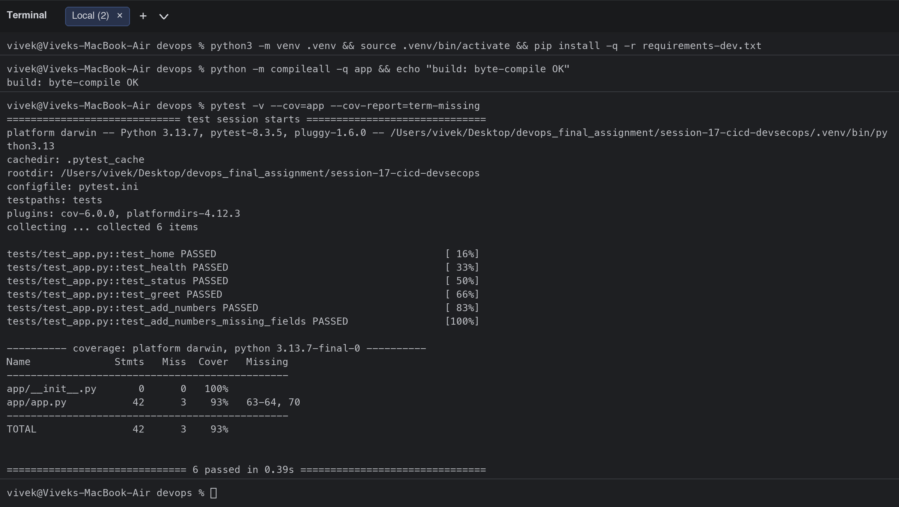

### 2. SAST (Bandit) - a real finding and its fix
The first scan reported **B104 hardcoded_bind_all_interfaces** (Medium). Binding to `0.0.0.0` is required inside a container, so the line was reviewed and marked `# nosec B104` with a justification; the second scan is clean.
```bash
$ bandit -r app -c security/bandit.yaml -f txt -o security/reports/bandit-report.txt --severity-level medium; echo "bandit exit code: $?"
[main]	INFO	profile include tests: None
[main]	INFO	profile exclude tests: None
[main]	INFO	cli include tests: None
[main]	INFO	cli exclude tests: None
[main]	INFO	using config: security/bandit.yaml
[main]	INFO	running on Python 3.13.7
[text]	INFO	Text output written to file: security/reports/bandit-report.txt
bandit exit code: 1
$ cat security/reports/bandit-report.txt
Run started:2026-10-07 08:38:05.073602

Test results:
>> Issue: [B104:hardcoded_bind_all_interfaces] Possible binding to all interfaces.
   Severity: Medium   Confidence: Medium
   CWE: CWE-605 (https://cwe.mitre.org/data/definitions/605.html)
   More Info: https://bandit.readthedocs.io/en/1.8.3/plugins/b104_hardcoded_bind_all_interfaces.html
   Location: app/app.py:69:17
68	if __name__ == "__main__":
69	    app.run(host="0.0.0.0", port=int(os.getenv("PORT", "5001")))

--------------------------------------------------

Code scanned:
	Total lines of code: 53
	Total lines skipped (#nosec): 0
	Total potential issues skipped due to specifically being disabled (e.g., #nosec BXXX): 0

Run metrics:
	Total issues (by severity):
		Undefined: 0
		Low: 0
		Medium: 1
		High: 0
	Total issues (by confidence):
		Undefined: 0
		Low: 0
		Medium: 1
		High: 0
Files skipped (0):
```
After the fix:
```bash
$ bandit -r app -c security/bandit.yaml -f txt -o security/reports/bandit-report.txt --severity-level medium; echo "bandit exit code: $?"
[main]	INFO	profile include tests: None
[main]	INFO	profile exclude tests: None
[main]	INFO	cli include tests: None
[main]	INFO	cli exclude tests: None
[main]	INFO	using config: security/bandit.yaml
[main]	INFO	running on Python 3.13.7
[manager]	WARNING	Test in comment: binding is not a test name or id, ignoring
[manager]	WARNING	Test in comment: to is not a test name or id, ignoring
[manager]	WARNING	Test in comment: all is not a test name or id, ignoring
[manager]	WARNING	Test in comment: interfaces is not a test name or id, ignoring
[manager]	WARNING	Test in comment: is is not a test name or id, ignoring
[manager]	WARNING	Test in comment: required is not a test name or id, ignoring
[manager]	WARNING	Test in comment: inside is not a test name or id, ignoring
[manager]	WARNING	Test in comment: a is not a test name or id, ignoring
[manager]	WARNING	Test in comment: container is not a test name or id, ignoring
[manager]	WARNING	Test in comment: not is not a test name or id, ignoring
[manager]	WARNING	Test in comment: exposed is not a test name or id, ignoring
[manager]	WARNING	Test in comment: directly is not a test name or id, ignoring
[manager]	WARNING	Test in comment: to is not a test name or id, ignoring
[manager]	WARNING	Test in comment: the is not a test name or id, ignoring
[manager]	WARNING	Test in comment: internet is not a test name or id, ignoring
[tester]	WARNING	nosec encountered (B104), but no failed test on line 70
[tester]	WARNING	nosec encountered (B104), but no failed test on line 70
[text]	INFO	Text output written to file: security/reports/bandit-report.txt
bandit exit code: 0
$ tail -n 12 security/reports/bandit-report.txt
Run metrics:
	Total issues (by severity):
		Undefined: 0
		Low: 0
		Medium: 0
		High: 0
	Total issues (by confidence):
		Undefined: 0
		Low: 0
		Medium: 0
		High: 0
Files skipped (0):
```
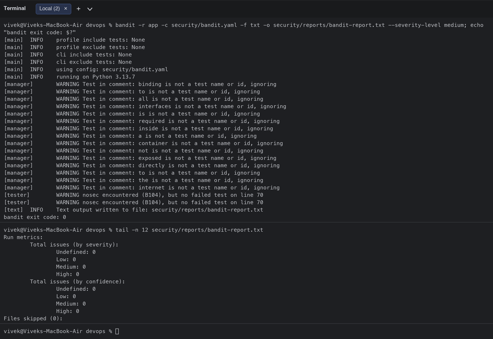
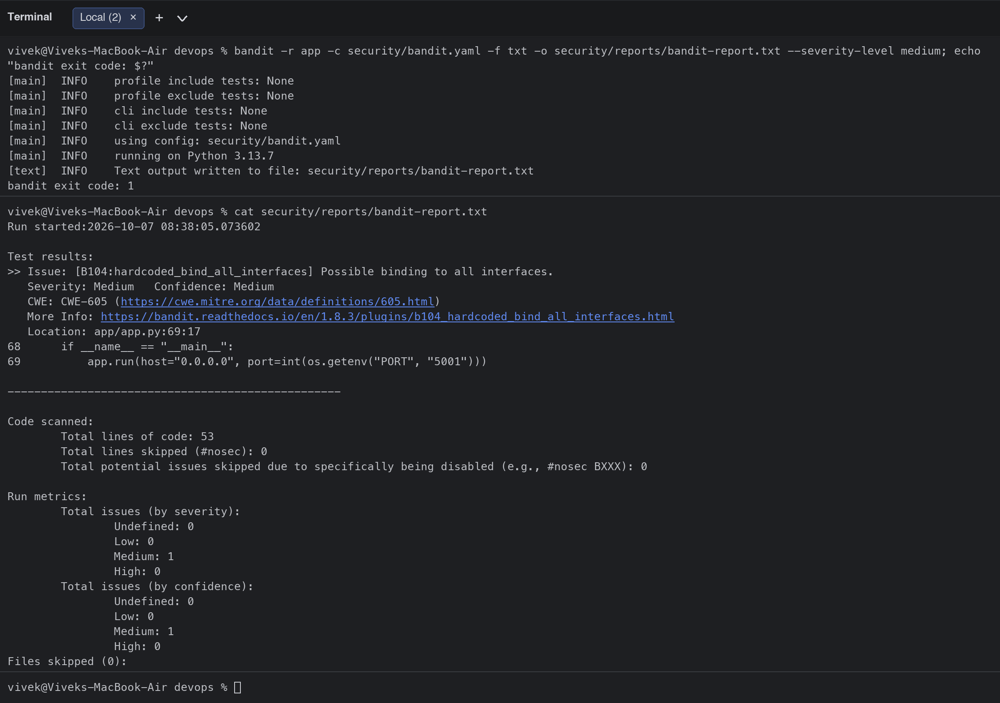

### 3. SCA (pip-audit) - a real CVE and its fix
`flask==3.1.1` was flagged with **PYSEC-2026-2151** (fixed in 3.1.3). The dependency was upgraded and the audit passes.
```bash
$ pip-audit -r requirements.txt --strict --desc; echo "pip-audit exit code: $?"
Found 1 known vulnerability in 1 package
Name  Version ID              Fix Versions Description
----- ------- --------------- ------------ ---------------------------------------------------------------------------------------------------------------------------------------------------------------------------------------------------------------------------------------------------------------------------------------------------------------------------------------------------------------------------------------------------------------------------------------------------------------------------------------------------------------------------------------------------------------------------------------------------------------------------------------------------------------------------------------------------------------------------------------------------------------------------------------------------------------------------------------------------------------
flask 3.1.1   PYSEC-2026-2151 3.1.3        Flask is a web server gateway interface (WSGI) web application framework. In versions 3.1.2 and below, when the session object is accessed, Flask should set the Vary: Cookie header., resulting in a Use of Cache Containing Sensitive Information vulnerability. The logic instructs caches not to cache the response, as it may contain information specific to a logged in user. This is handled in most cases, but some forms of access such as the Python in operator were overlooked. The severity and risk depend on the application being hosted behind a caching proxy that doesn't ignore responses with cookies, not setting a Cache-Control header to mark pages as private or non-cacheable, and accessing the session in a way that only touches keys without reading values or mutating the session. The issue has been fixed in version 3.1.3.
pip-audit exit code: 1
```
After the fix:
```bash
$ cat requirements.txt
flask==3.1.3
gunicorn==23.0.0
$ pip-audit -r requirements.txt --strict --desc; echo "pip-audit exit code: $?"
No known vulnerabilities found
pip-audit exit code: 0
```
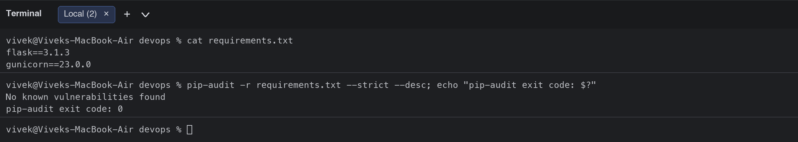
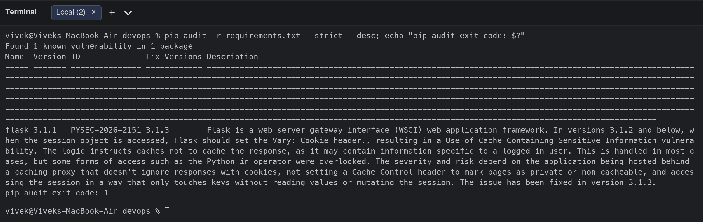

### 4. Secret scanning (gitleaks)
The repository is clean; to prove the scanner works, a temporary file with a fake AWS key and GitHub token was scanned and gitleaks exited 1 (the pipeline would stop).
```bash
$ gitleaks version
8.30.1
$ gitleaks dir . -c security/.gitleaks.toml --no-banner --report-format json --report-path security/reports/gitleaks-report.json; echo "gitleaks exit code: $?"
2:14PM INF scanned ~26411 bytes (26.41 KB) in 1.08s
2:14PM INF no leaks found
gitleaks exit code: 0
$ mkdir -p leak-demo && echo 'aws_access_key_id = AKIAKS4H************' > leak-demo/config.ini && echo 'github_token = ghp_pYUq********************************' >> leak-demo/config.ini
$ gitleaks dir leak-demo --no-banner; echo "gitleaks exit code on a file WITH secrets: $?"
2:14PM INF scanned ~97 bytes (97 bytes) in 1.13ms
2:14PM WRN leaks found: 1
gitleaks exit code on a file WITH secrets: 1
```
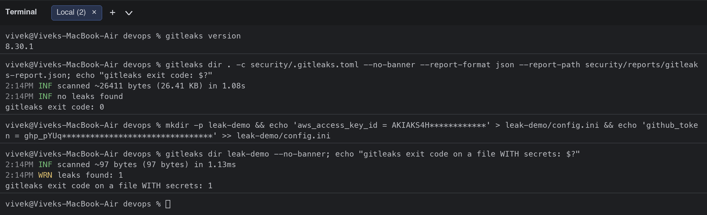

### 5. Docker build (multi-stage, non-root)
```bash
$ cat Dockerfile
# Stage 1: install dependencies
FROM python:3.12-alpine AS builder
WORKDIR /install
COPY requirements.txt .
RUN pip install --no-cache-dir --prefix=/install -r requirements.txt

# Stage 2: minimal Alpine runtime, non-root user.
# (python:3.12-slim/Debian carried 44 HIGH CVEs in util-linux at scan time; the Alpine base scanned clean.)
FROM python:3.12-alpine
RUN addgroup -S app && adduser -S -u 10001 -G app app
WORKDIR /app
COPY --from=builder /install /usr/local
COPY app ./app
USER app
ENV PORT=5001
EXPOSE 5001
CMD ["gunicorn", "-b", "0.0.0.0:5001", "-w", "2", "app.app:app"]
$ docker build -t session17-devsecops:local .
#0 building with "colima" instance using docker driver

#1 [internal] load build definition from Dockerfile
#1 transferring dockerfile: 621B done
#1 DONE 0.0s

#2 [internal] load metadata for docker.io/library/python:3.12-alpine
#2 DONE 0.0s

#3 [internal] load .dockerignore
#3 transferring context: 110B done
#3 DONE 0.0s

#4 [internal] load build context
#4 transferring context: 348B done
#4 DONE 0.0s

#5 [builder 1/4] FROM docker.io/library/python:3.12-alpine@sha256:1b668429b3511ab407d8e00648891631b0b1a4d7e15e3ca70f38ab5b91ad4ab4
#5 DONE 0.0s

#6 [builder 2/4] WORKDIR /install
#6 DONE 0.0s

#7 [builder 3/4] COPY requirements.txt .
#7 DONE 0.0s

#8 [stage-1 2/5] RUN addgroup -S app && adduser -S -u 10001 -G app app
#8 DONE 0.2s

#9 [builder 4/4] RUN pip install --no-cache-dir --prefix=/install -r requirements.txt

#10 [stage-1 3/5] WORKDIR /app
#10 DONE 0.0s

#9 [builder 4/4] RUN pip install --no-cache-dir --prefix=/install -r requirements.txt
#9 1.181 Collecting flask==3.1.3 (from -r requirements.txt (line 1))
#9 1.376   Downloading flask-3.1.3-py3-none-any.whl.metadata (3.2 kB)
#9 1.419 Collecting gunicorn==23.0.0 (from -r requirements.txt (line 2))
#9 1.445   Downloading gunicorn-23.0.0-py3-none-any.whl.metadata (4.4 kB)
#9 1.479 Collecting blinker>=1.9.0 (from flask==3.1.3->-r requirements.txt (line 1))
#9 1.507   Downloading blinker-1.9.0-py3-none-any.whl.metadata (1.6 kB)
#9 1.544 Collecting click>=8.1.3 (from flask==3.1.3->-r requirements.txt (line 1))
#9 1.572   Downloading click-8.5.0-py3-none-any.whl.metadata (2.6 kB)
#9 1.604 Collecting itsdangerous>=2.2.0 (from flask==3.1.3->-r requirements.txt (line 1))
#9 1.630   Downloading itsdangerous-2.2.0-py3-none-any.whl.metadata (1.9 kB)
#9 1.666 Collecting jinja2>=3.1.2 (from flask==3.1.3->-r requirements.txt (line 1))
#9 1.693   Downloading jinja2-3.1.6-py3-none-any.whl.metadata (2.9 kB)
#9 1.783 Collecting markupsafe>=2.1.1 (from flask==3.1.3->-r requirements.txt (line 1))
#9 1.812   Downloading markupsafe-3.0.4-cp312-cp312-musllinux_1_2_aarch64.whl.metadata (2.7 kB)
#9 1.850 Collecting werkzeug>=3.1.0 (from flask==3.1.3->-r requirements.txt (line 1))
#9 1.878   Downloading werkzeug-3.1.9-py3-none-any.whl.metadata (4.1 kB)
#9 1.914 Collecting packaging (from gunicorn==23.0.0->-r requirements.txt (line 2))
#9 1.941   Downloading packaging-26.3-py3-none-any.whl.metadata (3.5 kB)
#9 1.973 Downloading flask-3.1.3-py3-none-any.whl (103 kB)
#9 2.039 Downloading gunicorn-23.0.0-py3-none-any.whl (85 kB)
#9 2.075 Downloading blinker-1.9.0-py3-none-any.whl (8.5 kB)
#9 2.104 Downloading click-8.5.0-py3-none-any.whl (125 kB)
#9 2.163 Downloading itsdangerous-2.2.0-py3-none-any.whl (16 kB)
#9 2.190 Downloading jinja2-3.1.6-py3-none-any.whl (134 kB)
#9 2.254 Downloading markupsafe-3.0.4-cp312-cp312-musllinux_1_2_aarch64.whl (23 kB)
#9 2.282 Downloading werkzeug-3.1.9-py3-none-any.whl (228 kB)
#9 2.404 Downloading packaging-26.3-py3-none-any.whl (129 kB)
#9 2.454 Installing collected packages: packaging, markupsafe, itsdangerous, click, blinker, werkzeug, jinja2, gunicorn, flask
#9 2.778 Successfully installed blinker-1.9.0 click-8.5.0 flask-3.1.3 gunicorn-23.0.0 itsdangerous-2.2.0 jinja2-3.1.6 markupsafe-3.0.4 packaging-26.3 werkzeug-3.1.9
#9 2.778 WARNING: Running pip as the 'root' user can result in broken permissions and conflicting behaviour with the system package manager, possibly rendering your system unusable. It is recommended to use a virtual environment instead: https://pip.pypa.io/warnings/venv. Use the --root-user-action option if you know what you are doing and want to suppress this warning.
#9 2.890 
#9 2.890 [notice] A new release of pip is available: 25.0.1 -> 26.2.1
#9 2.890 [notice] To update, run: pip install --upgrade pip
#9 DONE 3.1s

#11 [stage-1 4/5] COPY --from=builder /install /usr/local
#11 DONE 0.1s

#12 [stage-1 5/5] COPY app ./app
#12 DONE 0.0s

#13 exporting to image
#13 exporting layers
#13 exporting layers 0.2s done
#13 exporting manifest sha256:73dd7bbe0c8900a67478f503a7b882fd8ec92fc709fd30e660b9192a24c62108 done
#13 exporting config sha256:a429317e3c050c960671aa16b3abcc79aeb792d32e745df14d9f65bf2dcbc4a3 done
#13 exporting attestation manifest sha256:d292e526ae3d2f64e8634aaff1a9e8d5a1942cf9a83b33f50c7af70831498566 done
#13 exporting manifest list sha256:7a105435849d1a44c810e82a0a246bcc470ed22bb7c0c654a11944e3025c3686 done
#13 naming to docker.io/library/session17-devsecops:local done
#13 unpacking to docker.io/library/session17-devsecops:local 0.0s done
#13 DONE 0.2s
$ docker images session17-devsecops
IMAGE                       ID             DISK USAGE   CONTENT SIZE   EXTRA
session17-devsecops:local   7a105435849d       97.8MB         23.6MB        
$ docker run --rm session17-devsecops:local id
uid=10001(app) gid=101(app) groups=101(app),101(app)
```
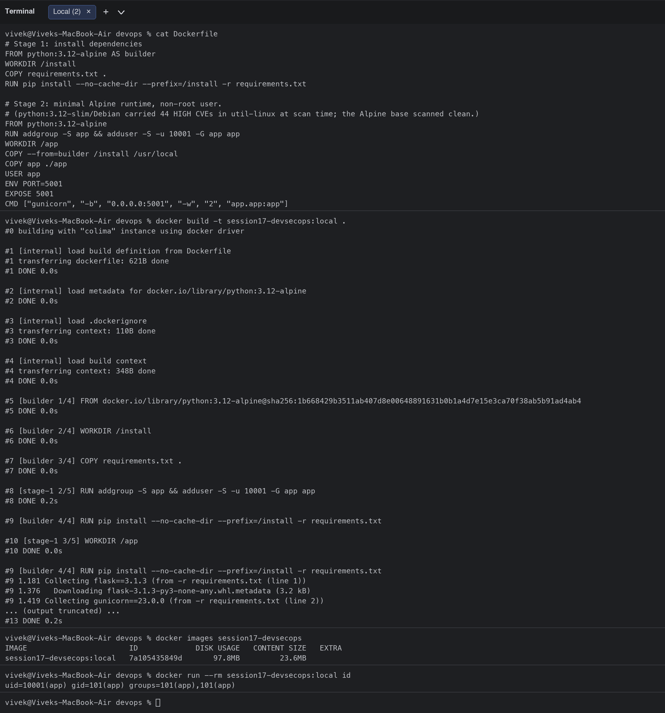

### 6. Container image scan (Trivy) - base image remediation
The first image (`python:3.12-slim`, Debian) failed the gate with **44 HIGH** CVEs in `util-linux`; `apt-get upgrade` did not remove them. Switching the runtime base to `python:3.12-alpine` produced a clean scan (0 HIGH / 0 CRITICAL).
```bash
$ trivy version | head -n 1
Version: 0.75.0
$ cat security/trivy.yaml
# Trivy (container image scanning) configuration
severity:
  - HIGH
  - CRITICAL
exit-code: 1
ignore-unfixed: true
scan:
  scanners:
    - vuln
    - secret
$ trivy image --config security/trivy.yaml --scanners vuln --format table session17-devsecops:local; echo "trivy exit code: $?"
2026-10-07T14:14:46+05:30	INFO	Loaded	file_path="security/trivy.yaml"
2026-10-07T14:14:46+05:30	INFO	[vuln] Vulnerability scanning is enabled
2026-10-07T14:14:47+05:30	INFO	[python] Licenses acquired from one or more METADATA files may be subject to additional terms. Use `--debug` flag to see all affected packages.
2026-10-07T14:14:47+05:30	INFO	Detected OS	family="debian" version="13.7"
2026-10-07T14:14:47+05:30	INFO	[debian] Detecting vulnerabilities...	os_version="13" pkg_num=87
2026-10-07T14:14:47+05:30	INFO	Number of language-specific files	num=1
2026-10-07T14:14:47+05:30	INFO	[python-pkg] Detecting vulnerabilities...
2026-10-07T14:14:47+05:30	WARN	Using severities from other vendors for some vulnerabilities. Read https://trivy.dev/docs/v0.75/guide/scanner/vulnerability#severity-selection for details.

Report Summary

┌──────────────────────────────────────────────────────────────────────────────┬────────────┬─────────────────┐
│                                    Target                                    │    Type    │ Vulnerabilities │
├──────────────────────────────────────────────────────────────────────────────┼────────────┼─────────────────┤
│ session17-devsecops:local (debian 13.7)                                      │   debian   │       44        │
├──────────────────────────────────────────────────────────────────────────────┼────────────┼─────────────────┤
│ usr/local/lib/python3.12/site-packages/blinker-1.9.0.dist-info/METADATA      │ python-pkg │        0        │
├──────────────────────────────────────────────────────────────────────────────┼────────────┼─────────────────┤
│ usr/local/lib/python3.12/site-packages/click-8.5.0.dist-info/METADATA        │ python-pkg │        0        │
├──────────────────────────────────────────────────────────────────────────────┼────────────┼─────────────────┤
│ usr/local/lib/python3.12/site-packages/flask-3.1.3.dist-info/METADATA        │ python-pkg │        0        │
├──────────────────────────────────────────────────────────────────────────────┼────────────┼─────────────────┤
│ usr/local/lib/python3.12/site-packages/gunicorn-23.0.0.dist-info/METADATA    │ python-pkg │        0        │
├──────────────────────────────────────────────────────────────────────────────┼────────────┼─────────────────┤
│ usr/local/lib/python3.12/site-packages/itsdangerous-2.2.0.dist-info/METADATA │ python-pkg │        0        │
├──────────────────────────────────────────────────────────────────────────────┼────────────┼─────────────────┤
│ usr/local/lib/python3.12/site-packages/jinja2-3.1.6.dist-info/METADATA       │ python-pkg │        0        │
├──────────────────────────────────────────────────────────────────────────────┼────────────┼─────────────────┤
│ usr/local/lib/python3.12/site-packages/markupsafe-3.0.4.dist-info/METADATA   │ python-pkg │        0        │
├──────────────────────────────────────────────────────────────────────────────┼────────────┼─────────────────┤
│ usr/local/lib/python3.12/site-packages/packaging-26.3.dist-info/METADATA     │ python-pkg │        0        │
├──────────────────────────────────────────────────────────────────────────────┼────────────┼─────────────────┤
│ usr/local/lib/python3.12/site-packages/pip-25.0.1.dist-info/METADATA         │ python-pkg │        0        │
├──────────────────────────────────────────────────────────────────────────────┼────────────┼─────────────────┤
│ usr/local/lib/python3.12/site-packages/werkzeug-3.1.9.dist-info/METADATA     │ python-pkg │        0        │
└──────────────────────────────────────────────────────────────────────────────┴────────────┴─────────────────┘
Legend:
- '-': Not scanned
- '0': Clean (no security findings detected)


session17-devsecops:local (debian 13.7)
=======================================
Total: 44 (HIGH: 44, CRITICAL: 0)

┌───────────────┬────────────────┬──────────┬──────────────┬───────────────────────────────────┬───────────────┬─────────────────────────────────────────────────────────────┐
│    Library    │ Vulnerability  │ Severity │    Status    │         Installed Version         │ Fixed Version │                            Title                            │
├───────────────┼────────────────┼──────────┼──────────────┼───────────────────────────────────┼───────────────┼─────────────────────────────────────────────────────────────┤
│ bsdutils      │ CVE-2026-76642 │ HIGH     │ affected     │ 1:2.41.5-0+deb13u1                │               │ util-linux: util-linux: failed external mount helper still  │
│               │                │          │              │                                   │               │ runs privileged X-mount post-hooks                          │
│               │                │          │              │                                   │               │ https://avd.aquasec.com/nvd/cve-2026-76642                  │
│               ├────────────────┤          │              │                                   ├───────────────┼─────────────────────────────────────────────────────────────┤
│               │ CVE-2026-78408 │          │              │                                   │               │ util-linux: util-linux: nsenter --join-cgroup leaks root    │
│               │                │          │              │                                   │               │ cgroup migration authority                                  │
│               │                │          │              │                                   │               │ https://avd.aquasec.com/nvd/cve-2026-78408                  │
│               ├────────────────┤          │              │                                   ├───────────────┼─────────────────────────────────────────────────────────────┤
│               │ CVE-2026-78409 │          │              │                                   │               │ util-linux: util-linux: X-mount.subdir detached-tree        │
│               │                │          │              │                                   │               │ resolution can escape via intermediate symlinks             │
│               │                │          │              │                                   │               │ https://avd.aquasec.com/nvd/cve-2026-78409                  │
│               ├────────────────┤          │              │                                   ├───────────────┼─────────────────────────────────────────────────────────────┤
│               │ CVE-2026-78410 │          │              │                                   │               │ util-linux: util-linux: restricted bind mounts do not pin   │
│               │                │          │              │                                   │               │ the source, allowing X-mount.owner/group/mode...            │
│               │                │          │              │                                   │               │ https://avd.aquasec.com/nvd/cve-2026-78410                  │
├───────────────┼────────────────┤          │              ├───────────────────────────────────┼───────────────┼─────────────────────────────────────────────────────────────┤
│ libacl1       │ CVE-2026-54369 │          │              │ 2.3.2-2+b1                        │               │ acl: Symlink traversal privilege escalation via libacl      │
│               │                │          │              │                                   │               │ functions                                                   │
│               │                │          │              │                                   │               │ https://avd.aquasec.com/nvd/cve-2026-54369                  │
├───────────────┼────────────────┤          │              ├───────────────────────────────────┼───────────────┼─────────────────────────────────────────────────────────────┤
│ libblkid1     │ CVE-2026-76642 │          │              │ 2.41.5-0+deb13u1                  │               │ util-linux: util-linux: failed external mount helper still  │
│               │                │          │              │                                   │               │ runs privileged X-mount post-hooks                          │
│               │                │          │              │                                   │               │ https://avd.aquasec.com/nvd/cve-2026-76642                  │
│               ├────────────────┤          │              │                                   ├───────────────┼─────────────────────────────────────────────────────────────┤
│               │ CVE-2026-78408 │          │              │                                   │               │ util-linux: util-linux: nsenter --join-cgroup leaks root    │
│               │                │          │              │                                   │               │ cgroup migration authority                                  │
│               │                │          │              │                                   │               │ https://avd.aquasec.com/nvd/cve-2026-78408                  │
│               ├────────────────┤          │              │                                   ├───────────────┼─────────────────────────────────────────────────────────────┤
│               │ CVE-2026-78409 │          │              │                                   │               │ util-linux: util-linux: X-mount.subdir detached-tree        │
│               │                │          │              │                                   │               │ resolution can escape via intermediate symlinks             │
│               │                │          │              │                                   │               │ https://avd.aquasec.com/nvd/cve-2026-78409                  │
│               ├────────────────┤          │              │                                   ├───────────────┼─────────────────────────────────────────────────────────────┤
│               │ CVE-2026-78410 │          │              │                                   │               │ util-linux: util-linux: restricted bind mounts do not pin   │
│               │                │          │              │                                   │               │ the source, allowing X-mount.owner/group/mode...            │
│               │                │          │              │                                   │               │ https://avd.aquasec.com/nvd/cve-2026-78410                  │
├───────────────┼────────────────┤          │              │                                   ├───────────────┼─────────────────────────────────────────────────────────────┤
│ liblastlog2-2 │ CVE-2026-76642 │          │              │                                   │               │ util-linux: util-linux: failed external mount helper still  │
│               │                │          │              │                                   │               │ runs privileged X-mount post-hooks                          │
│               │                │          │              │                                   │               │ https://avd.aquasec.com/nvd/cve-2026-76642                  │
│               ├────────────────┤          │              │                                   ├───────────────┼─────────────────────────────────────────────────────────────┤
│               │ CVE-2026-78408 │          │              │                                   │               │ util-linux: util-linux: nsenter --join-cgroup leaks root    │
│               │                │          │              │                                   │               │ cgroup migration authority                                  │
│               │                │          │              │                                   │               │ https://avd.aquasec.com/nvd/cve-2026-78408                  │
│               ├────────────────┤          │              │                                   ├───────────────┼─────────────────────────────────────────────────────────────┤
│               │ CVE-2026-78409 │          │              │                                   │               │ util-linux: util-linux: X-mount.subdir detached-tree        │
│               │                │          │              │                                   │               │ resolution can escape via intermediate symlinks             │
│               │                │          │              │                                   │               │ https://avd.aquasec.com/nvd/cve-2026-78409                  │
│               ├────────────────┤          │              │                                   ├───────────────┼─────────────────────────────────────────────────────────────┤
│               │ CVE-2026-78410 │          │              │                                   │               │ util-linux: util-linux: restricted bind mounts do not pin   │
│               │                │          │              │                                   │               │ the source, allowing X-mount.owner/group/mode...            │
│               │                │          │              │                                   │               │ https://avd.aquasec.com/nvd/cve-2026-78410                  │
├───────────────┼────────────────┤          │              │                                   ├───────────────┼─────────────────────────────────────────────────────────────┤
│ libmount1     │ CVE-2026-76642 │          │              │                                   │               │ util-linux: util-linux: failed external mount helper still  │
│               │                │          │              │                                   │               │ runs privileged X-mount post-hooks                          │
│               │                │          │              │                                   │               │ https://avd.aquasec.com/nvd/cve-2026-76642                  │
│               ├────────────────┤          │              │                                   ├───────────────┼─────────────────────────────────────────────────────────────┤
│               │ CVE-2026-78408 │          │              │                                   │               │ util-linux: util-linux: nsenter --join-cgroup leaks root    │
│               │                │          │              │                                   │               │ cgroup migration authority                                  │
│               │                │          │              │                                   │               │ https://avd.aquasec.com/nvd/cve-2026-78408                  │
│               ├────────────────┤          │              │                                   ├───────────────┼─────────────────────────────────────────────────────────────┤
│               │ CVE-2026-78409 │          │              │                                   │               │ util-linux: util-linux: X-mount.subdir detached-tree        │
│               │                │          │              │                                   │               │ resolution can escape via intermediate symlinks             │
│               │                │          │              │                                   │               │ https://avd.aquasec.com/nvd/cve-2026-78409                  │
│               ├────────────────┤          │              │                                   ├───────────────┼─────────────────────────────────────────────────────────────┤
│               │ CVE-2026-78410 │          │              │                                   │               │ util-linux: util-linux: restricted bind mounts do not pin   │
│               │                │          │              │                                   │               │ the source, allowing X-mount.owner/group/mode...            │
│               │                │          │              │                                   │               │ https://avd.aquasec.com/nvd/cve-2026-78410                  │
├───────────────┼────────────────┤          │              ├───────────────────────────────────┼───────────────┼─────────────────────────────────────────────────────────────┤
│ libncursesw6  │ CVE-2025-69720 │          │              │ 6.5+20250216-2                    │               │ ncurses: ncurses: Buffer overflow vulnerability may lead to │
│               │                │          │              │                                   │               │ arbitrary code execution.                                   │
│               │                │          │              │                                   │               │ https://avd.aquasec.com/nvd/cve-2025-69720                  │
├───────────────┼────────────────┤          │              ├───────────────────────────────────┼───────────────┼─────────────────────────────────────────────────────────────┤
│ libsmartcols1 │ CVE-2026-76642 │          │              │ 2.41.5-0+deb13u1                  │               │ util-linux: util-linux: failed external mount helper still  │
│               │                │          │              │                                   │               │ runs privileged X-mount post-hooks                          │
│               │                │          │              │                                   │               │ https://avd.aquasec.com/nvd/cve-2026-76642                  │
│               ├────────────────┤          │              │                                   ├───────────────┼─────────────────────────────────────────────────────────────┤
│               │ CVE-2026-78408 │          │              │                                   │               │ util-linux: util-linux: nsenter --join-cgroup leaks root    │
│               │                │          │              │                                   │               │ cgroup migration authority                                  │
│               │                │          │              │                                   │               │ https://avd.aquasec.com/nvd/cve-2026-78408                  │
│               ├────────────────┤          │              │                                   ├───────────────┼─────────────────────────────────────────────────────────────┤
│               │ CVE-2026-78409 │          │              │                                   │               │ util-linux: util-linux: X-mount.subdir detached-tree        │
│               │                │          │              │                                   │               │ resolution can escape via intermediate symlinks             │
│               │                │          │              │                                   │               │ https://avd.aquasec.com/nvd/cve-2026-78409                  │
│               ├────────────────┤          │              │                                   ├───────────────┼─────────────────────────────────────────────────────────────┤
│               │ CVE-2026-78410 │          │              │                                   │               │ util-linux: util-linux: restricted bind mounts do not pin   │
│               │                │          │              │                                   │               │ the source, allowing X-mount.owner/group/mode...            │
│               │                │          │              │                                   │               │ https://avd.aquasec.com/nvd/cve-2026-78410                  │
├───────────────┼────────────────┤          │              ├───────────────────────────────────┼───────────────┼─────────────────────────────────────────────────────────────┤
│ libsystemd0   │ CVE-2026-16742 │          │              │ 257.13-1~deb13u1                  │               │ systemd: systemd-homed: Local privilege escalation via      │
│               │                │          │              │                                   │               │ missing home-record signature verification                  │
│               │                │          │              │                                   │               │ https://avd.aquasec.com/nvd/cve-2026-16742                  │
├───────────────┼────────────────┤          │              ├───────────────────────────────────┼───────────────┼─────────────────────────────────────────────────────────────┤
│ libtinfo6     │ CVE-2025-69720 │          │              │ 6.5+20250216-2                    │               │ ncurses: ncurses: Buffer overflow vulnerability may lead to │
│               │                │          │              │                                   │               │ arbitrary code execution.                                   │
│               │                │          │              │                                   │               │ https://avd.aquasec.com/nvd/cve-2025-69720                  │
├───────────────┼────────────────┤          │              ├───────────────────────────────────┼───────────────┼─────────────────────────────────────────────────────────────┤
│ libudev1      │ CVE-2026-16742 │          │              │ 257.13-1~deb13u1                  │               │ systemd: systemd-homed: Local privilege escalation via      │
│               │                │          │              │                                   │               │ missing home-record signature verification                  │
│               │                │          │              │                                   │               │ https://avd.aquasec.com/nvd/cve-2026-16742                  │
├───────────────┼────────────────┤          │              ├───────────────────────────────────┼───────────────┼─────────────────────────────────────────────────────────────┤
│ libuuid1      │ CVE-2026-76642 │          │              │ 2.41.5-0+deb13u1                  │               │ util-linux: util-linux: failed external mount helper still  │
│               │                │          │              │                                   │               │ runs privileged X-mount post-hooks                          │
│               │                │          │              │                                   │               │ https://avd.aquasec.com/nvd/cve-2026-76642                  │
│               ├────────────────┤          │              │                                   ├───────────────┼─────────────────────────────────────────────────────────────┤
│               │ CVE-2026-78408 │          │              │                                   │               │ util-linux: util-linux: nsenter --join-cgroup leaks root    │
│               │                │          │              │                                   │               │ cgroup migration authority                                  │
│               │                │          │              │                                   │               │ https://avd.aquasec.com/nvd/cve-2026-78408                  │
│               ├────────────────┤          │              │                                   ├───────────────┼─────────────────────────────────────────────────────────────┤
│               │ CVE-2026-78409 │          │              │                                   │               │ util-linux: util-linux: X-mount.subdir detached-tree        │
│               │                │          │              │                                   │               │ resolution can escape via intermediate symlinks             │
│               │                │          │              │                                   │               │ https://avd.aquasec.com/nvd/cve-2026-78409                  │
│               ├────────────────┤          │              │                                   ├───────────────┼─────────────────────────────────────────────────────────────┤
│               │ CVE-2026-78410 │          │              │                                   │               │ util-linux: util-linux: restricted bind mounts do not pin   │
│               │                │          │              │                                   │               │ the source, allowing X-mount.owner/group/mode...            │
│               │                │          │              │                                   │               │ https://avd.aquasec.com/nvd/cve-2026-78410                  │
├───────────────┼────────────────┤          │              ├───────────────────────────────────┼───────────────┼─────────────────────────────────────────────────────────────┤
│ login         │ CVE-2026-76642 │          │              │ 1:4.16.0-2+really2.41.5-0+deb13u1 │               │ util-linux: util-linux: failed external mount helper still  │
│               │                │          │              │                                   │               │ runs privileged X-mount post-hooks                          │
│               │                │          │              │                                   │               │ https://avd.aquasec.com/nvd/cve-2026-76642                  │
│               ├────────────────┤          │              │                                   ├───────────────┼─────────────────────────────────────────────────────────────┤
│               │ CVE-2026-78408 │          │              │                                   │               │ util-linux: util-linux: nsenter --join-cgroup leaks root    │
│               │                │          │              │                                   │               │ cgroup migration authority                                  │
│               │                │          │              │                                   │               │ https://avd.aquasec.com/nvd/cve-2026-78408                  │
│               ├────────────────┤          │              │                                   ├───────────────┼─────────────────────────────────────────────────────────────┤
│               │ CVE-2026-78409 │          │              │                                   │               │ util-linux: util-linux: X-mount.subdir detached-tree        │
│               │                │          │              │                                   │               │ resolution can escape via intermediate symlinks             │
│               │                │          │              │                                   │               │ https://avd.aquasec.com/nvd/cve-2026-78409                  │
│               ├────────────────┤          │              │                                   ├───────────────┼─────────────────────────────────────────────────────────────┤
│               │ CVE-2026-78410 │          │              │                                   │               │ util-linux: util-linux: restricted bind mounts do not pin   │
│               │                │          │              │                                   │               │ the source, allowing X-mount.owner/group/mode...            │
│               │                │          │              │                                   │               │ https://avd.aquasec.com/nvd/cve-2026-78410                  │
├───────────────┼────────────────┤          │              ├───────────────────────────────────┼───────────────┼─────────────────────────────────────────────────────────────┤
│ mount         │ CVE-2026-76642 │          │              │ 2.41.5-0+deb13u1                  │               │ util-linux: util-linux: failed external mount helper still  │
│               │                │          │              │                                   │               │ runs privileged X-mount post-hooks                          │
│               │                │          │              │                                   │               │ https://avd.aquasec.com/nvd/cve-2026-76642                  │
│               ├────────────────┤          │              │                                   ├───────────────┼─────────────────────────────────────────────────────────────┤
│               │ CVE-2026-78408 │          │              │                                   │               │ util-linux: util-linux: nsenter --join-cgroup leaks root    │
│               │                │          │              │                                   │               │ cgroup migration authority                                  │
│               │                │          │              │                                   │               │ https://avd.aquasec.com/nvd/cve-2026-78408                  │
│               ├────────────────┤          │              │                                   ├───────────────┼─────────────────────────────────────────────────────────────┤
│               │ CVE-2026-78409 │          │              │                                   │               │ util-linux: util-linux: X-mount.subdir detached-tree        │
│               │                │          │              │                                   │               │ resolution can escape via intermediate symlinks             │
│               │                │          │              │                                   │               │ https://avd.aquasec.com/nvd/cve-2026-78409                  │
│               ├────────────────┤          │              │                                   ├───────────────┼─────────────────────────────────────────────────────────────┤
│               │ CVE-2026-78410 │          │              │                                   │               │ util-linux: util-linux: restricted bind mounts do not pin   │
│               │                │          │              │                                   │               │ the source, allowing X-mount.owner/group/mode...            │
│               │                │          │              │                                   │               │ https://avd.aquasec.com/nvd/cve-2026-78410                  │
├───────────────┼────────────────┤          │              ├───────────────────────────────────┼───────────────┼─────────────────────────────────────────────────────────────┤
│ ncurses-base  │ CVE-2025-69720 │          │              │ 6.5+20250216-2                    │               │ ncurses: ncurses: Buffer overflow vulnerability may lead to │
│               │                │          │              │                                   │               │ arbitrary code execution.                                   │
│               │                │          │              │                                   │               │ https://avd.aquasec.com/nvd/cve-2025-69720                  │
├───────────────┤                │          │              │                                   ├───────────────┤                                                             │
│ ncurses-bin   │                │          │              │                                   │               │                                                             │
│               │                │          │              │                                   │               │                                                             │
│               │                │          │              │                                   │               │                                                             │
├───────────────┼────────────────┤          ├──────────────┼───────────────────────────────────┼───────────────┼─────────────────────────────────────────────────────────────┤
│ perl-base     │ CVE-2026-9538  │          │ fix_deferred │ 5.40.1-6+deb13u1                  │               │ perl-Archive-Tar: perl-Archive-Tar: Denial of Service via   │
│               │                │          │              │                                   │               │ crafted tar header with large entry...                      │
│               │                │          │              │                                   │               │ https://avd.aquasec.com/nvd/cve-2026-9538                   │
├───────────────┼────────────────┤          ├──────────────┼───────────────────────────────────┼───────────────┼─────────────────────────────────────────────────────────────┤
│ util-linux    │ CVE-2026-76642 │          │ affected     │ 2.41.5-0+deb13u1                  │               │ util-linux: util-linux: failed external mount helper still  │
│               │                │          │              │                                   │               │ runs privileged X-mount post-hooks                          │
│               │                │          │              │                                   │               │ https://avd.aquasec.com/nvd/cve-2026-76642                  │
│               ├────────────────┤          │              │                                   ├───────────────┼─────────────────────────────────────────────────────────────┤
│               │ CVE-2026-78408 │          │              │                                   │               │ util-linux: util-linux: nsenter --join-cgroup leaks root    │
│               │                │          │              │                                   │               │ cgroup migration authority                                  │
│               │                │          │              │                                   │               │ https://avd.aquasec.com/nvd/cve-2026-78408                  │
│               ├────────────────┤          │              │                                   ├───────────────┼─────────────────────────────────────────────────────────────┤
│               │ CVE-2026-78409 │          │              │                                   │               │ util-linux: util-linux: X-mount.subdir detached-tree        │
│               │                │          │              │                                   │               │ resolution can escape via intermediate symlinks             │
│               │                │          │              │                                   │               │ https://avd.aquasec.com/nvd/cve-2026-78409                  │
│               ├────────────────┤          │              │                                   ├───────────────┼─────────────────────────────────────────────────────────────┤
│               │ CVE-2026-78410 │          │              │                                   │               │ util-linux: util-linux: restricted bind mounts do not pin   │
│               │                │          │              │                                   │               │ the source, allowing X-mount.owner/group/mode...            │
│               │                │          │              │                                   │               │ https://avd.aquasec.com/nvd/cve-2026-78410                  │
└───────────────┴────────────────┴──────────┴──────────────┴───────────────────────────────────┴───────────────┴─────────────────────────────────────────────────────────────┘
trivy exit code: 1
```
After switching to Alpine:
```bash
$ trivy version | head -n 1
Version: 0.75.0
$ cat security/trivy.yaml
# Trivy (container image scanning) configuration
severity:
  - HIGH
  - CRITICAL
exit-code: 1
ignore-unfixed: true
scan:
  scanners:
    - vuln
    - secret
$ trivy image --config security/trivy.yaml --scanners vuln --format table session17-devsecops:local; echo "trivy exit code: $?"
2026-10-07T14:18:50+05:30	INFO	Loaded	file_path="security/trivy.yaml"
2026-10-07T14:18:50+05:30	INFO	[vuln] Vulnerability scanning is enabled
2026-10-07T14:18:51+05:30	INFO	[python] Licenses acquired from one or more METADATA files may be subject to additional terms. Use `--debug` flag to see all affected packages.
2026-10-07T14:18:51+05:30	INFO	Detected OS	family="alpine" version="3.24.2"
2026-10-07T14:18:51+05:30	INFO	[alpine] Detecting vulnerabilities...	os_version="3.24" repository="3.24" pkg_num=38
2026-10-07T14:18:51+05:30	INFO	Number of language-specific files	num=1
2026-10-07T14:18:51+05:30	INFO	[python-pkg] Detecting vulnerabilities...
2026-10-07T14:18:51+05:30	WARN	Using severities from other vendors for some vulnerabilities. Read https://trivy.dev/docs/v0.75/guide/scanner/vulnerability#severity-selection for details.

Report Summary

┌──────────────────────────────────────────────────────────────────────────────┬────────────┬─────────────────┐
│                                    Target                                    │    Type    │ Vulnerabilities │
├──────────────────────────────────────────────────────────────────────────────┼────────────┼─────────────────┤
│ session17-devsecops:local (alpine 3.24.2)                                    │   alpine   │        0        │
├──────────────────────────────────────────────────────────────────────────────┼────────────┼─────────────────┤
│ usr/local/lib/python3.12/site-packages/blinker-1.9.0.dist-info/METADATA      │ python-pkg │        0        │
├──────────────────────────────────────────────────────────────────────────────┼────────────┼─────────────────┤
│ usr/local/lib/python3.12/site-packages/click-8.5.0.dist-info/METADATA        │ python-pkg │        0        │
├──────────────────────────────────────────────────────────────────────────────┼────────────┼─────────────────┤
│ usr/local/lib/python3.12/site-packages/flask-3.1.3.dist-info/METADATA        │ python-pkg │        0        │
├──────────────────────────────────────────────────────────────────────────────┼────────────┼─────────────────┤
│ usr/local/lib/python3.12/site-packages/gunicorn-23.0.0.dist-info/METADATA    │ python-pkg │        0        │
├──────────────────────────────────────────────────────────────────────────────┼────────────┼─────────────────┤
│ usr/local/lib/python3.12/site-packages/itsdangerous-2.2.0.dist-info/METADATA │ python-pkg │        0        │
├──────────────────────────────────────────────────────────────────────────────┼────────────┼─────────────────┤
│ usr/local/lib/python3.12/site-packages/jinja2-3.1.6.dist-info/METADATA       │ python-pkg │        0        │
├──────────────────────────────────────────────────────────────────────────────┼────────────┼─────────────────┤
│ usr/local/lib/python3.12/site-packages/markupsafe-3.0.4.dist-info/METADATA   │ python-pkg │        0        │
├──────────────────────────────────────────────────────────────────────────────┼────────────┼─────────────────┤
│ usr/local/lib/python3.12/site-packages/packaging-26.3.dist-info/METADATA     │ python-pkg │        0        │
├──────────────────────────────────────────────────────────────────────────────┼────────────┼─────────────────┤
│ usr/local/lib/python3.12/site-packages/pip-25.0.1.dist-info/METADATA         │ python-pkg │        0        │
├──────────────────────────────────────────────────────────────────────────────┼────────────┼─────────────────┤
│ usr/local/lib/python3.12/site-packages/werkzeug-3.1.9.dist-info/METADATA     │ python-pkg │        0        │
└──────────────────────────────────────────────────────────────────────────────┴────────────┴─────────────────┘
Legend:
- '-': Not scanned
- '0': Clean (no security findings detected)

trivy exit code: 0
```
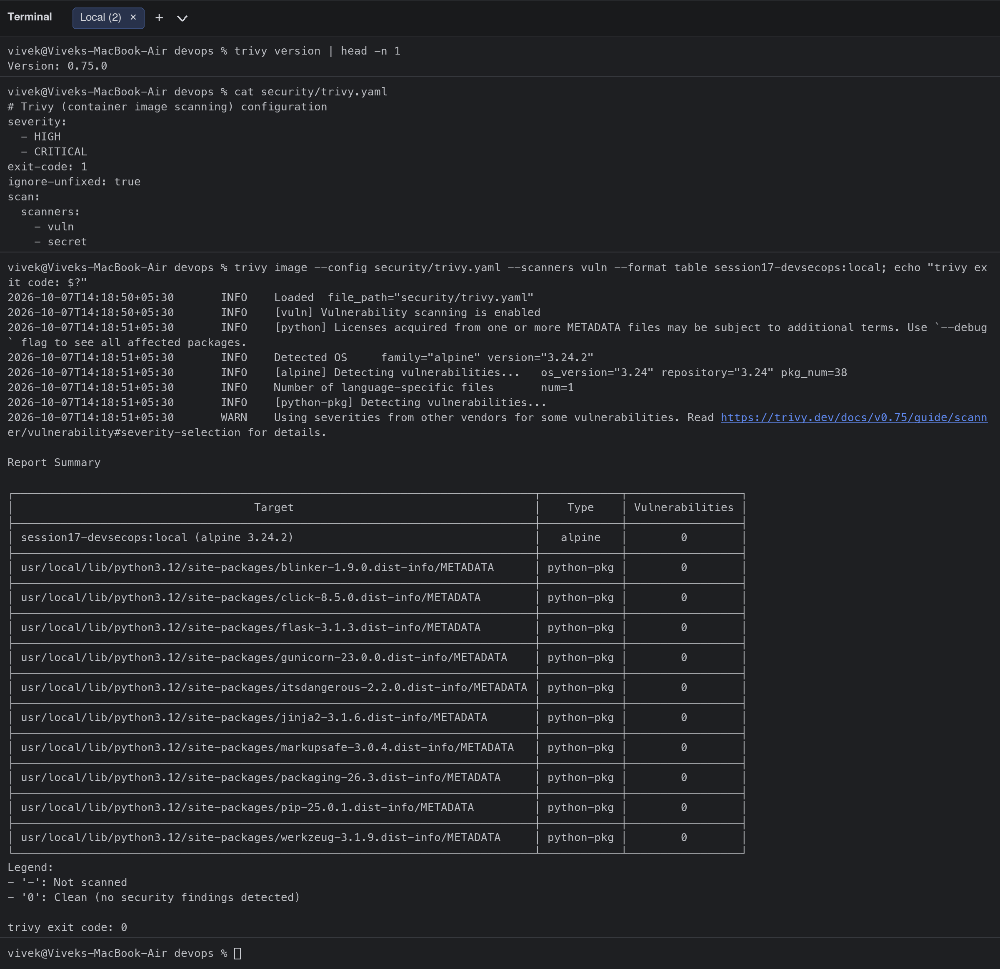
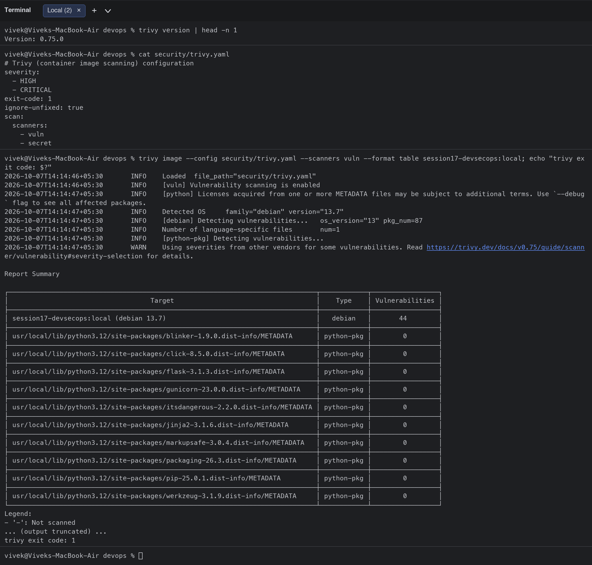

### 7. Security gate
```bash
$ ./security/security-gate.sh success success success success; echo "gate exit code: $?"
CHECK                  RESULT
SAST (bandit)          success
SCA (pip-audit)        success
Secret scan            success
Image scan             success
SECURITY GATE: PASSED - image may be pushed and deployed.
gate exit code: 0
$ ./security/security-gate.sh success failure success success; echo "gate exit code: $?"
CHECK                  RESULT
SAST (bandit)          success
SCA (pip-audit)        failure
Secret scan            success
Image scan             success
SECURITY GATE: BLOCKED - at least one security check did not pass.
gate exit code: 1
```
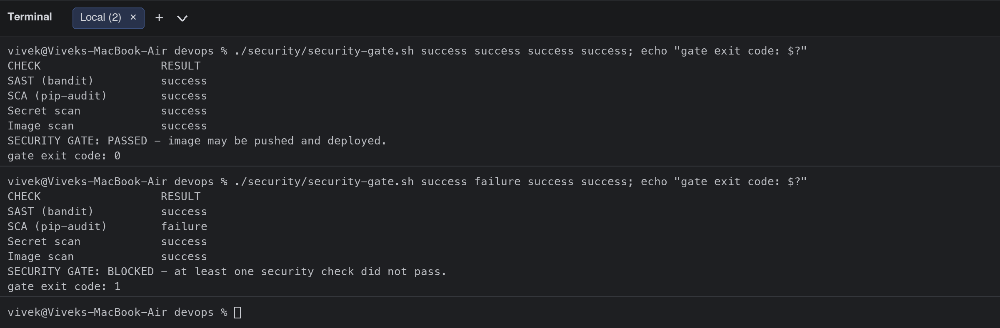

### 8. Deploy to Kubernetes (minikube, same manifests as the CD job)
The first deployment crashed (`CrashLoopBackOff`) because the hardened Pod has `readOnlyRootFilesystem: true` and gunicorn needs a writable `/tmp`; an `emptyDir` mounted at `/tmp` fixed it while keeping the root filesystem read-only.
```bash
$ minikube image load session17-devsecops:local
$ sed "s|ghcr.io/OWNER/session17-devsecops:__IMAGE_TAG__|session17-devsecops:local|" k8s/deployment.yaml | kubectl apply -f -
deployment.apps/session17-python created
$ kubectl apply -f k8s/service.yaml
service/session17-python created
$ kubectl rollout status deployment/session17-python --timeout=120s
Waiting for deployment "session17-python" rollout to finish: 0 of 2 updated replicas are available...
error: timed out waiting for the condition
$ kubectl get pods,svc -l app=session17-python
NAME                                    READY   STATUS             RESTARTS      AGE
pod/session17-python-757ccbd695-9qgc2   0/1     CrashLoopBackOff   4 (39s ago)   2m1s
pod/session17-python-757ccbd695-qxxck   0/1     CrashLoopBackOff   4 (19s ago)   2m1s
$ colima ssh -- curl -s http://192.168.49.2:30017/health
time="2026-10-07T14:13:35+05:30" level=fatal msg="exit status 7"
$ colima ssh -- curl -s http://192.168.49.2:30017/api/status
time="2026-10-07T14:13:36+05:30" level=fatal msg="exit status 7"
$ colima ssh -- curl -s -X POST -H 'Content-Type: application/json' -d '{"number1":10,"number2":20}' http://192.168.49.2:30017/api/add
time="2026-10-07T14:13:36+05:30" level=fatal msg="exit status 7"
$ kubectl delete -f k8s/service.yaml && kubectl delete deployment session17-python
service "session17-python" deleted from default namespace
deployment.apps "session17-python" deleted from default namespace
```
After the fix:
```bash
$ minikube image load session17-devsecops:local
$ sed "s|ghcr.io/OWNER/session17-devsecops:__IMAGE_TAG__|session17-devsecops:local|" k8s/deployment.yaml | kubectl apply -f -
deployment.apps/session17-python created
$ kubectl apply -f k8s/service.yaml
service/session17-python created
$ kubectl rollout status deployment/session17-python --timeout=120s
Waiting for deployment "session17-python" rollout to finish: 0 of 2 updated replicas are available...
Waiting for deployment "session17-python" rollout to finish: 1 of 2 updated replicas are available...
deployment "session17-python" successfully rolled out
$ kubectl get pods,svc -l app=session17-python
NAME                                    READY   STATUS    RESTARTS   AGE
pod/session17-python-866f6b6949-frvx7   1/1     Running   0          6s
pod/session17-python-866f6b6949-mfl27   1/1     Running   0          6s
$ colima ssh -- curl -s http://192.168.49.2:30017/health
{"status":"healthy","uptime_seconds":7.38}
$ colima ssh -- curl -s http://192.168.49.2:30017/api/status
{"app":"DevSecOps Dashboard","platform":"Linux","python_version":"3.12.15","status":"running","total_requests":2,"version":"2.0.0"}
$ colima ssh -- curl -s -X POST -H 'Content-Type: application/json' -d '{"number1":10,"number2":20}' http://192.168.49.2:30017/api/add
{"result":30.0}
$ kubectl exec deploy/session17-python -- id
uid=10001(app) gid=101(app) groups=101(app)
$ kubectl delete -f k8s/service.yaml && kubectl delete deployment session17-python
service "session17-python" deleted from default namespace
deployment.apps "session17-python" deleted from default namespace
```
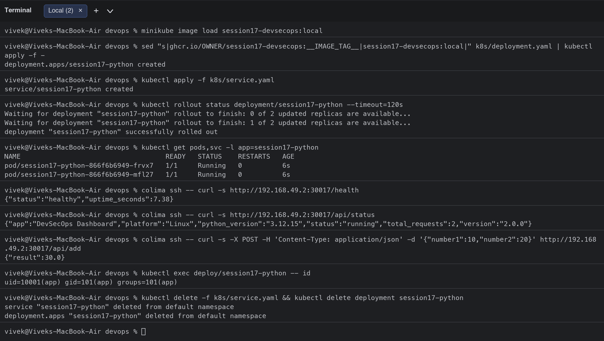
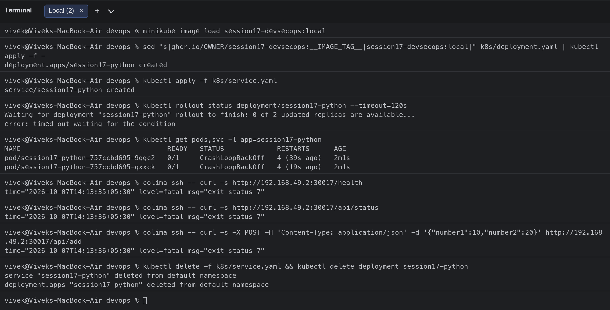

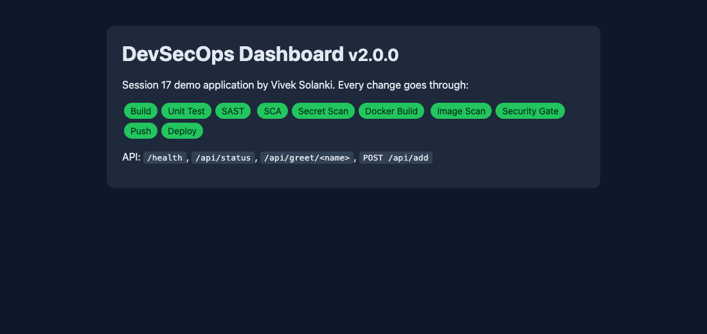

## Pipeline execution with `act` (workflow run locally)

The workflow was executed with `act` (`pull_request` event, so the GHCR push and deploy jobs are skipped exactly as on a PR). GitHub-only actions (CodeQL, gitleaks-action) are guarded with `if: ${{ !env.ACT }}` and replaced by the CLI equivalents locally.

```bash
$ act -W .github/workflows/session17-devsecops.yml --list
Stage  Job ID          Job name                      Workflow name                    Workflow file            Events                             
0      build-and-test  Build & Unit Test             Session 17 - DevSecOps Pipeline  session17-devsecops.yml  push,pull_request,workflow_dispatch
1      sca             SCA (pip-audit)               Session 17 - DevSecOps Pipeline  session17-devsecops.yml  push,pull_request,workflow_dispatch
1      sast            SAST (Bandit + CodeQL)        Session 17 - DevSecOps Pipeline  session17-devsecops.yml  workflow_dispatch,push,pull_request
1      secret-scan     Secret Scanning (gitleaks)    Session 17 - DevSecOps Pipeline  session17-devsecops.yml  push,pull_request,workflow_dispatch
2      docker-build    Docker Build                  Session 17 - DevSecOps Pipeline  session17-devsecops.yml  workflow_dispatch,push,pull_request
3      image-scan      Container Image Scan (Trivy)  Session 17 - DevSecOps Pipeline  session17-devsecops.yml  push,pull_request,workflow_dispatch
4      security-gate   Security Gate                 Session 17 - DevSecOps Pipeline  session17-devsecops.yml  push,pull_request,workflow_dispatch
5      push-image      Push Image (GHCR)             Session 17 - DevSecOps Pipeline  session17-devsecops.yml  push,pull_request,workflow_dispatch
6      deploy          Deploy to Kubernetes          Session 17 - DevSecOps Pipeline  session17-devsecops.yml  push,pull_request,workflow_dispatch
$ act pull_request -P ubuntu-latest=catthehacker/ubuntu:act-latest --container-architecture linux/arm64 --container-daemon-socket unix:///var/run/docker.sock -W .github/workflows/session17-devsecops.yml --artifact-server-path .act-artifacts/s17 -j security-gate 2>&1 | sed -E 's/\[[0-9;]*m//g' | grep -vE 'not located inside a git repository|unable to get git (ref|revision)'
[Session 17 - DevSecOps Pipeline/Build & Unit Test] ⭐ Run Main actions/checkout@v4
[Session 17 - DevSecOps Pipeline/Build & Unit Test]   ✅  Success - Main actions/checkout@v4 [772.508458ms]
[Session 17 - DevSecOps Pipeline/Build & Unit Test] ⭐ Run Main Python venv when running locally with act
[Session 17 - DevSecOps Pipeline/Build & Unit Test]   ✅  Success - Main Python venv when running locally with act [2.816315208s]
[Session 17 - DevSecOps Pipeline/Build & Unit Test] ⭐ Run Main Build (install dependencies, byte-compile)
[Session 17 - DevSecOps Pipeline/Build & Unit Test]   ✅  Success - Main Build (install dependencies, byte-compile) [15.241169834s]
[Session 17 - DevSecOps Pipeline/Build & Unit Test] ⭐ Run Main Unit tests
[Session 17 - DevSecOps Pipeline/Build & Unit Test]   ✅  Success - Main Unit tests [615.020291ms]
[Session 17 - DevSecOps Pipeline/Build & Unit Test] ⭐ Run Main actions/upload-artifact@v4
[Session 17 - DevSecOps Pipeline/Build & Unit Test]   ✅  Success - Main actions/upload-artifact@v4 [732.771417ms]
[Session 17 - DevSecOps Pipeline/Build & Unit Test] 🏁  Job succeeded
[Session 17 - DevSecOps Pipeline/SCA (pip-audit)           ] ⭐ Run Main actions/checkout@v4
[Session 17 - DevSecOps Pipeline/SCA (pip-audit)           ]   ✅  Success - Main actions/checkout@v4 [682.037167ms]
[Session 17 - DevSecOps Pipeline/SCA (pip-audit)           ] ⭐ Run Main Python venv when running locally with act
[Session 17 - DevSecOps Pipeline/Secret Scanning (gitleaks)] ⭐ Run Main actions/checkout@v4
[Session 17 - DevSecOps Pipeline/Secret Scanning (gitleaks)]   ✅  Success - Main actions/checkout@v4 [397.60975ms]
[Session 17 - DevSecOps Pipeline/Secret Scanning (gitleaks)] ⭐ Run Main gitleaks (local act fallback, same rules)
[Session 17 - DevSecOps Pipeline/Secret Scanning (gitleaks)]   ✅  Success - Main gitleaks (local act fallback, same rules) [573.94625ms]
[Session 17 - DevSecOps Pipeline/Secret Scanning (gitleaks)] 🏁  Job succeeded
[Session 17 - DevSecOps Pipeline/SCA (pip-audit)           ]   ✅  Success - Main Python venv when running locally with act [2.663406208s]
[Session 17 - DevSecOps Pipeline/SCA (pip-audit)           ] ⭐ Run Main Dependency vulnerability scan
[Session 17 - DevSecOps Pipeline/SAST (Bandit + CodeQL)    ] ⭐ Run Main actions/checkout@v4
[Session 17 - DevSecOps Pipeline/SAST (Bandit + CodeQL)    ]   ✅  Success - Main actions/checkout@v4 [678.904292ms]
[Session 17 - DevSecOps Pipeline/SAST (Bandit + CodeQL)    ] ⭐ Run Main Python venv when running locally with act
[Session 17 - DevSecOps Pipeline/SAST (Bandit + CodeQL)    ]   ✅  Success - Main Python venv when running locally with act [2.823087459s]
[Session 17 - DevSecOps Pipeline/SAST (Bandit + CodeQL)    ] ⭐ Run Main Bandit static analysis
[Session 17 - DevSecOps Pipeline/SCA (pip-audit)           ]   ✅  Success - Main Dependency vulnerability scan [17.423323708s]
[Session 17 - DevSecOps Pipeline/SCA (pip-audit)           ] 🏁  Job succeeded
[Session 17 - DevSecOps Pipeline/SAST (Bandit + CodeQL)    ]   ✅  Success - Main Bandit static analysis [4.405635958s]
[Session 17 - DevSecOps Pipeline/SAST (Bandit + CodeQL)    ] ⭐ Run Main actions/upload-artifact@v4
[Session 17 - DevSecOps Pipeline/SAST (Bandit + CodeQL)    ]   ✅  Success - Main actions/upload-artifact@v4 [763.787875ms]
[Session 17 - DevSecOps Pipeline/SAST (Bandit + CodeQL)    ] 🏁  Job succeeded
[Session 17 - DevSecOps Pipeline/Docker Build              ] ⭐ Run Main actions/checkout@v4
[Session 17 - DevSecOps Pipeline/Docker Build              ]   ✅  Success - Main actions/checkout@v4 [483.222542ms]
[Session 17 - DevSecOps Pipeline/Docker Build              ] ⭐ Run Main Build image
[Session 17 - DevSecOps Pipeline/Docker Build              ]   ✅  Success - Main Build image [611.418417ms]
[Session 17 - DevSecOps Pipeline/Docker Build              ] ⭐ Run Main actions/upload-artifact@v4
[Session 17 - DevSecOps Pipeline/Docker Build              ]   ✅  Success - Main actions/upload-artifact@v4 [1.361644459s]
[Session 17 - DevSecOps Pipeline/Docker Build              ] 🏁  Job succeeded
[Session 17 - DevSecOps Pipeline/Container Image Scan (Trivy)] ⭐ Run Main actions/checkout@v4
[Session 17 - DevSecOps Pipeline/Container Image Scan (Trivy)]   ✅  Success - Main actions/checkout@v4 [601.385583ms]
[Session 17 - DevSecOps Pipeline/Container Image Scan (Trivy)] ⭐ Run Main actions/download-artifact@v4
[Session 17 - DevSecOps Pipeline/Container Image Scan (Trivy)]   ✅  Success - Main actions/download-artifact@v4 [704.378125ms]
[Session 17 - DevSecOps Pipeline/Container Image Scan (Trivy)] ⭐ Run Main docker load -i image.tar
[Session 17 - DevSecOps Pipeline/Container Image Scan (Trivy)]   ✅  Success - Main docker load -i image.tar [295.540792ms]
[Session 17 - DevSecOps Pipeline/Container Image Scan (Trivy)] ⭐ Run Main Trivy scan (local act fallback, same settings via the Trivy container)
[Session 17 - DevSecOps Pipeline/Container Image Scan (Trivy)]   ✅  Success - Main Trivy scan (local act fallback, same settings via the Trivy container) [1m6.303605416s]
[Session 17 - DevSecOps Pipeline/Container Image Scan (Trivy)] 🏁  Job succeeded
[Session 17 - DevSecOps Pipeline/Security Gate               ] ⭐ Run Main actions/checkout@v4
[Session 17 - DevSecOps Pipeline/Security Gate               ]   ✅  Success - Main actions/checkout@v4 [730.595041ms]
[Session 17 - DevSecOps Pipeline/Security Gate               ] ⭐ Run Main Evaluate gate
[Session 17 - DevSecOps Pipeline/Security Gate               ]   ✅  Success - Main Evaluate gate [47.003416ms]
[Session 17 - DevSecOps Pipeline/Security Gate               ] 🏁  Job succeeded│ ghcr.io/nektos/session17-devsecops:local (alpine 3.24.2)                     │   alpine   │        0        │
```

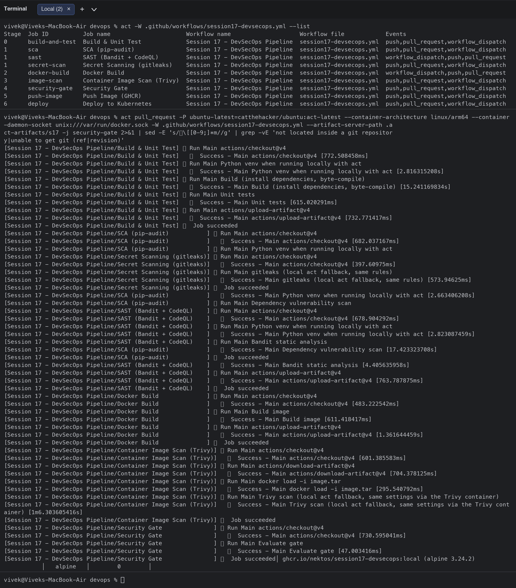

## Security tools configuration
- [security/bandit.yaml](security/bandit.yaml): SAST scope (excludes tests)
- [security/.gitleaks.toml](security/.gitleaks.toml): default rules + allowlist
- [security/trivy.yaml](security/trivy.yaml): severities HIGH,CRITICAL, exit-code 1, ignore-unfixed
- [security/security-gate.sh](security/security-gate.sh): aggregates job results and blocks the pipeline
