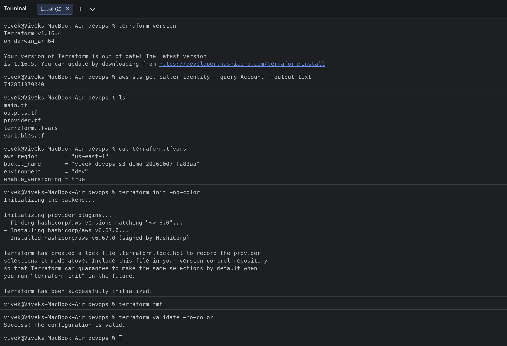
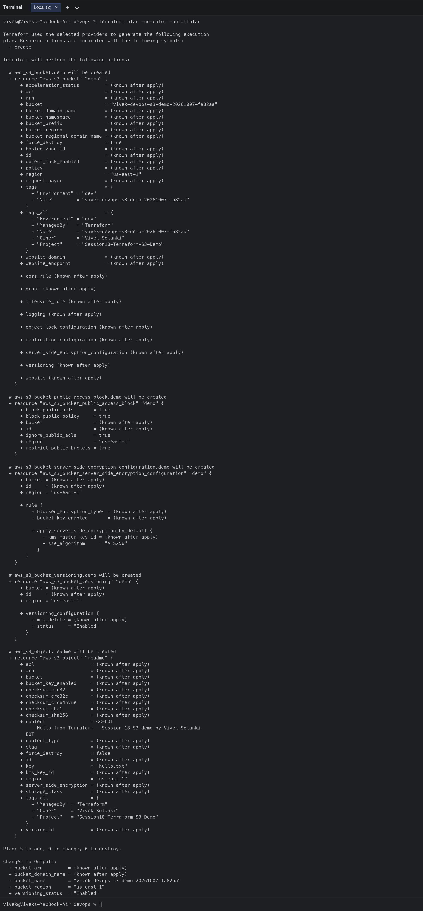
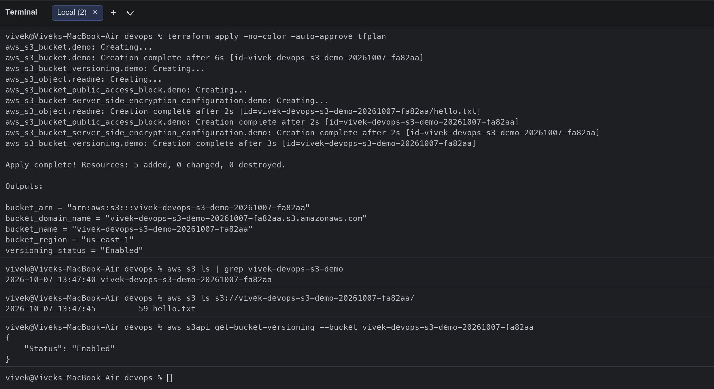
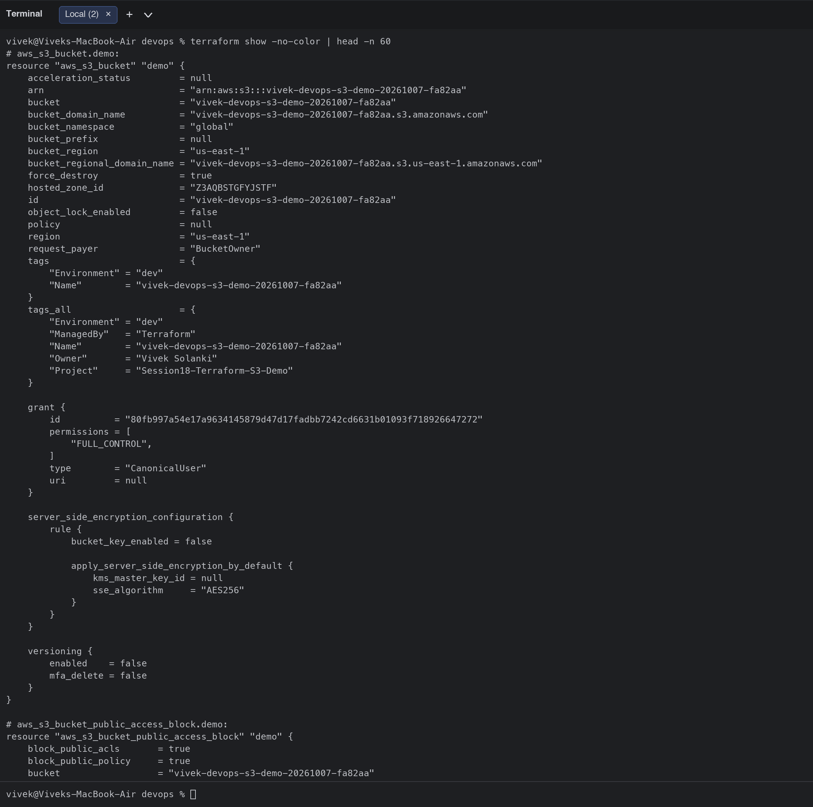
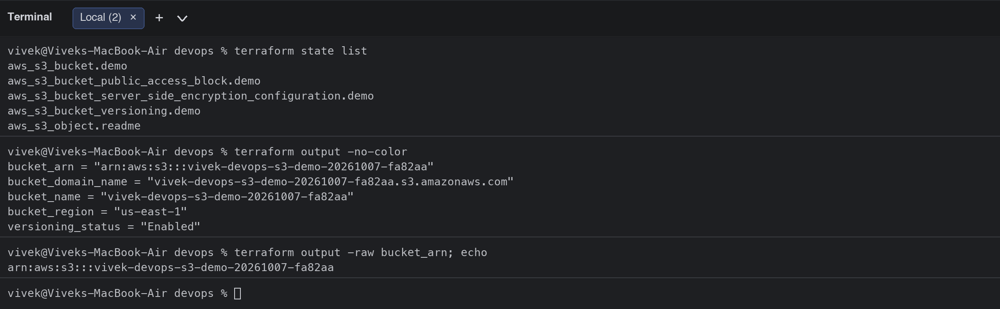
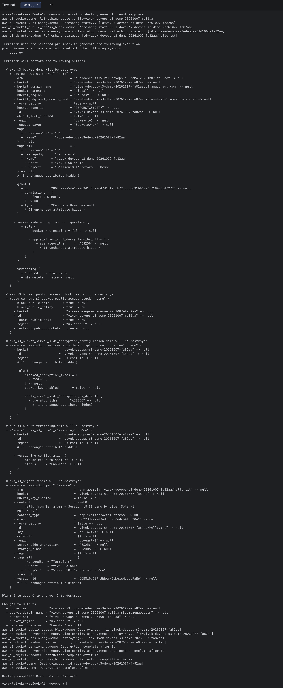
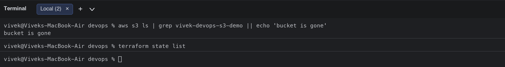

# Terraform S3 Demo (Session 18, Task 1)

**Student:** Vivek Singh Solanki | **Roll number:** 24bcs10338
**Region:** us-east-1 | **Terraform:** 1.14 | **AWS provider:** ~> 6.0

## Project structure

```text
terraform-s3-demo/
├── main.tf             # aws_s3_bucket + versioning + encryption + public-access block + a test object
├── variables.tf        # aws_region, bucket_name, environment, enable_versioning
├── outputs.tf          # bucket_name, bucket_arn, bucket_region, bucket_domain_name, versioning_status
├── provider.tf         # terraform { required_providers } + provider "aws" with default_tags
├── terraform.tfvars    # values for the variables (bucket name must be globally unique)
├── .gitignore          # .terraform/, *.tfstate, *.tfplan
└── README.md
```

## Files

### provider.tf
```hcl
terraform {
  required_version = ">= 1.6.0"

  required_providers {
    aws = {
      source  = "hashicorp/aws"
      version = "~> 6.0"
    }
  }
}

provider "aws" {
  region = var.aws_region

  default_tags {
    tags = {
      Project   = "Session18-Terraform-S3-Demo"
      ManagedBy = "Terraform"
      Owner     = "Vivek Solanki"
    }
  }
}
```

### variables.tf
```hcl
variable "aws_region" {
  description = "AWS region where the S3 bucket will be created."
  type        = string
  default     = "us-east-1"
}

variable "bucket_name" {
  description = "Globally unique name of the S3 bucket."
  type        = string
}

variable "environment" {
  description = "Environment tag (dev, staging, prod)."
  type        = string
  default     = "dev"
}

variable "enable_versioning" {
  description = "Enable object versioning on the bucket."
  type        = bool
  default     = true
}
```

### main.tf
```hcl
# ---------------------------------------------------------------
# S3 bucket + versioning + default encryption + block public access
# ---------------------------------------------------------------
resource "aws_s3_bucket" "demo" {
  bucket        = var.bucket_name
  force_destroy = true # allows terraform destroy even if objects exist

  tags = {
    Name        = var.bucket_name
    Environment = var.environment
  }
}

resource "aws_s3_bucket_versioning" "demo" {
  bucket = aws_s3_bucket.demo.id

  versioning_configuration {
    status = var.enable_versioning ? "Enabled" : "Suspended"
  }
}

resource "aws_s3_bucket_server_side_encryption_configuration" "demo" {
  bucket = aws_s3_bucket.demo.id

  rule {
    apply_server_side_encryption_by_default {
      sse_algorithm = "AES256"
    }
  }
}

resource "aws_s3_bucket_public_access_block" "demo" {
  bucket = aws_s3_bucket.demo.id

  block_public_acls       = true
  block_public_policy     = true
  ignore_public_acls      = true
  restrict_public_buckets = true
}

# A small object uploaded to prove the bucket works end-to-end
resource "aws_s3_object" "readme" {
  bucket  = aws_s3_bucket.demo.id
  key     = "hello.txt"
  content = "Hello from Terraform - Session 18 S3 demo by Vivek Solanki\n"
}
```

### outputs.tf
```hcl
output "bucket_name" {
  description = "Name of the S3 bucket."
  value       = aws_s3_bucket.demo.bucket
}

output "bucket_arn" {
  description = "ARN of the S3 bucket."
  value       = aws_s3_bucket.demo.arn
}

output "bucket_region" {
  description = "AWS region of the S3 bucket."
  value       = aws_s3_bucket.demo.region
}

output "bucket_domain_name" {
  description = "Bucket domain name."
  value       = aws_s3_bucket.demo.bucket_domain_name
}

output "versioning_status" {
  description = "Versioning status of the bucket."
  value       = aws_s3_bucket_versioning.demo.versioning_configuration[0].status
}
```

### terraform.tfvars
```hcl
aws_region        = "us-east-1"
bucket_name       = "vivek-devops-s3-demo-20261007-fa82aa"
environment       = "dev"
enable_versioning = true
```

## Workflow (every command was executed against my AWS account)

### 1. `terraform init`, `terraform fmt`, `terraform validate`
`init` downloads the AWS provider into `.terraform/` and writes `.terraform.lock.hcl`; `fmt` rewrites files in canonical style (prints nothing when everything is already formatted); `validate` checks syntax and references without touching AWS.

```bash
$ terraform version
Terraform v1.16.4
on darwin_arm64

Your version of Terraform is out of date! The latest version
is 1.16.5. You can update by downloading from https://developer.hashicorp.com/terraform/install
$ aws sts get-caller-identity --query Account --output text
742851379040
$ ls
main.tf
outputs.tf
provider.tf
terraform.tfvars
variables.tf
$ cat terraform.tfvars
aws_region        = "us-east-1"
bucket_name       = "vivek-devops-s3-demo-20261007-fa82aa"
environment       = "dev"
enable_versioning = true
$ terraform init -no-color
Initializing the backend...

Initializing provider plugins...
- Finding hashicorp/aws versions matching "~> 6.0"...
- Installing hashicorp/aws v6.67.0...
- Installed hashicorp/aws v6.67.0 (signed by HashiCorp)

Terraform has created a lock file .terraform.lock.hcl to record the provider
selections it made above. Include this file in your version control repository
so that Terraform can guarantee to make the same selections by default when
you run "terraform init" in the future.

Terraform has been successfully initialized!
$ terraform fmt
$ terraform validate -no-color
Success! The configuration is valid.
```



### 2. `terraform plan`
Shows what will change: **5 to add** (bucket, versioning, encryption, public-access block, object). Saved to `tfplan` so `apply` executes exactly this plan.

```bash
$ terraform plan -no-color -out=tfplan

Terraform used the selected providers to generate the following execution
plan. Resource actions are indicated with the following symbols:
  + create

Terraform will perform the following actions:

  # aws_s3_bucket.demo will be created
  + resource "aws_s3_bucket" "demo" {
      + acceleration_status         = (known after apply)
      + acl                         = (known after apply)
      + arn                         = (known after apply)
      + bucket                      = "vivek-devops-s3-demo-20261007-fa82aa"
      + bucket_domain_name          = (known after apply)
      + bucket_namespace            = (known after apply)
      + bucket_prefix               = (known after apply)
      + bucket_region               = (known after apply)
      + bucket_regional_domain_name = (known after apply)
      + force_destroy               = true
      + hosted_zone_id              = (known after apply)
      + id                          = (known after apply)
      + object_lock_enabled         = (known after apply)
      + policy                      = (known after apply)
      + region                      = "us-east-1"
      + request_payer               = (known after apply)
      + tags                        = {
          + "Environment" = "dev"
          + "Name"        = "vivek-devops-s3-demo-20261007-fa82aa"
        }
      + tags_all                    = {
          + "Environment" = "dev"
          + "ManagedBy"   = "Terraform"
          + "Name"        = "vivek-devops-s3-demo-20261007-fa82aa"
          + "Owner"       = "Vivek Solanki"
          + "Project"     = "Session18-Terraform-S3-Demo"
        }
      + website_domain              = (known after apply)
      + website_endpoint            = (known after apply)

      + cors_rule (known after apply)

      + grant (known after apply)

      + lifecycle_rule (known after apply)

      + logging (known after apply)

      + object_lock_configuration (known after apply)

      + replication_configuration (known after apply)

      + server_side_encryption_configuration (known after apply)

      + versioning (known after apply)

      + website (known after apply)
    }

  # aws_s3_bucket_public_access_block.demo will be created
  + resource "aws_s3_bucket_public_access_block" "demo" {
      + block_public_acls       = true
      + block_public_policy     = true
      + bucket                  = (known after apply)
      + id                      = (known after apply)
      + ignore_public_acls      = true
      + region                  = "us-east-1"
      + restrict_public_buckets = true
    }

  # aws_s3_bucket_server_side_encryption_configuration.demo will be created
  + resource "aws_s3_bucket_server_side_encryption_configuration" "demo" {
      + bucket = (known after apply)
      + id     = (known after apply)
      + region = "us-east-1"

      + rule {
          + blocked_encryption_types = (known after apply)
          + bucket_key_enabled       = (known after apply)

          + apply_server_side_encryption_by_default {
              + kms_master_key_id = (known after apply)
              + sse_algorithm     = "AES256"
            }
        }
    }

  # aws_s3_bucket_versioning.demo will be created
  + resource "aws_s3_bucket_versioning" "demo" {
      + bucket = (known after apply)
      + id     = (known after apply)
      + region = "us-east-1"

      + versioning_configuration {
          + mfa_delete = (known after apply)
          + status     = "Enabled"
        }
    }

  # aws_s3_object.readme will be created
  + resource "aws_s3_object" "readme" {
      + acl                    = (known after apply)
      + arn                    = (known after apply)
      + bucket                 = (known after apply)
      + bucket_key_enabled     = (known after apply)
      + checksum_crc32         = (known after apply)
      + checksum_crc32c        = (known after apply)
      + checksum_crc64nvme     = (known after apply)
      + checksum_sha1          = (known after apply)
      + checksum_sha256        = (known after apply)
      + content                = <<-EOT
            Hello from Terraform - Session 18 S3 demo by Vivek Solanki
        EOT
      + content_type           = (known after apply)
      + etag                   = (known after apply)
      + force_destroy          = false
      + id                     = (known after apply)
      + key                    = "hello.txt"
      + kms_key_id             = (known after apply)
      + region                 = "us-east-1"
      + server_side_encryption = (known after apply)
      + storage_class          = (known after apply)
      + tags_all               = {
          + "ManagedBy" = "Terraform"
          + "Owner"     = "Vivek Solanki"
          + "Project"   = "Session18-Terraform-S3-Demo"
        }
      + version_id             = (known after apply)
    }

Plan: 5 to add, 0 to change, 0 to destroy.

Changes to Outputs:
  + bucket_arn         = (known after apply)
  + bucket_domain_name = (known after apply)
  + bucket_name        = "vivek-devops-s3-demo-20261007-fa82aa"
  + bucket_region      = "us-east-1"
  + versioning_status  = "Enabled"
```



### 3. `terraform apply`
Creates the resources and prints the outputs. Verified with the AWS CLI that the bucket exists, contains `hello.txt` and has versioning enabled.

```bash
$ terraform apply -no-color -auto-approve tfplan
aws_s3_bucket.demo: Creating...
aws_s3_bucket.demo: Creation complete after 6s [id=vivek-devops-s3-demo-20261007-fa82aa]
aws_s3_bucket_versioning.demo: Creating...
aws_s3_object.readme: Creating...
aws_s3_bucket_public_access_block.demo: Creating...
aws_s3_bucket_server_side_encryption_configuration.demo: Creating...
aws_s3_object.readme: Creation complete after 2s [id=vivek-devops-s3-demo-20261007-fa82aa/hello.txt]
aws_s3_bucket_public_access_block.demo: Creation complete after 2s [id=vivek-devops-s3-demo-20261007-fa82aa]
aws_s3_bucket_server_side_encryption_configuration.demo: Creation complete after 2s [id=vivek-devops-s3-demo-20261007-fa82aa]
aws_s3_bucket_versioning.demo: Creation complete after 3s [id=vivek-devops-s3-demo-20261007-fa82aa]

Apply complete! Resources: 5 added, 0 changed, 0 destroyed.

Outputs:

bucket_arn = "arn:aws:s3:::vivek-devops-s3-demo-20261007-fa82aa"
bucket_domain_name = "vivek-devops-s3-demo-20261007-fa82aa.s3.amazonaws.com"
bucket_name = "vivek-devops-s3-demo-20261007-fa82aa"
bucket_region = "us-east-1"
versioning_status = "Enabled"
$ aws s3 ls | grep vivek-devops-s3-demo
2026-10-07 13:47:40 vivek-devops-s3-demo-20261007-fa82aa
$ aws s3 ls s3://vivek-devops-s3-demo-20261007-fa82aa/
2026-10-07 13:47:45         59 hello.txt
$ aws s3api get-bucket-versioning --bucket vivek-devops-s3-demo-20261007-fa82aa
{
    "Status": "Enabled"
}
```



### 4. `terraform show` and `terraform output`
`show` prints the state (all attributes AWS returned), `state list` the managed resources, `output` only the declared outputs (`-raw` for scripts).

```bash
$ terraform show -no-color | head -n 60
# aws_s3_bucket.demo:
resource "aws_s3_bucket" "demo" {
    acceleration_status         = null
    arn                         = "arn:aws:s3:::vivek-devops-s3-demo-20261007-fa82aa"
    bucket                      = "vivek-devops-s3-demo-20261007-fa82aa"
    bucket_domain_name          = "vivek-devops-s3-demo-20261007-fa82aa.s3.amazonaws.com"
    bucket_namespace            = "global"
    bucket_prefix               = null
    bucket_region               = "us-east-1"
    bucket_regional_domain_name = "vivek-devops-s3-demo-20261007-fa82aa.s3.us-east-1.amazonaws.com"
    force_destroy               = true
    hosted_zone_id              = "Z3AQBSTGFYJSTF"
    id                          = "vivek-devops-s3-demo-20261007-fa82aa"
    object_lock_enabled         = false
    policy                      = null
    region                      = "us-east-1"
    request_payer               = "BucketOwner"
    tags                        = {
        "Environment" = "dev"
        "Name"        = "vivek-devops-s3-demo-20261007-fa82aa"
    }
    tags_all                    = {
        "Environment" = "dev"
        "ManagedBy"   = "Terraform"
        "Name"        = "vivek-devops-s3-demo-20261007-fa82aa"
        "Owner"       = "Vivek Solanki"
        "Project"     = "Session18-Terraform-S3-Demo"
    }

    grant {
        id          = "80fb997a54e17a9634145879d47d17fadbb7242cd6631b01093f718926647272"
        permissions = [
            "FULL_CONTROL",
        ]
        type        = "CanonicalUser"
        uri         = null
    }

    server_side_encryption_configuration {
        rule {
            bucket_key_enabled = false

            apply_server_side_encryption_by_default {
                kms_master_key_id = null
                sse_algorithm     = "AES256"
            }
        }
    }

    versioning {
        enabled    = false
        mfa_delete = false
    }
}

# aws_s3_bucket_public_access_block.demo:
resource "aws_s3_bucket_public_access_block" "demo" {
    block_public_acls       = true
    block_public_policy     = true
    bucket                  = "vivek-devops-s3-demo-20261007-fa82aa"
$ terraform state list
aws_s3_bucket.demo
aws_s3_bucket_public_access_block.demo
aws_s3_bucket_server_side_encryption_configuration.demo
aws_s3_bucket_versioning.demo
aws_s3_object.readme
$ terraform output -no-color
bucket_arn = "arn:aws:s3:::vivek-devops-s3-demo-20261007-fa82aa"
bucket_domain_name = "vivek-devops-s3-demo-20261007-fa82aa.s3.amazonaws.com"
bucket_name = "vivek-devops-s3-demo-20261007-fa82aa"
bucket_region = "us-east-1"
versioning_status = "Enabled"
$ terraform output -raw bucket_arn; echo
arn:aws:s3:::vivek-devops-s3-demo-20261007-fa82aa
```




### 5. `terraform destroy`
Deletes everything in reverse dependency order (`force_destroy = true` lets Terraform empty the bucket first). The AWS CLI confirms the bucket is gone and the state is empty.

```bash
$ terraform destroy -no-color -auto-approve
aws_s3_bucket.demo: Refreshing state... [id=vivek-devops-s3-demo-20261007-fa82aa]
aws_s3_bucket_versioning.demo: Refreshing state... [id=vivek-devops-s3-demo-20261007-fa82aa]
aws_s3_bucket_public_access_block.demo: Refreshing state... [id=vivek-devops-s3-demo-20261007-fa82aa]
aws_s3_bucket_server_side_encryption_configuration.demo: Refreshing state... [id=vivek-devops-s3-demo-20261007-fa82aa]
aws_s3_object.readme: Refreshing state... [id=vivek-devops-s3-demo-20261007-fa82aa/hello.txt]

Terraform used the selected providers to generate the following execution
plan. Resource actions are indicated with the following symbols:
  - destroy

Terraform will perform the following actions:

  # aws_s3_bucket.demo will be destroyed
  - resource "aws_s3_bucket" "demo" {
      - arn                         = "arn:aws:s3:::vivek-devops-s3-demo-20261007-fa82aa" -> null
      - bucket                      = "vivek-devops-s3-demo-20261007-fa82aa" -> null
      - bucket_domain_name          = "vivek-devops-s3-demo-20261007-fa82aa.s3.amazonaws.com" -> null
      - bucket_namespace            = "global" -> null
      - bucket_region               = "us-east-1" -> null
      - bucket_regional_domain_name = "vivek-devops-s3-demo-20261007-fa82aa.s3.us-east-1.amazonaws.com" -> null
      - force_destroy               = true -> null
      - hosted_zone_id              = "Z3AQBSTGFYJSTF" -> null
      - id                          = "vivek-devops-s3-demo-20261007-fa82aa" -> null
      - object_lock_enabled         = false -> null
      - region                      = "us-east-1" -> null
      - request_payer               = "BucketOwner" -> null
      - tags                        = {
          - "Environment" = "dev"
          - "Name"        = "vivek-devops-s3-demo-20261007-fa82aa"
        } -> null
      - tags_all                    = {
          - "Environment" = "dev"
          - "ManagedBy"   = "Terraform"
          - "Name"        = "vivek-devops-s3-demo-20261007-fa82aa"
          - "Owner"       = "Vivek Solanki"
          - "Project"     = "Session18-Terraform-S3-Demo"
        } -> null
        # (3 unchanged attributes hidden)

      - grant {
          - id          = "80fb997a54e17a9634145879d47d17fadbb7242cd6631b01093f718926647272" -> null
          - permissions = [
              - "FULL_CONTROL",
            ] -> null
          - type        = "CanonicalUser" -> null
            # (1 unchanged attribute hidden)
        }

      - server_side_encryption_configuration {
          - rule {
              - bucket_key_enabled = false -> null

              - apply_server_side_encryption_by_default {
                  - sse_algorithm     = "AES256" -> null
                    # (1 unchanged attribute hidden)
                }
            }
        }

      - versioning {
          - enabled    = true -> null
          - mfa_delete = false -> null
        }
    }

  # aws_s3_bucket_public_access_block.demo will be destroyed
  - resource "aws_s3_bucket_public_access_block" "demo" {
      - block_public_acls       = true -> null
      - block_public_policy     = true -> null
      - bucket                  = "vivek-devops-s3-demo-20261007-fa82aa" -> null
      - id                      = "vivek-devops-s3-demo-20261007-fa82aa" -> null
      - ignore_public_acls      = true -> null
      - region                  = "us-east-1" -> null
      - restrict_public_buckets = true -> null
    }

  # aws_s3_bucket_server_side_encryption_configuration.demo will be destroyed
  - resource "aws_s3_bucket_server_side_encryption_configuration" "demo" {
      - bucket                = "vivek-devops-s3-demo-20261007-fa82aa" -> null
      - id                    = "vivek-devops-s3-demo-20261007-fa82aa" -> null
      - region                = "us-east-1" -> null
        # (1 unchanged attribute hidden)

      - rule {
          - blocked_encryption_types = [
              - "SSE-C",
            ] -> null
          - bucket_key_enabled       = false -> null

          - apply_server_side_encryption_by_default {
              - sse_algorithm     = "AES256" -> null
                # (1 unchanged attribute hidden)
            }
        }
    }

  # aws_s3_bucket_versioning.demo will be destroyed
  - resource "aws_s3_bucket_versioning" "demo" {
      - bucket                = "vivek-devops-s3-demo-20261007-fa82aa" -> null
      - id                    = "vivek-devops-s3-demo-20261007-fa82aa" -> null
      - region                = "us-east-1" -> null
        # (1 unchanged attribute hidden)

      - versioning_configuration {
          - mfa_delete = "Disabled" -> null
          - status     = "Enabled" -> null
        }
    }

  # aws_s3_object.readme will be destroyed
  - resource "aws_s3_object" "readme" {
      - arn                           = "arn:aws:s3:::vivek-devops-s3-demo-20261007-fa82aa/hello.txt" -> null
      - bucket                        = "vivek-devops-s3-demo-20261007-fa82aa" -> null
      - bucket_key_enabled            = false -> null
      - content                       = <<-EOT
            Hello from Terraform - Session 18 S3 demo by Vivek Solanki
        EOT -> null
      - content_type                  = "application/octet-stream" -> null
      - etag                          = "5d223da272e3ad283ab0edcb418520a1" -> null
      - force_destroy                 = false -> null
      - id                            = "vivek-devops-s3-demo-20261007-fa82aa/hello.txt" -> null
      - key                           = "hello.txt" -> null
      - metadata                      = {} -> null
      - region                        = "us-east-1" -> null
      - server_side_encryption        = "AES256" -> null
      - storage_class                 = "STANDARD" -> null
      - tags                          = {} -> null
      - tags_all                      = {
          - "ManagedBy" = "Terraform"
          - "Owner"     = "Vivek Solanki"
          - "Project"   = "Session18-Terraform-S3-Demo"
        } -> null
      - version_id                    = "D0EMzPv2iFnJBBAfH5UNg1cH.qdLPzEp" -> null
        # (13 unchanged attributes hidden)
    }

Plan: 0 to add, 0 to change, 5 to destroy.

Changes to Outputs:
  - bucket_arn         = "arn:aws:s3:::vivek-devops-s3-demo-20261007-fa82aa" -> null
  - bucket_domain_name = "vivek-devops-s3-demo-20261007-fa82aa.s3.amazonaws.com" -> null
  - bucket_name        = "vivek-devops-s3-demo-20261007-fa82aa" -> null
  - bucket_region      = "us-east-1" -> null
  - versioning_status  = "Enabled" -> null
aws_s3_bucket_public_access_block.demo: Destroying... [id=vivek-devops-s3-demo-20261007-fa82aa]
aws_s3_bucket_server_side_encryption_configuration.demo: Destroying... [id=vivek-devops-s3-demo-20261007-fa82aa]
aws_s3_bucket_versioning.demo: Destroying... [id=vivek-devops-s3-demo-20261007-fa82aa]
aws_s3_object.readme: Destroying... [id=vivek-devops-s3-demo-20261007-fa82aa/hello.txt]
aws_s3_bucket_versioning.demo: Destruction complete after 1s
aws_s3_bucket_server_side_encryption_configuration.demo: Destruction complete after 1s
aws_s3_object.readme: Destruction complete after 1s
aws_s3_bucket_public_access_block.demo: Destruction complete after 2s
aws_s3_bucket.demo: Destroying... [id=vivek-devops-s3-demo-20261007-fa82aa]
aws_s3_bucket.demo: Destruction complete after 1s

Destroy complete! Resources: 5 destroyed.
$ aws s3 ls | grep vivek-devops-s3-demo || echo 'bucket is gone'
bucket is gone
$ terraform state list
```




## What I learned
- The **state file** (`terraform.tfstate`) maps the HCL resources to real AWS IDs; it must never be committed (it can contain secrets) and in a team it belongs in a remote backend (S3 + DynamoDB lock).
- `terraform plan` is the safety net: read the `+ / ~ / -` symbols before `apply`.
- Variables (`variables.tf` + `terraform.tfvars`) make the same code reusable for dev/staging/prod; outputs expose values for other modules or CI pipelines.
- Dependencies are implicit: `aws_s3_bucket_versioning.demo` references `aws_s3_bucket.demo.id`, so Terraform creates the bucket first and destroys it last.
