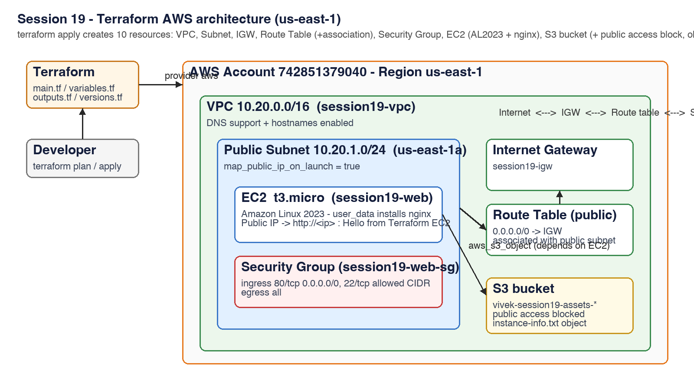
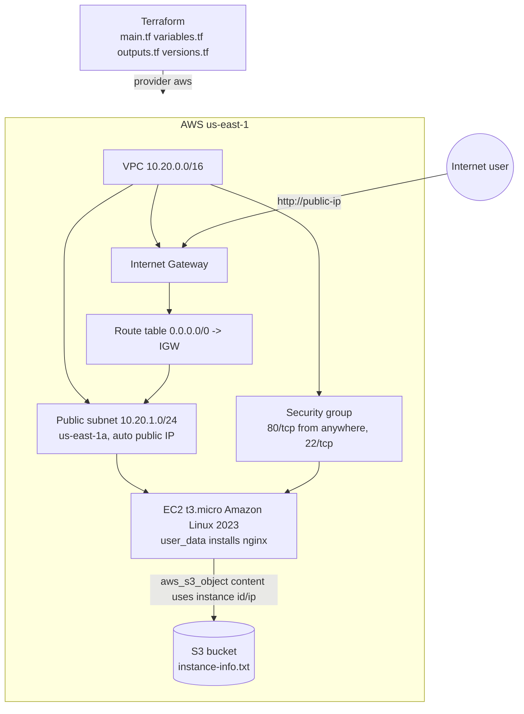
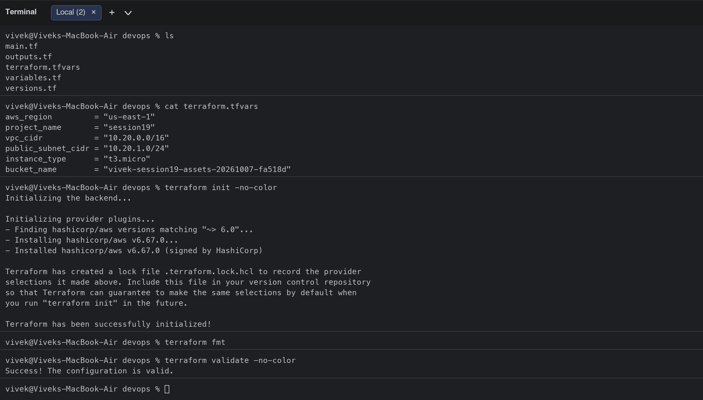
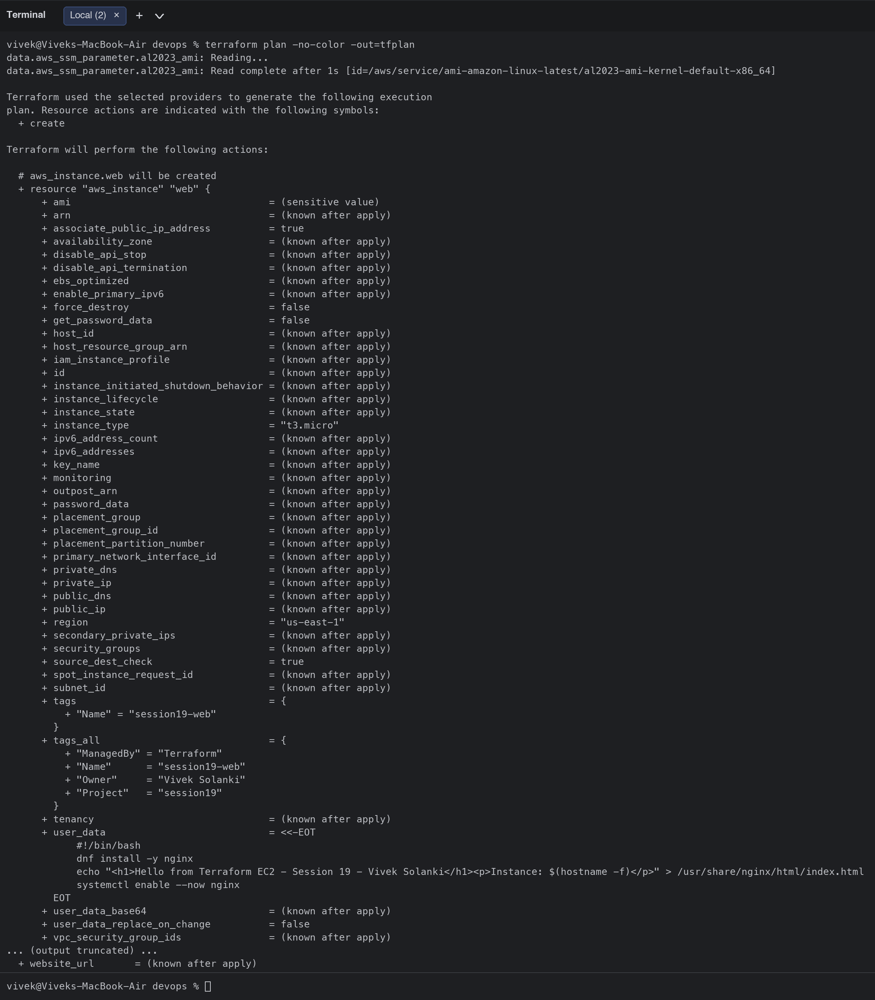
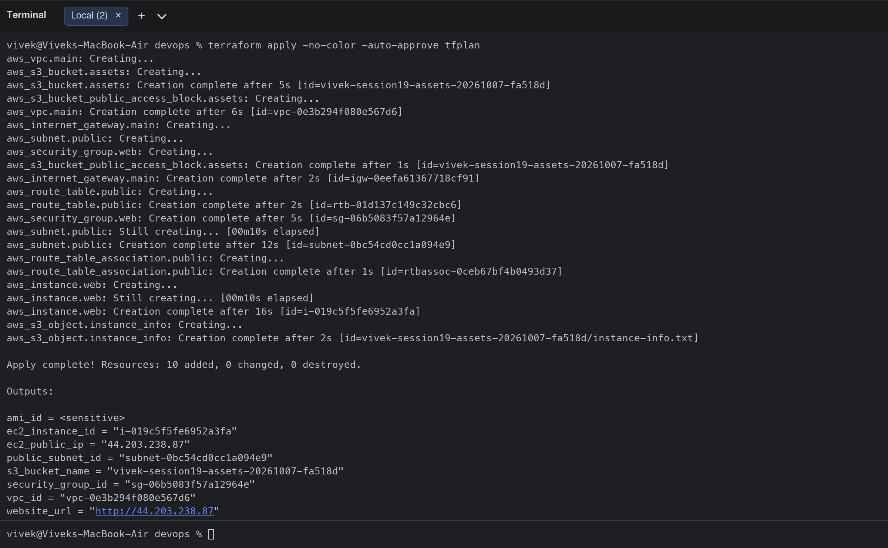
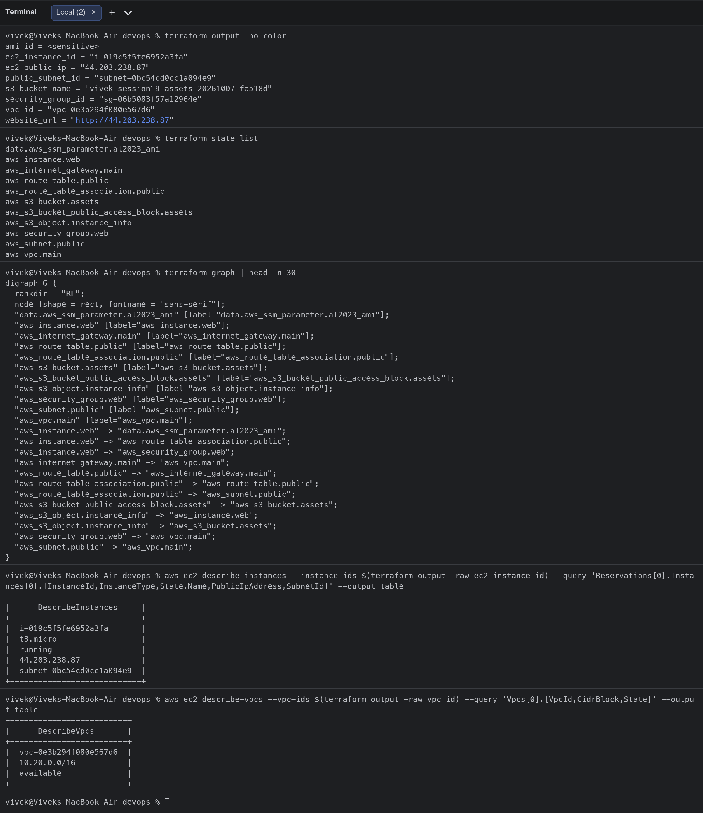
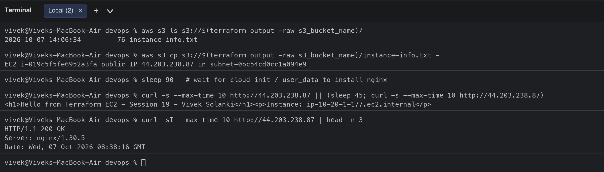
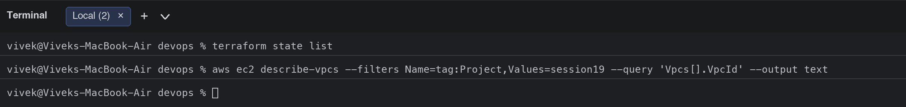

# Session 19: Cloud & Terraform in Action

**Student:** Vivek Singh Solanki | **Roll number:** 24bcs10338
**Project:** [terraform-aws-infra/](terraform-aws-infra/) (end-to-end AWS infrastructure with Terraform: VPC -> Subnet -> Security Group -> EC2 -> S3)
**Region:** us-east-1 | **Terraform** 1.14 | **AWS provider** ~> 6.0

## Architecture





## What the project demonstrates

| Requirement | Where |
|---|---|
| Terraform providers | `versions.tf`: `required_providers` hashicorp/aws ~> 6.0, `provider "aws"` with `default_tags` |
| Variables | `variables.tf` + `terraform.tfvars` (region, CIDRs, instance type, bucket name) |
| Resources | `main.tf`: `aws_vpc`, `aws_subnet`, `aws_internet_gateway`, `aws_route_table`, `aws_route_table_association`, `aws_security_group`, `aws_instance`, `aws_s3_bucket`, `aws_s3_bucket_public_access_block`, `aws_s3_object` + `data "aws_ssm_parameter"` for the latest AL2023 AMI |
| Outputs | `outputs.tf`: vpc_id, subnet id, sg id, instance id, public IP, website URL, bucket name |
| Dependencies | implicit (`aws_subnet.public.vpc_id = aws_vpc.main.id`, instance uses subnet + SG, S3 object content uses the instance attributes) and explicit (`depends_on = [aws_route_table_association.public]` so the instance boots with internet access for `dnf install`) - see `terraform graph` below |
| AWS infrastructure | real resources created in my account and verified with the AWS CLI and `curl` |
| Terraform state | `terraform state list`, `terraform.tfstate` (ignored by git) |
| plan / apply / destroy | executed below |

## Terraform files

### versions.tf
```hcl
terraform {
  required_version = ">= 1.6.0"

  required_providers {
    aws = {
      source  = "hashicorp/aws"
      version = "~> 6.0"
    }
  }
}

provider "aws" {
  region = var.aws_region

  default_tags {
    tags = {
      Project   = var.project_name
      ManagedBy = "Terraform"
      Owner     = "Vivek Solanki"
    }
  }
}
```

### variables.tf
```hcl
variable "aws_region" {
  description = "AWS region."
  type        = string
  default     = "us-east-1"
}

variable "project_name" {
  description = "Name prefix for every resource."
  type        = string
  default     = "session19"
}

variable "vpc_cidr" {
  description = "CIDR block of the VPC."
  type        = string
  default     = "10.20.0.0/16"
}

variable "public_subnet_cidr" {
  description = "CIDR block of the public subnet."
  type        = string
  default     = "10.20.1.0/24"
}

variable "instance_type" {
  description = "EC2 instance type (free-tier eligible)."
  type        = string
  default     = "t3.micro"
}

variable "bucket_name" {
  description = "Globally unique S3 bucket name."
  type        = string
}

variable "allowed_ssh_cidr" {
  description = "CIDR allowed to SSH to the instance."
  type        = string
  default     = "0.0.0.0/0"
}
```

### main.tf
```hcl
# ------------------------------------------------------------------
# Networking: VPC -> Subnet -> Internet Gateway -> Route Table
# ------------------------------------------------------------------
resource "aws_vpc" "main" {
  cidr_block           = var.vpc_cidr
  enable_dns_support   = true
  enable_dns_hostnames = true

  tags = { Name = "${var.project_name}-vpc" }
}

resource "aws_subnet" "public" {
  vpc_id                  = aws_vpc.main.id
  cidr_block              = var.public_subnet_cidr
  availability_zone       = "${var.aws_region}a"
  map_public_ip_on_launch = true

  tags = { Name = "${var.project_name}-public-subnet" }
}

resource "aws_internet_gateway" "main" {
  vpc_id = aws_vpc.main.id

  tags = { Name = "${var.project_name}-igw" }
}

resource "aws_route_table" "public" {
  vpc_id = aws_vpc.main.id

  route {
    cidr_block = "0.0.0.0/0"
    gateway_id = aws_internet_gateway.main.id
  }

  tags = { Name = "${var.project_name}-public-rt" }
}

resource "aws_route_table_association" "public" {
  subnet_id      = aws_subnet.public.id
  route_table_id = aws_route_table.public.id
}

# ------------------------------------------------------------------
# Security Group: HTTP from anywhere, SSH from allowed CIDR
# ------------------------------------------------------------------
resource "aws_security_group" "web" {
  name        = "${var.project_name}-web-sg"
  description = "Allow HTTP and SSH"
  vpc_id      = aws_vpc.main.id

  ingress {
    description = "HTTP"
    from_port   = 80
    to_port     = 80
    protocol    = "tcp"
    cidr_blocks = ["0.0.0.0/0"]
  }

  ingress {
    description = "SSH"
    from_port   = 22
    to_port     = 22
    protocol    = "tcp"
    cidr_blocks = [var.allowed_ssh_cidr]
  }

  egress {
    description = "All outbound"
    from_port   = 0
    to_port     = 0
    protocol    = "-1"
    cidr_blocks = ["0.0.0.0/0"]
  }

  tags = { Name = "${var.project_name}-web-sg" }
}

# ------------------------------------------------------------------
# Compute: latest Amazon Linux 2023 AMI + EC2 web server
# ------------------------------------------------------------------
data "aws_ssm_parameter" "al2023_ami" {
  name = "/aws/service/ami-amazon-linux-latest/al2023-ami-kernel-default-x86_64"
}

resource "aws_instance" "web" {
  ami                         = data.aws_ssm_parameter.al2023_ami.value
  instance_type               = var.instance_type
  subnet_id                   = aws_subnet.public.id
  vpc_security_group_ids      = [aws_security_group.web.id]
  associate_public_ip_address = true

  user_data = <<-EOT
    #!/bin/bash
    dnf install -y nginx
    echo "<h1>Hello from Terraform EC2 - Session 19 - Vivek Solanki</h1><p>Instance: $(hostname -f)</p>" > /usr/share/nginx/html/index.html
    systemctl enable --now nginx
  EOT

  # explicit dependency: make sure the route to the internet exists before boot (user_data needs dnf)
  depends_on = [aws_route_table_association.public]

  tags = { Name = "${var.project_name}-web" }
}

# ------------------------------------------------------------------
# Storage: S3 bucket for application assets / logs
# ------------------------------------------------------------------
resource "aws_s3_bucket" "assets" {
  bucket        = var.bucket_name
  force_destroy = true

  tags = { Name = var.bucket_name }
}

resource "aws_s3_bucket_public_access_block" "assets" {
  bucket                  = aws_s3_bucket.assets.id
  block_public_acls       = true
  block_public_policy     = true
  ignore_public_acls      = true
  restrict_public_buckets = true
}

resource "aws_s3_object" "instance_info" {
  bucket  = aws_s3_bucket.assets.id
  key     = "instance-info.txt"
  content = "EC2 ${aws_instance.web.id} public IP ${aws_instance.web.public_ip} in ${aws_subnet.public.id}\n"
}
```

### outputs.tf
```hcl
output "vpc_id" {
  description = "ID of the VPC."
  value       = aws_vpc.main.id
}

output "public_subnet_id" {
  description = "ID of the public subnet."
  value       = aws_subnet.public.id
}

output "security_group_id" {
  description = "ID of the web security group."
  value       = aws_security_group.web.id
}

output "ec2_instance_id" {
  description = "ID of the EC2 instance."
  value       = aws_instance.web.id
}

output "ec2_public_ip" {
  description = "Public IP of the web server."
  value       = aws_instance.web.public_ip
}

output "website_url" {
  description = "URL of the nginx page served by the instance."
  value       = "http://${aws_instance.web.public_ip}"
}

output "s3_bucket_name" {
  description = "Name of the S3 bucket."
  value       = aws_s3_bucket.assets.bucket
}

output "ami_id" {
  description = "AMI used for the instance."
  value       = data.aws_ssm_parameter.al2023_ami.value
  sensitive   = true
}
```

### terraform.tfvars
```hcl
aws_region         = "us-east-1"
project_name       = "session19"
vpc_cidr           = "10.20.0.0/16"
public_subnet_cidr = "10.20.1.0/24"
instance_type      = "t3.micro"
bucket_name        = "vivek-session19-assets-20261007-fa518d"
```

## Execution

### 1. init / fmt / validate
```bash
$ ls
main.tf
outputs.tf
terraform.tfvars
variables.tf
versions.tf
$ cat terraform.tfvars
aws_region         = "us-east-1"
project_name       = "session19"
vpc_cidr           = "10.20.0.0/16"
public_subnet_cidr = "10.20.1.0/24"
instance_type      = "t3.micro"
bucket_name        = "vivek-session19-assets-20261007-fa518d"
$ terraform init -no-color
Initializing the backend...

Initializing provider plugins...
- Finding hashicorp/aws versions matching "~> 6.0"...
- Installing hashicorp/aws v6.67.0...
- Installed hashicorp/aws v6.67.0 (signed by HashiCorp)

Terraform has created a lock file .terraform.lock.hcl to record the provider
selections it made above. Include this file in your version control repository
so that Terraform can guarantee to make the same selections by default when
you run "terraform init" in the future.

Terraform has been successfully initialized!
$ terraform fmt
$ terraform validate -no-color
Success! The configuration is valid.
```


### 2. terraform plan (10 resources to add)
```bash
  + resource "aws_vpc" "main" {
      + arn                                  = (known after apply)
      + cidr_block                           = "10.20.0.0/16"
      + default_network_acl_id               = (known after apply)
      + default_route_table_id               = (known after apply)
      + default_security_group_id            = (known after apply)
      + dhcp_options_id                      = (known after apply)
      + enable_dns_hostnames                 = true
      + enable_dns_support                   = true
      + enable_network_address_usage_metrics = (known after apply)
      + id                                   = (known after apply)
      + instance_tenancy                     = "default"
      + ipv6_association_id                  = (known after apply)
      + ipv6_cidr_block                      = (known after apply)
      + ipv6_cidr_block_network_border_group = (known after apply)
      + main_route_table_id                  = (known after apply)
      + owner_id                             = (known after apply)
      + region                               = "us-east-1"
      + tags                                 = {
          + "Name" = "session19-vpc"
        }
      + tags_all                             = {
          + "ManagedBy" = "Terraform"
          + "Name"      = "session19-vpc"
          + "Owner"     = "Vivek Solanki"
          + "Project"   = "session19"
        }
    }

Plan: 10 to add, 0 to change, 0 to destroy.

Changes to Outputs:
  + ami_id            = (sensitive value)
  + ec2_instance_id   = (known after apply)
  + ec2_public_ip     = (known after apply)
  + public_subnet_id  = (known after apply)
  + s3_bucket_name    = "vivek-session19-assets-20261007-fa518d"
  + security_group_id = (known after apply)
  + vpc_id            = (known after apply)
  + website_url       = (known after apply)
```
(full plan output in the screenshot)


### 3. terraform apply
```bash
$ terraform apply -no-color -auto-approve tfplan
aws_vpc.main: Creating...
aws_s3_bucket.assets: Creating...
aws_s3_bucket.assets: Creation complete after 5s [id=vivek-session19-assets-20261007-fa518d]
aws_s3_bucket_public_access_block.assets: Creating...
aws_vpc.main: Creation complete after 6s [id=vpc-0e3b294f080e567d6]
aws_internet_gateway.main: Creating...
aws_subnet.public: Creating...
aws_security_group.web: Creating...
aws_s3_bucket_public_access_block.assets: Creation complete after 1s [id=vivek-session19-assets-20261007-fa518d]
aws_internet_gateway.main: Creation complete after 2s [id=igw-0eefa61367718cf91]
aws_route_table.public: Creating...
aws_route_table.public: Creation complete after 2s [id=rtb-01d137c149c32cbc6]
aws_security_group.web: Creation complete after 5s [id=sg-06b5083f57a12964e]
aws_subnet.public: Still creating... [00m10s elapsed]
aws_subnet.public: Creation complete after 12s [id=subnet-0bc54cd0cc1a094e9]
aws_route_table_association.public: Creating...
aws_route_table_association.public: Creation complete after 1s [id=rtbassoc-0ceb67bf4b0493d37]
aws_instance.web: Creating...
aws_instance.web: Still creating... [00m10s elapsed]
aws_instance.web: Creation complete after 16s [id=i-019c5f5fe6952a3fa]
aws_s3_object.instance_info: Creating...
aws_s3_object.instance_info: Creation complete after 2s [id=vivek-session19-assets-20261007-fa518d/instance-info.txt]

Apply complete! Resources: 10 added, 0 changed, 0 destroyed.

Outputs:

ami_id = <sensitive>
ec2_instance_id = "i-019c5f5fe6952a3fa"
ec2_public_ip = "44.203.238.87"
public_subnet_id = "subnet-0bc54cd0cc1a094e9"
s3_bucket_name = "vivek-session19-assets-20261007-fa518d"
security_group_id = "sg-06b5083f57a12964e"
vpc_id = "vpc-0e3b294f080e567d6"
website_url = "http://44.203.238.87"
```


### 4. Outputs, state, dependency graph and verification
The EC2 instance really serves the nginx page over its public IP, the VPC/instance are visible through the AWS CLI, and the S3 object contains the instance ID and IP that Terraform injected.

```bash
$ terraform output -no-color
ami_id = <sensitive>
ec2_instance_id = "i-019c5f5fe6952a3fa"
ec2_public_ip = "44.203.238.87"
public_subnet_id = "subnet-0bc54cd0cc1a094e9"
s3_bucket_name = "vivek-session19-assets-20261007-fa518d"
security_group_id = "sg-06b5083f57a12964e"
vpc_id = "vpc-0e3b294f080e567d6"
website_url = "http://44.203.238.87"
$ terraform state list
data.aws_ssm_parameter.al2023_ami
aws_instance.web
aws_internet_gateway.main
aws_route_table.public
aws_route_table_association.public
aws_s3_bucket.assets
aws_s3_bucket_public_access_block.assets
aws_s3_object.instance_info
aws_security_group.web
aws_subnet.public
aws_vpc.main
$ terraform graph | head -n 30
digraph G {
  rankdir = "RL";
  node [shape = rect, fontname = "sans-serif"];
  "data.aws_ssm_parameter.al2023_ami" [label="data.aws_ssm_parameter.al2023_ami"];
  "aws_instance.web" [label="aws_instance.web"];
  "aws_internet_gateway.main" [label="aws_internet_gateway.main"];
  "aws_route_table.public" [label="aws_route_table.public"];
  "aws_route_table_association.public" [label="aws_route_table_association.public"];
  "aws_s3_bucket.assets" [label="aws_s3_bucket.assets"];
  "aws_s3_bucket_public_access_block.assets" [label="aws_s3_bucket_public_access_block.assets"];
  "aws_s3_object.instance_info" [label="aws_s3_object.instance_info"];
  "aws_security_group.web" [label="aws_security_group.web"];
  "aws_subnet.public" [label="aws_subnet.public"];
  "aws_vpc.main" [label="aws_vpc.main"];
  "aws_instance.web" -> "data.aws_ssm_parameter.al2023_ami";
  "aws_instance.web" -> "aws_route_table_association.public";
  "aws_instance.web" -> "aws_security_group.web";
  "aws_internet_gateway.main" -> "aws_vpc.main";
  "aws_route_table.public" -> "aws_internet_gateway.main";
  "aws_route_table_association.public" -> "aws_route_table.public";
  "aws_route_table_association.public" -> "aws_subnet.public";
  "aws_s3_bucket_public_access_block.assets" -> "aws_s3_bucket.assets";
  "aws_s3_object.instance_info" -> "aws_instance.web";
  "aws_s3_object.instance_info" -> "aws_s3_bucket.assets";
  "aws_security_group.web" -> "aws_vpc.main";
  "aws_subnet.public" -> "aws_vpc.main";
}
$ aws ec2 describe-instances --instance-ids $(terraform output -raw ec2_instance_id) --query 'Reservations[0].Instances[0].[InstanceId,InstanceType,State.Name,PublicIpAddress,SubnetId]' --output table
------------------------------
|      DescribeInstances     |
+----------------------------+
|  i-019c5f5fe6952a3fa       |
|  t3.micro                  |
|  running                   |
|  44.203.238.87             |
|  subnet-0bc54cd0cc1a094e9  |
+----------------------------+
$ aws ec2 describe-vpcs --vpc-ids $(terraform output -raw vpc_id) --query 'Vpcs[0].[VpcId,CidrBlock,State]' --output table
---------------------------
|      DescribeVpcs       |
+-------------------------+
|  vpc-0e3b294f080e567d6  |
|  10.20.0.0/16           |
|  available              |
+-------------------------+
$ aws s3 ls s3://$(terraform output -raw s3_bucket_name)/
2026-10-07 14:06:34         76 instance-info.txt
$ aws s3 cp s3://$(terraform output -raw s3_bucket_name)/instance-info.txt -
EC2 i-019c5f5fe6952a3fa public IP 44.203.238.87 in subnet-0bc54cd0cc1a094e9
$ sleep 90   # wait for cloud-init / user_data to install nginx
$ curl -s --max-time 10 http://44.203.238.87 || (sleep 45; curl -s --max-time 10 http://44.203.238.87)
<h1>Hello from Terraform EC2 - Session 19 - Vivek Solanki</h1><p>Instance: ip-10-20-1-177.ec2.internal</p>
$ curl -sI --max-time 10 http://44.203.238.87 | head -n 3
HTTP/1.1 200 OK
Server: nginx/1.30.5
Date: Wed, 07 Oct 2026 08:38:16 GMT
```



### 5. terraform destroy
All 10 resources removed; the state is empty and no VPC with the project tag remains, so nothing keeps billing.

```bash
$ terraform destroy -no-color -auto-approve
data.aws_ssm_parameter.al2023_ami: Reading...
aws_vpc.main: Refreshing state... [id=vpc-0e3b294f080e567d6]
aws_s3_bucket.assets: Refreshing state... [id=vivek-session19-assets-20261007-fa518d]
data.aws_ssm_parameter.al2023_ami: Read complete after 2s [id=/aws/service/ami-amazon-linux-latest/al2023-ami-kernel-default-x86_64]
aws_subnet.public: Refreshing state... [id=subnet-0bc54cd0cc1a094e9]
aws_internet_gateway.main: Refreshing state... [id=igw-0eefa61367718cf91]
aws_security_group.web: Refreshing state... [id=sg-06b5083f57a12964e]
aws_route_table.public: Refreshing state... [id=rtb-01d137c149c32cbc6]
aws_route_table_association.public: Refreshing state... [id=rtbassoc-0ceb67bf4b0493d37]
aws_instance.web: Refreshing state... [id=i-019c5f5fe6952a3fa]
aws_s3_bucket_public_access_block.assets: Refreshing state... [id=vivek-session19-assets-20261007-fa518d]
aws_s3_object.instance_info: Refreshing state... [id=vivek-session19-assets-20261007-fa518d/instance-info.txt]

Terraform used the selected providers to generate the following execution
plan. Resource actions are indicated with the following symbols:
  - destroy

Terraform will perform the following actions:

  # aws_instance.web will be destroyed
  - resource "aws_instance" "web" {
      - ami                                  = (sensitive value) -> null
      - arn                                  = "arn:aws:ec2:us-east-1:742851379040:instance/i-019c5f5fe6952a3fa" -> null
      - associate_public_ip_address          = true -> null
      - availability_zone                    = "us-east-1a" -> null
      - disable_api_stop                     = false -> null
      - disable_api_termination              = false -> null
      - ebs_optimized                        = false -> null
      - force_destroy                        = false -> null
      - get_password_data                    = false -> null
      - hibernation                          = false -> null
      - id                                   = "i-019c5f5fe6952a3fa" -> null
      - instance_initiated_shutdown_behavior = "stop" -> null
      - instance_state                       = "running" -> null
      - instance_type                        = "t3.micro" -> null
      - ipv6_address_count                   = 0 -> null
      - ipv6_addresses                       = [] -> null
      - monitoring                           = false -> null
      - placement_partition_number           = 0 -> null
      - primary_network_interface_id         = "eni-02afd02a926b99f38" -> null
      - private_dns                          = "ip-10-20-1-177.ec2.internal" -> null
      - private_ip                           = "10.20.1.177" -> null
      - public_dns                           = "ec2-44-203-238-87.compute-1.amazonaws.com" -> null
      - public_ip                            = "44.203.238.87" -> null
      - region                               = "us-east-1" -> null
      - secondary_private_ips                = [] -> null
      - security_groups                      = [] -> null
      - source_dest_check                    = true -> null
      - subnet_id                            = "subnet-0bc54cd0cc1a094e9" -> null
      - tags                                 = {
          - "Name" = "session19-web"
        } -> null
      - tags_all                             = {
          - "ManagedBy" = "Terraform"
          - "Name"      = "session19-web"
          - "Owner"     = "Vivek Solanki"
          - "Project"   = "session19"
        } -> null
      - tenancy                              = "default" -> null
      - user_data                            = <<-EOT
            #!/bin/bash
            dnf install -y nginx
            echo "<h1>Hello from Terraform EC2 - Session 19 - Vivek Solanki</h1><p>Instance: $(hostname -f)</p>" > /usr/share/nginx/html/index.html
            systemctl enable --now nginx
        EOT -> null
      - user_data_replace_on_change          = false -> null
      - vpc_security_group_ids               = [
          - "sg-06b5083f57a12964e",
        ] -> null
        # (9 unchanged attributes hidden)

      - capacity_reservation_specification {
          - capacity_reservation_preference = "open" -> null
        }

      - cpu_options {
          - core_count            = 1 -> null
          - threads_per_core      = 2 -> null
            # (2 unchanged attributes hidden)
        }

      - credit_specification {
          - cpu_credits = "unlimited" -> null
        }

      - enclave_options {
          - enabled = false -> null
        }

      - maintenance_options {
          - auto_recovery = "default" -> null
        }

      - metadata_options {
          - http_endpoint               = "enabled" -> null
          - http_protocol_ipv6          = "disabled" -> null
          - http_put_response_hop_limit = 2 -> null
          - http_tokens                 = "required" -> null
          - instance_metadata_tags      = "disabled" -> null
        }

      - primary_network_interface {
          - delete_on_termination = true -> null
          - network_interface_id  = "eni-02afd02a926b99f38" -> null
        }

      - private_dns_name_options {
          - enable_resource_name_dns_a_record    = false -> null
          - enable_resource_name_dns_aaaa_record = false -> null
          - hostname_type                        = "ip-name" -> null
        }

      - root_block_device {
          - delete_on_termination = true -> null
          - device_name           = "/dev/xvda" -> null
          - encrypted             = false -> null
          - iops                  = 3000 -> null
          - tags                  = {
              - "ManagedBy" = "Terraform"
              - "Owner"     = "Vivek Solanki"
              - "Project"   = "session19"
            } -> null
          - tags_all              = {
              - "ManagedBy" = "Terraform"
              - "Owner"     = "Vivek Solanki"
              - "Project"   = "session19"
            } -> null
          - throughput            = 125 -> null
          - volume_id             = "vol-08170c2cb5830976d" -> null
          - volume_size           = 8 -> null
          - volume_type           = "gp3" -> null
            # (1 unchanged attribute hidden)
        }
    }

  # aws_internet_gateway.main will be destroyed
  - resource "aws_internet_gateway" "main" {
      - arn      = "arn:aws:ec2:us-east-1:742851379040:internet-gateway/igw-0eefa61367718cf91" -> null
      - id       = "igw-0eefa61367718cf91" -> null
      - owner_id = "742851379040" -> null
      - region   = "us-east-1" -> null
      - tags     = {
          - "Name" = "session19-igw"
        } -> null
      - tags_all = {
          - "ManagedBy" = "Terraform"
          - "Name"      = "session19-igw"
          - "Owner"     = "Vivek Solanki"
          - "Project"   = "session19"
        } -> null
      - vpc_id   = "vpc-0e3b294f080e567d6" -> null
    }

  # aws_route_table.public will be destroyed
  - resource "aws_route_table" "public" {
      - arn              = "arn:aws:ec2:us-east-1:742851379040:route-table/rtb-01d137c149c32cbc6" -> null
      - id               = "rtb-01d137c149c32cbc6" -> null
      - owner_id         = "742851379040" -> null
      - propagating_vgws = [] -> null
      - region           = "us-east-1" -> null
      - route            = [
          - {
              - cidr_block                 = "0.0.0.0/0"
              - gateway_id                 = "igw-0eefa61367718cf91"
                # (12 unchanged attributes hidden)
            },
        ] -> null
      - tags             = {
          - "Name" = "session19-public-rt"
        } -> null
      - tags_all         = {
          - "ManagedBy" = "Terraform"
          - "Name"      = "session19-public-rt"
          - "Owner"     = "Vivek Solanki"
          - "Project"   = "session19"
        } -> null
      - vpc_id           = "vpc-0e3b294f080e567d6" -> null
    }

  # aws_route_table_association.public will be destroyed
  - resource "aws_route_table_association" "public" {
      - id             = "rtbassoc-0ceb67bf4b0493d37" -> null
      - region         = "us-east-1" -> null
      - route_table_id = "rtb-01d137c149c32cbc6" -> null
      - subnet_id      = "subnet-0bc54cd0cc1a094e9" -> null
        # (1 unchanged attribute hidden)
    }

  # aws_s3_bucket.assets will be destroyed
  - resource "aws_s3_bucket" "assets" {
      - arn                         = "arn:aws:s3:::vivek-session19-assets-20261007-fa518d" -> null
      - bucket                      = "vivek-session19-assets-20261007-fa518d" -> null
      - bucket_domain_name          = "vivek-session19-assets-20261007-fa518d.s3.amazonaws.com" -> null
      - bucket_namespace            = "global" -> null
      - bucket_region               = "us-east-1" -> null
      - bucket_regional_domain_name = "vivek-session19-assets-20261007-fa518d.s3.us-east-1.amazonaws.com" -> null
      - force_destroy               = true -> null
      - hosted_zone_id              = "Z3AQBSTGFYJSTF" -> null
      - id                          = "vivek-session19-assets-20261007-fa518d" -> null
      - object_lock_enabled         = false -> null
      - region                      = "us-east-1" -> null
      - request_payer               = "BucketOwner" -> null
      - tags                        = {
          - "Name" = "vivek-session19-assets-20261007-fa518d"
        } -> null
      - tags_all                    = {
          - "ManagedBy" = "Terraform"
          - "Name"      = "vivek-session19-assets-20261007-fa518d"
          - "Owner"     = "Vivek Solanki"
          - "Project"   = "session19"
        } -> null
        # (3 unchanged attributes hidden)

      - grant {
          - id          = "80fb997a54e17a9634145879d47d17fadbb7242cd6631b01093f718926647272" -> null
          - permissions = [
              - "FULL_CONTROL",
            ] -> null
          - type        = "CanonicalUser" -> null
            # (1 unchanged attribute hidden)
        }

      - server_side_encryption_configuration {
          - rule {
              - bucket_key_enabled = false -> null

              - apply_server_side_encryption_by_default {
                  - sse_algorithm     = "AES256" -> null
                    # (1 unchanged attribute hidden)
                }
            }
        }

      - versioning {
          - enabled    = false -> null
          - mfa_delete = false -> null
        }
    }

  # aws_s3_bucket_public_access_block.assets will be destroyed
  - resource "aws_s3_bucket_public_access_block" "assets" {
      - block_public_acls       = true -> null
      - block_public_policy     = true -> null
      - bucket                  = "vivek-session19-assets-20261007-fa518d" -> null
      - id                      = "vivek-session19-assets-20261007-fa518d" -> null
      - ignore_public_acls      = true -> null
      - region                  = "us-east-1" -> null
      - restrict_public_buckets = true -> null
    }

  # aws_s3_object.instance_info will be destroyed
  - resource "aws_s3_object" "instance_info" {
      - arn                           = "arn:aws:s3:::vivek-session19-assets-20261007-fa518d/instance-info.txt" -> null
      - bucket                        = "vivek-session19-assets-20261007-fa518d" -> null
      - bucket_key_enabled            = false -> null
      - content                       = <<-EOT
            EC2 i-019c5f5fe6952a3fa public IP 44.203.238.87 in subnet-0bc54cd0cc1a094e9
        EOT -> null
      - content_type                  = "application/octet-stream" -> null
      - etag                          = "13f235732057857b787de6b6d915a51c" -> null
      - force_destroy                 = false -> null
      - id                            = "vivek-session19-assets-20261007-fa518d/instance-info.txt" -> null
      - key                           = "instance-info.txt" -> null
      - metadata                      = {} -> null
      - region                        = "us-east-1" -> null
      - server_side_encryption        = "AES256" -> null
      - storage_class                 = "STANDARD" -> null
      - tags                          = {} -> null
      - tags_all                      = {
          - "ManagedBy" = "Terraform"
          - "Owner"     = "Vivek Solanki"
          - "Project"   = "session19"
        } -> null
        # (14 unchanged attributes hidden)
    }

  # aws_security_group.web will be destroyed
  - resource "aws_security_group" "web" {
      - arn                    = "arn:aws:ec2:us-east-1:742851379040:security-group/sg-06b5083f57a12964e" -> null
      - description            = "Allow HTTP and SSH" -> null
      - egress                 = [
          - {
              - cidr_blocks      = [
                  - "0.0.0.0/0",
                ]
              - description      = "All outbound"
              - from_port        = 0
              - ipv6_cidr_blocks = []
              - prefix_list_ids  = []
              - protocol         = "-1"
              - security_groups  = []
              - self             = false
              - to_port          = 0
            },
        ] -> null
      - id                     = "sg-06b5083f57a12964e" -> null
      - ingress                = [
          - {
              - cidr_blocks      = [
                  - "0.0.0.0/0",
                ]
              - description      = "HTTP"
              - from_port        = 80
              - ipv6_cidr_blocks = []
              - prefix_list_ids  = []
              - protocol         = "tcp"
              - security_groups  = []
              - self             = false
              - to_port          = 80
            },
          - {
              - cidr_blocks      = [
                  - "0.0.0.0/0",
                ]
              - description      = "SSH"
              - from_port        = 22
              - ipv6_cidr_blocks = []
              - prefix_list_ids  = []
              - protocol         = "tcp"
              - security_groups  = []
              - self             = false
              - to_port          = 22
            },
        ] -> null
      - name                   = "session19-web-sg" -> null
      - owner_id               = "742851379040" -> null
      - region                 = "us-east-1" -> null
      - revoke_rules_on_delete = false -> null
      - tags                   = {
          - "Name" = "session19-web-sg"
        } -> null
      - tags_all               = {
          - "ManagedBy" = "Terraform"
          - "Name"      = "session19-web-sg"
          - "Owner"     = "Vivek Solanki"
          - "Project"   = "session19"
        } -> null
      - vpc_id                 = "vpc-0e3b294f080e567d6" -> null
        # (1 unchanged attribute hidden)
    }

  # aws_subnet.public will be destroyed
  - resource "aws_subnet" "public" {
      - arn                                            = "arn:aws:ec2:us-east-1:742851379040:subnet/subnet-0bc54cd0cc1a094e9" -> null
      - assign_ipv6_address_on_creation                = false -> null
      - availability_zone                              = "us-east-1a" -> null
      - availability_zone_id                           = "use1-az1" -> null
      - cidr_block                                     = "10.20.1.0/24" -> null
      - enable_dns64                                   = false -> null
      - enable_lni_at_device_index                     = 0 -> null
      - enable_resource_name_dns_a_record_on_launch    = false -> null
      - enable_resource_name_dns_aaaa_record_on_launch = false -> null
      - id                                             = "subnet-0bc54cd0cc1a094e9" -> null
      - ipv6_native                                    = false -> null
      - map_customer_owned_ip_on_launch                = false -> null
      - map_public_ip_on_launch                        = true -> null
      - owner_id                                       = "742851379040" -> null
      - private_dns_hostname_type_on_launch            = "ip-name" -> null
      - region                                         = "us-east-1" -> null
      - tags                                           = {
          - "Name" = "session19-public-subnet"
        } -> null
      - tags_all                                       = {
          - "ManagedBy" = "Terraform"
          - "Name"      = "session19-public-subnet"
          - "Owner"     = "Vivek Solanki"
          - "Project"   = "session19"
        } -> null
      - vpc_id                                         = "vpc-0e3b294f080e567d6" -> null
        # (4 unchanged attributes hidden)
    }

  # aws_vpc.main will be destroyed
  - resource "aws_vpc" "main" {
      - arn                                  = "arn:aws:ec2:us-east-1:742851379040:vpc/vpc-0e3b294f080e567d6" -> null
      - assign_generated_ipv6_cidr_block     = false -> null
      - cidr_block                           = "10.20.0.0/16" -> null
      - default_network_acl_id               = "acl-0ca8909a38271763f" -> null
      - default_route_table_id               = "rtb-048cb2c7bedeee0df" -> null
      - default_security_group_id            = "sg-060f8fc7c10eccc87" -> null
      - dhcp_options_id                      = "dopt-003a6c42eb3825278" -> null
      - enable_dns_hostnames                 = true -> null
      - enable_dns_support                   = true -> null
      - enable_network_address_usage_metrics = false -> null
      - id                                   = "vpc-0e3b294f080e567d6" -> null
      - instance_tenancy                     = "default" -> null
      - ipv6_netmask_length                  = 0 -> null
      - main_route_table_id                  = "rtb-048cb2c7bedeee0df" -> null
      - owner_id                             = "742851379040" -> null
      - region                               = "us-east-1" -> null
      - tags                                 = {
          - "Name" = "session19-vpc"
        } -> null
      - tags_all                             = {
          - "ManagedBy" = "Terraform"
          - "Name"      = "session19-vpc"
          - "Owner"     = "Vivek Solanki"
          - "Project"   = "session19"
        } -> null
        # (4 unchanged attributes hidden)
    }

Plan: 0 to add, 0 to change, 10 to destroy.

Changes to Outputs:
  - ami_id            = (sensitive value) -> null
  - ec2_instance_id   = "i-019c5f5fe6952a3fa" -> null
  - ec2_public_ip     = "44.203.238.87" -> null
  - public_subnet_id  = "subnet-0bc54cd0cc1a094e9" -> null
  - s3_bucket_name    = "vivek-session19-assets-20261007-fa518d" -> null
  - security_group_id = "sg-06b5083f57a12964e" -> null
  - vpc_id            = "vpc-0e3b294f080e567d6" -> null
  - website_url       = "http://44.203.238.87" -> null
aws_s3_bucket_public_access_block.assets: Destroying... [id=vivek-session19-assets-20261007-fa518d]
aws_s3_object.instance_info: Destroying... [id=vivek-session19-assets-20261007-fa518d/instance-info.txt]
aws_s3_object.instance_info: Destruction complete after 1s
aws_instance.web: Destroying... [id=i-019c5f5fe6952a3fa]
aws_s3_bucket_public_access_block.assets: Destruction complete after 1s
aws_s3_bucket.assets: Destroying... [id=vivek-session19-assets-20261007-fa518d]
aws_s3_bucket.assets: Destruction complete after 1s
aws_instance.web: Still destroying... [id=i-019c5f5fe6952a3fa, 00m10s elapsed]
aws_instance.web: Still destroying... [id=i-019c5f5fe6952a3fa, 00m20s elapsed]
aws_instance.web: Still destroying... [id=i-019c5f5fe6952a3fa, 00m30s elapsed]
aws_instance.web: Destruction complete after 32s
aws_route_table_association.public: Destroying... [id=rtbassoc-0ceb67bf4b0493d37]
aws_security_group.web: Destroying... [id=sg-06b5083f57a12964e]
aws_route_table_association.public: Destruction complete after 1s
aws_route_table.public: Destroying... [id=rtb-01d137c149c32cbc6]
aws_subnet.public: Destroying... [id=subnet-0bc54cd0cc1a094e9]
aws_security_group.web: Destruction complete after 2s
aws_subnet.public: Destruction complete after 1s
aws_route_table.public: Destruction complete after 2s
aws_internet_gateway.main: Destroying... [id=igw-0eefa61367718cf91]
aws_internet_gateway.main: Destruction complete after 2s
aws_vpc.main: Destroying... [id=vpc-0e3b294f080e567d6]
aws_vpc.main: Destruction complete after 1s

Destroy complete! Resources: 10 destroyed.
$ terraform state list
$ aws ec2 describe-vpcs --filters Name=tag:Project,Values=session19 --query 'Vpcs[].VpcId' --output text
```



## Terraform commands used
`terraform init`, `terraform fmt`, `terraform validate`, `terraform plan -out=tfplan`, `terraform apply tfplan`, `terraform output`, `terraform state list`, `terraform graph`, `terraform destroy`.

## Notes / lessons
- The AMI ID is looked up from the public SSM parameter, so the code works in any region without hard-coding AMIs.
- `map_public_ip_on_launch` + a route to the IGW is what makes the subnet "public"; without the route the instance would get a public IP but no internet.
- Security groups are stateful: only ingress 80/22 is opened, replies are allowed automatically.
- `force_destroy = true` on the bucket lets `terraform destroy` succeed even though an object exists.
- The instance took ~1.5 minutes after `apply` to install nginx through `user_data` (cloud-init), so the first `curl` is wrapped in a retry.
