# Session 20: Monitoring, Observability & GitOps

**Student:** Vivek Singh Solanki | **Roll number:** 24bcs10338

## Task 1: Monitoring demo ([monitoring/](monitoring/))

Stack started with `docker compose up -d` ([docker-compose.yml](monitoring/docker-compose.yml)):

| Component | Role | Port |
|---|---|---|
| Prometheus 3.5 | scrapes **metrics** every 5 s, evaluates **alert rules** ([alert-rules.yml](monitoring/alert-rules.yml)) | 9090 |
| node-exporter | host **CPU / memory / disk** metrics | 9100 |
| cAdvisor | per-**container CPU and memory** | 8085 |
| sample-app (nginx) + nginx-prometheus-exporter | **application health** (`nginx_up`) and request counters | 8086 / 9113 |
| Grafana 11 | dashboards (auto-provisioned datasource + [dashboard](monitoring/grafana/provisioning/dashboards/session20-dashboard.json)) | 3000 |

### Metrics: targets and `up`
```bash
$ cat prometheus.yml
global:
  scrape_interval: 5s
  evaluation_interval: 5s

rule_files:
  - /etc/prometheus/alert-rules.yml

scrape_configs:
  - job_name: prometheus
    static_configs:
      - targets: ["prometheus:9090"]

  - job_name: node-exporter          # host CPU / memory / disk
    static_configs:
      - targets: ["node-exporter:9100"]

  - job_name: cadvisor               # per-container CPU / memory
    static_configs:
      - targets: ["cadvisor:8080"]

  - job_name: sample-app             # application health via nginx exporter
    static_configs:
      - targets: ["nginx-exporter:9113"]
$ docker compose up -d
 Network monitoring_default Creating 
 Network monitoring_default Creating 
 Network monitoring_default Created 
 Network monitoring_default Created 
 Container session20-sample-app Creating 
 Container session20-cadvisor Creating 
 Container session20-node-exporter Creating 
 Container session20-prometheus Creating 
 Container session20-cadvisor Created 
 Container session20-node-exporter Created 
 Container session20-sample-app Created 
 Container session20-nginx-exporter Creating 
 Container session20-prometheus Created 
 Container session20-grafana Creating 
 Container session20-grafana Created 
 Container session20-nginx-exporter Created 
 Container session20-sample-app Starting 
 Container session20-cadvisor Starting 
 Container session20-prometheus Starting 
 Container session20-node-exporter Starting 
 Container session20-sample-app Started 
 Container session20-nginx-exporter Starting 
 Container session20-cadvisor Started 
 Container session20-prometheus Started 
 Container session20-grafana Starting 
 Container session20-node-exporter Started 
 Container session20-nginx-exporter Started 
 Container session20-grafana Started 
$ docker compose ps
NAME                       IMAGE                                   COMMAND                  SERVICE          CREATED          STATUS                    PORTS
session20-cadvisor         gcr.io/cadvisor/cadvisor:v0.52.1        "/usr/bin/cadvisor -…"   cadvisor         31 seconds ago   Up 31 seconds (healthy)   0.0.0.0:8085->8080/tcp, [::]:8085->8080/tcp
session20-grafana          grafana/grafana:11.6.0                  "/run.sh"                grafana          31 seconds ago   Up 30 seconds             0.0.0.0:3000->3000/tcp, [::]:3000->3000/tcp
session20-nginx-exporter   nginx/nginx-prometheus-exporter:1.4.2   "/usr/bin/nginx-prom…"   nginx-exporter   31 seconds ago   Up 30 seconds             0.0.0.0:9113->9113/tcp, [::]:9113->9113/tcp
session20-node-exporter    prom/node-exporter:v1.9.1               "/bin/node_exporter"     node-exporter    31 seconds ago   Up 30 seconds             0.0.0.0:9100->9100/tcp, [::]:9100->9100/tcp
session20-prometheus       prom/prometheus:v3.5.0                  "/bin/prometheus --c…"   prometheus       31 seconds ago   Up 30 seconds             0.0.0.0:9090->9090/tcp, [::]:9090->9090/tcp
session20-sample-app       nginx:alpine                            "/docker-entrypoint.…"   sample-app       31 seconds ago   Up 31 seconds             0.0.0.0:8086->80/tcp, [::]:8086->80/tcp
$ curl -s http://localhost:9090/-/healthy
Prometheus Server is Healthy.
$ curl -s "http://localhost:9090/api/v1/targets" | jq -r ".data.activeTargets[] | \"\(.labels.job)\t\(.scrapeUrl)\t\(.health)\""
cadvisor	http://cadvisor:8080/metrics	up
node-exporter	http://node-exporter:9100/metrics	up
prometheus	http://prometheus:9090/metrics	up
sample-app	http://nginx-exporter:9113/metrics	up
$ curl -s "http://localhost:9090/api/v1/query?query=up" | jq -r ".data.result[] | \"\(.metric.job) up=\(.value[1])\""
node-exporter up=1
sample-app up=1
cadvisor up=1
prometheus up=1
```
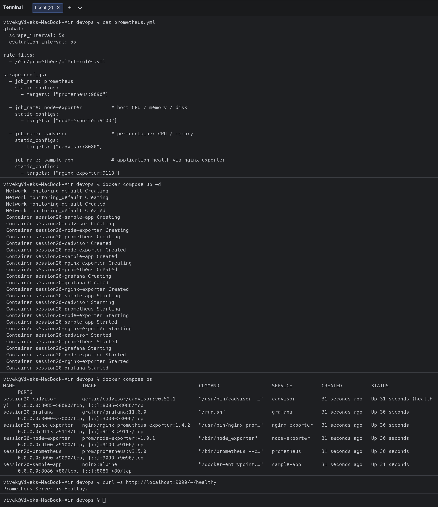
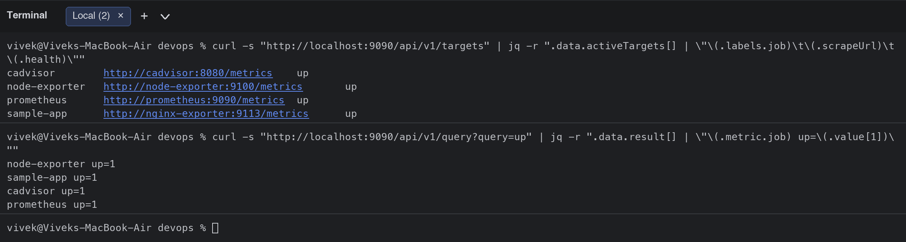

### CPU utilisation, memory utilisation, application health (PromQL) and per-container usage (`docker stats`)
```bash
$ curl -s "http://localhost:9090/api/v1/query" --data-urlencode "query=100 - (avg(rate(node_cpu_seconds_total{mode=\"idle\"}[1m])) * 100)" | jq -r "\"Host CPU utilisation %: \" + .data.result[0].value[1]"
Host CPU utilisation %: 59.06254189475742
$ curl -s "http://localhost:9090/api/v1/query" --data-urlencode "query=(1 - node_memory_MemAvailable_bytes / node_memory_MemTotal_bytes) * 100" | jq -r "\"Host memory utilisation %: \" + .data.result[0].value[1]"
Host memory utilisation %: 20.64111685864277
$ for i in $(seq 1 30); do curl -s -o /dev/null http://localhost:8086/; done; curl -s http://localhost:9113/metrics | grep -E "^nginx_(up|http_requests_total)"
nginx_http_requests_total 36
nginx_up 1
$ docker compose logs --tail=3 sample-app
session20-sample-app  | 172.18.0.1 - - [07/Oct/2026:09:16:04 +0000] "GET / HTTP/1.1" 200 896 "-" "curl/8.7.1" "-"
session20-sample-app  | 172.18.0.1 - - [07/Oct/2026:09:16:04 +0000] "GET / HTTP/1.1" 200 896 "-" "curl/8.7.1" "-"
session20-sample-app  | 172.18.0.6 - - [07/Oct/2026:09:16:04 +0000] "GET /stub_status HTTP/1.1" 200 100 "-" "NGINX-Prometheus-Exporter/v1.4.2" "-"
$ docker stats --no-stream --format "table {{.Name}}	{{.CPUPerc}}	{{.MemUsage}}" | grep session20
session20-nginx-exporter   0.15%     7.676MiB / 7.737GiB
session20-grafana          0.37%     78.25MiB / 7.737GiB
session20-sample-app       0.02%     11.56MiB / 7.737GiB
session20-prometheus       1.18%     39.54MiB / 7.737GiB
session20-cadvisor         8.91%     27.19MiB / 7.737GiB
session20-node-exporter    1.42%     7.23MiB / 7.737GiB
```
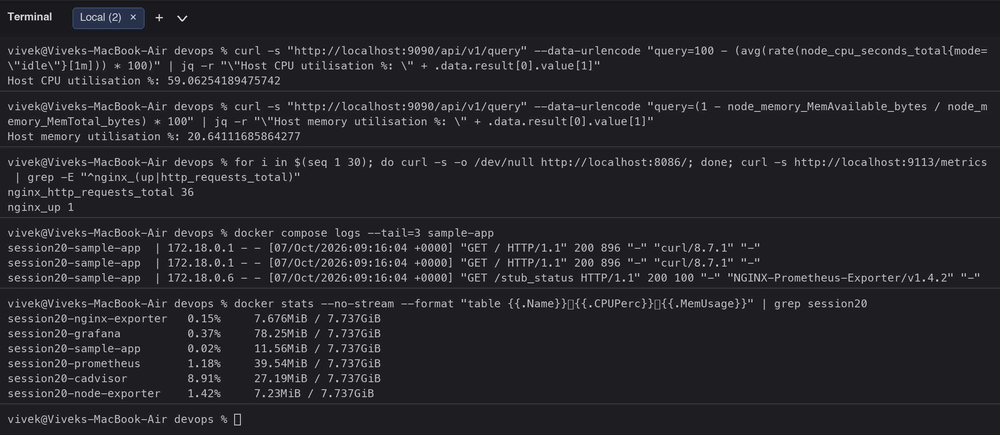

### Logs
Container logs were read with `docker compose logs` (above) and, on Kubernetes, with `kubectl logs`. In production these go to a log pipeline (Loki / EFK) so they can be searched next to the metrics.

### Alerts: stop the app -> `SampleAppDown` fires -> start it -> alert resolves
```bash
$ docker compose stop sample-app
 Container session20-sample-app Stopping 
 Container session20-sample-app Stopped 
$ sleep 45   # wait for the "for: 30s" alert condition
$ curl -s "http://localhost:9090/api/v1/alerts" | jq -r ".data.alerts[] | \"\(.labels.alertname)\t\(.state)\t\(.labels.severity)\t\(.annotations.summary)\""
SampleAppDown	firing	critical	Sample application is not healthy
$ docker compose start sample-app
 Container session20-sample-app Starting 
 Container session20-sample-app Started 
$ curl -s "http://localhost:9090/api/v1/alerts" | jq -r ".data.alerts | length | \"active alerts after recovery: \(.)\""
active alerts after recovery: 0
$ curl -s "http://localhost:9090/api/v1/query?query=up" | jq -r ".data.result[] | \"\(.metric.job) up=\(.value[1])\""
node-exporter up=1
sample-app up=1
cadvisor up=1
prometheus up=1
```
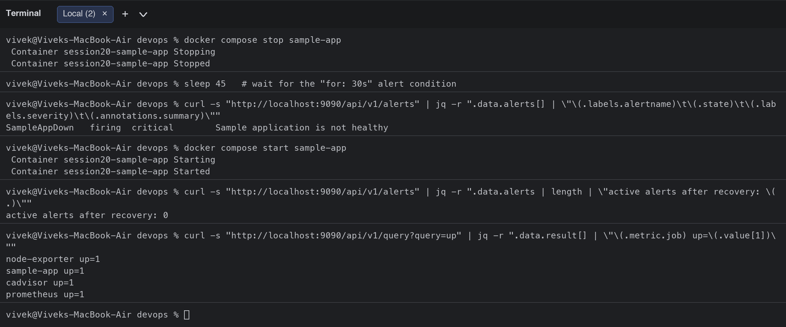

### Kubernetes monitoring with metrics-server (`kubectl top`) and logs
```bash
$ kubectl get deployment metrics-server -n kube-system
NAME             READY   UP-TO-DATE   AVAILABLE   AGE
metrics-server   1/1     1            1           119m
$ kubectl top nodes
NAME       CPU(cores)   CPU(%)   MEMORY(bytes)   MEMORY(%)   
minikube   175m         4%       2214Mi          27%         
$ kubectl top pods -A --sort-by=cpu | head -n 10
NAMESPACE           NAME                                                CPU(cores)   MEMORY(bytes)   
kube-system         kube-apiserver-minikube                             41m          507Mi           
kube-system         etcd-minikube                                       21m          94Mi            
kube-system         kube-controller-manager-minikube                    13m          120Mi           
kube-system         kube-scheduler-minikube                             7m           64Mi            
argocd              argocd-redis-bdbdffcb4-gx4ln                        6m           27Mi            
argocd              argocd-application-controller-0                     4m           95Mi            
kube-system         metrics-server-768f9f6999-k29fx                     3m           21Mi            
metallb-system      speaker-smvdq                                       2m           30Mi            
kube-system         coredns-559f6c778d-6fw59                            2m           65Mi            
$ kubectl top pods -n session20
NAME                                    CPU(cores)   MEMORY(bytes)   
session20-gitops-app-679fcbbd85-b5pls   0m           4Mi             
session20-gitops-app-679fcbbd85-bplbj   0m           4Mi             
session20-gitops-app-679fcbbd85-jblkt   0m           4Mi             
session20-gitops-app-679fcbbd85-ljfs7   0m           4Mi             
session20-gitops-app-679fcbbd85-q9bwk   0m           4Mi             
$ kubectl logs -n session20 deploy/session20-gitops-app --tail=3
Found 5 pods, using pod/session20-gitops-app-679fcbbd85-b5pls
2026/10/07 09:17:44 [notice] 1#1: start worker process 31
2026/10/07 09:17:44 [notice] 1#1: start worker process 32
2026/10/07 09:17:44 [notice] 1#1: start worker process 33
$ kubectl get --raw "/apis/metrics.k8s.io/v1beta1/nodes" | jq -r ".items[] | \"\(.metadata.name) cpu=\(.usage.cpu) memory=\(.usage.memory)\""
minikube cpu=174230965n memory=2268120Ki
$ kubectl describe node minikube | grep -A 6 "Allocated resources" | tail -n 5
  Resource           Requests     Limits
  --------           --------     ------
  cpu                1450m (36%)  700m (17%)
  memory             838Mi (10%)  676Mi (8%)
  ephemeral-storage  0 (0%)       0 (0%)
```
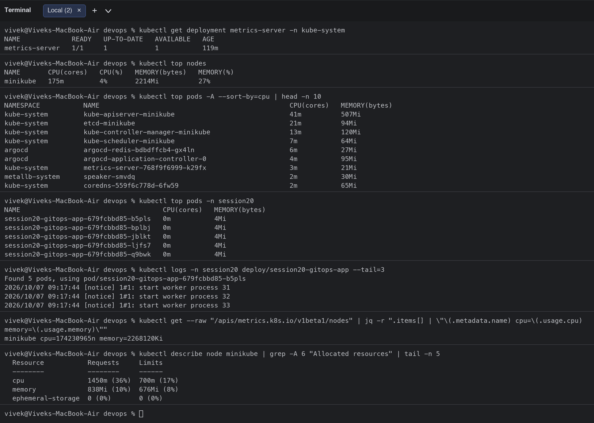

### UI screenshots

Prometheus targets | Prometheus CPU graph
---|---
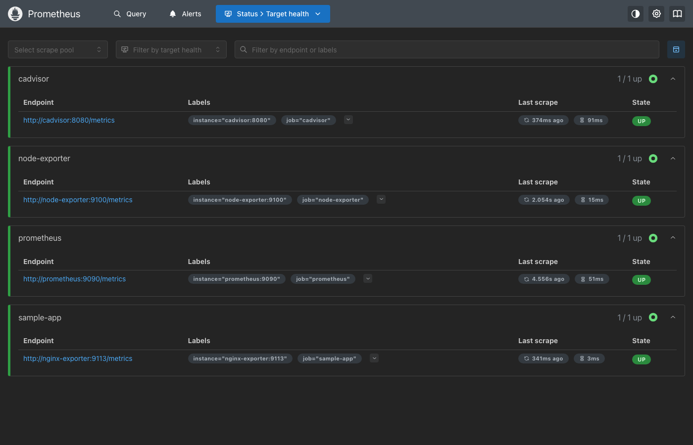 | 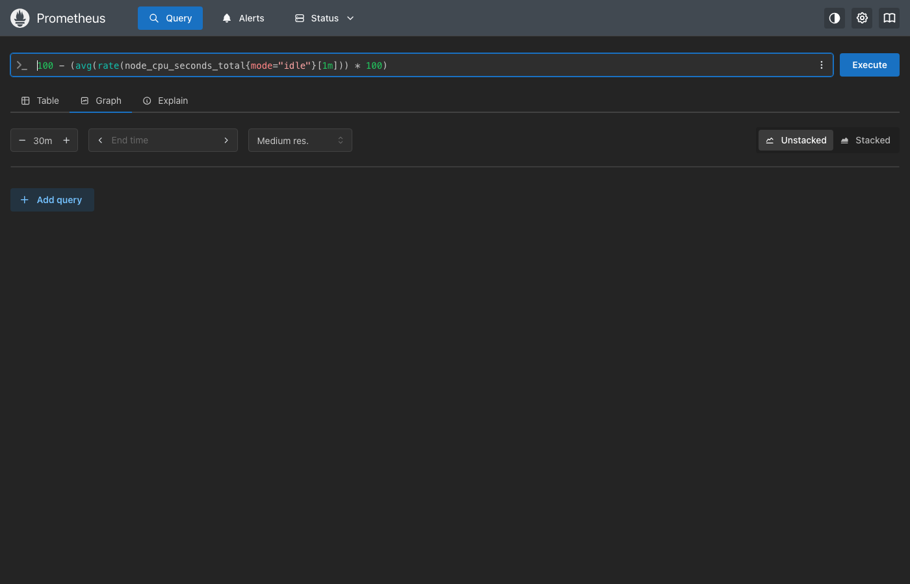

Alert firing | cAdvisor
---|---
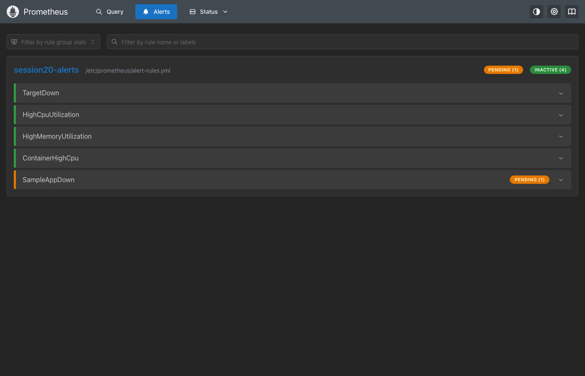 | 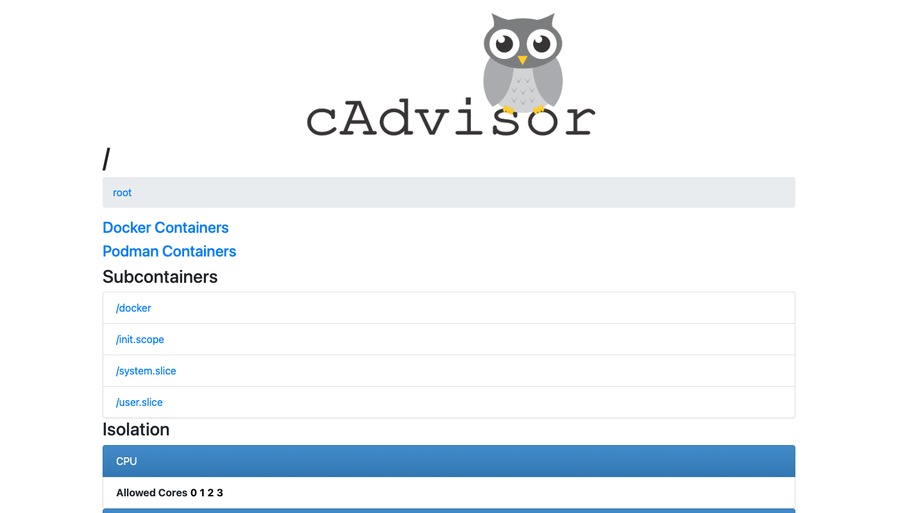

Grafana dashboard (targets up, host CPU %, host memory %, app health, CPU/memory over time, requests/s). Note: on this Docker engine (Docker 29 with the containerd snapshotter inside the Colima VM) cAdvisor only reports the host cgroups and the minikube container, so per-container CPU/memory was taken from `docker stats` above; on a standard Linux Docker host the cAdvisor `container_*` metrics (and the `ContainerHighCpu` rule) work as configured.

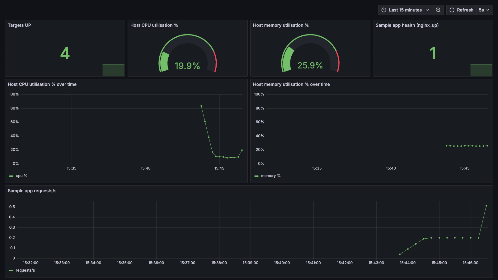

## Task 2: Observability (metrics, logs, traces)
Documentation: [observability/README.md](observability/README.md)

## Task 3: GitOps demo with Argo CD ([gitops-demo/](gitops-demo/))

Concept documentation: [gitops/README.md](gitops/README.md)

Argo CD was installed on minikube (`kubectl apply -n argocd -f .../argo-cd/stable/manifests/install.yaml`). An `Application` ([argocd-application-course-demo.yaml](gitops-demo/argocd-application-course-demo.yaml)) points at the course's public GitOps repository (`app/` folder: Deployment with 5 replicas + Service) with **automated sync, prune and selfHeal**. My own manifests for the same demo are in [gitops-demo/app/](gitops-demo/app/) with [argocd-application.yaml](gitops-demo/argocd-application.yaml) that will point to this repository once it is pushed.

```text
Git repo (desired state)  --->  Argo CD (compares every 3 min / webhook)  --->  Kubernetes (actual state)
         ^                                   |  OutOfSync -> sync (apply)        |
         |                                   |  selfHeal: cluster drift reverted |
   git push / PR merge                        -----------------------------------
```

### Install, login, create the Application, verify sync
```bash
$ kubectl get pods -n argocd
NAME                                                READY   STATUS    RESTARTS        AGE
argocd-application-controller-0                     1/1     Running   1 (7m10s ago)   40m
argocd-applicationset-controller-76fd8cdd4f-f4mqk   1/1     Running   1 (7m10s ago)   40m
argocd-dex-server-66c78cf887-qrbz2                  1/1     Running   1 (7m9s ago)    40m
argocd-notifications-controller-7fb9868fd6-nvqk7    1/1     Running   1 (7m10s ago)   40m
argocd-redis-bdbdffcb4-gx4ln                        1/1     Running   1 (7m10s ago)   40m
argocd-repo-server-d89c7967d-5g8wd                  1/1     Running   1 (7m10s ago)   40m
argocd-server-776b7cdd4d-xdpnv                      1/1     Running   1 (7m10s ago)   40m
$ kubectl get svc -n argocd argocd-server
NAME            TYPE        CLUSTER-IP      EXTERNAL-IP   PORT(S)          AGE
argocd-server   ClusterIP   10.106.183.62   <none>        80/TCP,443/TCP   40m
$ kubectl -n argocd get secret argocd-initial-admin-secret -o jsonpath="{.data.password}" | base64 -d | sed "s/./*/g"; echo "   (initial admin password, masked)"
****************   (initial admin password, masked)
$ kubectl port-forward svc/argocd-server -n argocd 8443:443 &
$ argocd login localhost:8443 --username admin --password 'uGYV38qhchnAuQ8y' --insecure --grpc-web
'admin:login' logged in successfully
Context 'localhost:8443' updated
$ cat argocd-application-course-demo.yaml
apiVersion: argoproj.io/v1alpha1
kind: Application
metadata:
  name: session20-app
  namespace: argocd
spec:
  project: default
  source:
    repoURL: https://github.com/Nency-Ravaliya/gitops-demo.git
    targetRevision: main
    path: app
  destination:
    server: https://kubernetes.default.svc
    namespace: session20
  syncPolicy:
    automated:
      prune: true
      selfHeal: true
    syncOptions:
      - CreateNamespace=true
$ kubectl apply -f argocd-application-course-demo.yaml
application.argoproj.io/session20-app created
$ argocd app list --grpc-web
NAME                  CLUSTER                         NAMESPACE  PROJECT  STATUS  HEALTH   SYNCPOLICY  CONDITIONS  REPO                                               PATH  TARGET
argocd/session20-app  https://kubernetes.default.svc  session20  default  Synced  Healthy  Auto-Prune  <none>      https://github.com/Nency-Ravaliya/gitops-demo.git  app   main
$ argocd app get session20-app --grpc-web
Name:               argocd/session20-app
Project:            default
Server:             https://kubernetes.default.svc
Namespace:          session20
URL:                https://localhost:8443/applications/session20-app
Source:
- Repo:             https://github.com/Nency-Ravaliya/gitops-demo.git
  Target:           main
  Path:             app
SyncWindow:         Sync Allowed
Sync Policy:        Automated (Prune)
Sync Status:        Synced to main (5c2c67f)
Health Status:      Healthy

GROUP        KIND         NAMESPACE  NAME                  STATUS   HEALTH   HOOK  MESSAGE
             Namespace               session20             Running  Synced         namespace/session20 created
             Service      session20  session20-gitops-app  Synced   Healthy        service/session20-gitops-app created
apps         Deployment   session20  session20-gitops-app  Synced   Healthy        deployment.apps/session20-gitops-app created
argoproj.io  Application  argocd     session20-app         Synced                  application.argoproj.io/session20-app configured
$ kubectl get all -n session20
NAME                                        READY   STATUS    RESTARTS   AGE
pod/session20-gitops-app-679fcbbd85-5hmsh   1/1     Running   0          28s
pod/session20-gitops-app-679fcbbd85-b5pls   1/1     Running   0          28s
pod/session20-gitops-app-679fcbbd85-fxmlt   1/1     Running   0          28s
pod/session20-gitops-app-679fcbbd85-tm7lj   1/1     Running   0          28s
pod/session20-gitops-app-679fcbbd85-trzw4   1/1     Running   0          28s

NAME                           TYPE        CLUSTER-IP       EXTERNAL-IP   PORT(S)   AGE
service/session20-gitops-app   ClusterIP   10.101.251.235   <none>        80/TCP    28s

NAME                                   READY   UP-TO-DATE   AVAILABLE   AGE
deployment.apps/session20-gitops-app   5/5     5            5           28s

NAME                                              DESIRED   CURRENT   READY   AGE
replicaset.apps/session20-gitops-app-679fcbbd85   5         5         5       28s
```
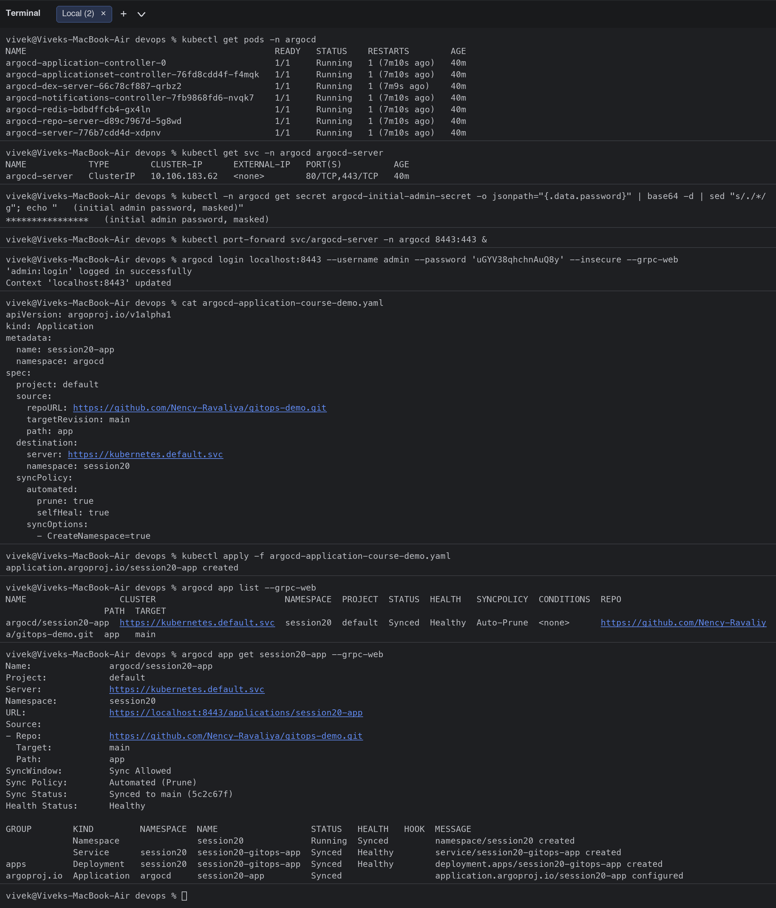
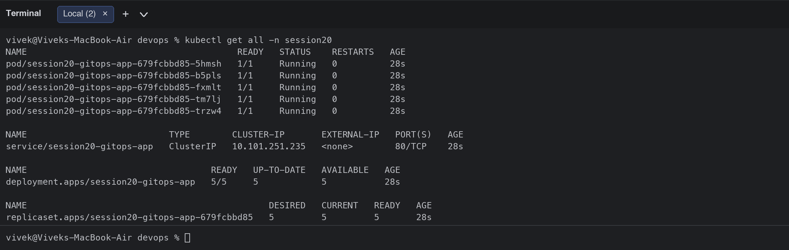

### Git as the source of truth: manual drift is reverted (selfHeal)
I scaled the Deployment to 1 replica by hand; Argo CD detected the drift and restored the 5 replicas declared in Git within a minute, without any kubectl from me.
```bash
# --- Drift test: change the cluster manually; Argo CD (selfHeal) must revert it to the Git state ---
$ kubectl scale deployment session20-gitops-app -n session20 --replicas=1
deployment.apps/session20-gitops-app scaled
$ kubectl get deployment -n session20
NAME                   READY   UP-TO-DATE   AVAILABLE   AGE
session20-gitops-app   1/1     1            1           28s
$ argocd app get session20-app --grpc-web | grep -E "Sync Status|Health Status|Sync Policy|Repo|Path"
- Repo:             https://github.com/Nency-Ravaliya/gitops-demo.git
  Path:             app
Sync Policy:        Automated (Prune)
Sync Status:        Synced to main (5c2c67f)
Health Status:      Healthy
$ kubectl get deployment -n session20
NAME                   READY   UP-TO-DATE   AVAILABLE   AGE
session20-gitops-app   5/5     5            5           99s
$ argocd app history session20-app --grpc-web
SOURCE  https://github.com/Nency-Ravaliya/gitops-demo.git
ID      DATE                           REVISION
0       2026-10-07 14:47:44 +0530 IST  main (5c2c67f)
$ argocd app resources session20-app --grpc-web
GROUP        KIND         NAMESPACE  NAME                  ORPHANED
             Service      session20  session20-gitops-app  No
apps         Deployment   session20  session20-gitops-app  No
argoproj.io  Application  argocd     session20-app         No
$ kubectl get application session20-app -n argocd -o jsonpath="{.status.sync.status} {.status.health.status} rev={.status.sync.revision}"; echo
Synced Healthy rev=5c2c67fae0acccbb1233f56d3377cca402de8666
```
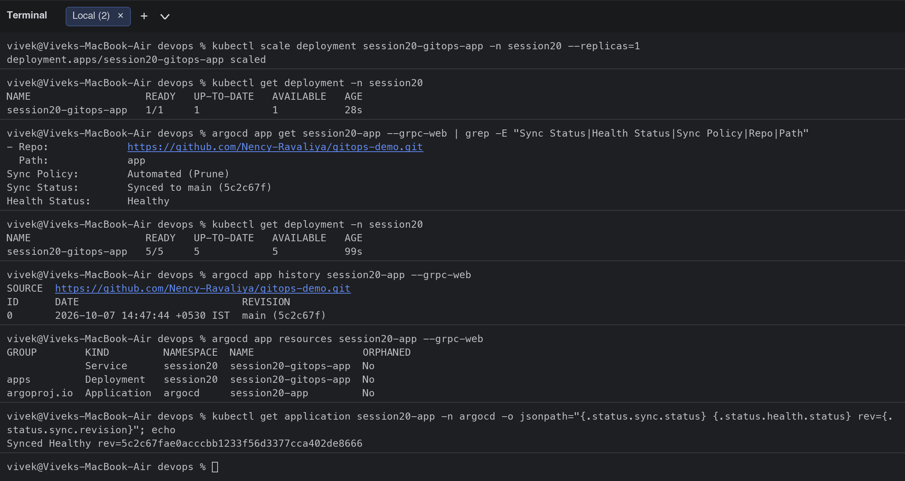

### Argo CD API view of the application
```bash
$ TOKEN=$(curl -sk https://localhost:8443/api/v1/session -H "Content-Type: application/json" -d "{\"username\":\"admin\",\"password\":\"$ARGOCD_PASSWORD\"}" | jq -r .token)
$ curl -sk -H 'Authorization: Bearer $TOKEN' https://localhost:8443/api/v1/applications/session20-app | jq '{name: .metadata.name, repo: .spec.source.repoURL, path: .spec.source.path, sync: .status.sync.status, health: .status.health.status, automated: .spec.syncPolicy.automated}'
{
  "name": "session20-app",
  "repo": "https://github.com/Nency-Ravaliya/gitops-demo.git",
  "path": "app",
  "sync": "Synced",
  "health": "Healthy",
  "automated": {
    "prune": true,
    "selfHeal": true
  }
}
$ curl -sk -H 'Authorization: Bearer $TOKEN' https://localhost:8443/api/v1/applications/session20-app/resource-tree | jq -r '.nodes[] | "\(.kind)	\(.name)	\(.health.status // "-")"'
Pod	session20-gitops-app-679fcbbd85-b5pls	Healthy
Pod	session20-gitops-app-679fcbbd85-bplbj	Healthy
Pod	session20-gitops-app-679fcbbd85-jblkt	Healthy
Pod	session20-gitops-app-679fcbbd85-ljfs7	Healthy
Pod	session20-gitops-app-679fcbbd85-q9bwk	Healthy
Service	session20-gitops-app	Healthy
Deployment	session20-gitops-app	Healthy
ReplicaSet	session20-gitops-app-679fcbbd85	Healthy
Application	session20-app	-
```
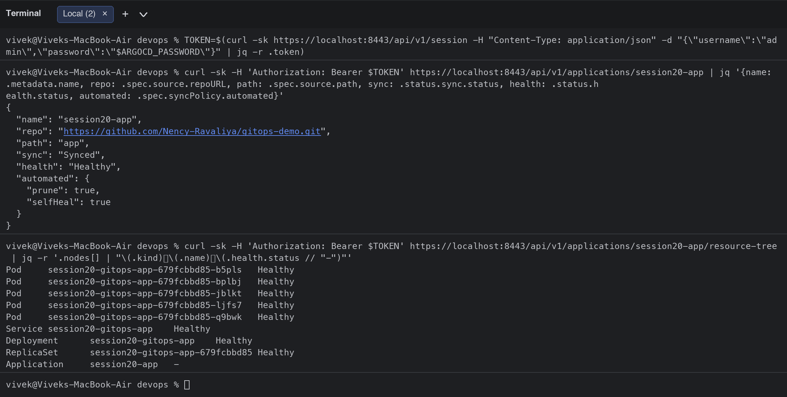

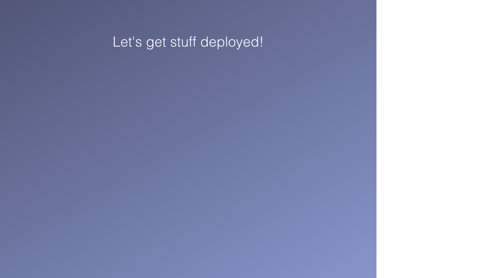

## Clean-up
```bash
cd monitoring && docker compose down -v
argocd app delete session20-app -y
kubectl delete namespace session20
```
